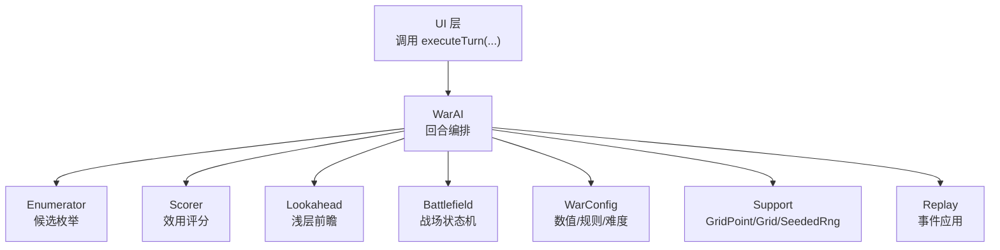
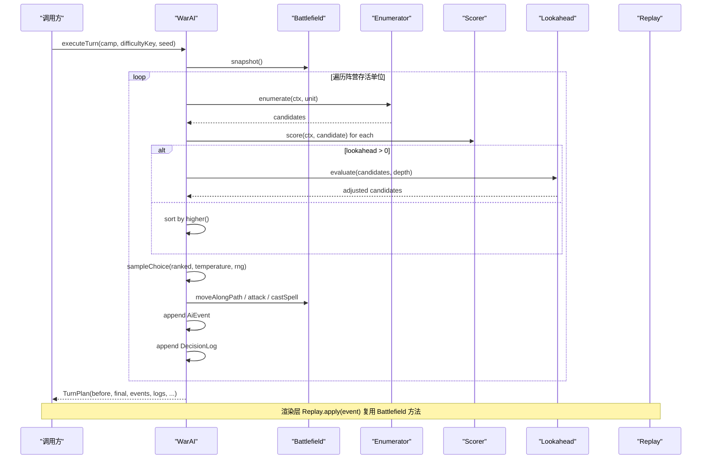
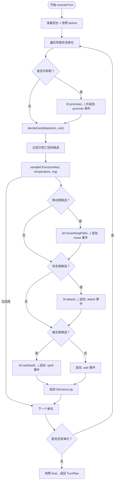
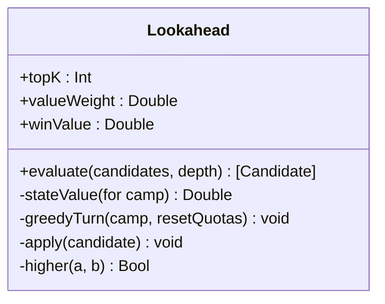
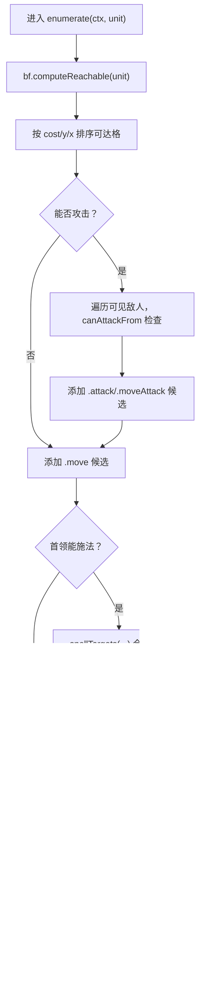
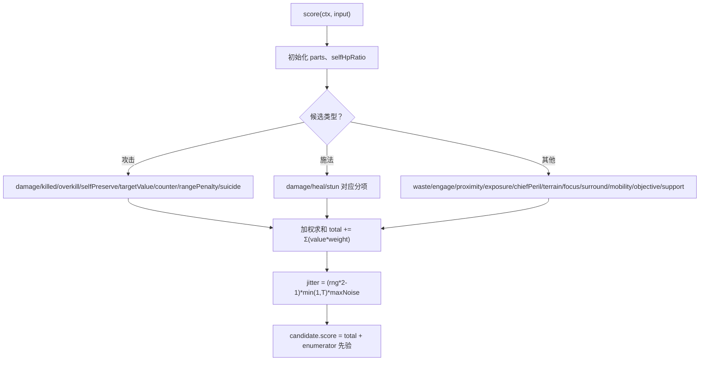
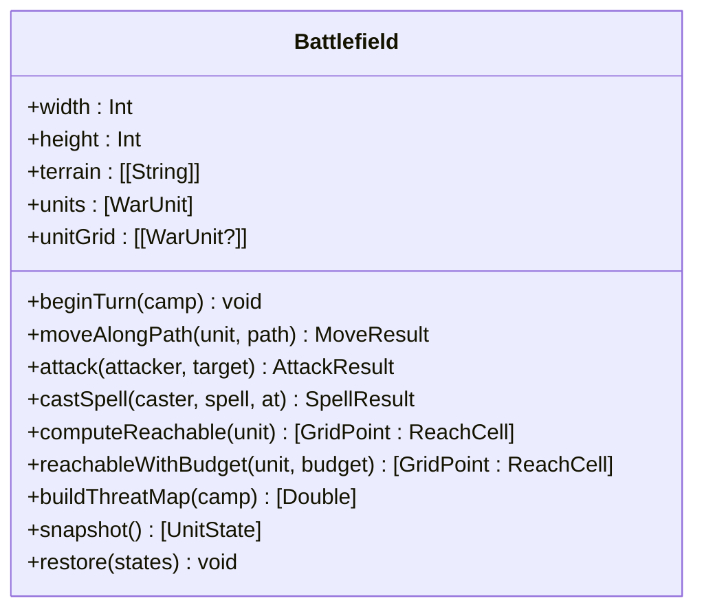
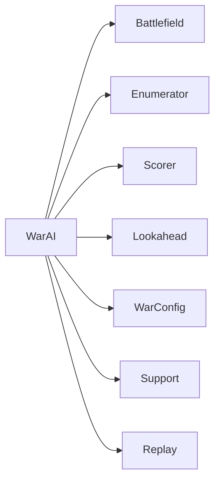

# AI 主控制器

<cite>
**本文引用的文件**   
- [WarAI.swift](file://war/ios/WarKit/Sources/WarKit/WarAI.swift)
- [Lookahead.swift](file://war/ios/WarKit/Sources/WarKit/Lookahead.swift)
- [Enumerator.swift](file://war/ios/WarKit/Sources/WarKit/Enumerator.swift)
- [Scorer.swift](file://war/ios/WarKit/Sources/WarKit/Scorer.swift)
- [Battlefield.swift](file://war/ios/WarKit/Sources/WarKit/Battlefield.swift)
- [WarConfig.swift](file://war/ios/WarKit/Sources/WarKit/WarConfig.swift)
- [Support.swift](file://war/ios/WarKit/Sources/WarKit/Support.swift)
</cite>

## 目录
1. [简介](#简介)
2. [项目结构](#项目结构)
3. [核心组件](#核心组件)
4. [架构总览](#架构总览)
5. [详细组件分析](#详细组件分析)
6. [依赖关系分析](#依赖关系分析)
7. [性能考量](#性能考量)
8. [故障排查指南](#故障排查指南)
9. [结论](#结论)
10. [附录：使用示例与集成接口](#附录使用示例与集成接口)

## 简介
本技术文档聚焦 WarAI 主控制器及其 AI 编排层，目标是帮助读者理解以下关键问题：
- 回合执行流程如何组织、单单位决策循环如何工作。
- 事件序列如何生成、如何被渲染层重放。
- softmax 采样算法如何实现，温度参数如何影响随机性，数值稳定性如何处理。
- 可重放事件系统的数据结构与状态同步机制。
- 如何设置 AI 难度、配置随机种子、获取决策信息。
- 与其他模块的集成接口和错误处理机制。

WarAI 的设计强调“同一份规则、多档难度”：四档难度共享评分代码，通过三个正交旋钮（视野、温度、前瞻）控制强度，避免“另一套算法”带来的维护成本与行为不一致。

## 项目结构
WarKit 是 iOS 侧的核心库，AI 相关逻辑集中在以下文件：
- WarAI.swift：AI 编排层、回合执行、softmax 采样、事件生成与重放入口。
- Lookahead.swift：浅层前瞻推演，对 top-K 候选做 1~2 回合 rollout。
- Enumerator.swift：为单个单位枚举所有候选动作（移动、攻击、施法、待命）。
- Scorer.swift：效用评分层，将候选映射到归一化分项并汇总得分。
- Battlefield.swift：战场状态机，封装地形、单位、移动、攻击、施法、快照等。
- WarConfig.swift：数值与规则权威定义（棋盘、兵种、魔法、难度、权重、标尺）。
- Support.swift：坐标、网格工具与确定性随机数生成器。

图表来源
- [WarAI.swift:61-187](file://war/ios/WarKit/Sources/WarKit/WarAI.swift#L61-L187)
- [WarConfig.swift:352-391](file://war/ios/WarKit/Sources/WarKit/WarConfig.swift#L352-L391)

章节来源
- [WarAI.swift:1-233](file://war/ios/WarKit/Sources/WarKit/WarAI.swift#L1-L233)
- [WarConfig.swift:1-576](file://war/ios/WarKit/Sources/WarKit/WarConfig.swift#L1-L576)

## 核心组件
- WarAI：AI 编排层，负责回合推进、单位决策、softmax 采样、事件收集与 TurnPlan 产出。
- Lookahead：对 top-K 候选进行浅层 rollout，评估二阶效应（反打、终局）。
- Enumerator：把可达落点 × 动作类型展开为候选列表，限制候选数量以保证帧预算。
- Scorer：计算候选的多项效用（伤害、击杀、自保、目标价值、暴露风险、机动、战略等），输出归一化分项与总分。
- Battlefield：战场状态机，提供移动、攻击、施法、威胁图、可达域、快照/回滚等能力。
- WarConfig：集中定义棋盘、地形、兵种、魔法、难度档位、权重与标尺。
- Support：坐标、网格工具与 SeededRng（mulberry32），保证可复现随机流。

章节来源
- [WarAI.swift:11-199](file://war/ios/WarKit/Sources/WarKit/WarAI.swift#L11-L199)
- [Lookahead.swift:1-168](file://war/ios/WarKit/Sources/WarKit/Lookahead.swift#L1-L168)
- [Enumerator.swift:1-126](file://war/ios/WarKit/Sources/WarKit/Enumerator.swift#L1-L126)
- [Scorer.swift:1-268](file://war/ios/WarKit/Sources/WarKit/Scorer.swift#L1-L268)
- [Battlefield.swift:46-809](file://war/ios/WarKit/Sources/WarKit/Battlefield.swift#L46-L809)
- [WarConfig.swift:352-576](file://war/ios/WarKit/Sources/WarKit/WarConfig.swift#L352-L576)
- [Support.swift:1-76](file://war/ios/WarKit/Sources/WarKit/Support.swift#L1-L76)

## 架构总览
WarAI 的回合执行遵循“战略 → 枚举 → 评分 →（可选前瞻）→ softmax 采样 → 执行”的流程。每个单位在回合内先转职（若满足条件），再枚举候选、评分、必要时进行浅层前瞻调整，最后按温度采样一个候选并执行（移动、攻击或施法），同时记录 AiEvent 与 DecisionLog。

图表来源
- [WarAI.swift:61-187](file://war/ios/WarKit/Sources/WarKit/WarAI.swift#L61-L187)
- [Lookahead.swift:25-61](file://war/ios/WarKit/Sources/WarKit/Lookahead.swift#L25-L61)
- [Enumerator.swift:14-104](file://war/ios/WarKit/Sources/WarKit/Enumerator.swift#L14-L104)
- [Scorer.swift:57-256](file://war/ios/WarKit/Sources/WarKit/Scorer.swift#L57-L256)
- [Battlefield.swift:332-556](file://war/ios/WarKit/Sources/WarKit/Battlefield.swift#L332-L556)

## 详细组件分析

### WarAI：AI 编排层与回合执行
- decideCandidates：对单个单位枚举候选、评分，并在 lookahead > 0 时交由 Lookahead 评估；否则按 higher() 排序。
- sampleChoice：实现 softmax 采样，采用温度缩放与数值稳定处理（以最高分为基准减去，避免 exp 溢出；scaleT = max(0.02, T)*40 保持温度连续可调）。
- executeTurn：真实推进状态并产出事件序列。步骤包括：
  - 准备回合（prepareTurn）、快照 before。
  - 遍历单位：转职（promote）→ 候选 → 过滤失效目标 → softmax 采样 → 移动/攻击/施法 → 兜底待命事件 → 决策日志。
  - 最终快照 final，返回 TurnPlan（含策略、目标、焦点、before/final、events/logs、决策计数、耗时）。
- Replay.apply：渲染层逐事件播放动画，复用 Battlefield 方法确保与决策结果一致。

图表来源
- [WarAI.swift:61-187](file://war/ios/WarKit/Sources/WarKit/WarAI.swift#L61-L187)

章节来源
- [WarAI.swift:18-199](file://war/ios/WarKit/Sources/WarKit/WarAI.swift#L18-L199)
- [WarAI.swift:201-232](file://war/ios/WarKit/Sources/WarKit/WarAI.swift#L201-L232)

### Lookahead：浅层前瞻推演
- 只对 top-K（默认 4）候选进行 1~depth 回合的 rollout。
- 每轮：敌方 greedyTurn → 我方 greedyTurn（深度 > 1 时交替），用 stateValue 评估物质差与终局项（斩首/被斩首）。
- 将 delta × valueWeight 加回候选分数，保持其余候选原样保留。
- greedyTurn 简单贪心：优先期望伤害最大且尽量无反击的动作；打不到则向敌方重心靠近。

图表来源
- [Lookahead.swift:1-168](file://war/ios/WarKit/Sources/WarKit/Lookahead.swift#L1-L168)

章节来源
- [Lookahead.swift:1-168](file://war/ios/WarKit/Sources/WarKit/Lookahead.swift#L1-L168)

### Enumerator：候选枚举
- 基于 Battlefield.computeReachable 得到可达格，按 cost、y、x 确定序。
- 攻击候选来自“可达域外扩射程”，从而完整枚举“移动+攻击”。
- 首领施法候选只在原地释放，目标由 spellTargets 判定（与 castSpell 校验口径一致）。
- 过滤“送死着法”（isSuicidalAttack），超预算时优先保留攻击/施法候选，限制总数 ≤ 120。

图表来源
- [Enumerator.swift:14-104](file://war/ios/WarKit/Sources/WarKit/Enumerator.swift#L14-L104)

章节来源
- [Enumerator.swift:1-126](file://war/ios/WarKit/Sources/WarKit/Enumerator.swift#L1-L126)

### Scorer：效用评分层
- 分项一律归一化到 [0,1]，符号由 WarConfig.weights 决定。
- 攻击分支：damage、kill、overkill、selfPreserve、targetValue、counterRisk、rangePenalty、suicide。
- 施法分支：damage/heal/stun 对应 damage/targetValue/kill/heal/freeze 等分项。
- 非攻击分支：waste、engage、proximity、exposure、chiefPeril、terrain、focus、surround、mobility、objective、support。
- 汇总后加入抖动 jitter（与 temperature 成正比），最终得到候选总分。

图表来源
- [Scorer.swift:57-256](file://war/ios/WarKit/Sources/WarKit/Scorer.swift#L57-L256)

章节来源
- [Scorer.swift:1-268](file://war/ios/WarKit/Sources/WarKit/Scorer.swift#L1-L268)

### Battlefield：战场状态机
- 移动：moveAlongPath 沿路径逐格校验（4 邻接、边界、地形消耗、占位），失败回滚到起点。
- 攻击：attack 结算伤害、反击、击杀清位、经验结算；唯一伤害写入点。
- 施法：castSpell 校验链（只有首领、携带、充能、射程、视线、目标存在等），伤害固定值、溅射只烧敌方、与普攻互斥。
- 可达域：computeReachable/reachableWithBudget 使用桶式 Dijkstra，带版本缓存。
- 威胁图：buildThreatMap 按满行动状态计算全场威胁值，带版本缓存。
- 快照/回滚：snapshot/restore 用于前瞻与回放。

图表来源
- [Battlefield.swift:46-809](file://war/ios/WarKit/Sources/WarKit/Battlefield.swift#L46-L809)

章节来源
- [Battlefield.swift:46-809](file://war/ios/WarKit/Sources/WarKit/Battlefield.swift#L46-L809)

### WarConfig：数值与规则
- Difficulty：包含 key、name、temperature、lookahead、vision、noise、budget、spellLevel。
- difficulties：easy/normal/hard/nightmare 四档，温度递减、前瞻递增、视野与预算递增。
- Weights/Scale：评分权重与归一化标尺，统一量纲。

章节来源
- [WarConfig.swift:352-576](file://war/ios/WarKit/Sources/WarKit/WarConfig.swift#L352-L576)

### Support：坐标与随机数
- GridPoint：二维坐标。
- Grid：曼哈顿距离、4 方向邻居。
- SeededRng：mulberry32 确定性随机数，next()/int()/bool()/pick()/shuffle()。

章节来源
- [Support.swift:1-76](file://war/ios/WarKit/Sources/WarKit/Support.swift#L1-L76)

## 依赖关系分析
- WarAI 依赖：
  - Battlefield：移动、攻击、施法、快照、威胁图等。
  - Enumerator：候选枚举。
  - Scorer：效用评分。
  - Lookahead：浅层前瞻。
  - WarConfig：难度、权重、标尺、兵种/魔法表。
  - Support：GridPoint/Grid/SeededRng。
- 耦合与内聚：
  - WarAI 作为编排层，职责清晰，低耦合高内聚。
  - Battlefield 封装所有可变状态与规则，避免分散修改。
  - Scorer/Enumerator/Lookahead 分别专注候选生成、评分、推演，职责分离。
- 外部依赖：
  - UI 层仅依赖 WarAI.executeTurn 与 Replay.apply，不直接访问内部状态。

图表来源
- [WarAI.swift:11-199](file://war/ios/WarKit/Sources/WarKit/WarAI.swift#L11-L199)

章节来源
- [WarAI.swift:11-199](file://war/ios/WarKit/Sources/WarKit/WarAI.swift#L11-L199)

## 性能考量
- 候选数量上限：Enumerator.maxCandidatesPerUnit = 120，防止 iPhone 上候选爆炸。
- 前瞻深度：Lookahead.topK = 4，只对 top-K 候选做 rollout，避免全枚举（20v20 全枚举约 10^6 量级）。
- 可达域缓存：Battlefield.reachableCache 与 threatCache 带版本号，避免重复计算。
- 桶式 Dijkstra：reachableWithBudget 使用整数代价桶，适合小值域快速求解。
- 温度缩放：sampleChoice 中 scaleT = max(0.02, T)*40 避免 exp 溢出并保持温度连续可调。

[本节为通用性能讨论，不直接分析具体文件]

## 故障排查指南
- 候选为空：
  - 检查 Enumerator.filter 是否把所有候选都过滤为“送死着法”；确认 isSuicidalAttack 条件与枚举逻辑一致。
  - 参考 [Enumerator.swift:76-102](file://war/ios/WarKit/Sources/WarKit/Enumerator.swift#L76-L102)。
- 移动未生效：
  - 检查 moveAlongPath 返回值 success/spent/reached；确认路径是否为 4 邻接、地形是否可通行、是否有占位。
  - 参考 [Battlefield.swift:332-381](file://war/ios/WarKit/Sources/WarKit/Battlefield.swift#L332-L381)。
- 攻击未造成伤害：
  - 检查 canAttackFrom 视线与射程；确认 remainingAttacks > 0 且未被冻结。
  - 参考 [Battlefield.swift:395-442](file://war/ios/WarKit/Sources/WarKit/Battlefield.swift#L395-L442)。
- 施法失败：
  - 检查 castSpell 校验链（首领、携带、充能、射程、视线、目标存在、效果合法性）。
  - 参考 [Battlefield.swift:493-556](file://war/ios/WarKit/Sources/WarKit/Battlefield.swift#L493-L556)。
- 重放不一致：
  - 确保 Replay.apply 调用的方法与 AI 推演完全一致（moveAlongPath/attack/castSpell/promote）。
  - 参考 [WarAI.swift:201-232](file://war/ios/WarKit/Sources/WarKit/WarAI.swift#L201-L232)。

章节来源
- [Enumerator.swift:76-102](file://war/ios/WarKit/Sources/WarKit/Enumerator.swift#L76-L102)
- [Battlefield.swift:332-556](file://war/ios/WarKit/Sources/WarKit/Battlefield.swift#L332-L556)
- [WarAI.swift:201-232](file://war/ios/WarKit/Sources/WarKit/WarAI.swift#L201-L232)

## 结论
WarAI 主控制器通过清晰的编排层、统一的规则内核与可重放的事件系统，实现了稳定、可复现、可扩展的 AI 行为。softmax 采样与浅层前瞻结合，既保证了不同难度的差异化体验，又避免了复杂搜索带来的性能问题。Battlefield 作为唯一状态写入点，确保了 AI 推演与玩家执行的严格一致性。

[本节为总结性内容，不直接分析具体文件]

## 附录：使用示例与集成接口

### 设置 AI 难度
- 通过 WarConfig.difficulties 获取难度对象，或直接传入 difficultyKey（如 "easy"/"normal"/"hard"/"nightmare"）。
- 难度影响 temperature、lookahead、vision、noise、budget、spellLevel。
- 参考 [WarConfig.swift:382-391](file://war/ios/WarKit/Sources/WarKit/WarConfig.swift#L382-L391)。

章节来源
- [WarConfig.swift:382-391](file://war/ios/WarKit/Sources/WarKit/WarConfig.swift#L382-L391)

### 配置随机种子
- 使用 SeededRng(seed: Int) 初始化确定性随机数生成器。
- WarAI.executeTurn(camp, difficulty, seed) 会创建 AiContext 并注入 SeededRng。
- 同一 seed + 同一局面 ⇒ 完全相同的回合与事件序列。
- 参考 [Support.swift:35-76](file://war/ios/WarKit/Sources/WarKit/Support.swift#L35-L76)、[WarAI.swift:64-67](file://war/ios/WarKit/Sources/WarKit/WarAI.swift#L64-L67)。

章节来源
- [Support.swift:35-76](file://war/ios/WarKit/Sources/WarKit/Support.swift#L35-L76)
- [WarAI.swift:64-67](file://war/ios/WarKit/Sources/WarKit/WarAI.swift#L64-L67)

### 获取决策信息
- TurnPlan 包含 strategy、objective、focusId、before/final 快照、events/logs、decisionCount、elapsedMs。
- DecisionLog 包含 unitId、unitName、kind、targetId、score、parts、top 候选、lookaheadApplied、spellKey。
- 参考 [WarAI.swift:175-180](file://war/ios/WarKit/Sources/WarKit/WarAI.swift#L175-L180)、[WarAI.swift:158-173](file://war/ios/WarKit/Sources/WarKit/WarAI.swift#L158-L173)。

章节来源
- [WarAI.swift:158-180](file://war/ios/WarKit/Sources/WarKit/WarAI.swift#L158-L180)

### 调用示例（伪代码）
- 设置难度：let diff = WarConfig.difficulties["hard"]!
- 执行回合：let plan = WarAI(bf: battlefield).executeTurn(camp: 0, difficulty: diff, seed: 12345)
- 渲染重放：for event in plan.events { Replay.apply(bf, event) }

章节来源
- [WarAI.swift:64-187](file://war/ios/WarKit/Sources/WarKit/WarAI.swift#L64-L187)
- [WarAI.swift:201-232](file://war/ios/WarKit/Sources/WarKit/WarAI.swift#L201-L232)