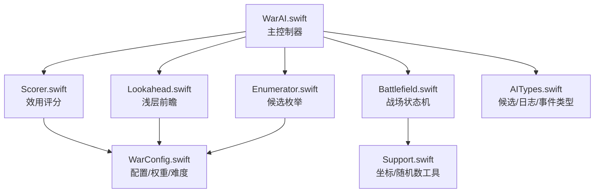
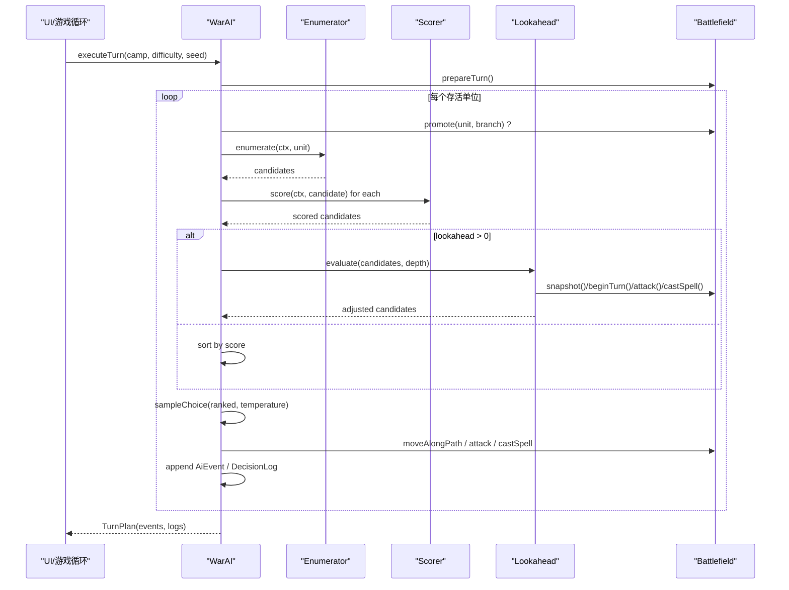
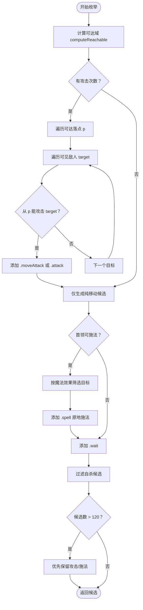
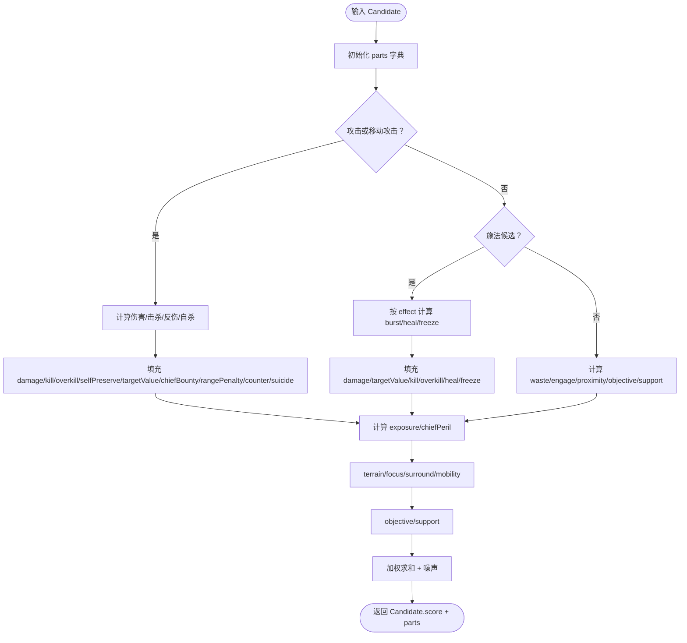
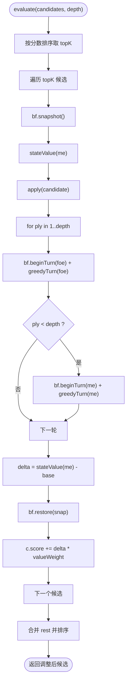
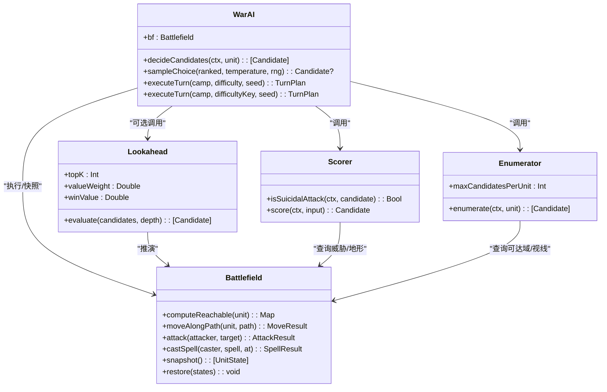
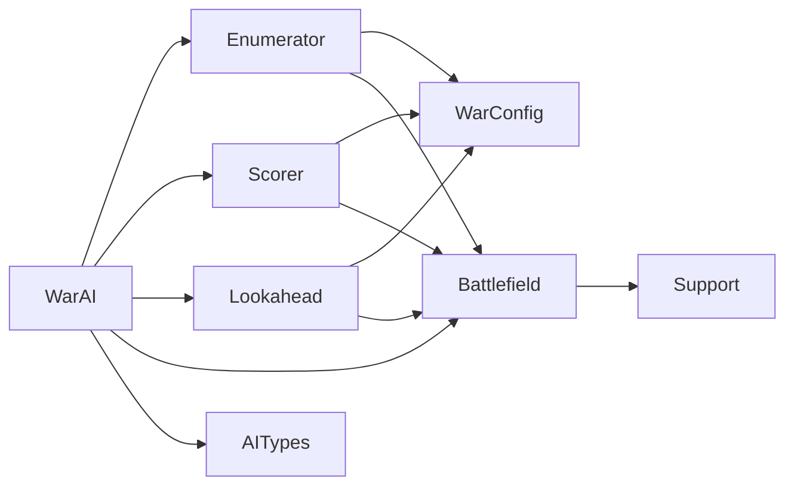

# AI 决策系统

<cite>
**本文引用的文件**   
- [WarAI.swift](file://war/ios/WarKit/Sources/WarKit/WarAI.swift)
- [Enumerator.swift](file://war/ios/WarKit/Sources/WarKit/Enumerator.swift)
- [Scorer.swift](file://war/ios/WarKit/Sources/WarKit/Scorer.swift)
- [Lookahead.swift](file://war/ios/WarKit/Sources/WarKit/Lookahead.swift)
- [WarConfig.swift](file://war/ios/WarKit/Sources/WarKit/WarConfig.swift)
- [Battlefield.swift](file://war/ios/WarKit/Sources/WarKit/Battlefield.swift)
- [Support.swift](file://war/ios/WarKit/Sources/WarKit/Support.swift)
- [AITypes.swift](file://war/ios/WarKit/Sources/WarKit/AITypes.swift)
</cite>

## 目录
1. [引言](#引言)
2. [项目结构](#项目结构)
3. [核心组件](#核心组件)
4. [架构总览](#架构总览)
5. [分层实现详解](#分层实现详解)
6. [依赖关系分析](#依赖关系分析)
7. [性能与复杂度](#性能与复杂度)
8. [难度调节：三个正交旋钮](#难度调节三个正交旋钮)
9. [自定义评分函数与扩展策略](#自定义评分函数与扩展策略)
10. [故障排查指南](#故障排查指南)
11. [结论](#结论)

## 引言
本技术文档面向 WAR 游戏的 AI 决策系统，目标是帮助开发者理解并扩展“分层 AI 架构”：  
战略规划层（Strategist）→ 候选动作枚举（Enumerator）→ 效用评分（Scorer）→ 浅层前瞻推演（Lookahead）→ 主控制器（WarAI）。  

该系统采用“同一份评分代码 + 三个正交难度旋钮”的设计思路：  
- vision：信息维度（能看到多少敌人）  
- temperature：执行维度（softmax 随机度）  
- lookahead：搜索维度（浅层推演深度）  

这使得四档难度共享同一套权重与评分逻辑，调参收益可跨难度复用，且胜率随档位单调上升。

## 项目结构
WAR 的 iOS 内核位于 `war/ios/WarKit/Sources/WarKit`，AI 相关核心文件如下：

**图示来源**  
- [WarAI.swift:1-28](file://war/ios/WarKit/Sources/WarKit/WarAI.swift#L1-L28)  
- [Enumerator.swift:1-12](file://war/ios/WarKit/Sources/WarKit/Enumerator.swift#L1-L12)  
- [Scorer.swift:1-11](file://war/ios/WarKit/Sources/WarKit/Scorer.swift#L1-L11)  
- [Lookahead.swift:1-16](file://war/ios/WarKit/Sources/WarKit/Lookahead.swift#L1-L16)  
- [WarConfig.swift:1-5](file://war/ios/WarKit/Sources/WarKit/WarConfig.swift#L1-L5)  
- [AITypes.swift:1-14](file://war/ios/WarKit/Sources/WarKit/AITypes.swift#L1-L14)  
- [Battlefield.swift:46-54](file://war/ios/WarKit/Sources/WarKit/Battlefield.swift#L46-L54)  
- [Support.swift:35-38](file://war/ios/WarKit/Sources/WarKit/Support.swift#L35-L38)

**章节来源**  
- [WarAI.swift:1-28](file://war/ios/WarKit/Sources/WarKit/WarAI.swift#L1-L28)  
- [WarConfig.swift:1-5](file://war/ios/WarKit/Sources/WarKit/WarConfig.swift#L1-L5)

## 核心组件
- **WarAI**：编排整局 AI 决策流程，负责调用枚举、评分、前瞻、采样与执行，并产出可重放事件。  
- **Enumerator**：为单个单位生成“可达落点 × 动作”的候选列表，包含移动、攻击、移动后攻击、施法、待命等。  
- **Scorer**：对候选进行多维度归一化评分，输出带分项 breakdown 的分数。  
- **Lookahead**：对 top-K 候选做 1~2 回合浅层推演，用物质差与终局项修正分数。  
- **WarConfig**：集中定义地形、兵种、魔法、难度、权重、标尺等所有可调参数。  
- **Battlefield**：战场状态机，提供移动、攻击、施法、威胁图、快照/回滚等底层能力。  
- **AITypes**：候选、日志、事件、回合计划等数据结构。  
- **Support**：坐标、曼哈顿距离、邻居格、确定性随机数。

**章节来源**  
- [WarAI.swift:11-28](file://war/ios/WarKit/Sources/WarKit/WarAI.swift#L11-L28)  
- [Enumerator.swift:9-14](file://war/ios/WarKit/Sources/WarKit/Enumerator.swift#L9-L14)  
- [Scorer.swift:11-11](file://war/ios/WarKit/Sources/WarKit/Scorer.swift#L11-L11)  
- [Lookahead.swift:9-16](file://war/ios/WarKit/Sources/WarKit/Lookahead.swift#L9-L16)  
- [WarConfig.swift:5-5](file://war/ios/WarKit/Sources/WarKit/WarConfig.swift#L5-L5)  
- [Battlefield.swift:46-54](file://war/ios/WarKit/Sources/WarKit/Battlefield.swift#L46-L54)  
- [AITypes.swift:1-14](file://war/ios/WarKit/Sources/WarKit/AITypes.swift#L1-L14)  
- [Support.swift:35-38](file://war/ios/WarKit/Sources/WarKit/Support.swift#L35-L38)

## 架构总览
AI 决策的主流程由 WarAI 驱动，逐单位处理：先转职（若满足条件），再枚举候选、评分、可选前瞻、softmax 采样，最后执行移动/攻击/施法/待命，并记录事件与决策日志。

**图示来源**  
- [WarAI.swift:64-181](file://war/ios/WarKit/Sources/WarKit/WarAI.swift#L64-L181)  
- [Enumerator.swift:14-104](file://war/ios/WarKit/Sources/WarKit/Enumerator.swift#L14-L104)  
- [Scorer.swift:57-256](file://war/ios/WarKit/Sources/WarKit/Scorer.swift#L57-L256)  
- [Lookahead.swift:26-61](file://war/ios/WarKit/Sources/WarKit/Lookahead.swift#L26-L61)  
- [Battlefield.swift:332-442](file://war/ios/WarKit/Sources/WarKit/Battlefield.swift#L332-L442)

## 分层实现详解

### 战略规划层（Strategist）
当前 Swift 实现中，战略层职责体现在 WarAI 的 `executeTurn` 与上下文准备阶段：  
- 根据阵营与难度构造 `AiContext`，并调用 `ctx.prepareTurn()`。  
- 在单位决策前处理转职分支选择（低两档取表里第一个，高两档走偏好表）。  
- 维护集火目标、战略目标、威胁图等上下文信息，供枚举与评分使用。

虽然 Swift 版本未单独暴露 Strategist 类，但其思想仍贯穿 WarAI 与 AiContext：  
- 战略决定“打什么”（进攻/防守/包抄/集火），并通过 objective、focusId 等字段影响评分。  
- 该层不直接写打分公式，而是把高层意图注入上下文，让 Scorer 统一消费。

**章节来源**  
- [WarAI.swift:64-89](file://war/ios/WarKit/Sources/WarKit/WarAI.swift#L64-L89)  
- [WarConfig.swift:352-388](file://war/ios/WarKit/Sources/WarKit/WarConfig.swift#L352-L388)

### 候选动作枚举（Enumerator）
Enumerator 的核心职责是“为单个单位摊出候选”，关键设计包括：

- **可达域外扩射程**：攻击候选不仅来自“当前已能打到谁”，还考虑“移动到某点后能打到的目标”，从而完整枚举“移动 + 攻击”。  
- **候选去重**：以 `(kind, spellKey, targetId, action)` 作为键，避免重复候选。  
- **集火先验加分**：若候选目标等于 ctx.focusId，给予微小先验分，减少同分摇摆。  
- **送死过滤**：在枚举层就剔除“反击必杀自己且打不死目标”的动作，防止低温度下 softmax 采样到自杀着法。  
- **预算控制**：单单位候选上限为 120；超限时优先保留攻击类候选，其次施法，最后机动与待命。  
- **首领施法候选**：只在原地施法，按实际魔法等级取值，并按效果筛选合法目标。

**图示来源**  
- [Enumerator.swift:14-104](file://war/ios/WarKit/Sources/WarKit/Enumerator.swift#L14-L104)  
- [Enumerator.swift:108-124](file://war/ios/WarKit/Sources/WarKit/Enumerator.swift#L108-L124)

**章节来源**  
- [Enumerator.swift:1-126](file://war/ios/WarKit/Sources/WarKit/Enumerator.swift#L1-L126)

### 效用评分系统（Scorer）
Scorer 是 AI 的“价值判断中心”，遵循两条铁律：  
1. 所有分项幅值归一到 `[0,1]`，符号由权重决定。  
2. 伤害预估与真实结算使用同一个 `damageTo`，避免 AI 评分与实际结果两套口径。

主要评分项包括：

| 类别 | 分项 | 含义 | 典型权重方向 |
|---|---|---|---|
| 收益 | damage | 本次攻击造成的伤害 | 正 |
| 收益 | kill | 击杀奖励 | 正 |
| 收益 | overkill | 溢出伤害惩罚 | 负 |
| 风险 | selfPreserve | 自身存活价值（血量越低越保守） | 负 |
| 价值 | targetValue | 目标兵种战略价值 | 正 |
| 风险 | exposure | 落点后下回合被敌方威胁打击的概率 | 负 |
| 位置 | terrain | 落点地形防御加成 | 正 |
| 战略 | focus | 集火同一目标 | 正 |
| 风险 | counterRisk | 会被反击的风险 | 负 |
| 机动 | mobility | 保留机动力 | 正 |
| 协同 | surround | 与友军合围同一目标 | 正 |
| 战略 | objective | 向战略目标靠近 | 正（撤退时反向） |
| 浪费 | waste | 有目标却不打 / 机动全废 | 负 |
| 远程 | rangePenalty | 远程单位贴脸输出惩罚 | 负 |
| 推进 | engage | 无目标时的推进意愿 | 正 |
| 接近 | proximity | 无目标时向敌情靠近 | 正 |
| 斩首 | chiefBounty | 攻击敌方首领额外加分 | 正 |
| 治疗 | heal | 治疗收益 | 正 |
| 控制 | freeze | 冰冻收益 | 正 |
| 自杀 | suicide | 反击必杀自己且打不死目标 | 强负 |
| 首领风险 | chiefPeril | 首领落点下回合会被打死 | 强负 |

最终分数 = Σ(分项 × 权重) + 少量噪声（与 temperature 相关）。

**图示来源**  
- [Scorer.swift:57-256](file://war/ios/WarKit/Sources/WarKit/Scorer.swift#L57-L256)

**章节来源**  
- [Scorer.swift:1-268](file://war/ios/WarKit/Sources/WarKit/Scorer.swift#L1-L268)  
- [WarConfig.swift:434-574](file://war/ios/WarKit/Sources/WarKit/WarConfig.swift#L434-L574)

### 浅层前瞻推演（Lookahead）
Lookahead 不对全部候选做 minimax，而是只对 top-K（默认 4）候选做 1~2 回合 rollout：

- 对每个候选：保存战场快照 → 应用候选 → 交替推进敌方/我方回合 → 计算物质差变化 → 恢复快照 → 将 delta 乘以 valueWeight 加回候选分数。  
- 子回合策略使用简单贪心：优先选期望伤害最大且尽量无反击的动作；若无攻击机会则朝敌方重心靠近。  
- 终局项：若推演中己方/敌方首领阵亡，分别加上 winValue/-winValue，避免只算物质分导致“换血否决赢面”。

**图示来源**  
- [Lookahead.swift:26-61](file://war/ios/WarKit/Sources/WarKit/Lookahead.swift#L26-L61)  
- [Lookahead.swift:70-76](file://war/ios/WarKit/Sources/WarKit/Lookahead.swift#L70-L76)  
- [Lookahead.swift:82-138](file://war/ios/WarKit/Sources/WarKit/Lookahead.swift#L82-L138)

**章节来源**  
- [Lookahead.swift:1-168](file://war/ios/WarKit/Sources/WarKit/Lookahead.swift#L1-L168)

### 主控制器（WarAI）
WarAI 是 AI 的调度中枢，负责：

- 构建 `AiContext`，准备回合。  
- 对每个单位：转职 → 枚举 → 评分 → 可选前瞻 → softmax 采样 → 执行。  
- 执行阶段严格复用 Battlefield 的移动、攻击、施法接口，确保“AI 宣称的收益”与“玩家看到的动画”一致。  
- 输出 `TurnPlan`，包含 before/final 快照、事件序列、决策日志、耗时等。

**图示来源**  
- [WarAI.swift:11-198](file://war/ios/WarKit/Sources/WarKit/WarAI.swift#L11-L198)  
- [Enumerator.swift:9-126](file://war/ios/WarKit/Sources/WarKit/Enumerator.swift#L9-L126)  
- [Scorer.swift:11-268](file://war/ios/WarKit/Sources/WarKit/Scorer.swift#L11-L268)  
- [Lookahead.swift:9-168](file://war/ios/WarKit/Sources/WarKit/Lookahead.swift#L9-L168)  
- [Battlefield.swift:244-556](file://war/ios/WarKit/Sources/WarKit/Battlefield.swift#L244-L556)

**章节来源**  
- [WarAI.swift:1-233](file://war/ios/WarKit/Sources/WarKit/WarAI.swift#L1-L233)

## 依赖关系分析
AI 各层之间的依赖呈现清晰的单向流：

- **耦合性**：WarAI 与 Battlefield 耦合最强，因为执行阶段必须复用内核规则。  
- **内聚性**：Scorer 高度内聚于评分逻辑，依赖 WarConfig 的权重与标尺。  
- **外部依赖**：Support 提供坐标与随机数，AITypes 提供数据结构，WarConfig 提供全局配置。

**图示来源**  
- [WarAI.swift:1-28](file://war/ios/WarKit/Sources/WarKit/WarAI.swift#L1-L28)  
- [Scorer.swift:1-11](file://war/ios/WarKit/Sources/WarKit/Scorer.swift#L1-L11)  
- [Lookahead.swift:1-16](file://war/ios/WarKit/Sources/WarKit/Lookahead.swift#L1-L16)  
- [Enumerator.swift:1-12](file://war/ios/WarKit/Sources/WarKit/Enumerator.swift#L1-L12)  
- [Battlefield.swift:46-54](file://war/ios/WarKit/Sources/WarKit/Battlefield.swift#L46-L54)  
- [Support.swift:35-38](file://war/ios/WarKit/Sources/WarKit/Support.swift#L35-L38)  
- [AITypes.swift:1-14](file://war/ios/WarKit/Sources/WarKit/AITypes.swift#L1-L14)

**章节来源**  
- [WarAI.swift:1-28](file://war/ios/WarKit/Sources/WarKit/WarAI.swift#L1-L28)  
- [WarConfig.swift:1-5](file://war/ios/WarKit/Sources/WarKit/WarConfig.swift#L1-L5)

## 性能与复杂度
- **候选数量**：单单位最多 120 个候选，配合 lookahead topK=4，移动端仍可接受。  
- **可达域计算**：使用 Dijkstra + 桶式优先队列，按整数 cost 优化，缓存基于 version 与 budget。  
- **威胁图**：每回合构建一次，缓存于 battlefield，避免重复计算。  
- **前瞻开销**：只对 topK 候选做 rollout，每层 rollout 使用贪心策略而非完整搜索。  
- **softmax 采样**：仅对 top6 候选计算指数权重，避免全量 exp 计算。

建议优化方向：  
- 若候选过多，可进一步限制攻击候选数量（例如按目标价值排序后截断）。  
- 若 lookahead 过深，可降低 topK 或 valueWeight。  
- 若评分项过多，可按场景裁剪非必要分项。

[本节为通用性能讨论，不直接分析具体文件]

## 难度调节三个正交旋钮
难度由 WarConfig.Difficulty 定义，四个档位共享同一评分代码，差异仅在于旋钮组合：

| 难度 | temperature | lookahead | vision | noise | budget | spellLevel |
|---|---|---|---|---|---|---|
| 简单 | 0.90 | 0 | 5 | 0.15 | 40 | 0 |
| 普通 | 0.35 | 0 | 9 | 0.08 | 90 | 1 |
| 困难 | 0.10 | 1 | ∞ | 0.04 | 140 | 2 |
| 噩梦 | 0.02 | 2 | ∞ | 0.00 | 200 | 3 |

- **vision**：控制 AI 能“看清”的敌方单位数量，越小越盲。  
- **temperature**：softmax 随机度，越大越“手软”，低难度会偶尔选次优动作。  
- **lookahead**：浅层推演层数，0 只看即时收益，1~2 层看后续交换。  
- **noise**：命中随机波动幅度，影响评分抖动。  
- **budget**：军费，影响编成强度。  
- **spellLevel**：敌方首领魔法等级，影响法术威力与射程。

**章节来源**  
- [WarConfig.swift:352-388](file://war/ios/WarKit/Sources/WarKit/WarConfig.swift#L352-L388)  
- [WarAI.swift:5-10](file://war/ios/WarKit/Sources/WarKit/WarAI.swift#L5-L10)

## 自定义评分函数与扩展策略

### 如何扩展评分项
若希望新增一个评分项（例如“保护残血友军”），可参考现有 Scorer 模式：

1. 在 `WarConfig.Weights` 中添加新权重字段。  
2. 在 `Scorer.score` 中计算新分项，并确保幅值归一到 `[0,1]`。  
3. 在 `weight(key)` 中映射新 key 到新权重。  
4. 调整权重使新项与其他项量级协调。

示例路径：  
- [WarConfig.swift:436-499](file://war/ios/WarKit/Sources/WarKit/WarConfig.swift#L436-L499)  
- [Scorer.swift:13-40](file://war/ios/WarKit/Sources/WarKit/Scorer.swift#L13-L40)  
- [Scorer.swift:246-256](file://war/ios/WarKit/Sources/WarKit/Scorer.swift#L246-L256)

### 如何自定义候选生成策略
若希望改变候选生成逻辑（例如限制远程单位只能远程攻击）：

1. 修改 `Enumerator.enumerate` 中的候选添加逻辑。  
2. 保持候选去重与预算控制不变。  
3. 若新增候选类型，需同步更新 `CandidateKind` 与评分逻辑。

示例路径：  
- [Enumerator.swift:44-74](file://war/ios/WarKit/Sources/WarKit/Enumerator.swift#L44-L74)  
- [AITypes.swift:3-14](file://war/ios/WarKit/Sources/WarKit/AITypes.swift#L3-L14)

### 如何扩展前瞻策略
若希望 lookahead 使用更复杂的 rollout 策略（例如加入随机性或启发式）：

1. 修改 `Lookahead.greedyTurn` 中的贪心选择逻辑。  
2. 保持 apply 与 stateValue 的一致性，确保推演与真实执行口径一致。  
3. 调整 topK、valueWeight、winValue 以平衡探索与利用。

示例路径：  
- [Lookahead.swift:82-138](file://war/ios/WarKit/Sources/WarKit/Lookahead.swift#L82-L138)  
- [Lookahead.swift:10-16](file://war/ios/WarKit/Sources/WarKit/Lookahead.swift#L10-L16)

**章节来源**  
- [Scorer.swift:13-40](file://war/ios/WarKit/Sources/WarKit/Scorer.swift#L13-L40)  
- [WarConfig.swift:436-499](file://war/ios/WarKit/Sources/WarKit/WarConfig.swift#L436-L499)  
- [Enumerator.swift:44-74](file://war/ios/WarKit/Sources/WarKit/Enumerator.swift#L44-L74)  
- [Lookahead.swift:82-138](file://war/ios/WarKit/Sources/WarKit/Lookahead.swift#L82-L138)

## 故障排查指南

### 常见问题与定位
- **AI 总是原地不动**：检查 Enumerator 是否因可达域为空或候选被过滤为空；确认 `canAttackFrom` 与视线判定是否符合预期。  
- **AI 频繁自杀**：检查 `Scorer.isSuicidalAttack` 与枚举层过滤逻辑；确认 `suicide` 权重是否足够负。  
- **AI 忽视首领**：检查 `chiefBounty` 权重与 `targetValue` 标尺；确认 `endsMatchHere` 是否正确识别斩首终结。  
- **前瞻无效**：检查 lookahead 深度是否为 0；确认 topK 与 valueWeight 是否合理。  
- **重放不一致**：确认 Replay.apply 与 AI 执行调用的是同一 Battlefield 方法；检查事件是否包含必要字段（如 spellKey、branchKey）。

### 调试建议
- 使用 `DecisionLog` 查看每个单位的候选、分数、分项 breakdown。  
- 使用 `TurnPlan.events` 逐事件回放，对比 AI 宣称的伤害与玩家看到的动画。  
- 固定 seed 运行多局，验证确定性。  
- 调整 temperature 观察 softmax 采样行为变化。  
- 逐步增加 lookahead 深度，观察分数稳定性。

**章节来源**  
- [WarAI.swift:158-173](file://war/ios/WarKit/Sources/WarKit/WarAI.swift#L158-L173)  
- [Scorer.swift:42-55](file://war/ios/WarKit/Sources/WarKit/Scorer.swift#L42-L55)  
- [Lookahead.swift:26-61](file://war/ios/WarKit/Sources/WarKit/Lookahead.swift#L26-L61)

## 结论
WAR 的 AI 决策系统通过分层架构实现了清晰的可维护性与可扩展性：  
- Strategist 注入高层意图，Enumerator 生成联合决策候选，Scorer 提供统一评分，Lookahead 补充二阶效应，WarAI 编排全流程。  
- 三个正交旋钮（vision、temperature、lookahead）使难度调节与评分逻辑解耦，调参收益可跨难度复用。  
- 通过 Battlefield 的统一状态机与快照/回滚机制，AI 推演与玩家执行保持一致，支持可靠的重放与回归测试。

对于扩展者而言，建议优先从 WarConfig 的权重与标尺入手，逐步调整 Scorer 的分项逻辑，必要时扩展 Enumerator 与 Lookahead 的策略。所有改动应围绕“分项归一化”“口径一致性”“可复现性”三大原则展开。

[本节为总结性内容，不直接分析具体文件]