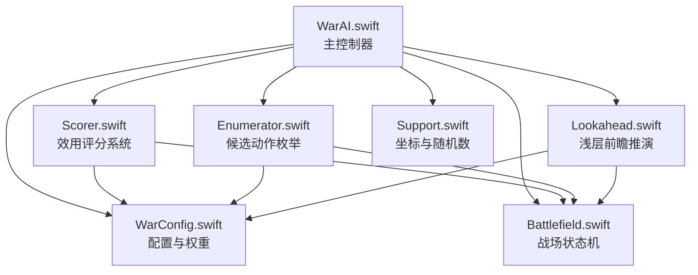
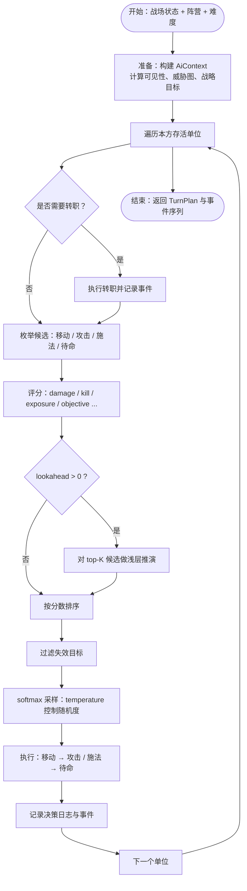
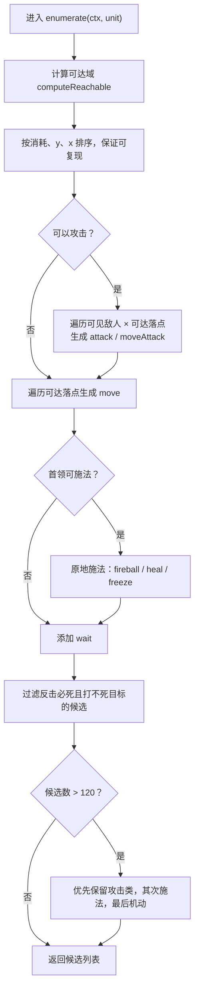
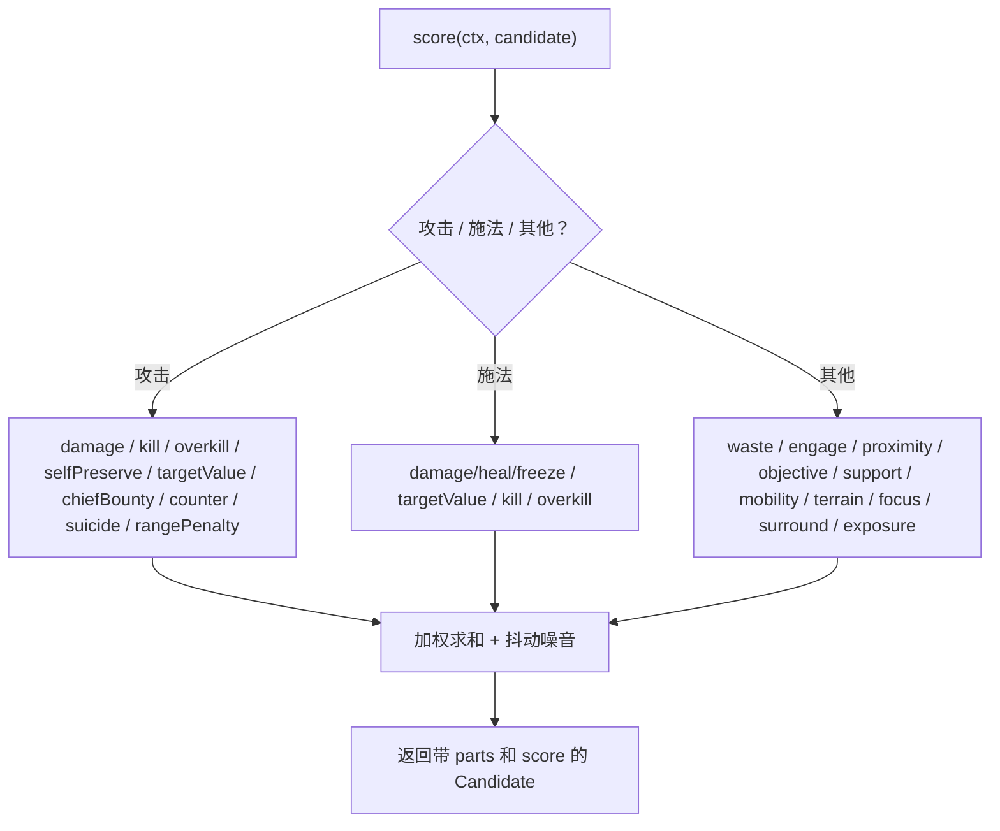
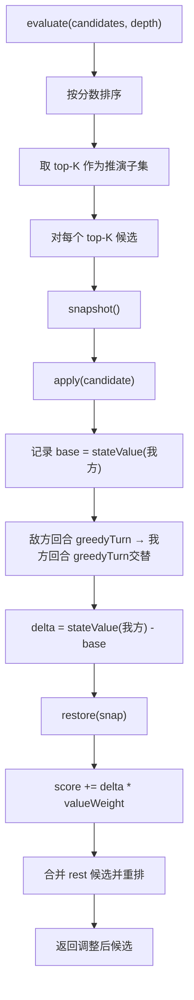
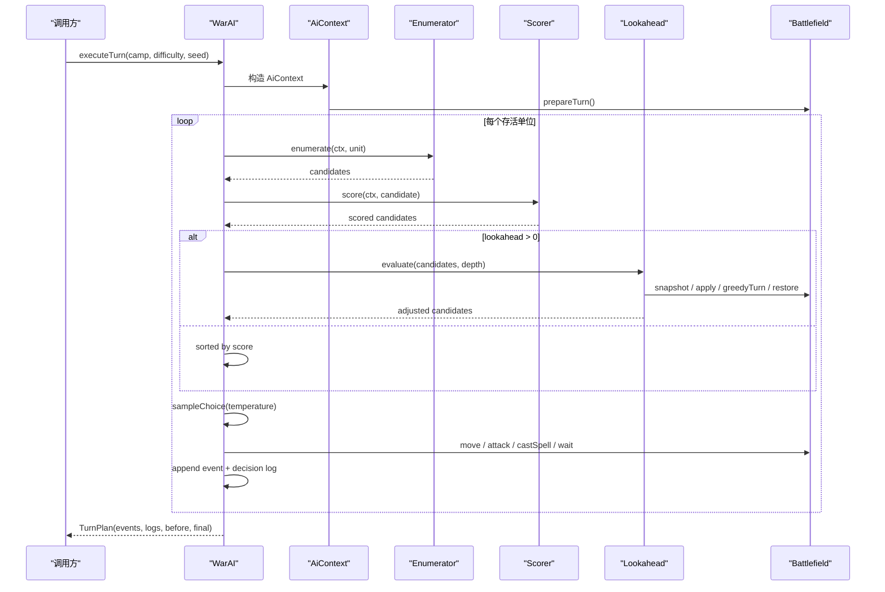
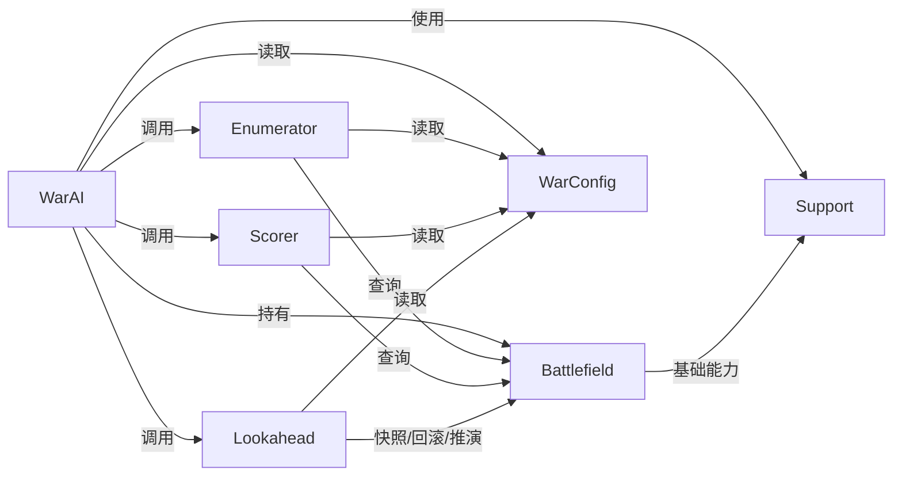
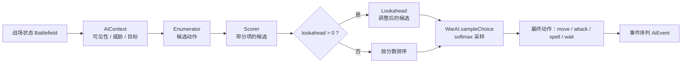
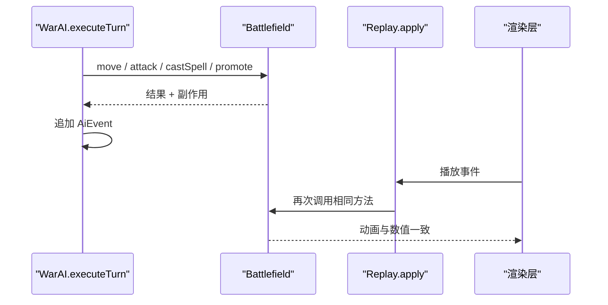

# AI 架构总览

<cite>
**本文引用的文件**   
- [WarAI.swift](file://war/ios/WarKit/Sources/WarKit/WarAI.swift)
- [Enumerator.swift](file://war/ios/WarKit/Sources/WarKit/Enumerator.swift)
- [Scorer.swift](file://war/ios/WarKit/Sources/WarKit/Scorer.swift)
- [Lookahead.swift](file://war/ios/WarKit/Sources/WarKit/Lookahead.swift)
- [WarConfig.swift](file://war/ios/WarKit/Sources/WarKit/WarConfig.swift)
- [Battlefield.swift](file://war/ios/WarKit/Sources/WarKit/Battlefield.swift)
- [Support.swift](file://war/ios/WarKit/Sources/WarKit/Support.swift)
</cite>

## 目录
1. [引言](#引言)
2. [项目结构](#项目结构)
3. [核心组件](#核心组件)
4. [架构总览](#架构总览)
5. [分层组件详解](#分层组件详解)
6. [依赖关系分析](#依赖关系分析)
7. [性能与复杂度](#性能与复杂度)
8. [决策流程与数据流](#决策流程与数据流)
9. [难度调节：三个正交旋钮](#难度调节三个正交旋钮)
10. [扩展与自定义指南](#扩展与自定义指南)
11. [故障排查](#故障排查)
12. [结论](#结论)

## 引言
本文件面向 WAR 游戏的 AI 子系统，目标是帮助开发者理解“分层 AI 设计模式”如何在代码中落地。整体思路是：**战略层只决定方向，枚举层负责穷举候选，评分层负责量化优劣，前瞻层做浅层推演校验，主控制器串联全流程并输出可重放事件**。

该设计的关键优势包括：
- 所有数值、规则、权重集中在配置层，调参不改动算法逻辑。
- 战场状态机是唯一真实执行入口，AI 的推演与玩家的实际操作共享同一套结算规则。
- 难度通过三个正交旋钮（视野、温度、前瞻）调节，而不是复制一套弱 AI 算法。
- 决策过程可完全复现，便于回归测试和回放展示。

## 项目结构
WAR 的 AI 核心位于 iOS 工程中的 `WarKit` 模块，主要源文件如下：

**图示来源**
- [WarAI.swift:11-28](file://war/ios/WarKit/Sources/WarKit/WarAI.swift#L11-L28)
- [Enumerator.swift:9-104](file://war/ios/WarKit/Sources/WarKit/Enumerator.swift#L9-L104)
- [Scorer.swift:11-257](file://war/ios/WarKit/Sources/WarKit/Scorer.swift#L11-L257)
- [Lookahead.swift:9-61](file://war/ios/WarKit/Sources/WarKit/Lookahead.swift#L9-L61)
- [WarConfig.swift:5-576](file://war/ios/WarKit/Sources/WarKit/WarConfig.swift#L5-L576)
- [Battlefield.swift:54-809](file://war/ios/WarKit/Sources/WarKit/Battlefield.swift#L54-L809)
- [Support.swift:3-76](file://war/ios/WarKit/Sources/WarKit/Support.swift#L3-L76)

**章节来源**
- [WarAI.swift:11-28](file://war/ios/WarKit/Sources/WarKit/WarAI.swift#L11-L28)
- [WarConfig.swift:5-576](file://war/ios/WarKit/Sources/WarKit/WarConfig.swift#L5-L576)

## 核心组件
WAR 的 AI 由五个关键层次组成：

| 层次 | 职责 | 主要输入 | 主要输出 | 是否修改战场 |
|---|---|---|---|---|
| Strategist（战略规划层） | 提供阵营目标、集火目标、策略倾向 | 当前阵营、战场快照、难度 | 战略上下文 | 否 |
| Enumerator（候选动作枚举） | 为单个单位生成可达落点 × 动作类型 | 单位、可见敌人、可达域 | 候选列表 | 否 |
| Scorer（效用评分系统） | 把候选映射为统一量纲的分数 | 候选、威胁图、地形、兵种价值 | 带分项的候选 | 否 |
| Lookahead（浅层前瞻） | 对 top-K 候选做 1~2 回合 rollout | 候选、战场快照 | 调整后的候选 | 是（快照回滚） |
| WarAI（主控制器） | 编排流程、采样最终动作、执行回合 | 战场、难度、随机种子 | 回合计划与事件序列 | 是 |

其中，“Strategist”在代码中体现为 `AiContext` 所承载的战略信息；“Candidate”是候选动作的统一封装；“WarAI”是对外暴露的主入口。

**章节来源**
- [WarAI.swift:11-28](file://war/ios/WarKit/Sources/WarKit/WarAI.swift#L11-L28)
- [WarAI.swift:64-181](file://war/ios/WarKit/Sources/WarKit/WarAI.swift#L64-L181)
- [WarConfig.swift:352-391](file://war/ios/WarKit/Sources/WarKit/WarConfig.swift#L352-L391)

## 架构总览
WAR 的 AI 不是单一函数，而是一个从“战场状态”到“可重放事件”的流水线：

**图示来源**
- [WarAI.swift:64-181](file://war/ios/WarKit/Sources/WarKit/WarAI.swift#L64-L181)
- [WarAI.swift:19-28](file://war/ios/WarKit/Sources/WarKit/WarAI.swift#L19-L28)
- [Lookahead.swift:26-61](file://war/ios/WarKit/Sources/WarKit/Lookahead.swift#L26-L61)

## 分层组件详解

### 战略规划层：AiContext
AiContext 是贯穿整个决策过程的上下文对象，它把“战场状态”和“AI 偏好”解耦：

- 持有当前战场 `Battlefield`。
- 持有当前行动阵营。
- 持有难度配置，从而读取 temperature、lookahead、vision、noise、budget、spellLevel。
- 维护确定性随机源 `SeededRng`，保证 softmax 采样和噪音可复现。
- 提供可见敌人、存活友军、威胁影响图、战略目标、集火目标等高层抽象。

这种设计的意义在于：**评分层不需要知道 UI 或关卡如何设置难度，只需要读 AiContext 提供的语义化信息**。

**章节来源**
- [WarAI.swift:64-67](file://war/ios/WarKit/Sources/WarKit/WarAI.swift#L64-L67)
- [WarConfig.swift:352-391](file://war/ios/WarKit/Sources/WarKit/WarConfig.swift#L352-L391)

### 候选动作枚举层：Enumerator
Enumerator 的核心任务是“把每个可达落点和每种动作摊成候选”。它的设计重点有三点：

1. **攻击候选来自可达域外扩射程**，而不是“当前位置能打到谁”。这使得“先走位再攻击”的组合动作被完整枚举出来。
2. **候选数量上限为 120**，避免移动端帧预算爆炸。
3. **送死着法在枚举层硬过滤**，防止低温度档的 softmax 把明显自杀的动作采样出来。

候选类型包括：
- 纯移动
- 移动后攻击
- 普通攻击
- 首领施法
- 待命

**图示来源**
- [Enumerator.swift:14-104](file://war/ios/WarKit/Sources/WarKit/Enumerator.swift#L14-L104)

**章节来源**
- [Enumerator.swift:9-126](file://war/ios/WarKit/Sources/WarKit/Enumerator.swift#L9-L126)

### 效用评分层：Scorer
Scorer 是 AI 的“价值观中心”。它把所有候选打分成一个总分，同时保留分项字典，用于调试和面板展示。

评分的两条铁律是：
1. 分项一律取 `[0,1]` 的幅值，符号由权重决定。
2. 伤害预估与真实结算使用同一个 `WarUnit.damageTo`，避免 AI 算的和实际打的不一样。

主要分项包括：

| 分项 | 含义 | 典型作用 |
|---|---|---|
| damage | 本次攻击造成的伤害 | 鼓励输出 |
| kill | 击杀奖励 | 鼓励终结 |
| overkill | 溢出伤害惩罚 | 反浪费残血 |
| selfPreserve | 自身存活价值 | 血量越低越保守 |
| targetValue | 目标兵种价值 | 优先高价值目标 |
| exposure | 落点后下回合被威胁的概率 | 反冒进 |
| terrain | 落点地形防御加成 | 利用地形 |
| focus | 集火同一目标 | 协同输出 |
| counterRisk | 会被反击的风险 | 反鲁莽 |
| mobility | 机动力使用度 | 反站桩 |
| surround | 与友军合围 | 协同包围 |
| objective | 向战略目标靠近 | 推进 |
| support | 保护濒危友军 | 支援 |
| waste | 浪费行动配额 | 反挂机 |
| rangePenalty | 远程单位贴脸惩罚 | 反错位输出 |
| engage | 无目标时的推进意愿 | 反僵持 |
| proximity | 无目标时向敌情靠近 | 反龟缩 |
| chiefBounty | 斩首赏金 | 强化首领优先级 |
| heal | 治疗收益 | 辅助恢复 |
| freeze | 冰冻收益 | 控制敌方回合 |
| suicide | 自杀门禁 | 反必死换不到击杀 |
| chiefPeril | 首领死亡风险 | 防丢首领 |

**图示来源**
- [Scorer.swift:57-257](file://war/ios/WarKit/Sources/WarKit/Scorer.swift#L57-L257)

**章节来源**
- [Scorer.swift:11-268](file://war/ios/WarKit/Sources/WarKit/Scorer.swift#L11-L268)
- [WarConfig.swift:434-574](file://war/ios/WarKit/Sources/WarKit/WarConfig.swift#L434-L574)

### 浅层前瞻层：Lookahead
Lookahead 不做完整 minimax，因为战棋单回合分支太大，手机算力有限。它只对评分最高的前 K 个候选做 1~2 回合 rollout，用“物质差 + 终局项”评估推演结果，再把 delta 加回候选分数。

关键点：
- `topK = 4`，其余候选沿用即时评分。
- `valueWeight = 60.0`，把 rollout 的物质增益换算到评分尺度。
- `winValue = 100.0`，把“斩首胜利 / 被斩首失败”表达成压倒性物质分。
- rollout 策略是简单贪心：能打就打，不能打就朝敌方重心靠。

**图示来源**
- [Lookahead.swift:26-61](file://war/ios/WarKit/Sources/WarKit/Lookahead.swift#L26-L61)
- [Lookahead.swift:70-76](file://war/ios/WarKit/Sources/WarKit/Lookahead.swift#L70-L76)
- [Lookahead.swift:82-138](file://war/ios/WarKit/Sources/WarKit/Lookahead.swift#L82-L138)

**章节来源**
- [Lookahead.swift:9-168](file://war/ios/WarKit/Sources/WarKit/Lookahead.swift#L9-L168)

### 主控制器：WarAI
WarAI 是 AI 的编排者，它不负责具体规则，而是把各层串起来：

1. 调用 `Enumerator.enumerate` 生成候选。
2. 调用 `Scorer.score` 给候选打分。
3. 如果 `lookahead > 0`，调用 `Lookahead.evaluate` 做浅层推演。
4. 否则直接按分数排序。
5. 调用 `sampleChoice` 用 softmax 采样最终动作。
6. 执行移动、攻击、施法或待命，并产出事件。

此外，它还负责：
- 回合开始时处理转职。
- 过滤已被友军击杀的目标。
- 记录决策日志。
- 返回 `TurnPlan`，包含前后快照、事件序列、耗时等。

**图示来源**
- [WarAI.swift:64-181](file://war/ios/WarKit/Sources/WarKit/WarAI.swift#L64-L181)
- [WarAI.swift:19-28](file://war/ios/WarKit/Sources/WarKit/WarAI.swift#L19-L28)
- [WarAI.swift:34-59](file://war/ios/WarKit/Sources/WarKit/WarAI.swift#L34-L59)

**章节来源**
- [WarAI.swift:11-233](file://war/ios/WarKit/Sources/WarKit/WarAI.swift#L11-L233)

## 依赖关系分析
WAR 的 AI 依赖关系遵循“上层依赖下层，底层尽量无状态”的原则：

**图示来源**
- [WarAI.swift:11-28](file://war/ios/WarKit/Sources/WarKit/WarAI.swift#L11-L28)
- [Enumerator.swift:14-104](file://war/ios/WarKit/Sources/WarKit/Enumerator.swift#L14-L104)
- [Scorer.swift:57-257](file://war/ios/WarKit/Sources/WarKit/Scorer.swift#L57-L257)
- [Lookahead.swift:26-61](file://war/ios/WarKit/Sources/WarKit/Lookahead.swift#L26-L61)

**章节来源**
- [WarAI.swift:11-28](file://war/ios/WarKit/Sources/WarKit/WarAI.swift#L11-L28)
- [WarConfig.swift:5-576](file://war/ios/WarKit/Sources/WarKit/WarConfig.swift#L5-L576)

## 性能与复杂度
WAR 的 AI 在移动端做了明确约束：

| 阶段 | 复杂度特征 | 优化手段 |
|---|---|---|
| 可达域 | Dijkstra + 桶式优先队列 | 版本缓存 + 预算参数化 |
| 候选枚举 | 可达格 × 可见敌人 | 上限 120，优先保留攻击类 |
| 评分 | 每候选多项计算 | 分项归一化，避免量级压制 |
| 前瞻 | top-K × depth × rollout | K=4，depth≤2，贪心 rollout |
| 采样 | softmax on top-6 | 尺度因子随 temperature 连续变化 |
| 执行 | 逐单位移动/攻击/施法 | 复用 Battlefield 唯一写入点 |

重要性能约定：
- 可达域缓存同时校验版本号和机动力预算，避免低预算候选误放行。
- 威胁影响图按阵营缓存，减少重复计算。
- 前瞻只做 top-K，避免全树搜索。
- softmax 只对 top-6 计算，避免全候选指数运算。

**章节来源**
- [Battlefield.swift:244-297](file://war/ios/WarKit/Sources/WarKit/Battlefield.swift#L244-L297)
- [Battlefield.swift:302-325](file://war/ios/WarKit/Sources/WarKit/Battlefield.swift#L302-L325)
- [Enumerator.swift:11-12](file://war/ios/WarKit/Sources/WarKit/Enumerator.swift#L11-L12)
- [Lookahead.swift:10-15](file://war/ios/WarKit/Sources/WarKit/Lookahead.swift#L10-L15)
- [WarAI.swift:34-59](file://war/ios/WarKit/Sources/WarKit/WarAI.swift#L34-L59)

## 决策流程与数据流

### 从战场状态到最终动作

**图示来源**
- [WarAI.swift:64-181](file://war/ios/WarKit/Sources/WarKit/WarAI.swift#L64-L181)
- [WarAI.swift:19-28](file://war/ios/WarKit/Sources/WarKit/WarAI.swift#L19-L28)
- [WarAI.swift:34-59](file://war/ios/WarKit/Sources/WarKit/WarAI.swift#L34-L59)

### 事件重放一致性
WarAI 在执行回合时产生 `AiEvent`，渲染层通过 `Replay.apply` 重新应用这些事件。这样动画结果与决策结果必然一致。

**图示来源**
- [WarAI.swift:102-173](file://war/ios/WarKit/Sources/WarKit/WarAI.swift#L102-L173)
- [WarAI.swift:205-231](file://war/ios/WarKit/Sources/WarKit/WarAI.swift#L205-L231)

**章节来源**
- [WarAI.swift:102-173](file://war/ios/WarKit/Sources/WarKit/WarAI.swift#L102-L173)
- [WarAI.swift:205-231](file://war/ios/WarKit/Sources/WarKit/WarAI.swift#L205-L231)

## 难度调节三个正交旋钮
WAR 的难度不是“另一套 AI”，而是通过三个正交旋钮调节同一套评分与执行逻辑：

| 旋钮 | 含义 | 影响范围 | 代码位置 |
|---|---|---|---|
| vision | AI 能看清多少敌人 | 枚举层可见敌人集合 | [WarConfig.swift:354-379](file://war/ios/WarKit/Sources/WarKit/WarConfig.swift#L354-L379) |
| temperature | softmax 随机度 | 采样层与评分抖动 | [WarAI.swift:34-59](file://war/ios/WarKit/Sources/WarKit/WarAI.swift#L34-L59)、[Scorer.swift:251-252](file://war/ios/WarKit/Sources/WarKit/Scorer.swift#L251-L252) |
| lookahead | 前瞻推演层数 | 前瞻层是否启用及深度 | [WarAI.swift:22-26](file://war/ios/WarKit/Sources/WarKit/WarAI.swift#L22-L26)、[Lookahead.swift:26-61](file://war/ios/WarKit/Sources/WarKit/Lookahead.swift#L26-L61) |

四个难度档位示例：
- 简单：高温度、零前瞻、有限视野。
- 普通：中等温度、零前瞻、较高视野。
- 困难：低温度、一层前瞻、最大视野。
- 噩梦：极低温度、两层前瞻、最大视野。

**章节来源**
- [WarConfig.swift:352-391](file://war/ios/WarKit/Sources/WarKit/WarConfig.swift#L352-L391)
- [WarAI.swift:22-26](file://war/ios/WarKit/Sources/WarKit/WarAI.swift#L22-L26)
- [WarAI.swift:34-59](file://war/ios/WarKit/Sources/WarKit/WarAI.swift#L34-L59)
- [Scorer.swift:251-252](file://war/ios/WarKit/Sources/WarKit/Scorer.swift#L251-L252)
- [Lookahead.swift:26-61](file://war/ios/WarKit/Sources/WarKit/Lookahead.swift#L26-L61)

## 扩展与自定义指南

### 扩展评分项
如果想增加新的评分维度，推荐步骤：

1. 在 `WarConfig.Weights` 中添加新字段。
2. 在 `Scorer.weight` 中映射 key。
3. 在 `Scorer.score` 中计算新分项，并确保幅值落在 `[0,1]`。
4. 调整权重，使新分项与其他项量级协调。
5. 通过单元测试验证单调性和稳定性。

参考路径：
- [WarConfig.swift:436-499](file://war/ios/WarKit/Sources/WarKit/WarConfig.swift#L436-L499)
- [Scorer.swift:13-40](file://war/ios/WarKit/Sources/WarKit/Scorer.swift#L13-L40)
- [Scorer.swift:246-256](file://war/ios/WarKit/Sources/WarKit/Scorer.swift#L246-L256)

**章节来源**
- [WarConfig.swift:436-499](file://war/ios/WarKit/Sources/WarKit/WarConfig.swift#L436-L499)
- [Scorer.swift:13-40](file://war/ios/WarKit/Sources/WarKit/Scorer.swift#L13-L40)
- [Scorer.swift:246-256](file://war/ios/WarKit/Sources/WarKit/Scorer.swift#L246-L256)

### 扩展候选动作
如果想新增动作类型，推荐步骤：

1. 扩展候选种类定义。
2. 在 `Enumerator.enumerate` 中生成对应候选。
3. 在 `Scorer.score` 中为该动作补充评分逻辑。
4. 在 `WarAI.executeTurn` 的执行分支中处理动作效果。
5. 在 `Replay.apply` 中支持事件重放。

参考路径：
- [Enumerator.swift:32-74](file://war/ios/WarKit/Sources/WarKit/Enumerator.swift#L32-L74)
- [Scorer.swift:90-185](file://war/ios/WarKit/Sources/WarKit/Scorer.swift#L90-L185)
- [WarAI.swift:107-156](file://war/ios/WarKit/Sources/WarKit/WarAI.swift#L107-L156)
- [WarAI.swift:207-230](file://war/ios/WarKit/Sources/WarKit/WarAI.swift#L207-L230)

**章节来源**
- [Enumerator.swift:32-74](file://war/ios/WarKit/Sources/WarKit/Enumerator.swift#L32-L74)
- [Scorer.swift:90-185](file://war/ios/WarKit/Sources/WarKit/Scorer.swift#L90-L185)
- [WarAI.swift:107-156](file://war/ios/WarKit/Sources/WarKit/WarAI.swift#L107-L156)
- [WarAI.swift:207-230](file://war/ios/WarKit/Sources/WarKit/WarAI.swift#L207-L230)

### 自定义难度旋钮
如果想新增难度旋钮，推荐做法：

1. 在 `WarConfig.Difficulty` 中添加字段。
2. 在现有难度表中填充默认值。
3. 在 `AiContext` 或相关层读取该旋钮。
4. 确保旋钮是“正交”的，不要和 temperature、lookahead、vision 耦合。
5. 通过胜率或后悔值回归测试验证单调性。

参考路径：
- [WarConfig.swift:354-391](file://war/ios/WarKit/Sources/WarKit/WarConfig.swift#L354-L391)

**章节来源**
- [WarConfig.swift:354-391](file://war/ios/WarKit/Sources/WarKit/WarConfig.swift#L354-L391)

## 故障排查

### 候选为空导致卡住
现象：某个单位没有合法候选，AI 跳过该单位。

可能原因：
- 单位被冻住，可达域为空。
- 所有攻击候选都被判定为自杀。
- 可达落点全部被占或不可通行。

排查建议：
- 检查 `computeReachable` 是否返回空。
- 检查 `isSuicidalAttack` 是否过于严格。
- 确认 `wait` 候选是否始终存在。

参考路径：
- [Battlefield.swift:244-257](file://war/ios/WarKit/Sources/WarKit/Battlefield.swift#L244-L257)
- [Scorer.swift:45-55](file://war/ios/WarKit/Sources/WarKit/Scorer.swift#L45-L55)
- [Enumerator.swift:74-81](file://war/ios/WarKit/Sources/WarKit/Enumerator.swift#L74-L81)

**章节来源**
- [Battlefield.swift:244-257](file://war/ios/WarKit/Sources/WarKit/Battlefield.swift#L244-L257)
- [Scorer.swift:45-55](file://war/ios/WarKit/Sources/WarKit/Scorer.swift#L45-L55)
- [Enumerator.swift:74-81](file://war/ios/WarKit/Sources/WarKit/Enumerator.swift#L74-L81)

### 重放不一致
现象：回放动画与 AI 宣称的伤害或结果不一致。

可能原因：
- 回放路径没有复用 `Battlefield` 的唯一写入方法。
- 事件缺少必要字段。
- 随机种子未传入或不同。

排查建议：
- 确保 `Replay.apply` 调用的是与 AI 相同的 `moveAlongPath`、`attack`、`castSpell`。
- 检查 `AiEvent` 是否携带 path、targetId、spellKey、affectedPoints。
- 检查 `SeededRng` 是否由同一 seed 初始化。

参考路径：
- [WarAI.swift:205-231](file://war/ios/WarKit/Sources/WarKit/WarAI.swift#L205-L231)
- [Support.swift:35-76](file://war/ios/WarKit/Sources/WarKit/Support.swift#L35-L76)

**章节来源**
- [WarAI.swift:205-231](file://war/ios/WarKit/Sources/WarKit/WarAI.swift#L205-L231)
- [Support.swift:35-76](file://war/ios/WarKit/Sources/WarKit/Support.swift#L35-L76)

### 低难度总是自杀
现象：低难度 AI 频繁选择反击必死的攻击。

可能原因：
- 仅靠评分扣分不够，softmax 仍会采样次优候选。
- 枚举层没有硬过滤自杀候选。

排查建议：
- 确认 `Scorer.isSuicidalAttack` 口径与枚举层一致。
- 确认 `Enumerator` 在超预算或过滤后仍保留非攻击兜底候选。

参考路径：
- [Scorer.swift:45-55](file://war/ios/WarKit/Sources/WarKit/Scorer.swift#L45-L55)
- [Enumerator.swift:76-81](file://war/ios/WarKit/Sources/WarKit/Enumerator.swift#L76-L81)

**章节来源**
- [Scorer.swift:45-55](file://war/ios/WarKit/Sources/WarKit/Scorer.swift#L45-L55)
- [Enumerator.swift:76-81](file://war/ios/WarKit/Sources/WarKit/Enumerator.swift#L76-L81)

## 结论
WAR 的 AI 架构以“分层 + 配置驱动 + 唯一状态机”为核心：  
- 战略层提供意图，枚举层穷举动作，评分层统一价值，前瞻层校验二阶效应，主控制器串联执行。  
- 难度通过 vision、temperature、lookahead 三个正交旋钮调节，而不是复制算法。  
- Battlefield 是所有状态变更的唯一入口，保证 AI 推演与玩家执行的一致性。  
- SeededRng 和事件重放机制让决策可复现、可调试、可回放。

对于扩展者来说，最安全的做法是：**改配置不动算法，改评分不绕开 Battlefield，新增动作必须同步枚举、评分、执行、重放四处**。这样既能保持 AI 质量稳定，又能让不同难度共享同一份权重体系。