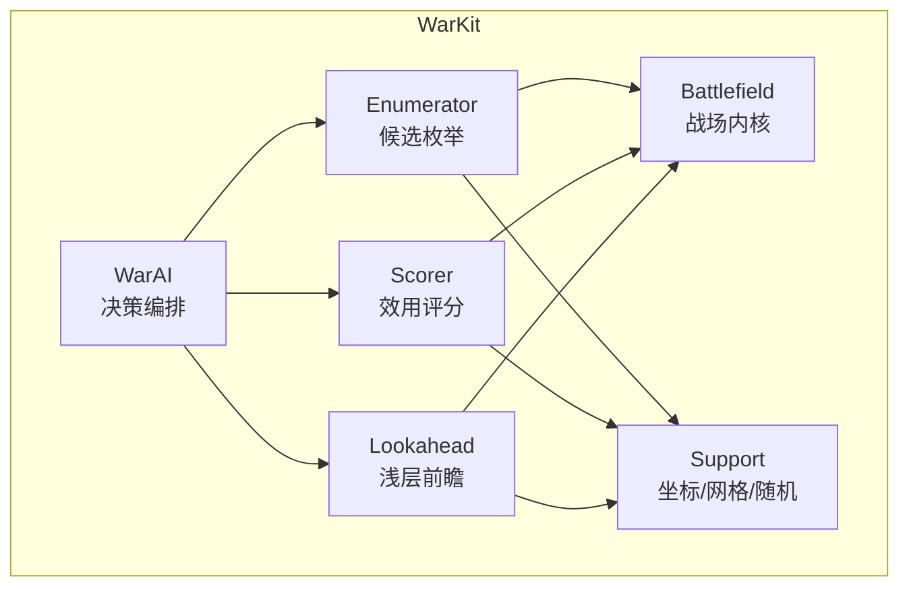
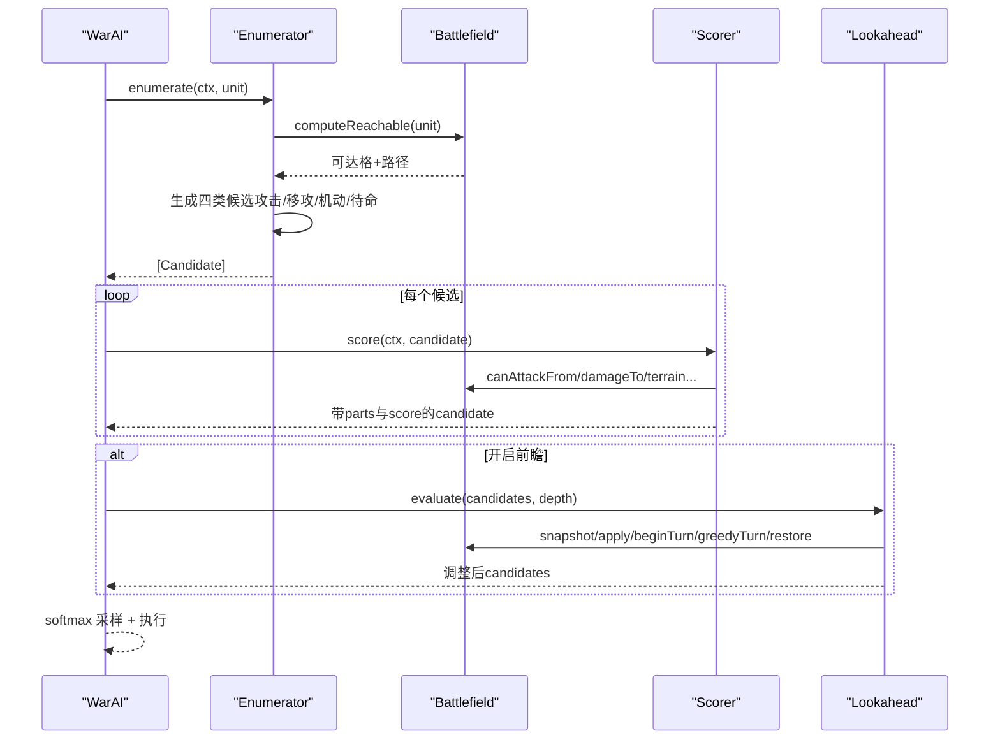
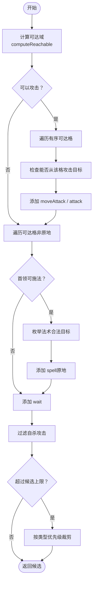
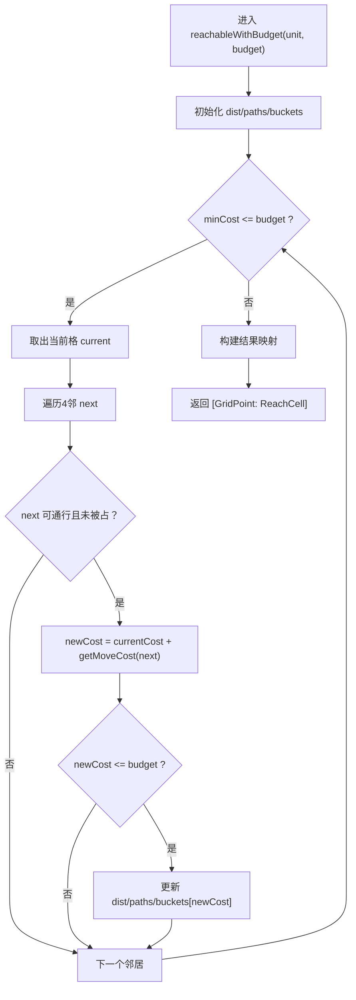
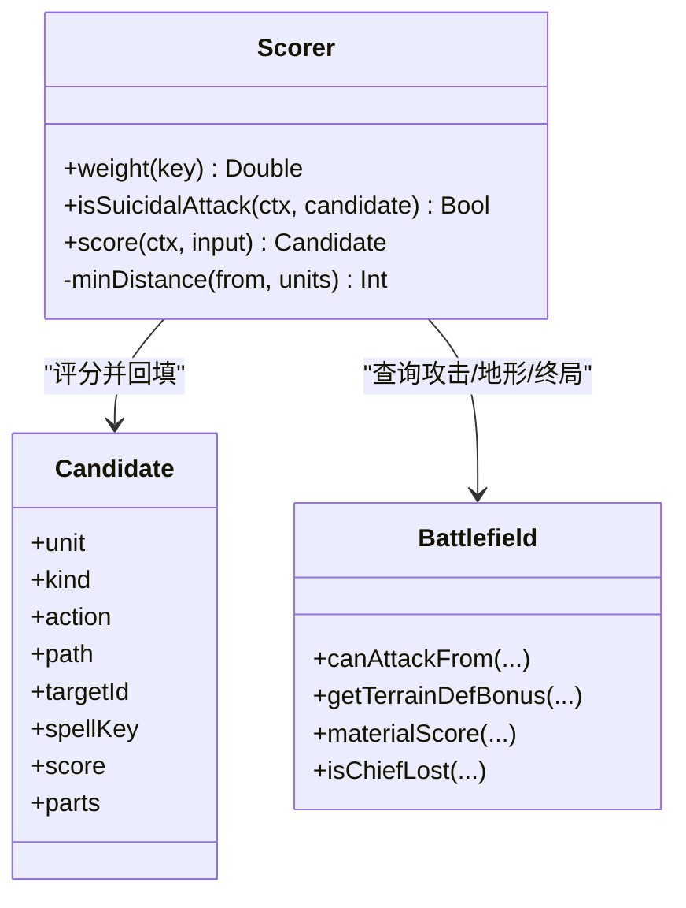
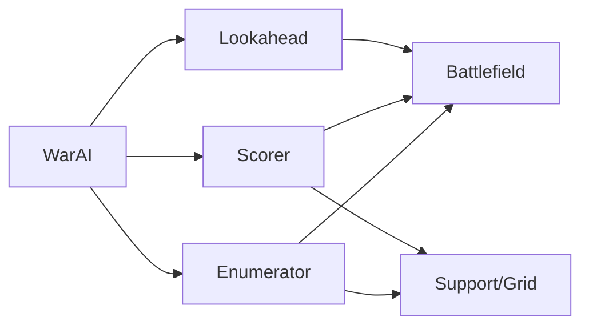

# 候选动作枚举

<cite>
**本文引用的文件**   
- [Enumerator.swift](file://war/ios/WarKit/Sources/WarKit/Enumerator.swift)
- [Scorer.swift](file://war/ios/WarKit/Sources/WarKit/Scorer.swift)
- [Battlefield.swift](file://war/ios/WarKit/Sources/WarKit/Battlefield.swift)
- [Lookahead.swift](file://war/ios/WarKit/Sources/WarKit/Lookahead.swift)
- [Support.swift](file://war/ios/WarKit/Sources/WarKit/Support.swift)
- [WarAI.swift](file://war/ios/WarKit/Sources/WarKit/WarAI.swift)
</cite>

## 目录
1. [引言](#引言)
2. [项目结构](#项目结构)
3. [核心组件](#核心组件)
4. [架构总览](#架构总览)
5. [详细组件分析](#详细组件分析)
6. [依赖关系分析](#依赖关系分析)
7. [性能与可扩展性](#性能与可扩展性)
8. [故障排查](#故障排查)
9. [结论](#结论)

## 引言
本文围绕“候选动作枚举”这一 AI 决策管线中的关键环节，系统梳理四个候选类别（原地攻击、移动后攻击、纯机动、待命）的生成逻辑，解释 Candidate 的数据结构与评分集成方式，并深入说明可达域计算、路径生成、地形影响、射程限制等底层机制。文档同时给出扩展新动作类型与优化候选生成效率的实践建议，以及和 Scorer 评分系统的协作接口与数据传递格式。

## 项目结构
本仓库采用分层组织：
- WarKit 为 iOS 端核心库，包含战场模拟、AI 决策、评分与前瞻推演等模块。
- Enumerator 负责把“每个可达落点 × 每种动作”摊成候选列表。
- Scorer 对候选进行多维效用打分。
- Lookahead 对 Top-K 候选做浅层多回合推演。
- Battlefield 提供地形、视线、可达域、威胁图、移动/攻击/施法结算等基础能力。
- Support 提供坐标、网格工具与确定性随机数。
- WarAI 编排整个决策流程：枚举 → 评分 → 可选前瞻 → softmax 采样 → 执行与回放。

图表来源
- [WarAI.swift:18-28](file://war/ios/WarKit/Sources/WarKit/WarAI.swift#L18-L28)
- [Enumerator.swift:14-104](file://war/ios/WarKit/Sources/WarKit/Enumerator.swift#L14-L104)
- [Scorer.swift:57-256](file://war/ios/WarKit/Sources/WarKit/Scorer.swift#L57-L256)
- [Lookahead.swift:26-61](file://war/ios/WarKit/Sources/WarKit/Lookahead.swift#L26-L61)
- [Battlefield.swift:242-320](file://war/ios/WarKit/Sources/WarKit/Battlefield.swift#L242-L320)
- [Support.swift:3-33](file://war/ios/WarKit/Sources/WarKit/Support.swift#L3-L33)

章节来源
- [WarAI.swift:1-28](file://war/ios/WarKit/Sources/WarKit/WarAI.swift#L1-L28)
- [Enumerator.swift:1-126](file://war/ios/WarKit/Sources/WarKit/Enumerator.swift#L1-L126)

## 核心组件
- 候选枚举器（Enumerator）：按单位状态与战场约束生成候选集合，控制候选上限与优先级。
- 评分器（Scorer）：将候选拆解为多个无量纲分项，加权汇总得到最终分数。
- 战场（Battlefield）：封装地形、占位、移动/攻击/施法规则、可达域与威胁图。
- 前瞻（Lookahead）：对 Top-K 候选进行 1~2 回合推演，修正即时评分偏差。
- 支持库（Support）：坐标、曼哈顿距离、四邻邻居、确定性随机。
- 编排器（WarAI）：串联枚举、评分、前瞻、采样与执行回放。

章节来源
- [Enumerator.swift:1-126](file://war/ios/WarKit/Sources/WarKit/Enumerator.swift#L1-L126)
- [Scorer.swift:1-268](file://war/ios/WarKit/Sources/WarKit/Scorer.swift#L1-L268)
- [Battlefield.swift:1-809](file://war/ios/WarKit/Sources/WarKit/Battlefield.swift#L1-L809)
- [Lookahead.swift:1-168](file://war/ios/WarKit/Sources/WarKit/Lookahead.swift#L1-L168)
- [Support.swift:1-76](file://war/ios/WarKit/Sources/WarKit/Support.swift#L1-L76)
- [WarAI.swift:1-233](file://war/ios/WarKit/Sources/WarKit/WarAI.swift#L1-L233)

## 架构总览
候选动作生成的端到端流程如下：

图表来源
- [WarAI.swift:18-28](file://war/ios/WarKit/Sources/WarKit/WarAI.swift#L18-L28)
- [Enumerator.swift:14-104](file://war/ios/WarKit/Sources/WarKit/Enumerator.swift#L14-L104)
- [Scorer.swift:57-256](file://war/ios/WarKit/Sources/WarKit/Scorer.swift#L57-L256)
- [Lookahead.swift:26-61](file://war/ios/WarKit/Sources/WarKit/Lookahead.swift#L26-L61)
- [Battlefield.swift:242-320](file://war/ios/WarKit/Sources/WarKit/Battlefield.swift#L242-L320)

## 详细组件分析

### 候选动作四类与生成策略
- 原地攻击：在当前位置对所有可攻击目标生成候选。
- 移动后攻击：先移动到可达落点，再对该落点能攻击到的目标生成候选。
- 纯机动：仅移动到可达落点（不含原地）。
- 待命：原地不动，放弃本回合剩余配额。

关键设计要点：
- 攻击候选基于“可达域外扩射程”，而非“当前已能打到的敌人”，从而完整覆盖“走一步再打”的组合技。
- 首领施法仅在原地枚举，避免“位移×法术×目标”组合爆炸；法术目标范围由实际档位决定。
- 候选去重键包含动作类型、法术键、目标 ID 与落点坐标，保证同 seed 下稳定。
- 集火目标有微小先验加分，避免同分摇摆。
- 过滤“反击必死且换不掉击杀”的自杀攻击；若为空则回退到全部候选，防止卡住。
- 超预算时优先保留攻击类候选，其次法术，最后机动与待命。

图表来源
- [Enumerator.swift:14-104](file://war/ios/WarKit/Sources/WarKit/Enumerator.swift#L14-L104)

章节来源
- [Enumerator.swift:14-104](file://war/ios/WarKit/Sources/WarKit/Enumerator.swift#L14-L104)

### Candidate 数据结构与属性语义
Candidate 承载一次“单位在某落点执行某动作”的假设，关键字段包括：
- 单位与动作类型：unit、kind（attack/moveAttack/move/spell/wait/promote）。
- 落点与路径：action、path（四邻逐格路径，含起点）。
- 目标与法术：targetId、spellKey。
- 评分与分项：score、parts（各分项值，供日志与调试）。
- 偏移与稳定性：offset（用于稳定排序）。

设计原则：
- 所有伤害预估与真实结算使用同一口径（damageTo），避免评分与实际不一致。
- parts 中各项取值归一化到 [0,1]，符号由权重决定，确保量纲统一。
- 评分阶段会回填 parts 与 score，供 UI 展示与回放日志。

章节来源
- [Scorer.swift:57-256](file://war/ios/WarKit/Sources/WarKit/Scorer.swift#L57-L256)
- [WarAI.swift:158-172](file://war/ios/WarKit/Sources/WarKit/WarAI.swift#L158-L172)

### 可达域计算与路径生成算法
- 输入：单位与其剩余机动力 budget。
- 算法：桶式 Dijkstra（cost 为整数，值域极小），维护 dist 与 paths。
- 约束：
  - 不可通行地形（moveCost >= 99）跳过。
  - 被占格跳过（自身起始格除外）。
  - 累计 cost 不超过 budget。
- 输出：[GridPoint: ReachCell]，其中 ReachCell 包含 cost 与 path。
- 缓存：按单位 id、版本号和预算缓存，避免重复计算。

图表来源
- [Battlefield.swift:262-297](file://war/ios/WarKit/Sources/WarKit/Battlefield.swift#L262-L297)

章节来源
- [Battlefield.swift:242-297](file://war/ios/WarKit/Sources/WarKit/Battlefield.swift#L242-L297)
- [Support.swift:13-33](file://war/ios/WarKit/Sources/WarKit/Support.swift#L13-L33)

### 地形影响、移动成本与射程限制
- 地形：通过 terrainKey 与 WarConfig.terrains 获取 moveCost、defBonus、impassable 等属性。
- 移动成本：getMoveCost(p) 直接读取地形配置；不可通行以 99 标记。
- 射程限制：canAttackFrom(attacker, from, target) 校验曼哈顿距离 ≤ attackRange 且存在视线。
- 视线：hasLineOfSight 考虑相邻/对角相邻与中间格是否被墙/水阻挡。

章节来源
- [Battlefield.swift:103-128](file://war/ios/WarKit/Sources/WarKit/Battlefield.swift#L103-L128)
- [Battlefield.swift:212-239](file://war/ios/WarKit/Sources/WarKit/Battlefield.swift#L212-L239)

### 反击计算与自杀攻击判定
- 反击风险：当目标可从落点反击时，计算 target.damageTo(attacker, at newTerrain)，并按血量比例缩放计入 counter 项。
- 自杀攻击：isSuicidalAttack 判定“我先手打不死目标，且目标反击能杀死我”。此类候选在枚举层硬过滤，并在评分层叠加 suicide 项。

章节来源
- [Scorer.swift:42-55](file://war/ios/WarKit/Sources/WarKit/Scorer.swift#L42-L55)
- [Scorer.swift:120-131](file://war/ios/WarKit/Sources/WarKit/Scorer.swift#L120-L131)

### 与 Scorer 评分系统的集成与数据传递
- 输入：AiContext（战场、可见敌友、焦点目标、难度、随机源等）与 Candidate。
- 输出：回填 parts 字典与 score 总分。
- 主要分项：
  - 收益类：damage、kill、overkill、chiefBounty、heal、freeze、targetValue。
  - 风险类：selfPreserve、counter、exposure、chiefPeril、suicide。
  - 位置类：terrain、focus、surround、mobility、objective、support、waste、rangePenalty、engage、proximity。
- 终局与战略：endsMatchHere 判断是否就地终结比赛；objective 根据策略（推进/撤退）调整方向。
- 抖动：加入低难度温度控制的噪声，使低难度 AI 偶尔次优。

图表来源
- [Scorer.swift:13-39](file://war/ios/WarKit/Sources/WarKit/Scorer.swift#L13-L39)
- [Scorer.swift:57-256](file://war/ios/WarKit/Sources/WarKit/Scorer.swift#L57-L256)
- [Battlefield.swift:231-239](file://war/ios/WarKit/Sources/WarKit/Battlefield.swift#L231-L239)

章节来源
- [Scorer.swift:1-268](file://war/ios/WarKit/Sources/WarKit/Scorer.swift#L1-L268)

### 与 Lookahead 前瞻层的衔接
- 只对 Top-K 候选进行 1~2 回合推演，用 stateValue（物质差 + 斩首奖励）评估 delta，乘以 valueWeight 加到候选分数。
- rollout 使用简单贪心策略，同样规避自杀攻击，保持与枚举层一致。

章节来源
- [Lookahead.swift:26-61](file://war/ios/WarKit/Sources/WarKit/Lookahead.swift#L26-L61)
- [Lookahead.swift:82-138](file://war/ios/WarKit/Sources/WarKit/Lookahead.swift#L82-L138)

## 依赖关系分析
- Enumerator 依赖 Battlefield 的可达域、视线与攻击判定，依赖 Support 的 Grid 工具。
- Scorer 依赖 Battlefield 的伤害、地形、终局与威胁图，依赖 Support 的距离计算。
- Lookahead 依赖 Battlefield 的快照/回滚与移动/攻击/施法方法。
- WarAI 编排三者，并通过 AiContext 注入战场、阵营、难度与随机源。

图表来源
- [Enumerator.swift:14-104](file://war/ios/WarKit/Sources/WarKit/Enumerator.swift#L14-L104)
- [Scorer.swift:57-256](file://war/ios/WarKit/Sources/WarKit/Scorer.swift#L57-L256)
- [Lookahead.swift:26-61](file://war/ios/WarKit/Sources/WarKit/Lookahead.swift#L26-L61)
- [WarAI.swift:18-28](file://war/ios/WarKit/Sources/WarKit/WarAI.swift#L18-L28)

章节来源
- [WarAI.swift:18-28](file://war/ios/WarKit/Sources/WarKit/WarAI.swift#L18-L28)

## 性能与可扩展性

### 性能特性
- 候选上限：每单位最多 120 个候选，配合 lookahead 仍满足移动端帧预算。
- 可达域缓存：按单位 id、版本号和预算缓存，避免重复计算。
- 威胁图缓存：按阵营与版本号缓存，减少重复扫描。
- 确定性：SeededRng 保证同一 seed 下完全复现。

### 优化建议
- 预筛目标：在枚举前按阵营、存活、视线与射程快速过滤，减少内层循环。
- 合并同类项：对相同 kind/action/targetId 的候选合并 parts 或只保留最优。
- 增量可达域：在同一回合多次调用 computeReachable 时复用已计算结果。
- 分支短路：对明显劣质的候选（如远离目标、无攻击价值）尽早剪枝。

### 扩展新动作类型
步骤建议：
1. 在 CandidateKind 中添加新类型（例如 enchant、buff）。
2. 在 Enumerator.enumerate 中增加对应分支：
   - 确定是否允许移动后施放（通常仅限原地）。
   - 计算合法目标集合（参考 spellTargets 的 inRange 与视线校验）。
   - 生成候选并插入 seen 去重。
3. 在 Scorer.score 中为新类型实现分项：
   - 伤害/治疗/控制效果复用现有尺子。
   - 明确是否触发反击（魔法不触发）。
   - 设置合适的权重与封顶。
4. 在 Lookahead.apply 中处理新类型的落地逻辑（移动+动作）。
5. 在 WarAI.executeTurn 的事件记录中补充新类型事件。

章节来源
- [Enumerator.swift:59-74](file://war/ios/WarKit/Sources/WarKit/Enumerator.swift#L59-L74)
- [Scorer.swift:132-165](file://war/ios/WarKit/Sources/WarKit/Scorer.swift#L132-L165)
- [Lookahead.swift:142-157](file://war/ios/WarKit/Sources/WarKit/Lookahead.swift#L142-L157)
- [WarAI.swift:134-148](file://war/ios/WarKit/Sources/WarKit/WarAI.swift#L134-L148)

## 故障排查
常见问题与定位要点：
- 候选为空导致卡住：检查 isSuicidalAttack 过滤条件是否过严；确认至少保留 .wait。
- 移动无效：检查路径是否为四邻逐格、地形是否不可通行、是否超出机动力预算。
- 攻击未命中：检查 canAttackFrom 的射程与视线；确认目标存活且不同阵营。
- 法术无效：检查首领身份、充能、视线、目标格是否有单位、效果合法性。
- 评分异常：核对 parts 是否越界 [0,1]；确认 damageTo 口径一致；检查权重配置。
- 回放不一致：确认 Replay.apply 调用的方法与 AI 内部一致；事件字段完整。

章节来源
- [Enumerator.swift:76-82](file://war/ios/WarKit/Sources/WarKit/Enumerator.swift#L76-L82)
- [Battlefield.swift:332-381](file://war/ios/WarKit/Sources/WarKit/Battlefield.swift#L332-L381)
- [Battlefield.swift:395-442](file://war/ios/WarKit/Sources/WarKit/Battlefield.swift#L395-L442)
- [Battlefield.swift:493-556](file://war/ios/WarKit/Sources/WarKit/Battlefield.swift#L493-L556)
- [WarAI.swift:205-230](file://war/ios/WarKit/Sources/WarKit/WarAI.swift#L205-L230)

## 结论
候选动作枚举是战棋 AI 质量的关键瓶颈。通过将“可达域 × 动作类型 × 目标”系统化展开，并结合地形、视线、射程与反击风险的多维评分，系统在移动端实现了高质量且稳定的决策。未来可通过更精细的目标预筛、增量可达域与分支剪枝进一步提升效率，同时保持与战场内核一致的口径，确保评分、推演与回放的一致性。