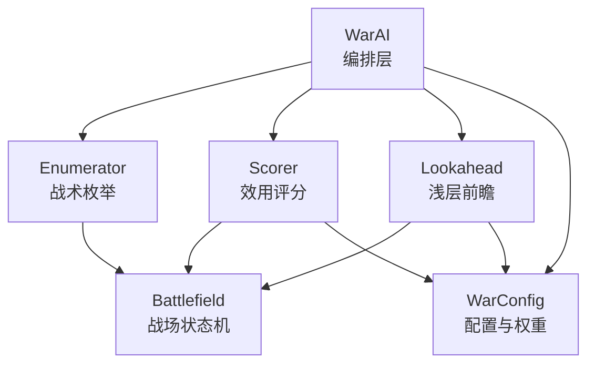
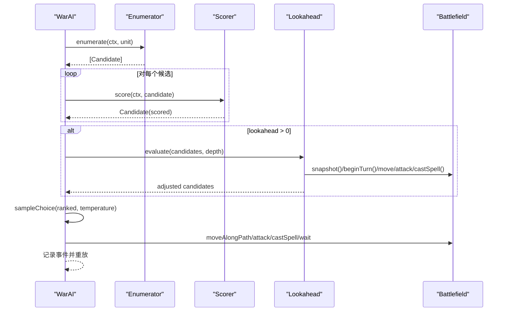
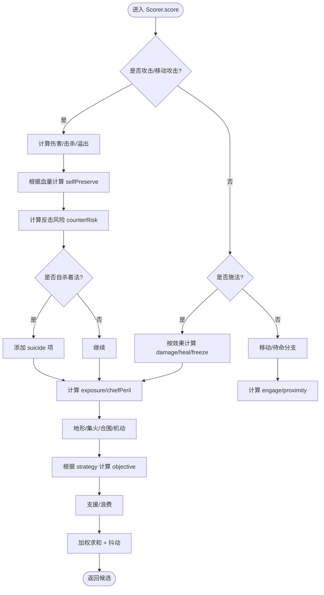
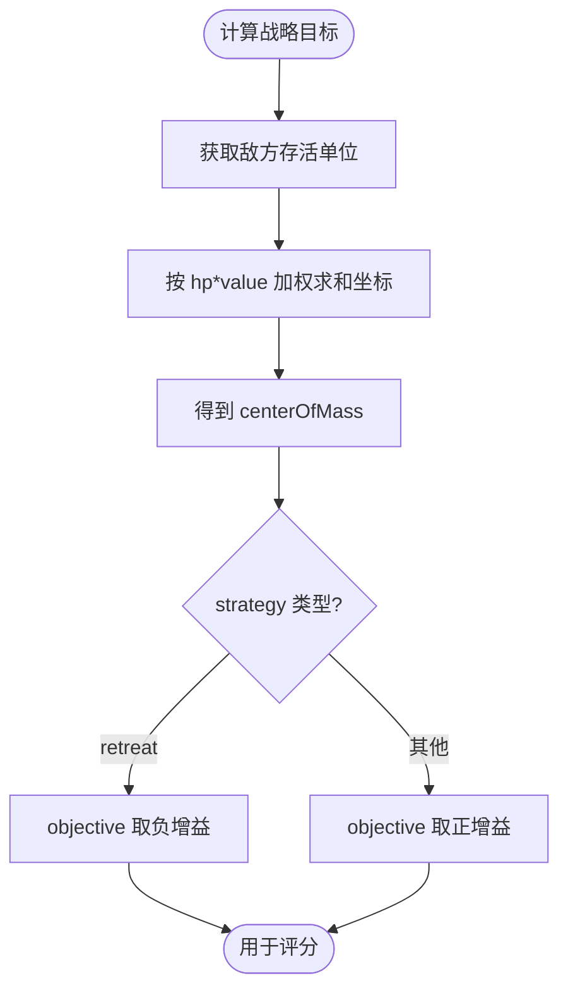
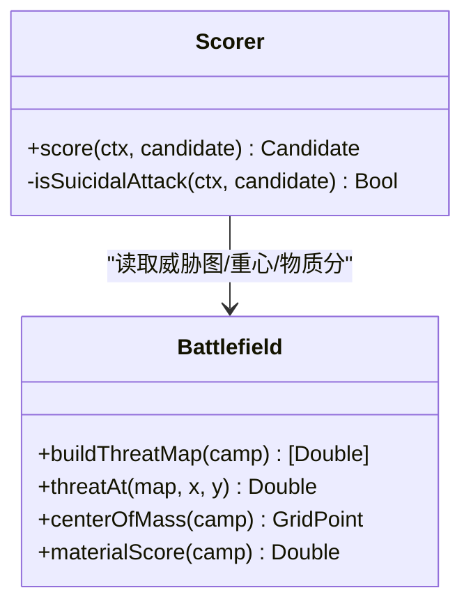
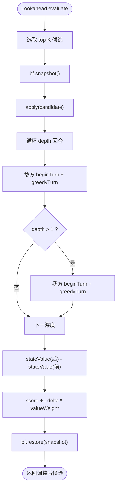
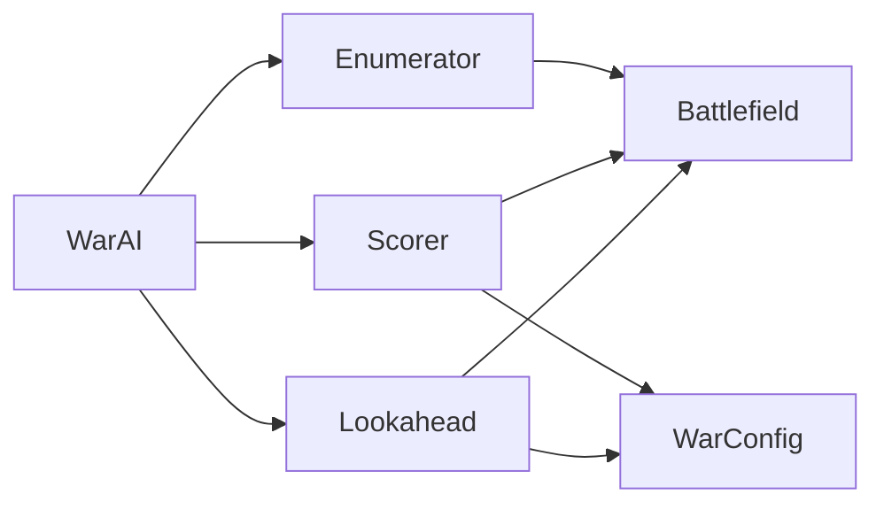

# 战略规划层

<cite>
**本文引用的文件**   
- [WarAI.swift](file://war/ios/WarKit/Sources/WarKit/WarAI.swift)
- [Enumerator.swift](file://war/ios/WarKit/Sources/WarKit/Enumerator.swift)
- [Scorer.swift](file://war/ios/WarKit/Sources/WarKit/Scorer.swift)
- [Lookahead.swift](file://war/ios/WarKit/Sources/WarKit/Lookahead.swift)
- [Battlefield.swift](file://war/ios/WarKit/Sources/WarKit/Battlefield.swift)
- [Support.swift](file://war/ios/WarKit/Sources/WarKit/Support.swift)
- [WarConfig.swift](file://war/ios/WarKit/Sources/WarKit/WarConfig.swift)
</cite>

## 目录
1. [引言](#引言)
2. [项目结构](#项目结构)
3. [核心组件](#核心组件)
4. [架构总览](#架构总览)
5. [详细组件分析](#详细组件分析)
6. [依赖关系分析](#依赖关系分析)
7. [性能与复杂度](#性能与复杂度)
8. [故障排查指南](#故障排查指南)
9. [结论](#结论)
10. [附录：接口约定与扩展指南](#附录接口约定与扩展指南)

## 引言
本文件面向 Strategist（战略规划层）的技术文档，聚焦以下目标：
- 解释局势评估算法：物质差、兵种价值、弱点识别、风险暴露等。
- 说明四种战略模式触发条件：attack（进攻）、defend（防守）、flank（包抄）、retreat（撤退），以及 rush（碾压）。
- 解释目标区域选择算法：敌方重心计算、包抄路径规划、撤退路线确定。
- 给出可操作的修改示例：调整评估权重、新增战略模式。
- 明确与上层 WarAI 和下层 Enumerator 的接口约定。

需要特别说明的是：当前代码库中并未出现名为“Strategist”的独立类或显式的“attack/defend/flank/retreat/rush”枚举；但 AI 的决策管线由 WarAI → Enumerator → Scorer → Lookahead 构成，其中 Scorer 通过 `ctx.strategy` 与 `ctx.objective` 驱动不同行为，而 Battlefield 提供 `centerOfMass` 作为战略目标点。因此，本文把“战略规划层”理解为以 Scorer 为核心的效用评分体系，并由 WarAI 编排执行。

## 项目结构
WarKit 的核心源码位于 iOS 工程下的 WarKit 模块，关键文件如下：
- WarAI.swift：AI 编排层，负责回合推进、候选排序、softmax 采样、事件重放。
- Enumerator.swift：战术枚举层，为单个单位生成可达落点 × 动作的候选集。
- Scorer.swift：效用评分层，将候选映射为分数，并输出分项贡献。
- Lookahead.swift：浅层前瞻推演，对 top-K 候选做 1~2 回合 rollout。
- Battlefield.swift：战场状态机，封装地形、移动、攻击、施法、威胁图、快照等。
- Support.swift：坐标、距离、确定性随机数等基础工具。
- WarConfig.swift：数值与规则权威定义处，包含兵种、魔法、难度、权重、标尺等。

**图表来源**
- [WarAI.swift:11-28](file://war/ios/WarKit/Sources/WarKit/WarAI.swift#L11-L28)
- [Enumerator.swift:9-104](file://war/ios/WarKit/Sources/WarKit/Enumerator.swift#L9-L104)
- [Scorer.swift:11-256](file://war/ios/WarKit/Sources/WarKit/Scorer.swift#L11-L256)
- [Lookahead.swift:9-61](file://war/ios/WarKit/Sources/WarKit/Lookahead.swift#L9-L61)
- [Battlefield.swift:54-690](file://war/ios/WarKit/Sources/WarKit/Battlefield.swift#L54-L690)
- [WarConfig.swift:434-574](file://war/ios/WarKit/Sources/WarKit/WarConfig.swift#L434-L574)

**章节来源**
- [WarAI.swift:11-28](file://war/ios/WarKit/Sources/WarKit/WarAI.swift#L11-L28)
- [WarConfig.swift:434-574](file://war/ios/WarKit/Sources/WarKit/WarConfig.swift#L434-L574)

## 核心组件
- WarAI：编排决策流程，调用 Enumerator 生成候选，Scorer 打分，可选 Lookahead 修正分数，最后用 softmax 采样执行。
- Enumerator：按可达域和射程枚举 move / attack / moveAttack / spell / wait 候选，并过滤自杀着法与超预算候选。
- Scorer：统一量纲的效用评分，涵盖伤害、击杀、溢出、存活、目标价值、暴露、地形、集火、反击风险、机动、合围、目标点、支援、浪费、射程惩罚、推进、靠近、斩首赏金、治疗、冰冻、自杀门禁、首领危险等分项。
- Lookahead：对 top-K 候选进行浅层 rollout，使用物质差 + 终局项评估状态变化，并用贪心策略模拟对手与我方后续行动。
- Battlefield：提供移动、攻击、施法、威胁图、中心点、物质分、快照/回滚等底层能力。
- WarConfig：集中管理兵种、魔法、难度、权重、标尺等所有可调参数。

**章节来源**
- [WarAI.swift:11-198](file://war/ios/WarKit/Sources/WarKit/WarAI.swift#L11-L198)
- [Enumerator.swift:9-104](file://war/ios/WarKit/Sources/WarKit/Enumerator.swift#L9-L104)
- [Scorer.swift:11-256](file://war/ios/WarKit/Sources/WarKit/Scorer.swift#L11-L256)
- [Lookahead.swift:9-167](file://war/ios/WarKit/Sources/WarKit/Lookahead.swift#L9-L167)
- [Battlefield.swift:54-690](file://war/ios/WarKit/Sources/WarKit/Battlefield.swift#L54-L690)
- [WarConfig.swift:434-574](file://war/ios/WarKit/Sources/WarKit/WarConfig.swift#L434-L574)

## 架构总览
AI 的决策流水线如下：
1. 对每个单位，调用 Enumerator.enumerate 生成候选。
2. 对候选调用 Scorer.score 打分。
3. 若 lookahead > 0，则用 Lookahead.evaluate 对 top-K 候选做浅层推演并修正分数。
4. 用 WarAI.sampleChoice 基于 temperature 做 softmax 采样。
5. 执行移动、攻击、施法或待命，记录事件用于重放。

**图表来源**
- [WarAI.swift:18-180](file://war/ios/WarKit/Sources/WarKit/WarAI.swift#L18-L180)
- [Enumerator.swift:14-104](file://war/ios/WarKit/Sources/WarKit/Enumerator.swift#L14-L104)
- [Scorer.swift:57-256](file://war/ios/WarKit/Sources/WarKit/Scorer.swift#L57-L256)
- [Lookahead.swift:26-61](file://war/ios/WarKit/Sources/WarKit/Lookahead.swift#L26-L61)
- [Battlefield.swift:332-556](file://war/ios/WarKit/Sources/WarKit/Battlefield.swift#L332-L556)

## 详细组件分析

### 局势评估算法（Scorer）
Scorer 是战略规划层的核心，它将候选动作拆解为多个无量纲分项，并通过 WarConfig.weights 加权汇总。关键逻辑包括：
- 伤害与击杀：damage、kill、overkill。
- 自身存活：selfPreserve、counterRisk、suicide。
- 目标价值：targetValue、chiefBounty。
- 风险暴露：exposure、chiefPeril。
- 位置与地形：terrain、surround、mobility、rangePenalty。
- 战略目标：objective（受 ctx.strategy 影响）、support、waste、engage、proximity。
- 魔法收益：heal、freeze。

评分铁律：
- 分项一律取 [0,1] 幅值，符号由权重决定。
- 伤害预估与真实结算使用同一口径（WarUnit.damageTo），避免两套标准。

**图表来源**
- [Scorer.swift:57-256](file://war/ios/WarKit/Sources/WarKit/Scorer.swift#L57-L256)

**章节来源**
- [Scorer.swift:11-256](file://war/ios/WarKit/Sources/WarKit/Scorer.swift#L11-L256)
- [WarConfig.swift:434-574](file://war/ios/WarKit/Sources/WarKit/WarConfig.swift#L434-L574)

### 目标区域选择算法
- 敌方重心：Battlefield.centerOfMass 按 hp×value 加权计算敌方阵营的重心坐标，用作战略目标点。
- 包抄路径：Enumerator 在枚举时考虑可达域外扩射程，从而产生 moveAttack 候选；Scorer 通过 proximity、engage、surround 鼓励靠近敌人并与友军合围。
- 撤退路线：当 ctx.strategy == "retreat" 时，Scorer 对 objective 项取负增益，促使单位远离目标点。

**图表来源**
- [Battlefield.swift:612-624](file://war/ios/WarKit/Sources/WarKit/Battlefield.swift#L612-L624)
- [Scorer.swift:226-234](file://war/ios/WarKit/Sources/WarKit/Scorer.swift#L226-L234)

**章节来源**
- [Battlefield.swift:612-624](file://war/ios/WarKit/Sources/WarKit/Battlefield.swift#L612-L624)
- [Scorer.swift:226-234](file://war/ios/WarKit/Sources/WarKit/Scorer.swift#L226-L234)

### 四种战略模式的触发条件与实现现状
当前代码未直接暴露 attack/defend/flank/retreat/rush 五种模式枚举，但可通过以下方式理解与扩展：
- retreat：已在 Scorer 中对 objective 项取反，使单位倾向远离目标点。
- attack/defend/flank/rush：可通过 ctx.strategy 字符串判断并在 Scorer 中增加对应分支，例如：
  - attack：提高 damage、kill、chiefBounty 权重。
  - defend：提高 terrain、exposure、support 权重。
  - flank：提高 surround、proximity、engage 权重。
  - rush：提高 mobility、engage、proximity 权重。

建议扩展方式：
- 在 AiContext 中增加 strategy 字段（当前已存在）。
- 在 Scorer.score 中根据 ctx.strategy 动态调整 parts 或临时权重。
- 在 WarConfig.Weights 中为新模式提供默认权重组合。

**章节来源**
- [Scorer.swift:226-234](file://war/ios/WarKit/Sources/WarKit/Scorer.swift#L226-L234)
- [WarConfig.swift:434-574](file://war/ios/WarKit/Sources/WarKit/WarConfig.swift#L434-L574)

### 弱点识别与风险暴露
- 弱点识别：Scorer 通过 targetValue、chiefBounty 鼓励优先处理高价值目标（如首领）；exposure 与 chiefPeril 评估落点被反击的风险。
- 风险暴露：Battlefield.buildThreatMap 计算敌方满状态下的威胁图，Scorer 据此计算 exposure；chiefPeril 仅在首领落点下回合会被打死时生效。

**图表来源**
- [Scorer.swift:42-256](file://war/ios/WarKit/Sources/WarKit/Scorer.swift#L42-L256)
- [Battlefield.swift:302-325](file://war/ios/WarKit/Sources/WarKit/Battlefield.swift#L302-L325)
- [Battlefield.swift:612-628](file://war/ios/WarKit/Sources/WarKit/Battlefield.swift#L612-L628)

**章节来源**
- [Scorer.swift:42-256](file://war/ios/WarKit/Sources/WarKit/Scorer.swift#L42-L256)
- [Battlefield.swift:302-325](file://war/ios/WarKit/Sources/WarKit/Battlefield.swift#L302-L325)
- [Battlefield.swift:612-628](file://war/ios/WarKit/Sources/WarKit/Battlefield.swift#L612-L628)

### 浅层前瞻（Lookahead）
Lookahead 对 top-K 候选进行 1~2 回合 rollout，使用 stateValue = 我方物质分 − 敌方物质分 + 终局项（斩首胜利/失败）来评估状态变化。rollout 策略为贪心：优先选期望伤害最大且尽量无反击的动作，打不到则朝敌方重心靠。

**图表来源**
- [Lookahead.swift:26-61](file://war/ios/WarKit/Sources/WarKit/Lookahead.swift#L26-L61)
- [Lookahead.swift:70-76](file://war/ios/WarKit/Sources/WarKit/Lookahead.swift#L70-L76)
- [Lookahead.swift:82-138](file://war/ios/WarKit/Sources/WarKit/Lookahead.swift#L82-L138)

**章节来源**
- [Lookahead.swift:9-167](file://war/ios/WarKit/Sources/WarKit/Lookahead.swift#L9-L167)

## 依赖关系分析
- WarAI 依赖 Enumerator、Scorer、Lookahead、Battlefield、WarConfig。
- Enumerator 依赖 Battlefield（可达域、视线、攻击判定）。
- Scorer 依赖 Battlefield（威胁图、地形防御、物质分、中心点）与 WarConfig（权重、标尺）。
- Lookahead 依赖 Battlefield（快照、移动、攻击、施法、物质分、中心点）与 WarConfig（权重、标尺）。
- 所有组件共享 WarConfig 作为唯一权威配置源。

**图表来源**
- [WarAI.swift:11-28](file://war/ios/WarKit/Sources/WarKit/WarAI.swift#L11-L28)
- [Enumerator.swift:14-104](file://war/ios/WarKit/Sources/WarKit/Enumerator.swift#L14-L104)
- [Scorer.swift:57-256](file://war/ios/WarKit/Sources/WarKit/Scorer.swift#L57-L256)
- [Lookahead.swift:26-61](file://war/ios/WarKit/Sources/WarKit/Lookahead.swift#L26-L61)

**章节来源**
- [WarAI.swift:11-28](file://war/ios/WarKit/Sources/WarKit/WarAI.swift#L11-L28)
- [WarConfig.swift:434-574](file://war/ios/WarKit/Sources/WarKit/WarConfig.swift#L434-L574)

## 性能与复杂度
- 候选数量上限：Enumerator.maxCandidatesPerUnit = 120，确保 iPhone 上可控。
- 前瞻深度：Lookahead.topK = 4，depth 通常为 1~2，避免全树搜索。
- 可达域计算：Battlefield.reachableWithBudget 使用桶式优先队列，时间复杂度近似 O(V+E)，V 为可达格数，E 为邻接边数。
- 威胁图构建：Battlefield.buildThreatMap 遍历敌方单位及其可达域，再对半径内格子累加攻击力，复杂度与敌方单位数和棋盘大小相关。
- 评分阶段：Scorer.score 对每个候选计算多项特征，复杂度与候选数 × 特征数成正比。

优化建议：
- 合理设置 maxCandidatesPerUnit 与 lookahead.depth，平衡棋力与帧预算。
- 使用 WarConfig.scale 中的参考值归一化分项，避免量纲失衡导致某项主导总分。

**章节来源**
- [Enumerator.swift:11-12](file://war/ios/WarKit/Sources/WarKit/Enumerator.swift#L11-L12)
- [Lookahead.swift:10-15](file://war/ios/WarKit/Sources/WarKit/Lookahead.swift#L10-L15)
- [Battlefield.swift:262-297](file://war/ios/WarKit/Sources/WarKit/Battlefield.swift#L262-L297)
- [Battlefield.swift:302-325](file://war/ios/WarKit/Sources/WarKit/Battlefield.swift#L302-L325)
- [Scorer.swift:57-256](file://war/ios/WarKit/Sources/WarKit/Scorer.swift#L57-L256)

## 故障排查指南
常见问题与定位方法：
- AI 总是原地不动：检查 Enumerator 是否过滤掉所有候选（如自杀着法过滤过严），确认 .wait 候选是否存在。
- AI 频繁送死：检查 Scorer.isSuicidalAttack 与 weights.suicide，确保自杀门禁生效；同时查看 Lookahead.rollout 是否同样过滤自杀着法。
- 首领过于保守：检查 weights.chiefPeril 与 Scorer 中 chiefPeril 的触发条件，确保不会过度压制进攻。
- 魔法不如普攻：检查 weights.heal、weights.freeze 与 Scorer 中魔法分项，确保不抢掉到手的击杀。
- 决策不可复现：确认 SeededRng 的 seed 一致，且 WarAI.sampleChoice 与 Lookahead 的随机调用顺序稳定。

**章节来源**
- [Enumerator.swift:76-81](file://war/ios/WarKit/Sources/WarKit/Enumerator.swift#L76-L81)
- [Scorer.swift:42-55](file://war/ios/WarKit/Sources/WarKit/Scorer.swift#L42-L55)
- [Lookahead.swift:103-108](file://war/ios/WarKit/Sources/WarKit/Lookahead.swift#L103-L108)
- [WarConfig.swift:501-529](file://war/ios/WarKit/Sources/WarKit/WarConfig.swift#L501-L529)

## 结论
Strategist 战略规划层以 Scorer 为核心，通过无量纲分项与统一权重实现灵活的局势评估；WarAI 编排决策流程，Enumerator 生成候选，Lookahead 补充二阶效应，Battlefield 提供底层状态机。尽管当前代码未显式实现 attack/defend/flank/retreat/rush 五种模式，但可通过 ctx.strategy 与 Scorer 分支轻松扩展。目标区域选择依赖 Battlefield.centerOfMass，结合 Scorer 的 objective、proximity、engage 等项实现推进、包抄与撤退。

## 附录：接口约定与扩展指南

### 与上层 WarAI 的接口约定
- WarAI.decideCandidates：接收 AiContext 与 WarUnit，返回按分数降序的候选列表。
- WarAI.sampleChoice：对 ranked 候选进行 softmax 采样，temperature 控制随机度。
- WarAI.executeTurn：推进整个阵营回合，产出 TurnPlan 与事件序列。

**章节来源**
- [WarAI.swift:18-28](file://war/ios/WarKit/Sources/WarKit/WarAI.swift#L18-L28)
- [WarAI.swift:34-59](file://war/ios/WarKit/Sources/WarKit/WarAI.swift#L34-L59)
- [WarAI.swift:64-180](file://war/ios/WarKit/Sources/WarKit/WarAI.swift#L64-L180)

### 与下层 Enumerator 的接口约定
- Enumerator.enumerate：接收 AiContext 与 WarUnit，返回 Candidate 列表。
- 候选类型：move、attack、moveAttack、spell、wait。
- 自杀着法过滤：Scorer.isSuicidalAttack 与 Enumerator 硬过滤保持一致。

**章节来源**
- [Enumerator.swift:14-104](file://war/ios/WarKit/Sources/WarKit/Enumerator.swift#L14-L104)
- [Scorer.swift:42-55](file://war/ios/WarKit/Sources/WarKit/Scorer.swift#L42-L55)

### 修改战略评估参数的步骤
1. 打开 WarConfig.swift，定位 Weights 与 Scale。
2. 调整 weights 中各分项权重（如 damage、kill、exposure、objective 等）。
3. 如需改变归一化尺度，调整 scale 中的 damageRef、valueRef、maxNoise 等。
4. 重新运行测试，观察胜率与决策日志是否符合预期。

**章节来源**
- [WarConfig.swift:434-574](file://war/ios/WarKit/Sources/WarKit/WarConfig.swift#L434-L574)

### 添加新战略模式的步骤
1. 在 AiContext 中确认 strategy 字段可用（当前已存在）。
2. 在 Scorer.score 中增加对 ctx.strategy 的判断分支。
3. 在新分支中动态调整 parts 或临时权重，以实现新模式的行为（如 attack/defend/flank/rush）。
4. 在 WarAI.executeTurn 中设置 ctx.strategy（可由上层传入或由局势自动推导）。
5. 验证新模式在不同难度档下的表现，确保不会破坏现有平衡。

**章节来源**
- [Scorer.swift:226-234](file://war/ios/WarKit/Sources/WarKit/Scorer.swift#L226-L234)
- [WarAI.swift:64-180](file://war/ios/WarKit/Sources/WarKit/WarAI.swift#L64-L180)