# 效用评分系统

<cite>
**本文引用的文件**   
- [Scorer.swift](file://war/ios/WarKit/Sources/WarKit/Scorer.swift)
- [WarConfig.swift](file://war/ios/WarKit/Sources/WarKit/WarConfig.swift)
- [WarAI.swift](file://war/ios/WarKit/Sources/WarKit/WarAI.swift)
- [Enumerator.swift](file://war/ios/WarKit/Sources/WarKit/Enumerator.swift)
- [Lookahead.swift](file://war/ios/WarKit/Sources/WarKit/Lookahead.swift)
- [Battlefield.swift](file://war/ios/WarKit/Sources/WarKit/Battlefield.swift)
- [Support.swift](file://war/ios/WarKit/Sources/WarKit/Support.swift)
</cite>

## 目录
1. [引言](#引言)
2. [项目结构](#项目结构)
3. [核心组件](#核心组件)
4. [架构总览](#架构总览)
5. [详细组件分析](#详细组件分析)
6. [依赖关系分析](#依赖关系分析)
7. [性能与复杂度](#性能与复杂度)
8. [调参与扩展指南](#调参与扩展指南)
9. [可解释性与调试输出](#可解释性与调试输出)
10. [故障排查](#故障排查)
11. [结论](#结论)

## 引言
本技术文档围绕 Scorer 效用评分系统，系统性说明多维度评分机制、权重配置与归一化方法、高级协同算法（包围、战略目标牵引、友军支援），以及评分结果的可解释性与调试信息。该评分系统是 AI 决策链中的“打分器”，负责把候选动作拆解为多个无量纲分项，再按 WarConfig.weights 加权汇总，最终影响候选排序与采样。

## 项目结构
与评分系统直接相关的代码集中在 WarKit 模块中：
- 评分计算：Scorer.swift
- 权重与标尺：WarConfig.swift
- 候选枚举与过滤：Enumerator.swift
- 前瞻推演：Lookahead.swift
- 战场规则与伤害结算：Battlefield.swift
- 坐标与随机数工具：Support.swift
- AI 编排层（调用评分、采样、执行）：WarAI.swift

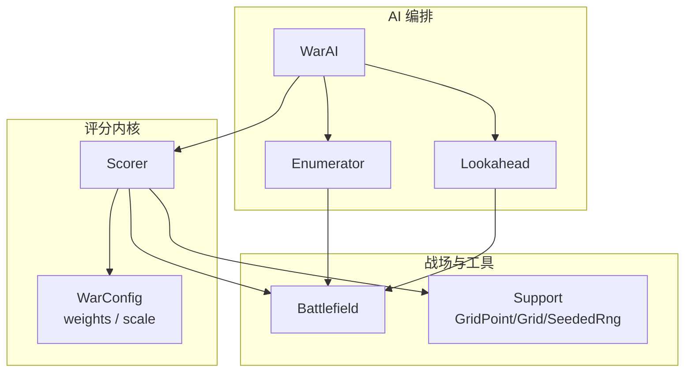

**图表来源**
- [WarAI.swift:18-28](file://war/ios/WarKit/Sources/WarKit/WarAI.swift#L18-L28)
- [Scorer.swift:57-256](file://war/ios/WarKit/Sources/WarKit/Scorer.swift#L57-L256)
- [WarConfig.swift:434-574](file://war/ios/WarKit/Sources/WarKit/WarConfig.swift#L434-L574)
- [Enumerator.swift:14-103](file://war/ios/WarKit/Sources/WarKit/Enumerator.swift#L14-L103)
- [Lookahead.swift:25-60](file://war/ios/WarKit/Sources/WarKit/Lookahead.swift#L25-L60)
- [Battlefield.swift:242-325](file://war/ios/WarKit/Sources/WarKit/Battlefield.swift#L242-L325)
- [Support.swift:3-33](file://war/ios/WarKit/Sources/WarKit/Support.swift#L3-L33)

**章节来源**
- [WarAI.swift:18-28](file://war/ios/WarKit/Sources/WarKit/WarAI.swift#L18-L28)
- [WarConfig.swift:434-574](file://war/ios/WarKit/Sources/WarKit/WarConfig.swift#L434-L574)

## 核心组件
- Scorer：实现所有分项评分、权重查找、总分汇总与抖动注入。
- WarConfig.Weights：定义各分项权重；WarConfig.Scale：定义各分项归一化参考值。
- Enumerator：生成候选集（移动、攻击、移动+攻击、施法、待命），并做自杀候选硬过滤。
- Lookahead：对 top-K 候选进行浅层推演，用物质差与终局项修正分数。
- Battlefield：提供可达域、威胁图、地形防御加成、伤害/反击/施法结算等统一口径。
- Support：坐标、曼哈顿距离、邻居、确定性随机数。

**章节来源**
- [Scorer.swift:11-268](file://war/ios/WarKit/Sources/WarKit/Scorer.swift#L11-L268)
- [WarConfig.swift:434-574](file://war/ios/WarKit/Sources/WarKit/WarConfig.swift#L434-L574)
- [Enumerator.swift:1-126](file://war/ios/WarKit/Sources/WarKit/Enumerator.swift#L1-L126)
- [Lookahead.swift:1-168](file://war/ios/WarKit/Sources/WarKit/Lookahead.swift#L1-L168)
- [Battlefield.swift:46-325](file://war/ios/WarKit/Sources/WarKit/Battlefield.swift#L46-L325)
- [Support.swift:3-33](file://war/ios/WarKit/Sources/WarKit/Support.swift#L3-L33)

## 架构总览
评分系统在 AI 决策链中的位置如下：

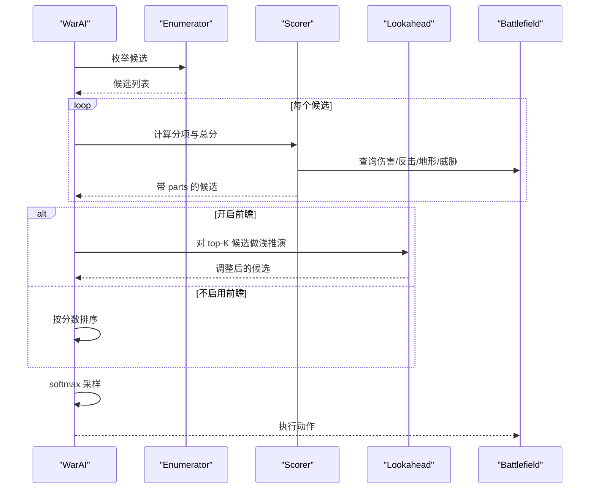

**图表来源**
- [WarAI.swift:18-28](file://war/ios/WarKit/Sources/WarKit/WarAI.swift#L18-L28)
- [WarAI.swift:34-59](file://war/ios/WarKit/Sources/WarKit/WarAI.swift#L34-L59)
- [WarAI.swift:64-180](file://war/ios/WarKit/Sources/WarKit/WarAI.swift#L64-L180)
- [Scorer.swift:57-256](file://war/ios/WarKit/Sources/WarKit/Scorer.swift#L57-L256)
- [Lookahead.swift:25-60](file://war/ios/WarKit/Sources/WarKit/Lookahead.swift#L25-L60)

## 详细组件分析

### 评分维度与实现要点
Scorer.score 将候选拆分为多个分项，全部遵循“分项幅值在 [0,1]”的铁律，符号由权重决定。主要维度如下：

- 伤害类
  - damage：本次攻击或魔法爆发伤害相对 damageRef 归一化。
  - kill：一击必杀时奖励，与目标价值相关。
  - overkill：溢出伤害惩罚，避免浪费。
  - selfPreserve：打不死还要动手时的存活风险，血量越低越保守。
  - targetValue：目标战略价值，结合残血比例形成“残值”。
  - chiefBounty：斩首额外倾向，单独表达首领价值溢出部分。
  - rangePenalty：远程单位贴脸输出惩罚。
  - counter：反击风险，按落点地形与距离评估。
  - suicide：反击必杀自己且换不掉击杀的“纯送死”标记。

- 位置类
  - exposure：落点下回合被敌方威胁打击的概率，按 threatSaturation 饱和。
  - terrain：落点地形防御加成相对 maxDefBonus 归一化。
  - focus：是否命中当前集火目标。
  - mobility：使用机动点的程度，对抗“站桩不动”。
  - proximity：无目标时向敌情靠近的绝对距离收益。
  - engage：无目标时推进意愿，按拉近的距离与是否进入射程区分。

- 协同类
  - surround：包围协同，统计能攻击同一目标的友军数量。
  - objective：向战略目标（兵力重心）靠拢的收益或撤退惩罚。
  - support：保护濒危友军的倾向，非攻击候选根据附近低血量友军判定。

- 其他
  - waste：浪费行动配额（有目标不打或机动全废）。
  - heal：治疗量相对目标最大生命归一化。
  - freeze：冰冻收益按目标价值折算。
  - chiefPeril：首领落点下回合会被打死的风险，仅当真实会死且不是就地斩首时计入。

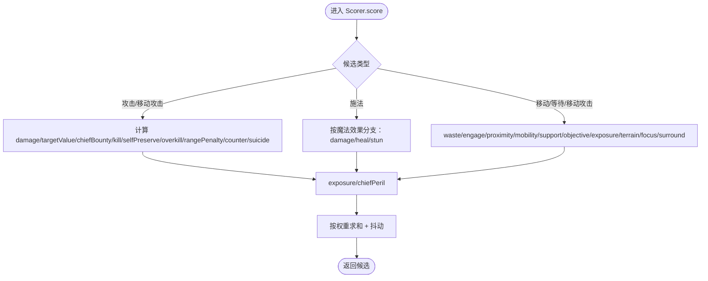

**图表来源**
- [Scorer.swift:90-244](file://war/ios/WarKit/Sources/WarKit/Scorer.swift#L90-L244)
- [Scorer.swift:246-256](file://war/ios/WarKit/Sources/WarKit/Scorer.swift#L246-L256)

**章节来源**
- [Scorer.swift:57-256](file://war/ios/WarKit/Sources/WarKit/Scorer.swift#L57-L256)

### 权重配置与归一化
- WarConfig.weights：每个分项一个权重，正值为加分，负值为扣分。例如 damage、kill 为正，overkill、selfPreserve、exposure、suicide、chiefPeril 等为负。
- WarConfig.scale：用于把不同量纲的分项统一到 [0,1]，如 damageRef、threatSaturation、maxDefBonus、valueRef、surroundUnit、objectiveGain、supportHpThreshold、moveBudgetRef、maxNoise 等。

关键设计约定：
- 所有分项先归一化到 [0,1]，再用 weights 加权；因此权重可直接理解为“该项的最大贡献上限”。
- 伤害与结算共用 Battlefield.damageTo，确保 AI 评分依据与真实结果一致。
- 首领 value 高于 valueRef，targetValue 会被钳到 1.0，多出的分量通过 chiefBounty 表达，既保持分项约定又不破坏士兵间相对分序。

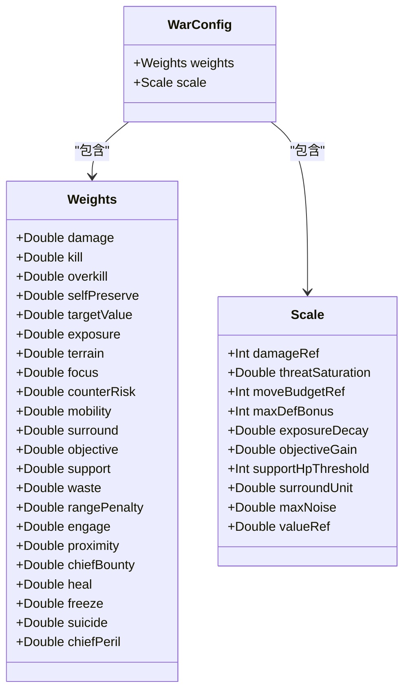

**图表来源**
- [WarConfig.swift:434-574](file://war/ios/WarKit/Sources/WarKit/WarConfig.swift#L434-L574)

**章节来源**
- [WarConfig.swift:434-574](file://war/ios/WarKit/Sources/WarKit/WarConfig.swift#L434-L574)
- [Scorer.swift:13-40](file://war/ios/WarKit/Sources/WarKit/Scorer.swift#L13-L40)
- [Scorer.swift:90-244](file://war/ios/WarKit/Sources/WarKit/Scorer.swift#L90-L244)

### 包围协同算法（surround）
- 当候选攻击敌方单位时，遍历己方存活友军，统计与目标曼哈顿距离 ≤ 2 且能对目标发起攻击的友军数量。
- surround 分值 = min(1.0, 友军数量 × surroundUnit)。
- 该机制鼓励多兵合围同一目标，提升集火效率。

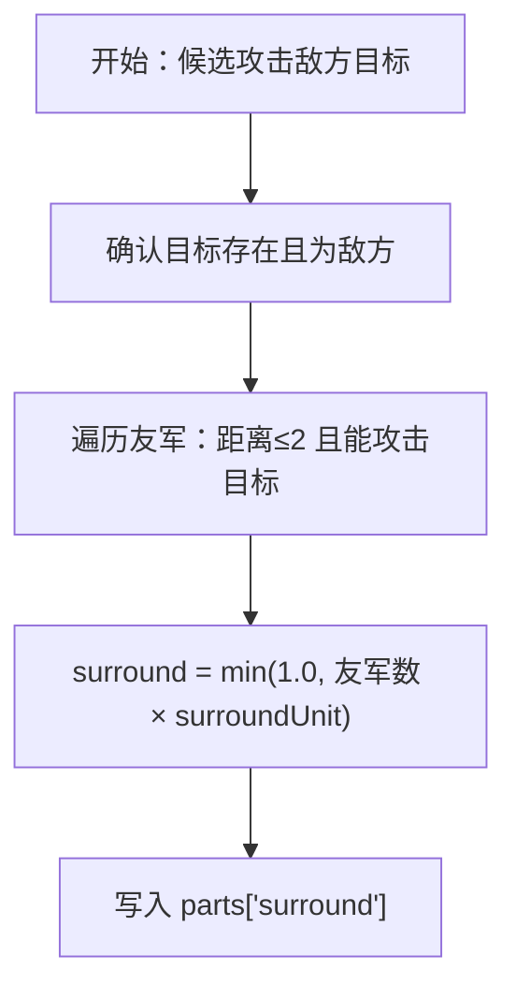

**图表来源**
- [Scorer.swift:212-218](file://war/ios/WarKit/Sources/WarKit/Scorer.swift#L212-L218)

**章节来源**
- [Scorer.swift:212-218](file://war/ios/WarKit/Sources/WarKit/Scorer.swift#L212-L218)

### 战略目标牵引（objective）
- 战略目标取己方兵力重心（centerOfMass），即按 hp×value 加权的位置。
- 对移动/等待/移动攻击候选，比较移动前后与战略目标的曼哈顿距离变化 gain。
- 进攻策略下，objective = gain × objectiveGain；撤退策略下，objective = -gain。
- 非移动类候选 objective 为 0。

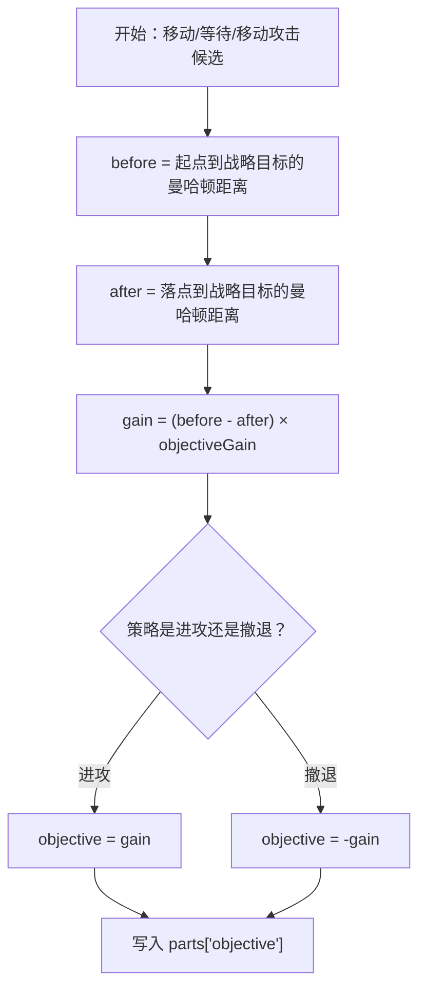

**图表来源**
- [Scorer.swift:226-234](file://war/ios/WarKit/Sources/WarKit/Scorer.swift#L226-L234)
- [Battlefield.swift:611-624](file://war/ios/WarKit/Sources/WarKit/Battlefield.swift#L611-L624)

**章节来源**
- [Scorer.swift:226-234](file://war/ios/WarKit/Sources/WarKit/Scorer.swift#L226-L234)
- [Battlefield.swift:611-624](file://war/ios/WarKit/Sources/WarKit/Battlefield.swift#L611-L624)

### 友军支援（support）
- 非攻击候选（移动/等待/移动攻击）检查附近是否存在低血量友军（hp < supportHpThreshold，距离 ≤ 3）。
- 若存在濒危友军，support = 0.6；否则 support = -0.3。
- 该机制让 AI 在非攻击回合更倾向于靠近需要保护的友军。

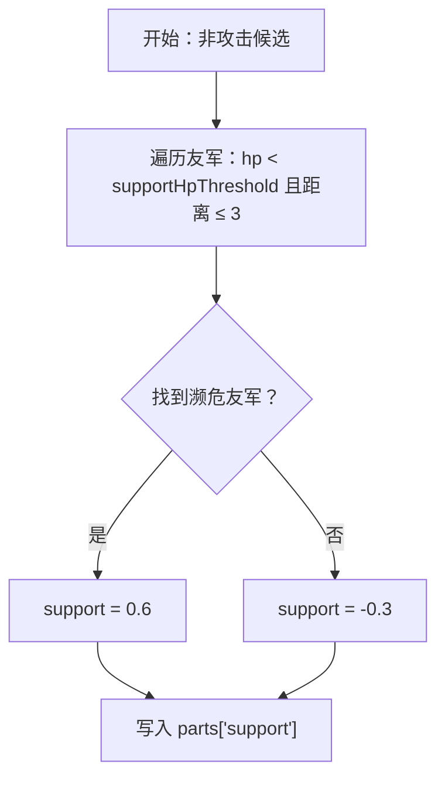

**图表来源**
- [Scorer.swift:236-244](file://war/ios/WarKit/Sources/WarKit/Scorer.swift#L236-L244)

**章节来源**
- [Scorer.swift:236-244](file://war/ios/WarKit/Sources/WarKit/Scorer.swift#L236-L244)

### 伤害预估与反击风险评估
- 伤害预估使用 unit.damageTo(target, targetTerrainDefBonus)，与真实攻击结算口径一致。
- 反击风险 counter：若目标能对攻击者反击，则按落点地形与距离计算 cdmg，并按 selfHpRatio 调节幅度，最后钳到 [0,1]。
- 自杀门禁 isSuicidalAttack：反击必杀自己且打不死目标，标记 suicide=1.0，并在 Enumerator 层硬过滤。

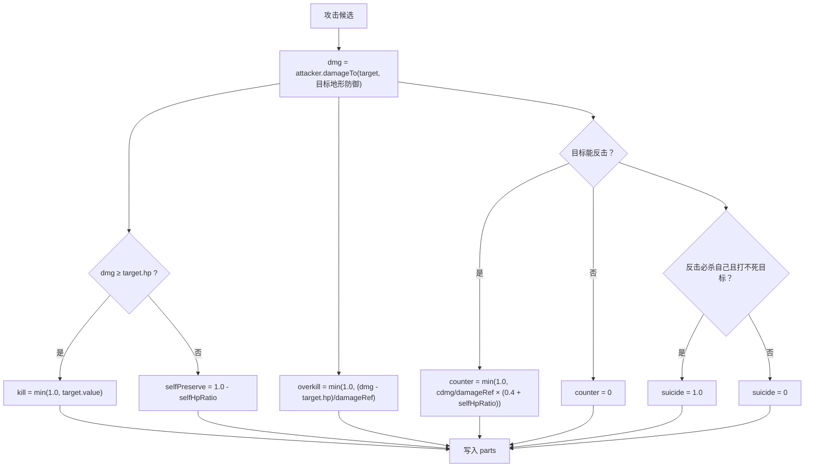

**图表来源**
- [Scorer.swift:91-131](file://war/ios/WarKit/Sources/WarKit/Scorer.swift#L91-L131)
- [Scorer.swift:45-55](file://war/ios/WarKit/Sources/WarKit/Scorer.swift#L45-L55)

**章节来源**
- [Scorer.swift:91-131](file://war/ios/WarKit/Sources/WarKit/Scorer.swift#L91-L131)
- [Scorer.swift:45-55](file://war/ios/WarKit/Sources/WarKit/Scorer.swift#L45-L55)

### 暴露与首领风险（exposure、chiefPeril）
- exposure：基于 Battlefield.buildThreatMap 的威胁值，按 threatSaturation 饱和，表示落点下回合被敌方威胁打击的概率。
- chiefPeril：仅当单位为首领、落点威胁/承伤能力 ≥ 1，且不是就地斩杀敌方首领时，标记 chiefPeril=1.0。
- 该分层设计避免通用“落点死亡风险”导致双方绕行僵持。

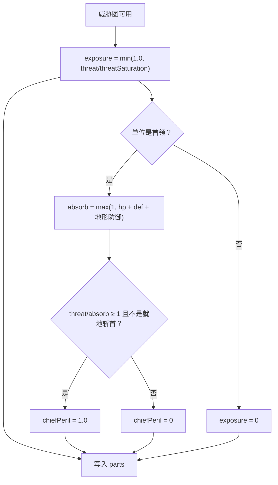

**图表来源**
- [Scorer.swift:187-205](file://war/ios/WarKit/Sources/WarKit/Scorer.swift#L187-L205)
- [Battlefield.swift:299-325](file://war/ios/WarKit/Sources/WarKit/Battlefield.swift#L299-L325)

**章节来源**
- [Scorer.swift:187-205](file://war/ios/WarKit/Sources/WarKit/Scorer.swift#L187-L205)
- [Battlefield.swift:299-325](file://war/ios/WarKit/Sources/WarKit/Battlefield.swift#L299-L325)

### 魔法评分分支（fireball/heal/freeze）
- fireball（伤害）：中心伤害 + 溅射伤害，复用 damage/targetValue/chiefBounty/kill/selfPreserve/overkill 口径。
- heal（治疗）：healed = min(power, maxHp - hp)，heal = healed/maxHp，targetValue 同样按残值计算。
- freeze（冻结）：freeze = min(1.0, target/valueRef)，体现封住高价值目标的战术收益。
- 魔法不触发反击，因此不写 counter 项，这是魔法的真实优势而非额外奖励。

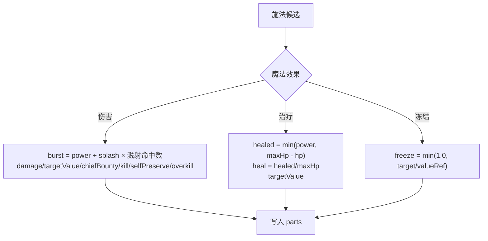

**图表来源**
- [Scorer.swift:132-165](file://war/ios/WarKit/Sources/WarKit/Scorer.swift#L132-L165)

**章节来源**
- [Scorer.swift:132-165](file://war/ios/WarKit/Sources/WarKit/Scorer.swift#L132-L165)

### 机动力与接近度（mobility、proximity、engage）
- mobility：路径长度 > 0 时，按 moveCost 相对 moveBudgetRef 归一化，鼓励用满机动点。
- proximity：无目标时，按离最近敌人的距离倒数衡量“绝对接近度”。
- engage：无目标时，按拉近的距离与是否进入射程给予推进意愿。

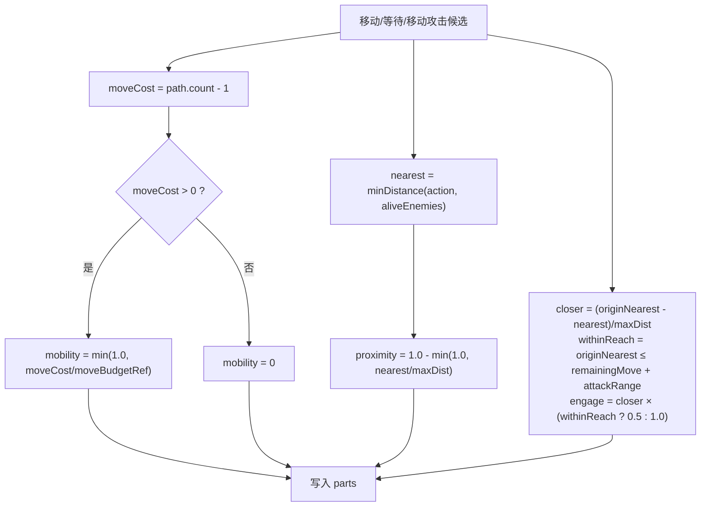

**图表来源**
- [Scorer.swift:220-224](file://war/ios/WarKit/Sources/WarKit/Scorer.swift#L220-L224)
- [Scorer.swift:176-184](file://war/ios/WarKit/Sources/WarKit/Scorer.swift#L176-L184)

**章节来源**
- [Scorer.swift:176-184](file://war/ios/WarKit/Sources/WarKit/Scorer.swift#L176-L184)
- [Scorer.swift:220-224](file://war/ios/WarKit/Sources/WarKit/Scorer.swift#L220-L224)

### 汇总与抖动
- 总分 = Σ(parts[key] × weight(key)) + jitter。
- jitter = (rng.next() * 2 - 1) × min(1.0, difficulty.temperature) × maxNoise。
- 低难度 AI 通过温度引入判断力不稳，表现为偶发次优手，但不会改变权重语义。

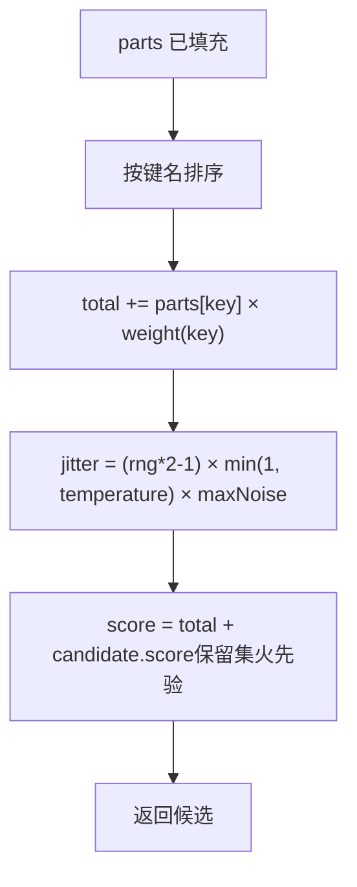

**图表来源**
- [Scorer.swift:246-256](file://war/ios/WarKit/Sources/WarKit/Scorer.swift#L246-L256)

**章节来源**
- [Scorer.swift:246-256](file://war/ios/WarKit/Sources/WarKit/Scorer.swift#L246-L256)

## 依赖关系分析
- Scorer 依赖 WarConfig.weights/scale 获取权重与标尺。
- Scorer 依赖 Battlefield 获取伤害、反击、地形防御、威胁图、单位查询。
- Scorer 依赖 Support.Grid 计算曼哈顿距离与邻居。
- Enumerator 依赖 Battlefield.computeReachable 与 canAttackFrom 生成候选。
- Lookahead 依赖 Battlefield.materialScore/isChiefLost 计算状态价值，并使用 apply 与真实执行同口径。
- WarAI 串联 Enumerator → Scorer → Lookahead → softmax 采样 → 执行。

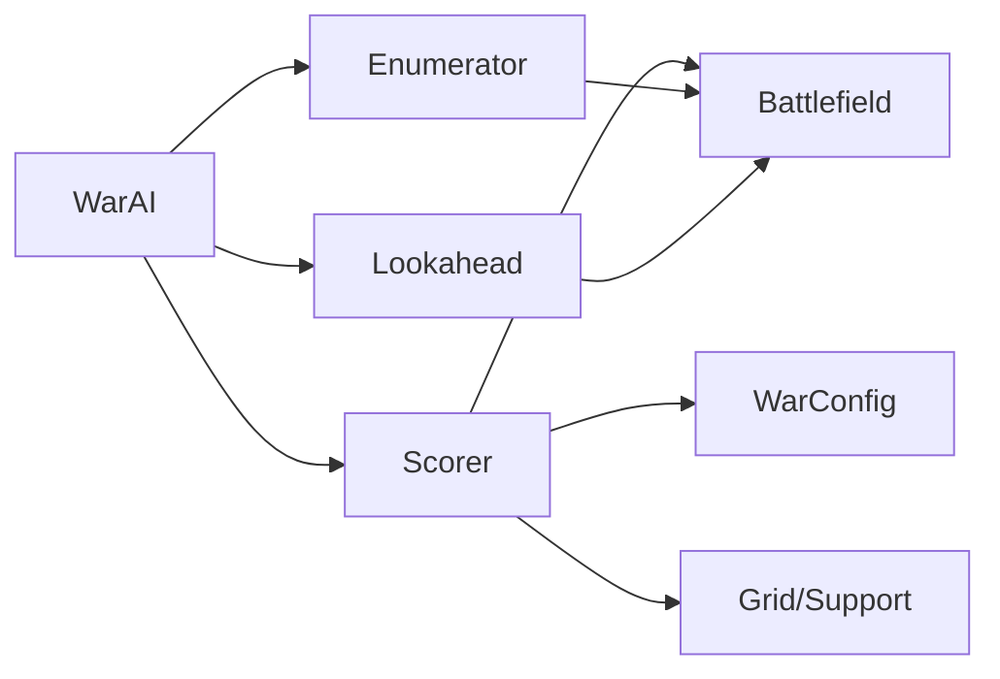

**图表来源**
- [Scorer.swift:13-40](file://war/ios/WarKit/Sources/WarKit/Scorer.swift#L13-L40)
- [Scorer.swift:90-244](file://war/ios/WarKit/Sources/WarKit/Scorer.swift#L90-L244)
- [Enumerator.swift:14-103](file://war/ios/WarKit/Sources/WarKit/Enumerator.swift#L14-L103)
- [Lookahead.swift:25-60](file://war/ios/WarKit/Sources/WarKit/Lookahead.swift#L25-L60)
- [WarAI.swift:18-28](file://war/ios/WarKit/Sources/WarKit/WarAI.swift#L18-L28)

**章节来源**
- [Scorer.swift:13-40](file://war/ios/WarKit/Sources/WarKit/Scorer.swift#L13-L40)
- [Enumerator.swift:14-103](file://war/ios/WarKit/Sources/WarKit/Enumerator.swift#L14-L103)
- [Lookahead.swift:25-60](file://war/ios/WarKit/Sources/WarKit/Lookahead.swift#L25-L60)
- [WarAI.swift:18-28](file://war/ios/WarKit/Sources/WarKit/WarAI.swift#L18-L28)

## 性能与复杂度
- 候选枚举：每单位最多 120 个候选，优先保留攻击与施法候选，避免纯机动候选过多。
- 威胁图构建：O(敌方单位数 × 可达格数 × 半径内格子数)，带版本缓存与预算参数化。
- 可达域：桶式优先队列 Dijkstra，成本为整数且值域极小，适合战棋网格。
- 前瞻推演：只对 top-K=4 候选做 1~2 回合 rollout，贪心策略开销低。
- 评分计算：每个候选遍历少量友军与敌人，常数级操作为主。

[本节为一般性讨论，不直接分析具体文件]

## 调参与扩展指南

### 调整评分权重
- 修改 WarConfig.weights 对应字段即可调整各分项重要性。例如提高 surround 以强化包围，提高 objective 以强化推进，降低 overkill 以减少对溢出的惩罚。
- 注意：权重单位为“归一化分项的最大贡献”，因此提高某项权重会线性放大该项对总分的影响。

示例路径：
- [WarConfig.swift:501-529](file://war/ios/WarKit/Sources/WarKit/WarConfig.swift#L501-L529)

**章节来源**
- [WarConfig.swift:501-529](file://war/ios/WarKit/Sources/WarKit/WarConfig.swift#L501-L529)

### 调整归一化标尺
- 修改 WarConfig.scale 对应字段以改变分项归一化基准。例如增大 damageRef 会降低伤害项的相对强度；增大 surroundUnit 会增强包围协同；增大 objectiveGain 会强化战略目标牵引。
- 注意：scale 与 weights 共同决定最终行为，建议成对调参并观察胜率与决策日志。

示例路径：
- [WarConfig.swift:563-574](file://war/ios/WarKit/Sources/WarKit/WarConfig.swift#L563-L574)

**章节来源**
- [WarConfig.swift:563-574](file://war/ios/WarKit/Sources/WarKit/WarConfig.swift#L563-L574)

### 添加新的评分维度
步骤建议：
1. 在 WarConfig.Weights 中添加新字段，并在 WarConfig.weights 默认实例中赋予初始权重。
2. 在 Scorer.weight 的 switch 中为新键返回对应权重。
3. 在 Scorer.score 中计算新分项，确保幅值在 [0,1]，写入 parts["newKey"]。
4. 如需新标尺，在 WarConfig.Scale 中添加字段并在 WarConfig.scale 中赋值。
5. 验证：运行测试或对战，观察 DecisionLog 中新增分项与总分变化。

参考路径：
- [WarConfig.swift:436-499](file://war/ios/WarKit/Sources/WarKit/WarConfig.swift#L436-L499)
- [WarConfig.swift:501-529](file://war/ios/WarKit/Sources/WarKit/WarConfig.swift#L501-L529)
- [WarConfig.swift:531-574](file://war/ios/WarKit/Sources/WarKit/WarConfig.swift#L531-L574)
- [Scorer.swift:13-40](file://war/ios/WarKit/Sources/WarKit/Scorer.swift#L13-L40)
- [Scorer.swift:57-256](file://war/ios/WarKit/Sources/WarKit/Scorer.swift#L57-L256)

**章节来源**
- [WarConfig.swift:436-499](file://war/ios/WarKit/Sources/WarKit/WarConfig.swift#L436-L499)
- [WarConfig.swift:501-529](file://war/ios/WarKit/Sources/WarKit/WarConfig.swift#L501-L529)
- [WarConfig.swift:531-574](file://war/ios/WarKit/Sources/WarKit/WarConfig.swift#L531-L574)
- [Scorer.swift:13-40](file://war/ios/WarKit/Sources/WarKit/Scorer.swift#L13-L40)
- [Scorer.swift:57-256](file://war/ios/WarKit/Sources/WarKit/Scorer.swift#L57-L256)

## 可解释性与调试输出
- WarAI.executeTurn 会为每个单位生成 DecisionLog，包含：
  - 单位 ID 与名称
  - 动作类型与目标
  - 总分 score
  - 分项 parts（damage、kill、overkill、selfPreserve、targetValue、exposure、terrain、focus、counterRisk、mobility、surround、objective、support、waste、rangePenalty、engage、proximity、chiefBounty、heal、freeze、suicide、chiefPeril）
  - 前 5 名候选的简要信息
  - 是否启用前瞻 lookaheadApplied
  - 施法 key（如有）
- 这些日志可用于“AI 为什么这么走”面板，帮助玩家理解决策原因。

示例路径：
- [WarAI.swift:158-172](file://war/ios/WarKit/Sources/WarKit/WarAI.swift#L158-L172)

**章节来源**
- [WarAI.swift:158-172](file://war/ios/WarKit/Sources/WarKit/WarAI.swift#L158-L172)

## 故障排查
常见问题与建议：
- AI 过于保守或绕行不接战：
  - 检查 exposure 权重是否过低或过高；注释指出 -62 会导致双方绕行。
  - 检查 objective 与 proximity 权重是否足够推动推进。
- AI 频繁送死：
  - 检查 suicide 与 chiefPeril 权重是否足够负；同时确认 Enumerator 的自杀过滤逻辑未被误改。
- 魔法抢击杀：
  - 检查 heal 与 freeze 权重是否低于 kill；注释强调魔法项刻意低于 kill。
- 远程单位贴脸输出不合理：
  - 检查 rangePenalty 权重是否为负且足够大。
- 包围协同不足：
  - 检查 surround 权重与 surroundUnit 标尺是否偏低。
- 战略目标牵引弱：
  - 检查 objective 权重与 objectiveGain 标尺。

参考路径：
- [WarConfig.swift:501-529](file://war/ios/WarKit/Sources/WarKit/WarConfig.swift#L501-L529)
- [Scorer.swift:45-55](file://war/ios/WarKit/Sources/WarKit/Scorer.swift#L45-L55)
- [Scorer.swift:90-244](file://war/ios/WarKit/Sources/WarKit/Scorer.swift#L90-L244)

**章节来源**
- [WarConfig.swift:501-529](file://war/ios/WarKit/Sources/WarKit/WarConfig.swift#L501-L529)
- [Scorer.swift:45-55](file://war/ios/WarKit/Sources/WarKit/Scorer.swift#L45-L55)
- [Scorer.swift:90-244](file://war/ios/WarKit/Sources/WarKit/Scorer.swift#L90-L244)

## 结论
Scorer 效用评分系统通过严格的“分项归一化到 [0,1]”与“权重加权汇总”机制，实现了伤害、位置、协同等多维度的统一评分。WarConfig.weights 与 WarConfig.scale 提供了集中可调的参数入口，使 AI 在不同难度下共享同一份评分代码，并通过温度、前瞻、视野、军费等旋钮控制行为差异。包围协同、战略目标牵引、友军支援等高级算法增强了 AI 的战术表现。DecisionLog 提供的分项与总分信息使得评分过程具备良好可解释性，便于调试与优化。

[本节为总结性内容，不直接分析具体文件]