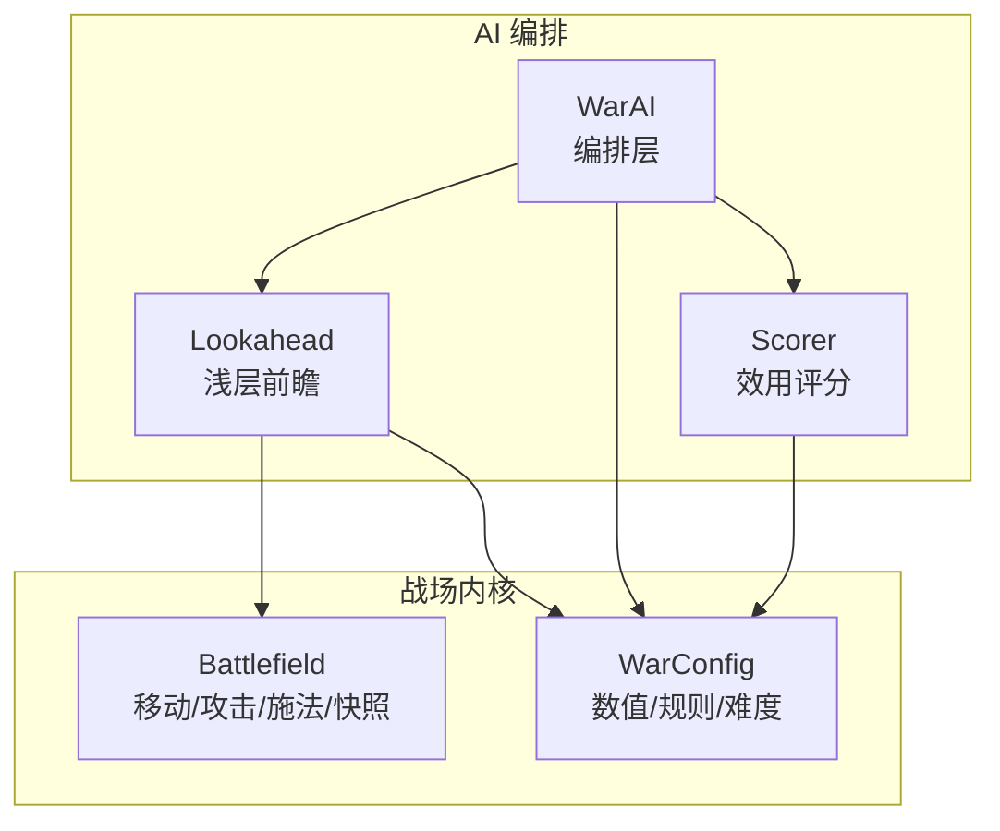
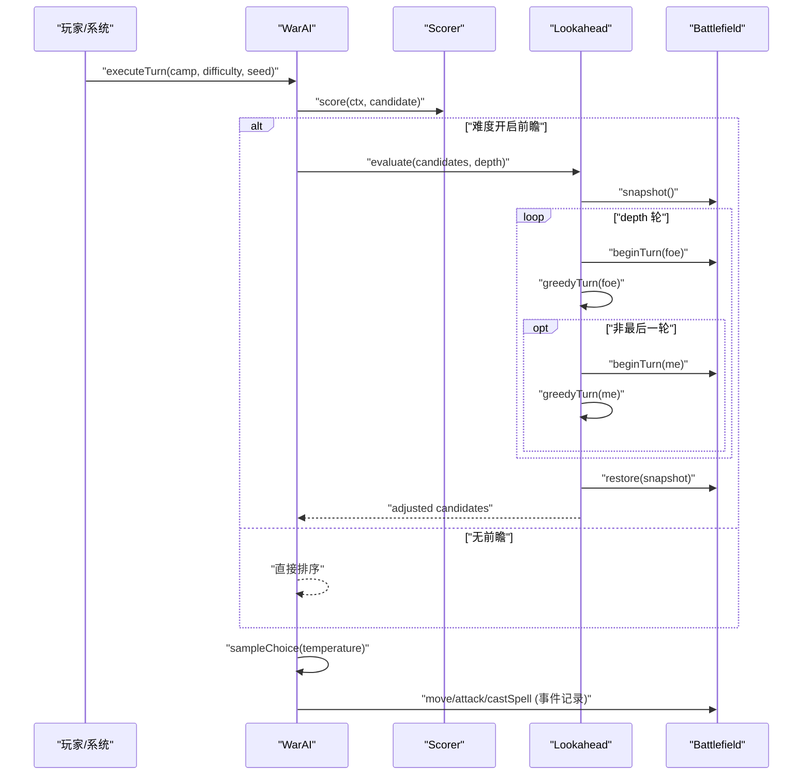
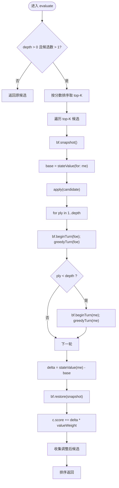
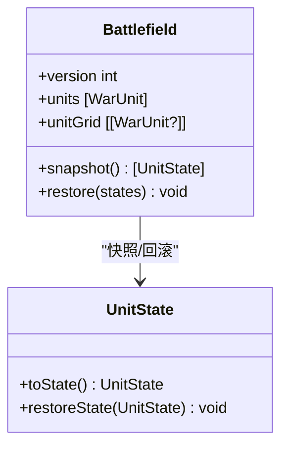
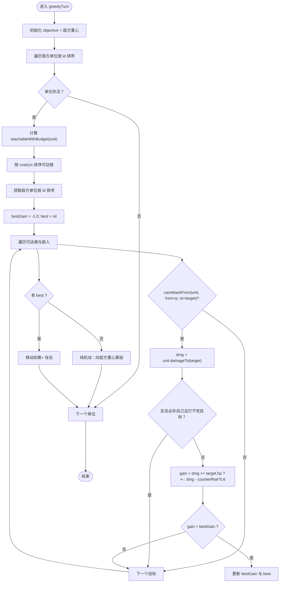
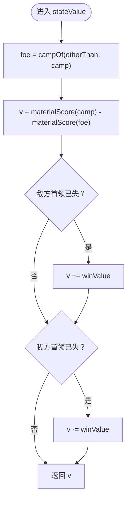
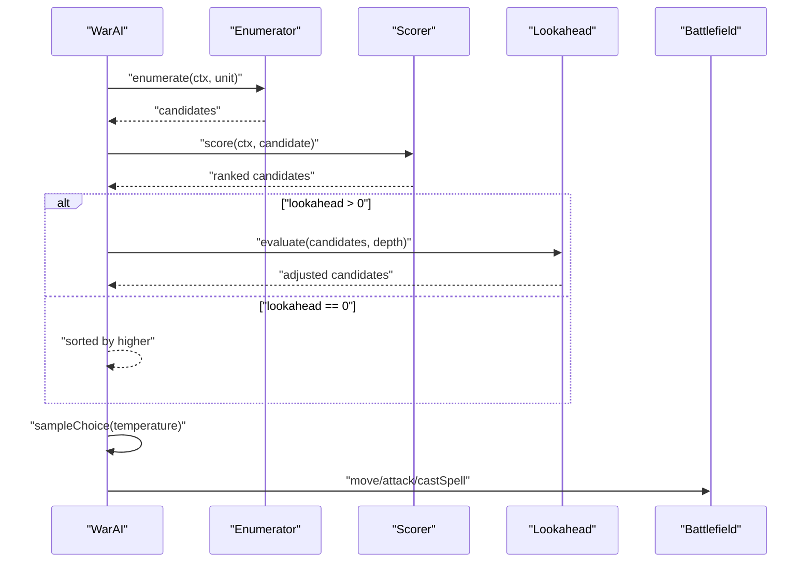
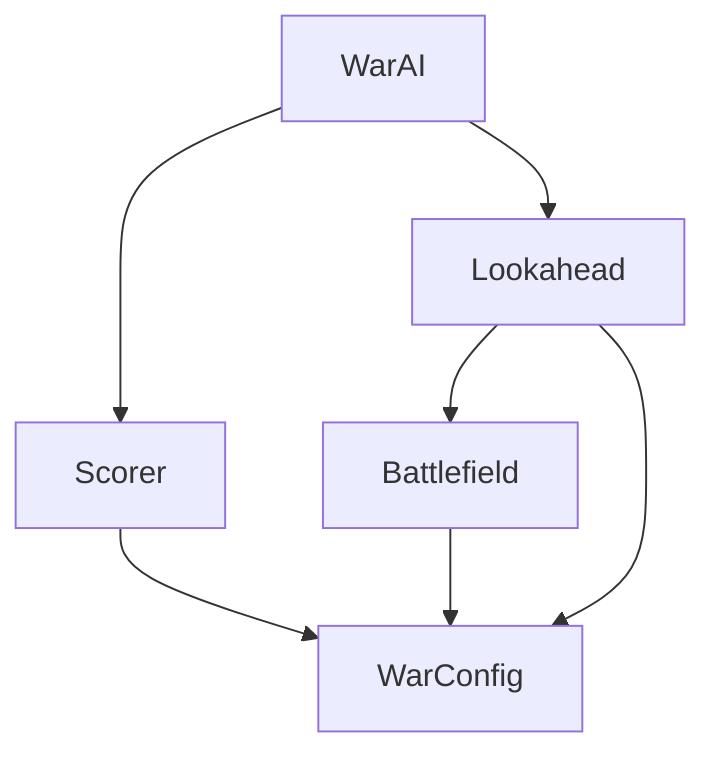

# 浅层前瞻推演

<cite>
**本文引用的文件**   
- [Lookahead.swift](file://war/ios/WarKit/Sources/WarKit/Lookahead.swift)
- [WarAI.swift](file://war/ios/WarKit/Sources/WarKit/WarAI.swift)
- [Battlefield.swift](file://war/ios/WarKit/Sources/WarKit/Battlefield.swift)
- [Scorer.swift](file://war/ios/WarKit/Sources/WarKit/Scorer.swift)
- [WarConfig.swift](file://war/ios/WarKit/Sources/WarKit/WarConfig.swift)
</cite>

## 目录
1. [引言](#引言)
2. [项目结构](#项目结构)
3. [核心组件](#核心组件)
4. [架构总览](#架构总览)
5. [详细组件分析](#详细组件分析)
6. [依赖关系分析](#依赖关系分析)
7. [性能考量与优化](#性能考量与优化)
8. [故障排查指南](#故障排查指南)
9. [结论](#结论)
10. [附录：调参与示例](#附录调参与示例)

## 引言
本技术文档聚焦 Lookahead 浅层前瞻推演引擎，面向“战棋类 AI”在移动端上的实时决策需求。其核心目标是：在极短预算内，对评分最高的少数候选进行有限深度的模拟推演，从而把“会不会被反打”“对手会怎么动”这类二阶效应纳入最终选择，而不做完整搜索树。

该方案由以下关键设计组成：
- 快照-回滚机制：每次推演前保存战场状态，推演后恢复，保证真实执行路径不受污染。
- 多步推演策略：对 top-K 候选分别推进若干回合（敌方先动、我方再动），以近似对抗过程。
- 对手行为建模：使用轻量贪心 rollout 模拟对手行动，避免复杂博弈带来的开销。
- 快棋手算法 _greedyTurn：在每个单位上选择期望净伤害最大且尽量无反击的动作；无法攻击时向敌方重心靠拢。
- 状态价值评估 _stateValue：以物质优势为主，叠加终局项（斩首）作为压倒性信号。
- 与主决策流程集成：WarAI 在枚举与评分之后，按难度决定是否启用 Lookahead，并输出可重放事件序列。

## 项目结构
本仓库采用 iOS Swift 工程组织，AI 相关逻辑集中在 WarKit 模块中：
- Lookahead.swift：浅层前瞻推演器，负责候选评估与 rollout。
- WarAI.swift：AI 编排层，串联枚举、评分、前瞻、采样与执行。
- Battlefield.swift：战场内核，提供移动、攻击、施法、可达域、威胁图、快照/回滚等能力。
- Scorer.swift：效用评分层，将候选动作拆解为多个分项并加权汇总。
- WarConfig.swift：数值与规则权威定义，包括地形、兵种、魔法、难度档位、权重与标尺。

**图表来源**
- [WarAI.swift:1-28](file://war/ios/WarKit/Sources/WarKit/WarAI.swift#L1-L28)
- [Lookahead.swift:1-61](file://war/ios/WarKit/Sources/WarKit/Lookahead.swift#L1-L61)
- [Battlefield.swift:46-54](file://war/ios/WarKit/Sources/WarKit/Battlefield.swift#L46-L54)
- [WarConfig.swift:352-387](file://war/ios/WarKit/Sources/WarKit/WarConfig.swift#L352-L387)

**章节来源**
- [WarAI.swift:1-28](file://war/ios/WarKit/Sources/WarKit/WarAI.swift#L1-L28)
- [Lookahead.swift:1-61](file://war/ios/WarKit/Sources/WarKit/Lookahead.swift#L1-L61)
- [Battlefield.swift:46-54](file://war/ios/WarKit/Sources/WarKit/Battlefield.swift#L46-L54)
- [WarConfig.swift:352-387](file://war/ios/WarKit/Sources/WarKit/WarConfig.swift#L352-L387)

## 核心组件
- Lookahead：浅层前瞻推演器，仅对 top-K 候选进行有限深度 rollout，并以状态价值差调整候选分数。
- WarAI：AI 编排层，负责难度旋钮（温度、前瞻、视野）、候选排序、softmax 采样与回合执行。
- Battlefield：战场内核，封装所有可变状态变更，并提供快照/回滚、可达域、威胁图、终局判定等。
- Scorer：效用评分层，将候选动作分解为多个无量纲分项，并按权重汇总。
- WarConfig：数值与规则权威定义，包含地形、兵种、魔法、难度档位、权重与归一化标尺。

**章节来源**
- [Lookahead.swift:1-61](file://war/ios/WarKit/Sources/WarKit/Lookahead.swift#L1-L61)
- [WarAI.swift:1-28](file://war/ios/WarKit/Sources/WarKit/WarAI.swift#L1-L28)
- [Battlefield.swift:46-54](file://war/ios/WarKit/Sources/WarKit/Battlefield.swift#L46-L54)
- [Scorer.swift:1-11](file://war/ios/WarKit/Sources/WarKit/Scorer.swift#L1-L11)
- [WarConfig.swift:352-387](file://war/ios/WarKit/Sources/WarKit/WarConfig.swift#L352-L387)

## 架构总览
Lookahead 浅层前瞻推演与主决策流程的集成如下：
- WarAI 对每个单位生成候选集，调用 Scorer 评分。
- 若当前难度开启前瞻（lookahead > 0），则调用 Lookahead.evaluate 对 top-K 候选进行有限深度 rollout。
- 最终返回排序后的候选，再由 WarAI.sampleChoice 根据 temperature 进行 softmax 采样。
- 执行阶段通过 Replay 回放事件，确保动画与决策一致。

**图表来源**
- [WarAI.swift:64-181](file://war/ios/WarKit/Sources/WarKit/WarAI.swift#L64-L181)
- [Lookahead.swift:25-61](file://war/ios/WarKit/Sources/WarKit/Lookahead.swift#L25-L61)
- [Battlefield.swift:678-690](file://war/ios/WarKit/Sources/WarKit/Battlefield.swift#L678-L690)

**章节来源**
- [WarAI.swift:64-181](file://war/ios/WarKit/Sources/WarKit/WarAI.swift#L64-L181)
- [Lookahead.swift:25-61](file://war/ios/WarKit/Sources/WarKit/Lookahead.swift#L25-L61)
- [Battlefield.swift:678-690](file://war/ios/WarKit/Sources/WarKit/Battlefield.swift#L678-L690)

## 详细组件分析

### Lookahead 浅层前瞻推演器
Lookahead 的核心职责是对 top-K 候选进行有限深度 rollout，并通过状态价值差调整候选分数。其关键特性包括：
- 仅对 top-K 候选进行推演，其余候选沿用即时评分。
- 每轮推演先让敌方行动，再让我方行动（除最后一轮外），以避免“敌方连动两次、我方无力还手”的偏差。
- 使用 Battlefield.snapshot/restore 实现快照-回滚，保证推演不污染真实状态。
- 使用 stateValue 计算物质优势与终局项，作为 rollout 的价值基准。
- 使用 greedyTurn 模拟对手与我方的轻量行动。

**图表来源**
- [Lookahead.swift:25-61](file://war/ios/WarKit/Sources/WarKit/Lookahead.swift#L25-L61)
- [Battlefield.swift:678-690](file://war/ios/WarKit/Sources/WarKit/Battlefield.swift#L678-L690)

**章节来源**
- [Lookahead.swift:25-61](file://war/ios/WarKit/Sources/WarKit/Lookahead.swift#L25-L61)

#### 快照-回滚机制
- Battlefield.snapshot 返回 units 的状态数组，用于后续 restore。
- Battlefield.restore 按索引对齐恢复单位状态，并重建 unitGrid 索引。
- 任何写操作都会增加 version，使缓存失效，保证一致性。

**图表来源**
- [Battlefield.swift:678-690](file://war/ios/WarKit/Sources/WarKit/Battlefield.swift#L678-L690)

**章节来源**
- [Battlefield.swift:678-690](file://war/ios/WarKit/Sources/WarKit/Battlefield.swift#L678-L690)

#### 多步推演策略
- 每轮先敌方后我方，避免“敌方连动两次”的偏差。
- 最后一轮不让我方行动，防止过度保守。
- 使用 greedyTurn 模拟对手与我方，保持轻量与确定性。

**章节来源**
- [Lookahead.swift:41-52](file://war/ios/WarKit/Sources/WarKit/Lookahead.swift#L41-L52)

#### 对手行为建模
- 使用 greedyTurn 模拟对手行动，选择期望净伤害最大且尽量无反击的动作。
- 无法攻击时向敌方重心靠拢，其次少花点数。
- 与真实执行共用 Battlefield 方法，保证口径一致。

**章节来源**
- [Lookahead.swift:82-138](file://war/ios/WarKit/Sources/WarKit/Lookahead.swift#L82-L138)

### _greedyTurn 快棋手算法
_greedyTurn 是 Lookahead 内部的轻量 rollout 策略，目标是在推演中不弱于随机，同时避免噪声淹没前瞻结论。其核心逻辑包括：
- 贪婪动作选择：对每个存活单位，计算可达格与敌人列表，选择期望净伤害最大的动作。
- 净伤害计算：考虑伤害、反击风险（反击伤害乘以 0.6 的惩罚系数）。
- 反击风险评估：如果反击必杀自己且打不死目标，则跳过该动作（自杀门禁）。
- 纯机动：无法攻击时，向敌方重心靠拢，其次少花点数。

**图表来源**
- [Lookahead.swift:82-138](file://war/ios/WarKit/Sources/WarKit/Lookahead.swift#L82-L138)
- [Battlefield.swift:244-297](file://war/ios/WarKit/Sources/WarKit/Battlefield.swift#L244-L297)

**章节来源**
- [Lookahead.swift:82-138](file://war/ios/WarKit/Sources/WarKit/Lookahead.swift#L82-L138)
- [Battlefield.swift:244-297](file://war/ios/WarKit/Sources/WarKit/Battlefield.swift#L244-L297)

### _stateValue 状态价值评估函数
_stateValue 是 Lookahead 内部的状态价值评估函数，核心思想是以物质优势为主，叠加终局项（斩首）作为压倒性信号。其设计要点包括：
- 物质优势计算：我方物质分减去敌方物质分，单位为“hp × 兵种价值 / 100”。
- 终局项：如果敌方首领阵亡，加 winValue；如果我方首领阵亡，减 winValue。
- 终局项必要性：只算物质分会导致深算忽略“斩首即赢”的语义，因此必须叠加终局项。

**图表来源**
- [Lookahead.swift:70-76](file://war/ios/WarKit/Sources/WarKit/Lookahead.swift#L70-L76)
- [Battlefield.swift:626-628](file://war/ios/WarKit/Sources/WarKit/Battlefield.swift#L626-L628)
- [Battlefield.swift:668-676](file://war/ios/WarKit/Sources/WarKit/Battlefield.swift#L668-L676)

**章节来源**
- [Lookahead.swift:70-76](file://war/ios/WarKit/Sources/WarKit/Lookahead.swift#L70-L76)
- [Battlefield.swift:626-628](file://war/ios/WarKit/Sources/WarKit/Battlefield.swift#L626-L628)
- [Battlefield.swift:668-676](file://war/ios/WarKit/Sources/WarKit/Battlefield.swift#L668-L676)

### 与主决策流程的集成
WarAI 作为 AI 编排层，负责串联枚举、评分、前瞻、采样与执行：
- decideCandidates：对每个单位生成候选，调用 Scorer 评分，若难度开启前瞻则调用 Lookahead.evaluate。
- sampleChoice：使用 softmax 采样，temperature 越大越“手软”。
- executeTurn：执行整个阵营回合，记录事件与日志，支持重放。

**图表来源**
- [WarAI.swift:18-28](file://war/ios/WarKit/Sources/WarKit/WarAI.swift#L18-L28)
- [WarAI.swift:34-59](file://war/ios/WarKit/Sources/WarKit/WarAI.swift#L34-L59)
- [WarAI.swift:64-181](file://war/ios/WarKit/Sources/WarKit/WarAI.swift#L64-L181)

**章节来源**
- [WarAI.swift:18-28](file://war/ios/WarKit/Sources/WarKit/WarAI.swift#L18-L28)
- [WarAI.swift:34-59](file://war/ios/WarKit/Sources/WarKit/WarAI.swift#L34-L59)
- [WarAI.swift:64-181](file://war/ios/WarKit/Sources/WarKit/WarAI.swift#L64-L181)

## 依赖关系分析
Lookahead 与 WarAI、Battlefield、Scorer、WarConfig 之间的依赖关系如下：
- Lookahead 依赖 Battlefield 进行状态变更与快照/回滚。
- Lookahead 依赖 WarConfig 中的难度配置（如 lookahead 值）。
- WarAI 依赖 Scorer 进行候选评分，依赖 Lookahead 进行前瞻评估。
- Scorer 依赖 WarConfig 中的权重与标尺。
- Battlefield 依赖 WarConfig 中的地形、兵种、魔法等规则。

**图表来源**
- [Lookahead.swift:1-61](file://war/ios/WarKit/Sources/WarKit/Lookahead.swift#L1-L61)
- [WarAI.swift:1-28](file://war/ios/WarKit/Sources/WarKit/WarAI.swift#L1-L28)
- [Scorer.swift:1-11](file://war/ios/WarKit/Sources/WarKit/Scorer.swift#L1-L11)
- [Battlefield.swift:46-54](file://war/ios/WarKit/Sources/WarKit/Battlefield.swift#L46-L54)
- [WarConfig.swift:352-387](file://war/ios/WarKit/Sources/WarKit/WarConfig.swift#L352-L387)

**章节来源**
- [Lookahead.swift:1-61](file://war/ios/WarKit/Sources/WarKit/Lookahead.swift#L1-L61)
- [WarAI.swift:1-28](file://war/ios/WarKit/Sources/WarKit/WarAI.swift#L1-L28)
- [Scorer.swift:1-11](file://war/ios/WarKit/Sources/WarKit/Scorer.swift#L1-L11)
- [Battlefield.swift:46-54](file://war/ios/WarKit/Sources/WarKit/Battlefield.swift#L46-L54)
- [WarConfig.swift:352-387](file://war/ios/WarKit/Sources/WarKit/WarConfig.swift#L352-L387)

## 性能考量与优化
- 分支爆炸控制：单回合分支为“单位数 × 落点数 × 目标数”，20v20 全枚举达 10^6 量级，手机预算仅几毫秒。Lookahead 仅对 top-K 候选进行有限深度 rollout，性价比远高于加深搜索深度。
- 快照-回滚开销：每次推演前 snapshot，结束后 restore，避免状态污染，但会增加内存与时间开销。可通过减少 top-K 或 depth 优化。
- greedyTurn 复杂度：对每个单位计算可达格与敌人列表，时间复杂度与单位数、可达格数、敌人数成正比。可通过限制 reach 范围或敌人数量优化。
- 状态价值计算：materialScore 遍历阵营单位，时间复杂度与单位数成正比。可通过缓存或增量更新优化。
- 与主流程集成：WarAI 的 softmax 采样与事件记录可能成为瓶颈，可通过减少候选数或简化日志记录优化。

**章节来源**
- [Lookahead.swift:3-8](file://war/ios/WarKit/Sources/WarKit/Lookahead.swift#L3-L8)
- [Lookahead.swift:25-61](file://war/ios/WarKit/Sources/WarKit/Lookahead.swift#L25-L61)
- [WarAI.swift:34-59](file://war/ios/WarKit/Sources/WarKit/WarAI.swift#L34-L59)

## 故障排查指南
- 前瞻结果异常：检查 Lookahead.evaluate 中的 depth 与 top-K 设置，确认 snapshot/restore 是否成对调用。
- 对手行为不合理：检查 greedyTurn 中的反击风险评估与自杀门禁，确认 canCounterAttackerAt 与 damageTo 逻辑正确。
- 状态价值偏差：检查 stateValue 中的物质优势与终局项计算，确认 materialScore 与 isChiefLost 逻辑正确。
- 性能问题：检查 Battlefield.reachableWithBudget 与 buildThreatMap 的缓存失效逻辑，确认 version 递增正确。

**章节来源**
- [Lookahead.swift:25-61](file://war/ios/WarKit/Sources/WarKit/Lookahead.swift#L25-L61)
- [Lookahead.swift:82-138](file://war/ios/WarKit/Sources/WarKit/Lookahead.swift#L82-L138)
- [Lookahead.swift:70-76](file://war/ios/WarKit/Sources/WarKit/Lookahead.swift#L70-L76)
- [Battlefield.swift:244-297](file://war/ios/WarKit/Sources/WarKit/Battlefield.swift#L244-L297)

## 结论
Lookahead 浅层前瞻推演引擎通过快照-回滚机制、多步推演策略、对手行为建模、快棋手算法与状态价值评估，实现了在移动端实时决策下的“轻量但有效”的前瞻能力。其与主决策流程的集成确保了决策的一致性与可重放性，同时通过难度旋钮（温度、前瞻、视野）提供了灵活的强度调节。未来优化方向包括减少 top-K 与 depth、缓存状态价值、优化 greedyTurn 的可达格计算等。

## 附录：调参与示例
- 调整推演深度：修改 WarConfig.difficulties 中的 lookahead 值，例如从 1 改为 2，以增加前瞻深度。
- 优化性能：减少 Lookahead.topK 或降低 WarConfig.difficulties 中的 lookahead，以减少推演开销。
- 调整价值权重：修改 Lookahead.valueWeight，以增强或减弱前瞻结果对候选分数的影响。
- 调整对手行为：修改 greedyTurn 中的反击惩罚系数（0.6），以改变对手行为的激进程度。

**章节来源**
- [WarConfig.swift:382-387](file://war/ios/WarKit/Sources/WarKit/WarConfig.swift#L382-L387)
- [Lookahead.swift:10-15](file://war/ios/WarKit/Sources/WarKit/Lookahead.swift#L10-L15)
- [Lookahead.swift:105-112](file://war/ios/WarKit/Sources/WarKit/Lookahead.swift#L105-L112)