# AI 决策 API

<cite>
**本文引用的文件**   
- [ai.js](file://war/war/ai.js)
- [config.js](file://war/war/config.js)
- [WarAI.swift](file://war/ios/WarKit/Sources/WarKit/WarAI.swift)
- [WarConfig.swift](file://war/ios/WarKit/Sources/WarKit/WarConfig.swift)
- [Enumerator.swift](file://war/ios/WarKit/Sources/WarKit/Enumerator.swift)
- [Scorer.swift](file://war/ios/WarKit/Sources/WarKit/Scorer.swift)
- [Lookahead.swift](file://war/ios/WarKit/Sources/WarKit/Lookahead.swift)
</cite>

## 目录
1. [引言](#引言)
2. [项目结构](#项目结构)
3. [核心组件](#核心组件)
4. [架构总览](#架构总览)
5. [详细组件分析](#详细组件分析)
6. [依赖关系分析](#依赖关系分析)
7. [性能与复杂度](#性能与复杂度)
8. [集成示例与高级用法](#集成示例与高级用法)
9. [故障排查](#故障排查)
10. [结论](#结论)

## 引言
本文件为 WAR 项目的 AI 决策系统提供完整 API 文档，覆盖 JavaScript 原型（WAR）与 iOS WarKit 两套实现。文档聚焦以下目标：
- 记录 WarAI 主控制器的接口设计：构造函数参数、难度配置、回合执行、单单位决策等。
- 解释分层 AI 架构的公共接口：Strategist（战略规划）、Enumerator（候选动作枚举）、Scorer（效用评分）、Lookahead（浅层前瞻）。
- 给出 AI 决策流程的接口说明：战场状态输入 → 候选生成 → 评分计算 → 可选前瞻 → 最终选择 → 事件回放。
- 详细说明 AI 配置选项：温度、前瞻深度、视野范围、权重与标尺等参数的影响。
- 提供实际集成示例：异步决策、错误恢复、性能监控、重放一致性等高级用法。
- 确保文档与 ai.js 源代码保持同步，并补充 iOS WarKit 对应接口的对照说明。

## 项目结构
WAR 项目包含两个主要实现：
- JavaScript 原型 war/war/ai.js 与 war/war/config.js，定义分层 AI 与全局配置。
- iOS WarKit 在 war/ios/WarKit/Sources/WarKit 下提供 Swift 版本：WarAI、WarConfig、Enumerator、Scorer、Lookahead。

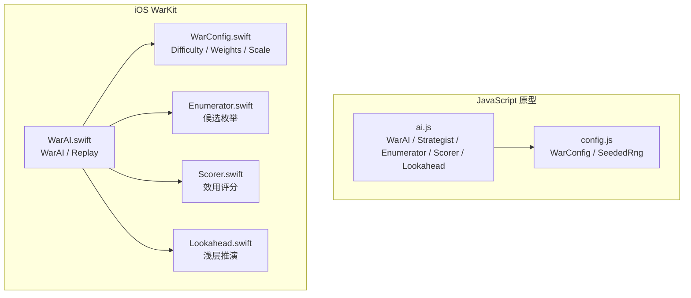

**图表来源**
- [ai.js:1-648](file://war/war/ai.js#L1-L648)
- [config.js:1-146](file://war/war/config.js#L1-L146)
- [WarAI.swift:1-233](file://war/ios/WarKit/Sources/WarKit/WarAI.swift#L1-L233)
- [WarConfig.swift:1-576](file://war/ios/WarKit/Sources/WarKit/WarConfig.swift#L1-L576)
- [Enumerator.swift:1-126](file://war/ios/WarKit/Sources/WarKit/Enumerator.swift#L1-L126)
- [Scorer.swift:1-268](file://war/ios/WarKit/Sources/WarKit/Scorer.swift#L1-L268)
- [Lookahead.swift:1-168](file://war/ios/WarKit/Sources/WarKit/Lookahead.swift#L1-L168)

**章节来源**
- [ai.js:1-648](file://war/war/ai.js#L1-L648)
- [config.js:1-146](file://war/war/config.js#L1-L146)
- [WarAI.swift:1-233](file://war/ios/WarKit/Sources/WarKit/WarAI.swift#L1-L233)
- [WarConfig.swift:1-576](file://war/ios/WarKit/Sources/WarKit/WarConfig.swift#L1-L576)

## 核心组件
本节概述各组件的职责与公共接口，便于读者快速定位后续详细分析。

- WarAI（编排层）
  - JavaScript：构造时接收 battlefield、camp、opts；提供 executeTurn、decide、setDifficulty、setSeed、getInfo 等方法。
  - iOS：构造时接收 Battlefield；提供 decideCandidates、sampleChoice、executeTurn 重载、Replay.apply。

- Strategist（战略层，JS）
  - 评估当前物质差、兵种对比、最脆单位，产出 strategy、objective、focusId、note 等。

- Enumerator（候选枚举）
  - JS：对每个单位生成 attack/moveAttack/move/wait 候选，考虑可见敌人、可达域、射程。
  - iOS：扩展支持首领施法候选，限制候选数量上限，过滤自杀式攻击。

- Scorer（效用评分）
  - JS：统一量纲分项（伤害、击杀、浪费、暴露、地形、机动力、协同、目标牵引等），输出 parts 与 score。
  - iOS：更细化的分项（含 selfPreserve、rangePenalty、engage、proximity、chiefBounty、heal、freeze、suicide、chiefPeril），并提供 isSuicidalAttack 判定。

- Lookahead（浅层前瞻）
  - JS：对 top-K 候选做 1~2 ply 模拟，用局势评估修正分数。
  - iOS：固定 topK=4，valueWeight=60，winValue=100，使用贪心 rollout 策略。

- 配置与随机性
  - JS：WarConfig.difficulty 提供 temperature、lookahead、vision、noise、sampleEnemies；SeededRng 提供确定性随机。
  - iOS：WarConfig.Difficulty 提供 temperature、lookahead、vision、noise、budget、spellLevel；Weights 与 Scale 集中定义评分权重与归一化标尺。

**章节来源**
- [ai.js:15-648](file://war/war/ai.js#L15-L648)
- [config.js:12-146](file://war/war/config.js#L12-L146)
- [WarAI.swift:11-233](file://war/ios/WarKit/Sources/WarKit/WarAI.swift#L11-L233)
- [WarConfig.swift:5-576](file://war/ios/WarKit/Sources/WarKit/WarConfig.swift#L5-L576)
- [Enumerator.swift:9-126](file://war/ios/WarKit/Sources/WarKit/Enumerator.swift#L9-L126)
- [Scorer.swift:11-268](file://war/ios/WarKit/Sources/WarKit/Scorer.swift#L11-L268)
- [Lookahead.swift:9-168](file://war/ios/WarKit/Sources/WarKit/Lookahead.swift#L9-L168)

## 架构总览
AI 决策采用分层架构：
- 战略层（Strategist）决定本轮整体意图（进攻/防守/包抄/撤退），产出 objective 与 focusId。
- 候选层（Enumerator）将“落点 × 动作”摊开，避免“先打谁再找位置”的贪心缺陷。
- 评分层（Scorer）对所有候选同源同量纲打分，附带 parts breakdown。
- 前瞻层（Lookahead）只对 top-K 候选做浅层推演，修正分数。
- 编排层（WarAI）串联上述步骤，softmax 采样后真实推进战场状态，并产出可重放事件序列。

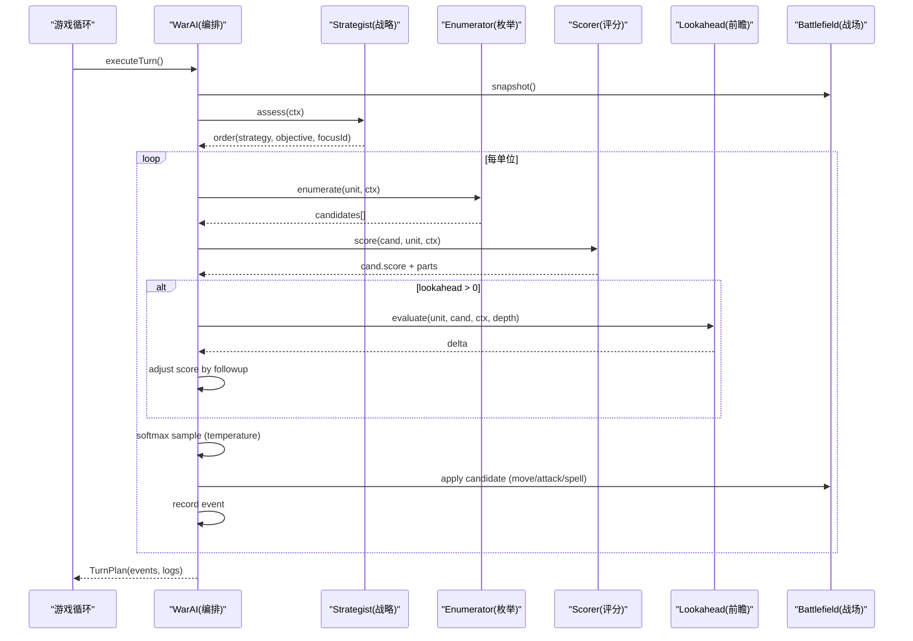

**图表来源**
- [ai.js:421-628](file://war/war/ai.js#L421-L628)
- [WarAI.swift:64-187](file://war/ios/WarKit/Sources/WarKit/WarAI.swift#L64-L187)

**章节来源**
- [ai.js:421-628](file://war/war/ai.js#L421-L628)
- [WarAI.swift:64-187](file://war/ios/WarKit/Sources/WarKit/WarAI.swift#L64-L187)

## 详细组件分析

### WarAI（主控制器）
- JavaScript 接口
  - 构造函数：constructor(battlefield, camp, opts = {})
    - battlefield：战场对象
    - camp：阵营编号
    - opts.difficulty：难度键（如 'normal'）
    - opts.seed：随机种子（默认 12345）
    - opts.debug：是否记录调试日志（默认 true）
  - setDifficulty(d)：设置难度键
  - setSeed(seed)：设置随机种子并重建 SeededRng
  - executeTurn()：执行整场回合，返回 plan（含 events、snapshot、order、decisions）
  - decide(unit, ctx)：单单位决策，返回 Candidate
  - getInfo()：返回 camp、difficulty、cfg、seed、unitCount

- iOS 接口
  - 构造函数：init(bf: Battlefield)
  - decideCandidates(ctx, unit)：返回按分数降序的候选列表
  - sampleChoice(ranked, temperature, rng)：softmax 采样，公开用于回归测试
  - executeTurn(camp, difficulty, seed)：执行整场回合，返回 TurnPlan
  - executeTurn(camp, difficultyKey, seed)：以字符串难度键调用
  - Replay.apply(bf, event)：逐事件重放，保证动画与决策一致

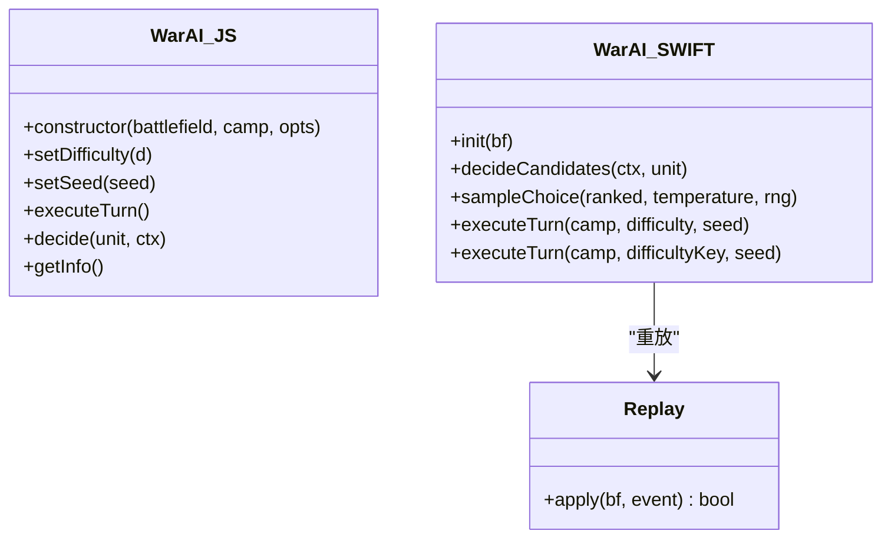

**图表来源**
- [ai.js:421-628](file://war/war/ai.js#L421-L628)
- [WarAI.swift:11-233](file://war/ios/WarKit/Sources/WarKit/WarAI.swift#L11-L233)

**章节来源**
- [ai.js:421-628](file://war/war/ai.js#L421-L628)
- [WarAI.swift:11-233](file://war/ios/WarKit/Sources/WarKit/WarAI.swift#L11-L233)

### Strategist（战略规划层，JS）
- 职责：根据双方兵力、血量、兵种构成判断策略（rush/attack/flank/defend/retreat），并确定 objective 与 focusId。
- 关键方法：assess(ctx) → {score, strategy, objective, focusId, weakestId, note}
- 影响：为 Scorer 的 objective 项提供牵引方向；为集火逻辑提供 focusId。

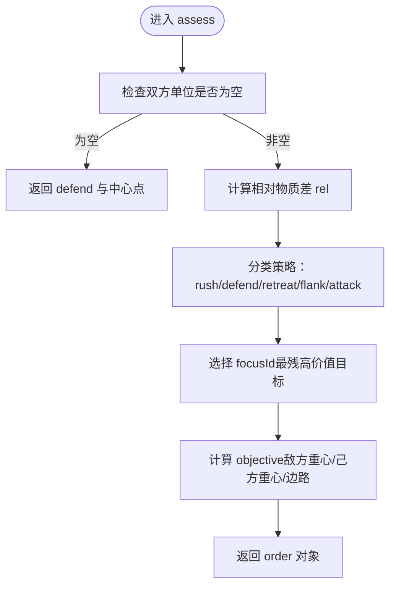

**图表来源**
- [ai.js:44-124](file://war/war/ai.js#L44-L124)

**章节来源**
- [ai.js:44-124](file://war/war/ai.js#L44-L124)

### Enumerator（候选动作枚举器）
- JS 接口
  - enumerate(unit, ctx) → Candidate[]
  - 候选类型：attack、moveAttack、move、wait
  - 考虑可见敌人、可达域、射程、反击预估、移动成本
- iOS 接口
  - static enumerate(ctx, unit) → [Candidate]
  - 支持首领施法候选（原地施法），限制 maxCandidatesPerUnit=120
  - 过滤自杀式攻击（isSuicidalAttack）

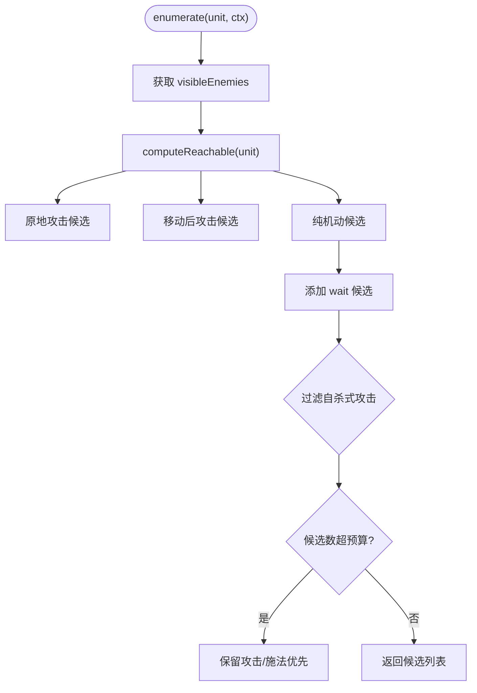

**图表来源**
- [ai.js:159-221](file://war/war/ai.js#L159-L221)
- [Enumerator.swift:14-104](file://war/ios/WarKit/Sources/WarKit/Enumerator.swift#L14-L104)

**章节来源**
- [ai.js:159-221](file://war/war/ai.js#L159-L221)
- [Enumerator.swift:14-104](file://war/ios/WarKit/Sources/WarKit/Enumerator.swift#L14-L104)

### Scorer（效用评分器）
- JS 接口
  - score(cand, unit, ctx) → Candidate（填充 parts 与 score）
  - 分项：damage、kill、overkill、targetValue、exposure、terrain、mobility、surround、objective、support、waste、counter、focus
- iOS 接口
  - static score(ctx, input) → Candidate
  - 更细分项：selfPreserve、rangePenalty、engage、proximity、chiefBounty、heal、freeze、suicide、chiefPeril
  - static isSuicidalAttack(ctx, candidate) → Bool

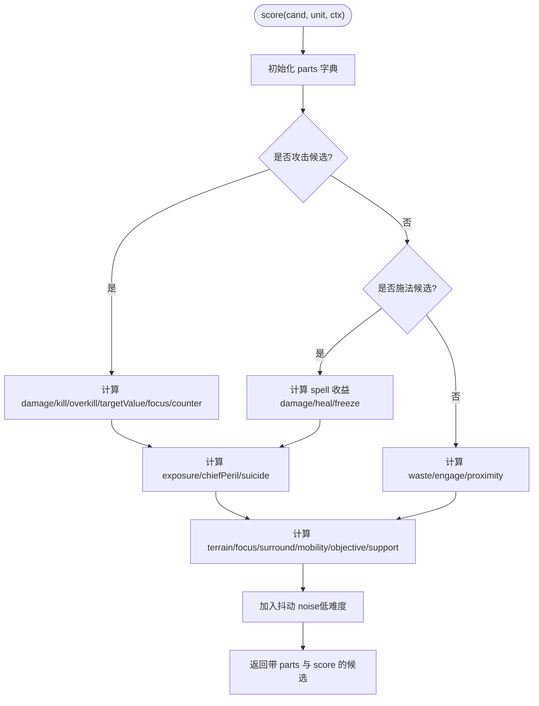

**图表来源**
- [ai.js:224-335](file://war/war/ai.js#L224-L335)
- [Scorer.swift:57-257](file://war/ios/WarKit/Sources/WarKit/Scorer.swift#L57-L257)

**章节来源**
- [ai.js:224-335](file://war/war/ai.js#L224-L335)
- [Scorer.swift:57-257](file://war/ios/WarKit/Sources/WarKit/Scorer.swift#L57-L257)

### Lookahead（浅层前瞻推演器）
- JS 接口
  - constructor(bf)
  - evaluate(unit, cand, ctx, depth) → number（局势增减）
  - _greedyTurn(camp)：快棋手策略，用于 rollout
- iOS 接口
  - init(bf, ctx)
  - evaluate(candidates, depth) → [Candidate]（调整 top-K 候选分数）
  - 常量：topK=4、valueWeight=60、winValue=100

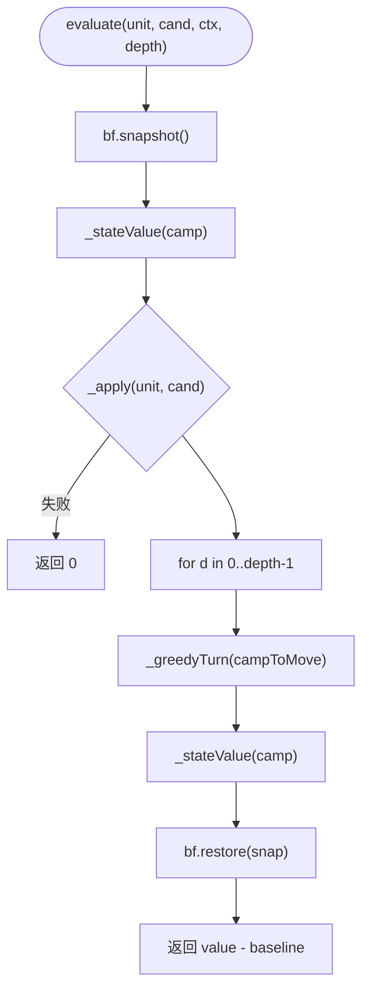

**图表来源**
- [ai.js:341-418](file://war/war/ai.js#L341-L418)
- [Lookahead.swift:26-61](file://war/ios/WarKit/Sources/WarKit/Lookahead.swift#L26-L61)

**章节来源**
- [ai.js:341-418](file://war/war/ai.js#L341-L418)
- [Lookahead.swift:26-61](file://war/ios/WarKit/Sources/WarKit/Lookahead.swift#L26-L61)

### 配置与难度旋钮
- JS 配置（config.js）
  - board.width/height：棋盘尺寸
  - terrain：地形属性（平原/森林/山地/河流/岩壁）
  - unitTypes：兵种属性（步兵/骑兵/弓兵）
  - difficulty：easy/normal/hard/nightmare，含 temperature、lookahead、vision、noise、sampleEnemies
  - weights：评分权重（damage、kill、overkill、targetValue、exposure、terrain、focus、counter、mobility、objective、support、waste、followup）
  - scale：归一化标尺（damageRef、threatRef、moveBudgetRef、terrainDefRef、supportRadius、objectiveDecay）
  - deployment：maxPerSide、maxTurns
  - defaultRoster：默认编成
  - SeededRng：确定性随机数生成器

- iOS 配置（WarConfig.swift）
  - BoardSize：棋盘尺寸（10×10、14×14、18×18）
  - Terrain：地形属性（plain/forest/hill/water/wall）
  - UnitStat：兵种属性（infantry/cavalry/archer/commander 及转职分支）
  - Upgrades：三线升级（atk/def/hp）
  - Spells：魔法（fireball/heal/freeze）
  - Difficulty：key/name/temperature/lookahead/vision/noise/budget/spellLevel
  - Weights：更细化的评分权重
  - Scale：归一化标尺（damageRef、threatSaturation、moveBudgetRef、maxDefBonus、exposureDecay、objectiveGain、supportHpThreshold、surroundUnit、maxNoise、valueRef）

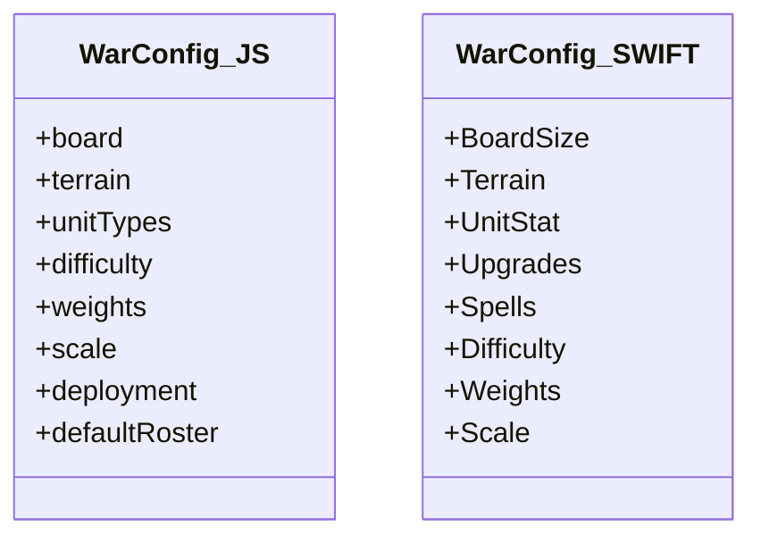

**图表来源**
- [config.js:12-146](file://war/war/config.js#L12-L146)
- [WarConfig.swift:5-576](file://war/ios/WarKit/Sources/WarKit/WarConfig.swift#L5-L576)

**章节来源**
- [config.js:12-146](file://war/war/config.js#L12-L146)
- [WarConfig.swift:5-576](file://war/ios/WarKit/Sources/WarKit/WarConfig.swift#L5-L576)

## 依赖关系分析
- WarAI 依赖：
  - JS：Strategist、Enumerator、Scorer、Lookahead、AiContext、Candidate、WarConfig、SeededRng
  - iOS：Enumerator、Scorer、Lookahead、WarConfig、Battlefield、AiContext、Candidate、WarUnit、Grid、ProcessInfo
- 外部依赖：
  - JS：Battlefield（战场）、Unit（单位）、SeededRng（随机）
  - iOS：Battlefield（战场）、WarUnit（单位）、Grid（网格工具）、ProcessInfo（性能计时）

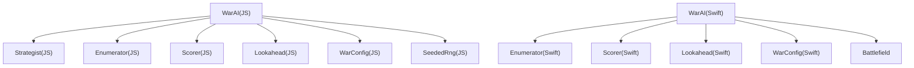

**图表来源**
- [ai.js:15-648](file://war/war/ai.js#L15-L648)
- [WarAI.swift:11-233](file://war/ios/WarKit/Sources/WarKit/WarAI.swift#L11-L233)

**章节来源**
- [ai.js:15-648](file://war/war/ai.js#L15-L648)
- [WarAI.swift:11-233](file://war/ios/WarKit/Sources/WarKit/WarAI.swift#L11-L233)

## 性能与复杂度
- 候选数量
  - JS：无硬上限，但受可见敌人、可达域、射程限制
  - iOS：maxCandidatesPerUnit=120，超预算时优先保留攻击/施法候选
- 评分开销
  - 每个候选一次 Scorer.score，iOS 版本分项更多但仍在百量级候选内可控
- 前瞻开销
  - JS：对 top-K（≤4）候选进行 1~2 ply 推演
  - iOS：固定 topK=4，valueWeight=60，winValue=100，贪心 rollout
- 随机性与复现
  - JS：SeededRng 提供确定性随机
  - iOS：通过 seed 控制采样与前瞻随机序列

[本节为通用性能讨论，不直接分析具体代码行]

## 集成示例与高级用法

### JavaScript 集成示例
- 基本用法
  - 创建 WarAI：new WarAI(battlefield, camp, { difficulty: 'normal', seed: 12345 })
  - 执行回合：plan = warAI.executeTurn()
  - 获取信息：info = warAI.getInfo()
- 异步决策处理
  - 可在游戏循环中分帧调用 decide(unit, ctx)，逐步构建候选列表
- 错误恢复
  - 若 bf.moveAlongPath 或 bf.attack 返回 rejected，跳过该候选并记录 reason
- 性能监控
  - 启用 debug=true，ctx.log 中包含 ms、candidates、top、chosen、chosenScore

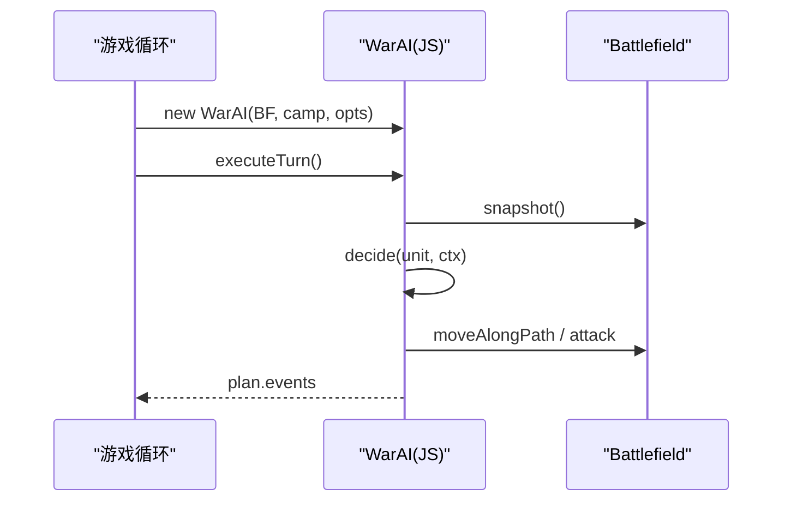

**图表来源**
- [ai.js:421-628](file://war/war/ai.js#L421-L628)

**章节来源**
- [ai.js:421-628](file://war/war/ai.js#L421-L628)

### iOS 集成示例
- 基本用法
  - 创建 WarAI：let warAI = WarAI(bf: battlefield)
  - 执行回合：let plan = warAI.executeTurn(camp: camp, difficultyKey: "normal", seed: 12345)
  - 重放事件：Replay.apply(bf, event)
- 异步决策处理
  - 使用 decideCandidates(ctx, unit) 获取候选列表，结合 sampleChoice 进行 softmax 采样
- 错误恢复
  - 过滤失效候选（目标已被友军击杀）后再采样
- 性能监控
  - TurnPlan.elapsedMs 提供回合耗时

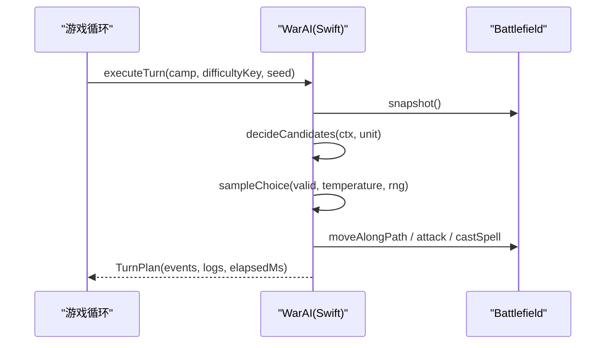

**图表来源**
- [WarAI.swift:64-187](file://war/ios/WarKit/Sources/WarKit/WarAI.swift#L64-L187)

**章节来源**
- [WarAI.swift:64-187](file://war/ios/WarKit/Sources/WarKit/WarAI.swift#L64-L187)

## 故障排查
- 候选为空
  - JS：若 enumerator.enumerate 返回空数组，decide 返回 null
  - iOS：若 survivable 过滤后为空，保留 wait 候选作为兜底
- 目标消失
  - JS：_applyCandidate 中 target_gone 原因返回
  - iOS：在执行前过滤掉目标已死的候选
- 移动失败
  - JS：bf.moveAlongPath 返回 ok=false，记录 reason
  - iOS：bf.moveAlongPath.success 为 false，跳过移动事件
- 攻击被拒绝
  - JS：bf.attack.rejected 存在，记录 rejected 原因
  - iOS：bf.attack 返回 result.damage=0，视为无效攻击
- 重放不一致
  - JS：replayEvent 需与 AI 内部执行使用同一套 Battlefield 方法
  - iOS：Replay.apply 与 AI 内部调用的 Battlefield 方法完全一致

**章节来源**
- [ai.js:593-617](file://war/war/ai.js#L593-L617)
- [WarAI.swift:205-232](file://war/ios/WarKit/Sources/WarKit/WarAI.swift#L205-L232)

## 结论
本 API 文档系统化梳理了 WAR 项目的 AI 决策系统，涵盖 JavaScript 原型与 iOS WarKit 两套实现。通过分层架构（Strategist/Enumerator/Scorer/Lookahead）与正交难度旋钮（temperature/lookahead/vision），AI 在不同难度下表现出稳定且可调节的智能水平。集成时建议：
- 使用确定性随机（SeededRng/seed）确保决策可复现
- 利用 debug/logs 监控决策过程与性能
- 通过 Replay 保证动画与决策的一致性
- 根据平台特性调整候选数量与前瞻深度

[本节为总结性内容，不直接分析具体代码行]