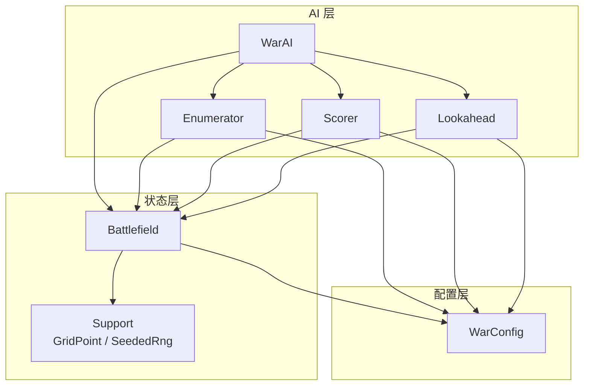
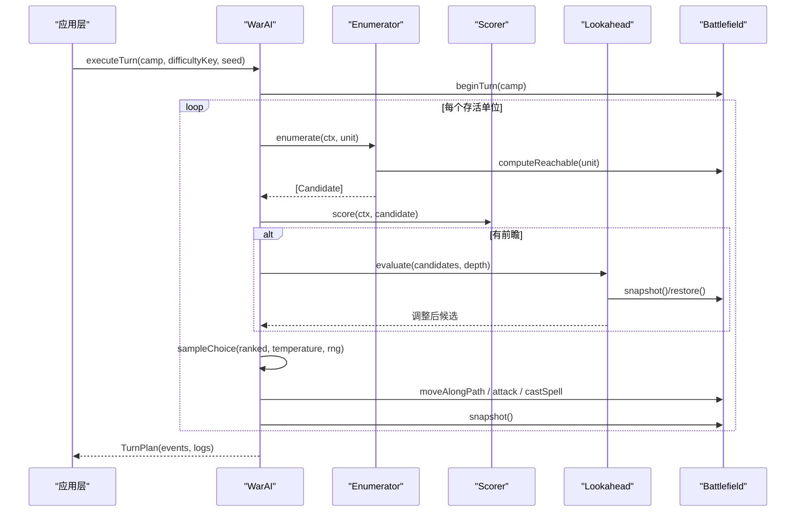
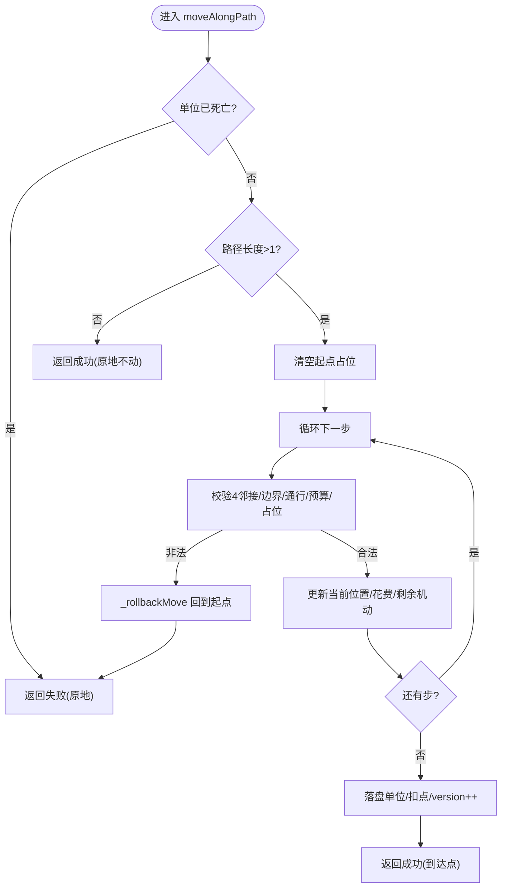
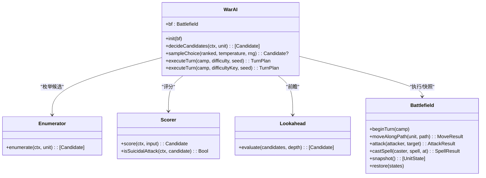
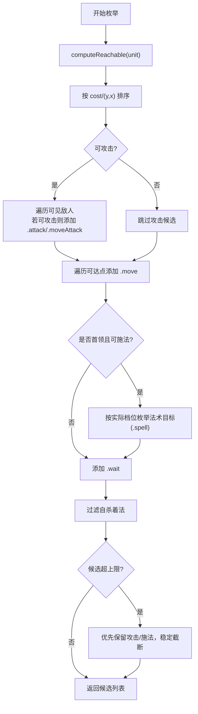
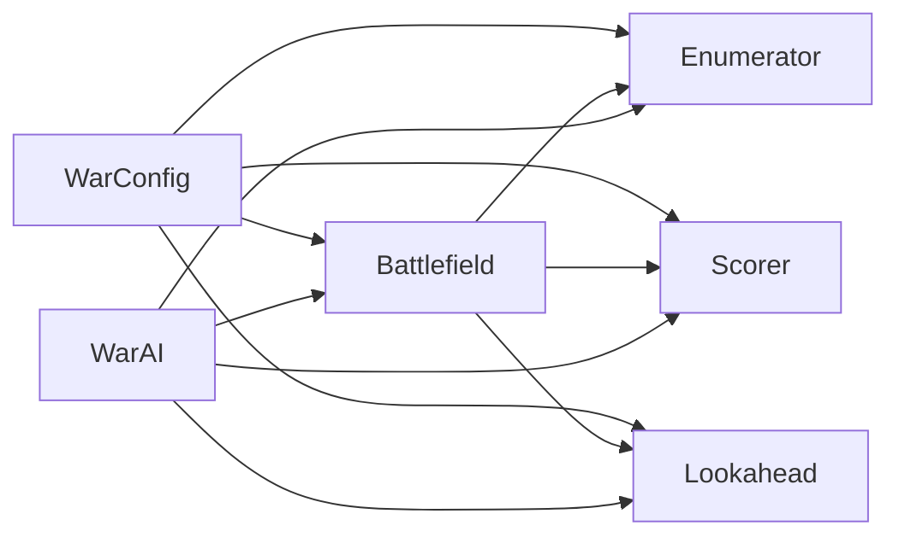

# API 参考文档

<cite>
**本文引用的文件**   
- [WarConfig.swift](file://war/ios/WarKit/Sources/WarKit/WarConfig.swift)
- [Battlefield.swift](file://war/ios/WarKit/Sources/WarKit/Battlefield.swift)
- [WarAI.swift](file://war/ios/WarKit/Sources/WarKit/WarAI.swift)
- [Enumerator.swift](file://war/ios/WarKit/Sources/WarKit/Enumerator.swift)
- [Lookahead.swift](file://war/ios/WarKit/Sources/WarKit/Lookahead.swift)
- [Scorer.swift](file://war/ios/WarKit/Sources/WarKit/Scorer.swift)
- [Support.swift](file://war/ios/WarKit/Sources/WarKit/Support.swift)
</cite>

## 目录
1. [简介](#简介)
2. [项目结构](#项目结构)
3. [核心组件](#核心组件)
4. [架构总览](#架构总览)
5. [详细组件分析](#详细组件分析)
6. [依赖关系分析](#依赖关系分析)
7. [性能与复杂度](#性能与复杂度)
8. [使用示例与调用模式](#使用示例与调用模式)
9. [错误处理与排障](#错误处理与排障)
10. [版本与兼容性](#版本与兼容性)
11. [结论](#结论)

## 简介
本参考文档面向 WAR 项目的核心 API，覆盖以下公共接口与数据结构：
- WarConfig：全局规则、数值与难度配置。
- Battlefield：战场状态机，负责地形、单位、移动、攻击、施法、终局判定与快照回滚。
- WarAI：AI 决策编排层，包含候选枚举、评分、前瞻推演与回合执行。
- Unit（WarUnit）：单位实体操作接口（在 Battlefield 中通过方法暴露）。
- 辅助类型：GridPoint、SeededRng、ReachCell、MoveResult、AttackResult、SpellResult 等。

文档提供参数说明、返回值类型、关键流程与常见调用模式，并给出与源码对应的定位路径，便于同步维护。

## 项目结构
WARKit 是 iOS 侧的核心库，采用“配置 + 状态机 + AI”的分层组织：
- 配置层：WarConfig.swift 集中定义棋盘、地形、兵种、魔法、难度、权重与成长公式。
- 状态层：Battlefield.swift 实现战场状态机与所有可写操作。
- AI 层：WarAI.swift 编排决策；Enumerator.swift 生成候选；Scorer.swift 计算效用分；Lookahead.swift 做浅层前瞻。
- 支撑层：Support.swift 提供坐标、距离、邻居与确定性随机数。

图表来源
- [WarAI.swift:11-18](file://war/ios/WarKit/Sources/WarKit/WarAI.swift#L11-L18)
- [Enumerator.swift:9-14](file://war/ios/WarKit/Sources/WarKit/Enumerator.swift#L9-L14)
- [Scorer.swift:11-12](file://war/ios/WarKit/Sources/WarKit/Scorer.swift#L11-L12)
- [Lookahead.swift:9-23](file://war/ios/WarKit/Sources/WarKit/Lookahead.swift#L9-L23)
- [Battlefield.swift:54-64](file://war/ios/WarKit/Sources/WarKit/Battlefield.swift#L54-L64)
- [Support.swift:3-11](file://war/ios/WarKit/Sources/WarKit/Support.swift#L3-L11)

章节来源
- [WarConfig.swift:1-10](file://war/ios/WarKit/Sources/WarKit/WarConfig.swift#L1-L10)
- [Battlefield.swift:46-64](file://war/ios/WarKit/Sources/WarKit/Battlefield.swift#L46-L64)
- [WarAI.swift:1-16](file://war/ios/WarKit/Sources/WarKit/WarAI.swift#L1-L16)

## 核心组件
本节概述各公共接口的职责边界与对外能力。

- WarConfig
  - 作用：唯一权威的数据与规则入口，包括棋盘尺寸、地形、兵种、魔法、难度、权重、成长与关卡公式。
  - 典型成员：BoardSize、Terrain、UnitStat、Upgrades、UpgradeTrack、SpellStat、Difficulty、Weights、Scale、campaignLevel 等。
  - 设计要点：纯函数式取值（如 unitStat、spellStat），避免 UI 与内核两套口径。

- Battlefield
  - 作用：战场状态机，封装地形、单位、可达域、威胁图、移动/攻击/施法结算、终局判定、快照回滚与地图生成。
  - 关键不变式：
    - units 数组是唯一真实源，unitGrid 为派生索引；击杀只清格不删元素，保证快照对齐。
    - 所有可变状态的唯一写入点：moveAlongPath、attack、castSpell、promote、allocate、place/forcePlace/removeForPlacement。
    - 缓存带版本号，任何写操作 version++ 失效。

- WarAI
  - 作用：AI 编排层，将战略 → 候选枚举 → 评分 → 前瞻 → softmax 采样 → 执行串联起来。
  - 公开接口：decideCandidates、sampleChoice、executeTurn（含 difficultyKey 重载）、Replay.apply。

- Unit（WarUnit）
  - 作为 Battlefield 内部管理的实体，其操作通过 Battlefield 的 allocate/promote/place 等方法暴露给外部。
  - 属性与方法签名详见后续“详细组件分析”。

- 辅助类型
  - GridPoint：二维坐标。
  - SeededRng：确定性随机数，用于可复现的 AI 行为。
  - ReachCell：可达格（累计消耗 + 完整路径）。
  - MoveResult/AttackResult/SpellResult：动作结果。

章节来源
- [WarConfig.swift:5-10](file://war/ios/WarKit/Sources/WarKit/WarConfig.swift#L5-L10)
- [Battlefield.swift:46-64](file://war/ios/WarKit/Sources/WarKit/Battlefield.swift#L46-L64)
- [WarAI.swift:1-16](file://war/ios/WarKit/Sources/WarKit/WarAI.swift#L1-L16)
- [Support.swift:3-11](file://war/ios/WarKit/Sources/WarKit/Support.swift#L3-L11)

## 架构总览
下图展示一次 AI 回合从决策到执行的完整时序。

图表来源
- [WarAI.swift:64-187](file://war/ios/WarKit/Sources/WarKit/WarAI.swift#L64-L187)
- [Enumerator.swift:14-104](file://war/ios/WarKit/Sources/WarKit/Enumerator.swift#L14-L104)
- [Scorer.swift:57-257](file://war/ios/WarKit/Sources/WarKit/Scorer.swift#L57-L257)
- [Lookahead.swift:26-61](file://war/ios/WarKit/Sources/WarKit/Lookahead.swift#L26-L61)
- [Battlefield.swift:194-198](file://war/ios/WarKit/Sources/WarKit/Battlefield.swift#L194-L198)

## 详细组件分析

### WarConfig：全局配置接口
- 棋盘与部署
  - BoardSize：width、height。
  - boardSizes/defaultBoard：可选棋盘尺寸与默认值。
  - deployColumnCount：每方出生区列数。
- 地形 Terrain
  - key/name/symbol/moveCost/defBonus/impassable/colorRGB。
  - terrains/defaultTerrainKey/terrainOrder。
- 兵种 UnitStat
  - key/name/symbol/hp/atk/def/moveRange/attackRange/counterAttack/value/isChief/cost/promotable。
  - unitTypes/unitTypeOrder/chiefTypeKey。
- 升级 Upgrades 与 UpgradeTrack
  - atk/def/hp 三条独立等级线；level/bump/lower/isBase。
  - upgradeCost(typeKey, currentLevel)、unitStat(typeKey, upgrades)。
- 魔法 SpellStat
  - effect(damage/heal/stun)/range/power/splash/splashRadius/unlockCost/chargeCost。
  - spells/spellOrder/maxSpellLevel/spellStat(key, level)/spellUpgradeCost(key, level)/maxSpellsPerTurn。
- 回合与规模
  - maxAttacksPerTurn/soldiersPerSide/maxUnitsPerSide/maxTurns。
- 难度 Difficulty
  - key/name/temperature/lookahead/vision/noise/budget/spellLevel。
  - difficulties/difficultyOrder/defaultDifficultyKey。
- 闯关 LevelSpec 与 campaignLevel(n)
  - 由关数导出难度键、敌军升级、地形/AI seed、首领魔法等级。
- 评分权重 Weights 与 Scale
  - 归一化分项与参考标尺，统一 AI 评分口径。

常用方法与返回类型
- unitStat(typeKey, upgrades) -> UnitStat?
- spellStat(key, level) -> SpellStat?
- upgradeCost(typeKey, currentLevel) -> Int
- spellUpgradeCost(key, level) -> Int
- campaignLevel(n) -> LevelSpec

章节来源
- [WarConfig.swift:9-27](file://war/ios/WarKit/Sources/WarKit/WarConfig.swift#L9-L27)
- [WarConfig.swift:31-68](file://war/ios/WarKit/Sources/WarKit/WarConfig.swift#L31-L68)
- [WarConfig.swift:72-166](file://war/ios/WarKit/Sources/WarKit/WarConfig.swift#L72-L166)
- [WarConfig.swift:176-248](file://war/ios/WarKit/Sources/WarKit/WarConfig.swift#L176-L248)
- [WarConfig.swift:259-339](file://war/ios/WarKit/Sources/WarKit/WarConfig.swift#L259-L339)
- [WarConfig.swift:341-350](file://war/ios/WarKit/Sources/WarKit/WarConfig.swift#L341-L350)
- [WarConfig.swift:354-391](file://war/ios/WarKit/Sources/WarKit/WarConfig.swift#L354-L391)
- [WarConfig.swift:398-432](file://war/ios/WarKit/Sources/WarKit/WarConfig.swift#L398-L432)
- [WarConfig.swift:436-574](file://war/ios/WarKit/Sources/WarKit/WarConfig.swift#L436-L574)

### Battlefield：战场状态管理接口
- 构造与基础查询
  - init(width, height, terrain, units)
  - isInside(x,y)/isPassable/getTerrain/getMoveCost/isCellAvailable/hasUnitAt/getUnitAt/findUnitById
  - unitsOfCamp/unitsOfCampExcludingChief/chief/isChiefLost/campOf
- 视线与攻击判定
  - hasLineOfSight(from,to)/canAttackFrom/canAttackWithLineOfSight
- 可达域与威胁图
  - computeReachable/reachableWithBudget/buildThreatMap/threatAt
- 移动结算
  - moveAlongPath(unit, path) -> MoveResult
- 攻击结算
  - attack(attacker, target) -> AttackResult
- 成长与转职
  - allocate(unit, track) -> Bool
  - promote(unit, to branchKey) -> Bool
- 施法结算
  - castSpell(caster, spell, at target) -> SpellResult
- 布阵与放置
  - place(forcePlace/removeForPlacement)
- 评估与终局
  - centerOfMass/materialScore/matchOutcome(forTurnOf)/materialWinner
- 快照与回滚
  - snapshot()/restore(states)
- 地图生成与默认布局
  - generateTerrain(width,height,seed)/findSpawnSpot/setDefaultLayout/placeArmy

关键方法签名与语义
- moveAlongPath(unit, path) -> MoveResult
  - 逐格校验 4 邻接、占位、地形消耗；失败回滚起点；成功扣减 remainingMove。
- attack(attacker, target) -> AttackResult
  - 校验射程/视线/行动配额；结算伤害、反击、经验、击杀清位。
- castSpell(caster, spell, at) -> SpellResult
  - 校验首领/携带/充能/射程/视线/目标阵营；固定值伤害或治疗/冰冻；记录 affected/killed。
- setDefaultLayout(difficultyKey?, camp?, autoGrows?) -> Bool
  - 按 ArmyComposer 计划落位士兵与首领，首领携带魔法档位与充能。

图表来源
- [Battlefield.swift:332-381](file://war/ios/WarKit/Sources/WarKit/Battlefield.swift#L332-L381)

章节来源
- [Battlefield.swift:65-96](file://war/ios/WarKit/Sources/WarKit/Battlefield.swift#L65-L96)
- [Battlefield.swift:98-173](file://war/ios/WarKit/Sources/WarKit/Battlefield.swift#L98-L173)
- [Battlefield.swift:210-240](file://war/ios/WarKit/Sources/WarKit/Battlefield.swift#L210-L240)
- [Battlefield.swift:242-325](file://war/ios/WarKit/Sources/WarKit/Battlefield.swift#L242-L325)
- [Battlefield.swift:327-388](file://war/ios/WarKit/Sources/WarKit/Battlefield.swift#L327-L388)
- [Battlefield.swift:390-442](file://war/ios/WarKit/Sources/WarKit/Battlefield.swift#L390-L442)
- [Battlefield.swift:444-480](file://war/ios/WarKit/Sources/WarKit/Battlefield.swift#L444-L480)
- [Battlefield.swift:482-570](file://war/ios/WarKit/Sources/WarKit/Battlefield.swift#L482-L570)
- [Battlefield.swift:572-607](file://war/ios/WarKit/Sources/WarKit/Battlefield.swift#L572-L607)
- [Battlefield.swift:609-676](file://war/ios/WarKit/Sources/WarKit/Battlefield.swift#L609-L676)
- [Battlefield.swift:678-690](file://war/ios/WarKit/Sources/WarKit/Battlefield.swift#L678-L690)
- [Battlefield.swift:692-753](file://war/ios/WarKit/Sources/WarKit/Battlefield.swift#L692-L753)
- [Battlefield.swift:755-809](file://war/ios/WarKit/Sources/WarKit/Battlefield.swift#L755-L809)

### WarAI：决策接口
- decideCandidates(ctx, unit) -> [Candidate]
  - 枚举候选 → 评分 → 可选前瞻调整 → 排序。
- sampleChoice(ranked, temperature, rng) -> Candidate?
  - 对 top-K 候选做 softmax 采样，temperature 越大越随机。
- executeTurn(camp, difficulty, seed) -> TurnPlan
  - 准备回合 → 遍历单位 → 转职 → 决策 → 执行（移动/攻击/施法/待命）→ 产出事件与日志。
- executeTurn(camp, difficultyKey, seed) -> TurnPlan
  - 便捷重载，按 key 取难度。
- Replay.apply(bf, event) -> Bool
  - 渲染重放：将事件映射到 Battlefield 的真实方法，确保动画与决策一致。

图表来源
- [WarAI.swift:11-18](file://war/ios/WarKit/Sources/WarKit/WarAI.swift#L11-L18)
- [WarAI.swift:19-28](file://war/ios/WarKit/Sources/WarKit/WarAI.swift#L19-L28)
- [WarAI.swift:34-59](file://war/ios/WarKit/Sources/WarKit/WarAI.swift#L34-L59)
- [WarAI.swift:64-187](file://war/ios/WarKit/Sources/WarKit/WarAI.swift#L64-L187)
- [Enumerator.swift:14-104](file://war/ios/WarKit/Sources/WarKit/Enumerator.swift#L14-L104)
- [Scorer.swift:57-257](file://war/ios/WarKit/Sources/WarKit/Scorer.swift#L57-L257)
- [Lookahead.swift:26-61](file://war/ios/WarKit/Sources/WarKit/Lookahead.swift#L26-L61)

章节来源
- [WarAI.swift:11-28](file://war/ios/WarKit/Sources/WarKit/WarAI.swift#L11-L28)
- [WarAI.swift:34-59](file://war/ios/WarKit/Sources/WarKit/WarAI.swift#L34-L59)
- [WarAI.swift:64-187](file://war/ios/WarKit/Sources/WarKit/WarAI.swift#L64-L187)
- [WarAI.swift:205-232](file://war/ios/WarKit/Sources/WarKit/WarAI.swift#L205-L232)

### 枚举与评分：Enumerator 与 Scorer
- Enumerator.enumerate(ctx, unit)
  - 基于可达域外扩射程枚举“移动/攻击/移动+攻击/施法/待命”，去重、过滤自杀着法、限制候选上限。
- Scorer.score(ctx, candidate)
  - 将收益/浪费/风险/位置/战略等多维分项归一化到 [0,1]，乘以权重汇总，加入抖动。

图表来源
- [Enumerator.swift:14-104](file://war/ios/WarKit/Sources/WarKit/Enumerator.swift#L14-L104)

章节来源
- [Enumerator.swift:1-126](file://war/ios/WarKit/Sources/WarKit/Enumerator.swift#L1-L126)
- [Scorer.swift:1-268](file://war/ios/WarKit/Sources/WarKit/Scorer.swift#L1-L268)

### 辅助类型：Support
- GridPoint：x/y 坐标，Hashable/Sendable。
- Grid：manhattan 距离、neighbors4 四向邻居。
- SeededRng：确定性随机数，支持 next/int/bool/pick/shuffle。

章节来源
- [Support.swift:3-11](file://war/ios/WarKit/Sources/WarKit/Support.swift#L3-L11)
- [Support.swift:13-33](file://war/ios/WarKit/Sources/WarKit/Support.swift#L13-L33)
- [Support.swift:35-75](file://war/ios/WarKit/Sources/WarKit/Support.swift#L35-L75)

## 依赖关系分析
- 耦合关系
  - WarAI 强依赖 Battlefield 的状态变更与快照；同时依赖 Enumerator/Scorer/Lookahead 进行决策。
  - Enumerator/Scorer/Lookahead 均依赖 Battlefield 提供的可达域、威胁图、攻击判定与状态查询。
  - 所有模块共享 WarConfig 的单一数据源，避免口径分裂。
- 外部依赖
  - Foundation（Foundation 标准库）。
- 潜在环依赖
  - 当前代码无直接循环 import；AI 层单向依赖状态层与配置层。

图表来源
- [WarAI.swift:11-18](file://war/ios/WarKit/Sources/WarKit/WarAI.swift#L11-L18)
- [Enumerator.swift:14-104](file://war/ios/WarKit/Sources/WarKit/Enumerator.swift#L14-L104)
- [Scorer.swift:57-257](file://war/ios/WarKit/Sources/WarKit/Scorer.swift#L57-L257)
- [Lookahead.swift:26-61](file://war/ios/WarKit/Sources/WarKit/Lookahead.swift#L26-L61)
- [Battlefield.swift:242-325](file://war/ios/WarKit/Sources/WarKit/Battlefield.swift#L242-L325)

章节来源
- [WarAI.swift:11-18](file://war/ios/WarKit/Sources/WarKit/WarAI.swift#L11-L18)
- [Battlefield.swift:46-64](file://war/ios/WarKit/Sources/WarKit/Battlefield.swift#L46-L64)

## 性能与复杂度
- 可达域计算
  - 桶式 Dijkstra，时间复杂度 O(V+E)，V/E 受网格大小与预算限制；带版本与预算双缓存。
- 威胁图构建
  - 对每单位计算满机动可达域并对攻击半径累加，O(N·(可达格×半径²))，带版本缓存。
- 候选枚举
  - 单单位候选上限 120；攻击候选来自可达域外扩射程，避免呆板。
- 前瞻推演
  - 仅对 top-K=4 候选做 1~2 层 rollout，贪心策略推进，控制手机帧预算。
- 评分
  - 单项归一化后加权求和，常数项开销小；抖动幅度随温度线性变化。

[本节为通用性能讨论，不直接分析具体文件]

## 使用示例与调用模式

### 初始化战场与默认布局
- 步骤
  1) 创建 Battlefield，传入棋盘尺寸与地形。
  2) 调用 setDefaultLayout 设置双方默认编成（可传难度键以启用 AI 编队）。
  3) 如需指定某侧自动成长，设置 autoGrows。
- 关键点
  - 默认布局会放置士兵与首领，首领携带魔法档位与充能。
  - 未传难度键走基线编成，保证回归指纹稳定。

章节来源
- [Battlefield.swift:755-809](file://war/ios/WarKit/Sources/WarKit/Battlefield.swift#L755-L809)

### 执行一个 AI 回合
- 步骤
  1) 用 WarAI(bf) 创建 AI。
  2) 调用 executeTurn(camp, difficultyKey, seed) 获取 TurnPlan。
  3) 根据 events 序列驱动渲染或回放。
- 关键点
  - 同一 seed + 同一局面 ⇒ 完全相同的回合。
  - 决策日志 logs 可用于“为什么这么走”的面板。

章节来源
- [WarAI.swift:64-187](file://war/ios/WarKit/Sources/WarKit/WarAI.swift#L64-L187)

### 手动移动与攻击
- 移动
  - 先 computeReachable 获取可达域与路径，再 moveAlongPath。
  - 检查 MoveResult.success/message 判断是否成功或部分移动。
- 攻击
  - 使用 canAttackFrom/canAttackWithLineOfSight 预检，再调用 attack。
  - 读取 AttackResult.damage/counterDamage/targetKilled/counterKilled。

章节来源
- [Battlefield.swift:242-257](file://war/ios/WarKit/Sources/WarKit/Battlefield.swift#L242-L257)
- [Battlefield.swift:332-381](file://war/ios/WarKit/Sources/WarKit/Battlefield.swift#L332-L381)
- [Battlefield.swift:390-442](file://war/ios/WarKit/Sources/WarKit/Battlefield.swift#L390-L442)

### 施法
- 条件
  - 只有首领可施法；需携带该法术且有充能；目标在射程内且有视线；目标阵营符合效果要求。
- 结果
  - SpellResult.success/message/affected/impact/killed/stunnedTarget。
- 注意
  - 施法与普攻互斥；出手即结束本回合行动。

章节来源
- [Battlefield.swift:482-570](file://war/ios/WarKit/Sources/WarKit/Battlefield.swift#L482-L570)

### 成长与转职
- 分配属性点
  - allocate(unit, track) 校验有待分点数且未达等级上限。
- 转职
  - promote(unit, to branchKey) 校验等级、分支合法性与首领属性一致性；转职后发放 1 点属性点并提升等级上限。

章节来源
- [Battlefield.swift:444-480](file://war/ios/WarKit/Sources/WarKit/Battlefield.swift#L444-L480)

### 终局判定
- matchOutcome(forTurnOf camp)
  - 优先级：斩首 > 全灭；两败俱伤比物质分。
- materialWinner
  - 同分平局返回 -1。

章节来源
- [Battlefield.swift:630-676](file://war/ios/WarKit/Sources/WarKit/Battlefield.swift#L630-L676)

## 错误处理与排障
- 移动失败
  - 可能原因：单位死亡、非 4 邻接、出界、不可通行、预算不足、被占位。
  - 排查：检查 MoveResult.message 与 battlefield.getMoveCost/isPassable/isCellAvailable。
- 攻击无效
  - 可能原因：目标死亡/同阵营/超出射程/无视线/无攻击配额/被冻住。
  - 排查：使用 canAttackFrom/canAttackWithLineOfSight 预检。
- 施法失败
  - 可能原因：非首领、未携带、充能用尽、超射程、无视线、目标阵营不符、目标已满血/已被冻住。
  - 排查：查看 SpellResult.message。
- 转职失败
  - 可能原因：未满级、已转职、分支不属于该兵种、分支首领属性不一致。
  - 排查：确认 WarConfig.promotions 与 unit.isChief。
- 快照/回滚异常
  - 可能原因：states 数量与 units 不一致。
  - 排查：确保 restore 前 snapshot 未被污染。

章节来源
- [Battlefield.swift:332-381](file://war/ios/WarKit/Sources/WarKit/Battlefield.swift#L332-L381)
- [Battlefield.swift:390-442](file://war/ios/WarKit/Sources/WarKit/Battlefield.swift#L390-L442)
- [Battlefield.swift:482-570](file://war/ios/WarKit/Sources/WarKit/Battlefield.swift#L482-L570)
- [Battlefield.swift:678-690](file://war/ios/WarKit/Sources/WarKit/Battlefield.swift#L678-L690)

## 版本与兼容性
- 数据口径一致性
  - 所有数值与规则以 WarConfig 为准；UI 不得自行乘系数。
- 可复现性
  - SeededRng 保证 softmax 与前瞻可复现；同一 seed + 局面 = 相同回合。
- 难度调参
  - 通过 Temperature/Lookahead/Vision/Budget/SpellLevel 五个旋钮调节，不改算法逻辑。
- 回归基准
  - 默认布局与基线编成（difficultyKey=nil）用于回归测试，不应漂移。

章节来源
- [WarConfig.swift:354-391](file://war/ios/WarKit/Sources/WarKit/WarConfig.swift#L354-L391)
- [Support.swift:35-75](file://war/ios/WarKit/Sources/WarKit/Support.swift#L35-L75)
- [Battlefield.swift:755-771](file://war/ios/WarKit/Sources/WarKit/Battlefield.swift#L755-L771)

## 结论
WARKit 通过 WarConfig 统一数据口径，Battlefield 严格约束状态变更入口，WarAI 以枚举-评分-前瞻-采样的流水线完成决策，配合 Support 的基础工具类型，形成清晰、可复现、可重放的战棋内核。API 设计强调“唯一真相源”与“确定性与可回放”，便于 UI 与 AI 共用同一套规则，降低维护成本与回归风险。