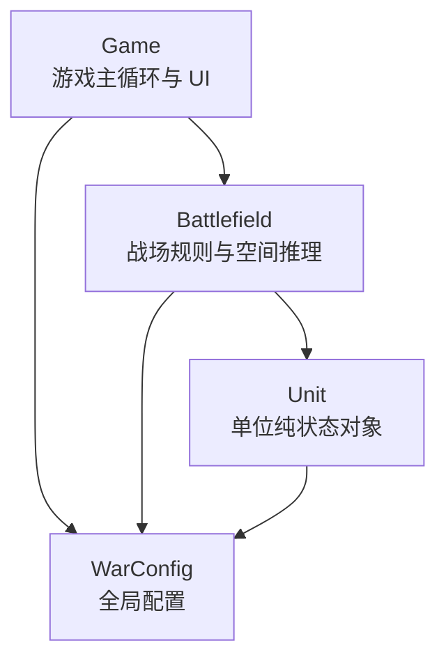
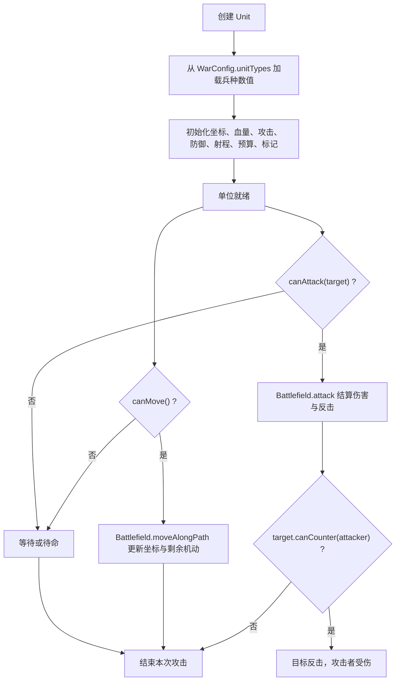
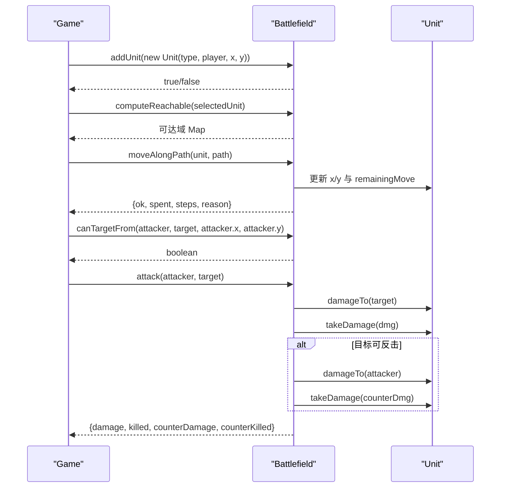
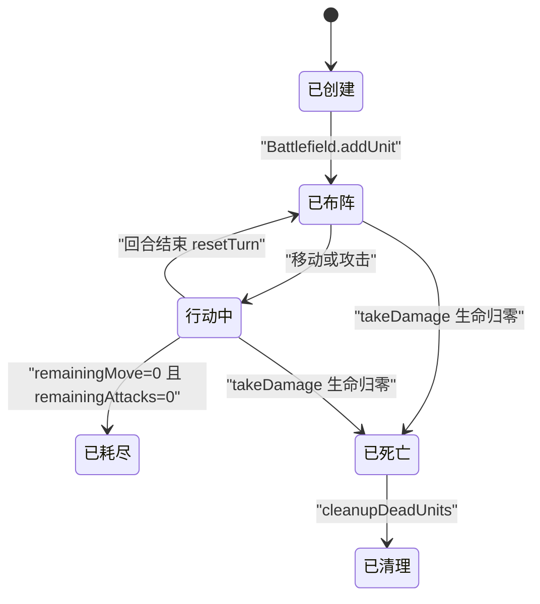
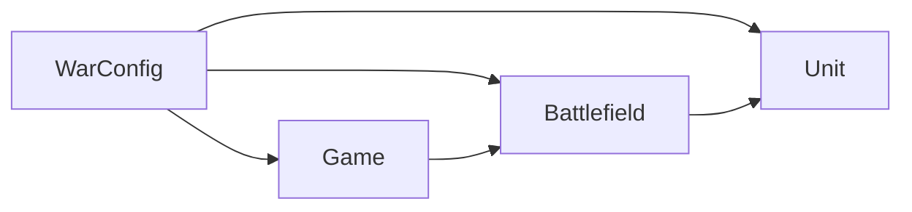

# 单位 API

<cite>
**本文引用的文件**   
- [item.js](file://war/war/item.js)
- [field.js](file://war/war/field.js)
- [config.js](file://war/war/config.js)
- [game.js](file://war/war/game.js)
</cite>

## 目录
1. [引言](#引言)
2. [项目结构](#项目结构)
3. [核心组件](#核心组件)
4. [架构总览](#架构总览)
5. [详细组件分析](#详细组件分析)
6. [依赖关系分析](#依赖关系分析)
7. [性能与复杂度](#性能与复杂度)
8. [使用示例与调用模式](#使用示例与调用模式)
9. [错误处理与排错指南](#错误处理与排错指南)
10. [结论](#结论)

## 引言
本文件为 WAR 项目中“单位”系统的完整 API 文档，聚焦于 `Unit` 类的设计、属性、方法、生命周期以及与战场 `Battlefield` 的交互。文档同时说明：
- 单位的创建、移动、攻击、反击等操作的接口契约；
- 单位状态查询方法（是否可移动、是否可攻击、伤害计算等）；
- 单位与战场的坐标更新、占位同步、回合重置等机制；
- 常见调用模式与错误处理方式；
- 与配置项 `WarConfig.unitTypes` 的关系，确保与 `item.js` 实现保持同步。

## 项目结构
WAR 项目的单位系统由以下关键文件组成：
- `item.js`：定义纯状态对象 `Unit`，封装单位的基础属性、配额、伤害计算、序列化等能力；
- `field.js`：定义 `Battlefield`，负责地形、单位占位、移动、攻击、可达域、威胁影响图、快照回滚等规则；
- `config.js`：集中定义棋盘尺寸、地形参数、兵种模板、难度旋钮、评分权重等全局配置；
- `game.js`：游戏主循环、UI 事件、AI 回合播放、渲染与状态展示。

**图表来源**
- [game.js:12-42](file://war/war/game.js#L12-L42)
- [field.js:11-32](file://war/war/field.js#L11-L32)
- [item.js:12-44](file://war/war/item.js#L12-L44)
- [config.js:12-103](file://war/war/config.js#L12-L103)

**章节来源**
- [game.js:12-42](file://war/war/game.js#L12-L42)
- [field.js:11-32](file://war/war/field.js#L11-L32)
- [item.js:12-44](file://war/war/item.js#L12-L44)
- [config.js:12-103](file://war/war/config.js#L12-L103)

## 核心组件
本节聚焦 `Unit` 类的构造、属性与方法，并说明其与 `WarConfig.unitTypes` 的绑定关系。

### 构造函数与参数
`Unit` 的构造函数签名如下：
- `constructor(type, player, x, y, id = null)`
  - `type`：兵种类型键名，必须存在于 `WarConfig.unitTypes`；
  - `player`：所属阵营，取值为 `1` 或 `2`；
  - `x, y`：初始坐标；
  - `id`：可选单位标识，未提供时由战场分配递增 ID。

构造过程会从 `WarConfig.unitTypes[type]` 读取基础数值，并初始化：
- 基础属性：`maxHealth`、`health`、`attack`、`defense`、`attackRange`；
- 行动预算：`moveBudget`、`attackBudget`；
- 行为特性：`counterAttack`、`aiValue`、`symbol`、`name`；
- 本回合剩余配额：`remainingMove`、`remainingAttacks`；
- 状态标记：`isDead`、`hasCountered`。

若传入的 `type` 不存在，将抛出错误。

**章节来源**
- [item.js:12-44](file://war/war/item.js#L12-L44)
- [config.js:33-55](file://war/war/config.js#L33-L55)

### 核心属性
| 属性 | 含义 | 备注 |
|---|---|---|
| `id` | 单位唯一标识 | 由战场分配或外部传入 |
| `type` | 兵种类型键名 | 对应 `WarConfig.unitTypes` |
| `player` | 所属阵营 | `1` 或 `2` |
| `x, y` | 当前坐标 | 由战场在移动时更新 |
| `maxHealth` | 最大生命值 | 从兵种模板读取 |
| `health` | 当前生命值 | 受击后减少，归零即死亡 |
| `attack` | 攻击力 | 从兵种模板读取 |
| `defense` | 防御力 | 从兵种模板读取 |
| `attackRange` | 攻击射程 | 从兵种模板读取 |
| `moveBudget` | 每回合机动点上限 | 从兵种模板读取 |
| `attackBudget` | 每回合攻击次数上限 | 从兵种模板读取 |
| `counterAttack` | 是否具备反击能力 | 近战兵种通常为真 |
| `aiValue` | AI 目标价值基线 | 用于评估与排序 |
| `symbol` | 显示符号 | 用于 UI 渲染 |
| `name` | 兵种名称 | 用于显示 |
| `remainingMove` | 本回合剩余机动点 | 移动消耗 |
| `remainingAttacks` | 本回合剩余攻击次数 | 攻击消耗 |
| `isDead` | 是否已死亡 | 生命归零后置真 |
| `hasCountered` | 本回合是否已反击 | 反击只允许一次 |

**章节来源**
- [item.js:19-44](file://war/war/item.js#L19-L44)

### 位置与距离
- `pos`：返回 `{x, y}` 的位置快照；
- `distanceTo(other)`：与另一个单位的曼哈顿距离；
- `static distance(ax, ay, bx, by)`：静态距离计算工具。

这些方法不修改状态，适合用于 UI 提示、AI 候选评估与调试输出。

**章节来源**
- [item.js:46-58](file://war/war/item.js#L46-L58)

### 存活判定
- `isAlive()`：当 `isDead` 为假时返回真。

注意：该方法是单位自身的轻量判断；战场侧还提供更严格的 `getUnitAt`、`hasUnitAt`，会排除死亡单位。

**章节来源**
- [item.js:60-63](file://war/war/item.js#L60-L63)
- [field.js:69-83](file://war/war/field.js#L69-L83)

### 回合配额管理
- `resetTurn()`：恢复本回合的机动与攻击配额，并清除反击标记；
- `canMove()`：存活且仍有机动点时可移动；
- `canAttackAgain()`：存活且仍有攻击次数时可再次攻击；
- `isExhausted()`：机动与攻击均用尽时视为“已行动”。

这些方法供 UI 与 AI 做前置校验，避免无效操作。

**章节来源**
- [item.js:65-84](file://war/war/item.js#L65-L84)

### 伤害与防御
- `damageTo(target, targetTerrainDefBonus = 0)`：计算一次攻击对目标的期望伤害；
- `effectiveDefense(terrainDefBonus = 0)`：计算包含地形加成的有效防御；
- `takeDamage(amount)`：受到伤害，返回实际扣血量，并在生命归零时标记死亡。

`damageTo` 是纯函数风格，不会改变单位状态，适合 AI 在不修改战场的前提下预估伤害。

**章节来源**
- [item.js:86-115](file://war/war/item.js#L86-L115)

### 攻击资格
- `canAttack(target)`：检查敌我、存活、距离与攻击配额；
- `canCounter(attacker)`：检查反击条件，包括是否具备反击能力、是否存活、是否已反击过、以及攻击者是否在射程内。

注意：`canAttack` 不检查视线与占位，这些由 `Battlefield.canTargetFrom` 补充。

**章节来源**
- [item.js:98-122](file://war/war/item.js#L98-L122)
- [field.js:321-328](file://war/war/field.js#L321-L328)

### 序列化与显示信息
- `toState()`：导出单位状态，用于快照与回滚；
- `restoreState(s)`：从状态对象恢复坐标、血量、配额与标记；
- `getInfo()`：返回供 UI 展示的详细信息；
- `getDisplayName()`：返回带阵营信息的显示名称。

**章节来源**
- [item.js:124-171](file://war/war/item.js#L124-L171)

## 架构总览
单位系统采用“纯状态对象 + 单一写入者”的设计：
- `Unit` 仅保存自身状态，不负责写战场网格；
- `Battlefield` 是唯一能修改单位坐标、占位、血量与死亡的入口；
- `Game` 协调 UI、回合流转与 AI 决策，并通过 `Battlefield` 执行动作；
- `WarConfig` 集中兵种、地形、难度与权重，避免多处散落数值。

```mermaid
classDiagram
class Unit {
+number id
+string type
+number player
+number x
+number y
+number maxHealth
+number health
+number attack
+number defense
+number attackRange
+number moveBudget
+number attackBudget
+boolean counterAttack
+number aiValue
+string symbol
+string name
+number remainingMove
+number remainingAttacks
+boolean isDead
+boolean hasCountered
+pos() object
+distanceTo(other) number
+static distance(ax,ay,bx,by) number
+isAlive() boolean
+resetTurn() void
+canMove() boolean
+canAttackAgain() boolean
+isExhausted() boolean
+damageTo(target, terrainDefBonus) number
+effectiveDefense(terrainDefBonus) number
+takeDamage(amount) number
+canAttack(target) boolean
+canCounter(attacker) boolean
+toState() object
+restoreState(state) void
+getInfo() object
+getDisplayName() string
}
class Battlefield {
+number width
+number height
+Array units
+addUnit(unit) boolean
+removeUnit(unit) boolean
+aliveUnits() Array
+unitsOfCamp(camp) Array
+computeReachable(unit) Map
+reachableWithBudget(unit,budget) Map
+getMovablePositions(unit) Array
+hasLineOfSight(ax,ay,bx,by) boolean
+canTargetFrom(attacker,target,x,y) boolean
+getAttackableTargets(unit) Array
+attack(attacker,target) object
+moveAlongPath(unit,path) object
+moveUnit(unit,x,y) boolean
+buildThreatMap(camp) Float32Array
+threatAt(camp,x,y) number
+snapshot() object
+restore(snapshot) Battlefield
+isGameOver() boolean
+getWinner() number
+materialScore(camp) number
+setDefaultLayout(roster) Battlefield
+findSpawnSpot(camp,index) object
}
class Game {
+battlefield Battlefield
+currentPlayer number
+selectedUnit Unit
+handleCellClick(x,y) void
+tryPlayerMove(x,y) void
+tryPlayerAttack(target) void
+endTurn() void
+executeAITurn() Promise
+renderBattlefield() void
+updateUnitStats(unit) void
}
Game --> Battlefield : "持有"
Battlefield --> Unit : "管理与结算"
```

**图表来源**
- [item.js:12-171](file://war/war/item.js#L12-L171)
- [field.js:11-617](file://war/war/field.js#L11-L617)
- [game.js:12-587](file://war/war/game.js#L12-L587)

## 详细组件分析

### Unit 类设计要点
- 单位是“纯状态对象”，所有副作用集中在 `Battlefield`；
- 行动配额拆分为 `moveBudget` 与 `attackBudget`，避免旧版统一 AP 池导致的伪约束；
- 伤害计算通过 `damageTo` 暴露给 AI，使 AI 能在不改变状态的情况下进行前瞻；
- 反击逻辑通过 `canCounter` 与战场 `attack` 配合，保证近战反击的条件与限制一致；
- 序列化方法支持战场快照与回滚，便于 AI 推演与动画重放。

**图表来源**
- [item.js:12-122](file://war/war/item.js#L12-L122)
- [field.js:343-429](file://war/war/field.js#L343-L429)

**章节来源**
- [item.js:12-171](file://war/war/item.js#L12-L171)
- [field.js:343-429](file://war/war/field.js#L343-L429)

### Battlefield 与 Unit 的交互
战场是单位状态的唯一写入者，主要交互包括：
- 添加单位：`addUnit` 校验边界、通行性与占位；
- 移除单位：`removeUnit` 精确清理数组与网格；
- 移动：`moveAlongPath` 逐步校验邻接、地形、占位与预算，成功后更新坐标并扣除机动点；
- 攻击：`attack` 计算伤害、扣血、击杀、反击，并清理死亡单位占位；
- 可达域：`computeReachable` 与 `reachableWithBudget` 基于地形移动成本计算可到达区域；
- 威胁影响图：`buildThreatMap` 累计敌方下回合可能造成的威胁；
- 快照与回滚：`snapshot` 与 `restore` 支持 AI 推演与动画重放。

**图表来源**
- [game.js:194-241](file://war/war/game.js#L194-L241)
- [field.js:140-169](file://war/war/field.js#L140-L169)
- [field.js:391-429](file://war/war/field.js#L391-L429)
- [field.js:343-383](file://war/war/field.js#L343-L383)

**章节来源**
- [field.js:140-169](file://war/war/field.js#L140-L169)
- [field.js:391-429](file://war/war/field.js#L391-L429)
- [field.js:343-383](file://war/war/field.js#L343-L383)
- [game.js:194-241](file://war/war/game.js#L194-L241)

### 单位生命周期
单位的生命周期大致如下：
1. 创建：通过 `new Unit(type, player, x, y)` 构造；
2. 布阵：通过 `Battlefield.addUnit` 加入战场；
3. 选择：`Game.selectUnit` 选中单位，展示状态；
4. 移动：`Game.tryPlayerMove` 调用 `Battlefield.moveAlongPath`；
5. 攻击：`Game.tryPlayerAttack` 调用 `Battlefield.attack`；
6. 反击：由 `Battlefield.attack` 内部根据 `target.canCounter` 触发；
7. 回合结束：`Game.endTurn` 调用 `Battlefield.resetAllActions` 重置配额；
8. 死亡：`Unit.takeDamage` 将生命归零并标记死亡，随后战场清理占位；
9. 清理：`Battlefield.cleanupDeadUnits` 移除死亡单位。

**图表来源**
- [item.js:106-122](file://war/war/item.js#L106-L122)
- [field.js:188-199](file://war/war/field.js#L188-L199)
- [field.js:201-205](file://war/war/field.js#L201-L205)
- [game.js:255-285](file://war/war/game.js#L255-L285)

**章节来源**
- [item.js:106-122](file://war/war/item.js#L106-L122)
- [field.js:188-199](file://war/war/field.js#L188-L199)
- [field.js:201-205](file://war/war/field.js#L201-L205)
- [game.js:255-285](file://war/war/game.js#L255-L285)

## 依赖关系分析
- `Unit` 依赖 `WarConfig.unitTypes` 获取兵种数值；
- `Battlefield` 依赖 `WarConfig.board`、`WarConfig.terrain`、`WarConfig.defaultRoster`；
- `Game` 依赖 `WarConfig.deployment`、`WarConfig.difficulty`、`WarConfig.weights`；
- `Battlefield` 与 `Unit` 之间通过方法契约协作，而非直接耦合字段；
- `Game` 通过 `Battlefield` 间接操作 `Unit`，避免 UI 层直接修改状态。

**图表来源**
- [config.js:12-103](file://war/war/config.js#L12-L103)
- [item.js:12-44](file://war/war/item.js#L12-L44)
- [field.js:11-32](file://war/war/field.js#L11-L32)
- [game.js:12-42](file://war/war/game.js#L12-L42)

**章节来源**
- [config.js:12-103](file://war/war/config.js#L12-L103)
- [item.js:12-44](file://war/war/item.js#L12-L44)
- [field.js:11-32](file://war/war/field.js#L11-L32)
- [game.js:12-42](file://war/war/game.js#L12-L42)

## 性能与复杂度
- 可达域计算：`reachableWithBudget` 使用桶式优先队列，预算较小（通常不超过最大兵种机动点），整体接近线性于可达格子数；
- 威胁影响图：`buildThreatMap` 遍历敌方单位及其可达域，并按射程外扩累加威胁值，时间复杂度与敌方单位数量、可达域大小成正比；
- 移动结算：`moveAlongPath` 逐格校验，失败时回滚中途步骤，保证调用无部分副作用；
- 攻击结算：`attack` 是 O(1) 的核心结算路径，附带可能的反击与占位清理；
- 快照与回滚：`snapshot` 复制单位状态数组，`restore` 按索引恢复，依赖稳定的数组下标。

[本节为通用性能讨论，不直接分析具体代码行]

## 使用示例与调用模式

### 创建单位并加入战场
典型流程：
1. 构造单位：`new Unit(type, player, x, y)`；
2. 加入战场：`battlefield.addUnit(unit)`；
3. 检查返回结果，确认落点合法。

常见错误：
- 传入未知 `type`：构造时抛出错误；
- 坐标越界、不可通行或被占用：`addUnit` 返回假。

**章节来源**
- [item.js:12-44](file://war/war/item.js#L12-L44)
- [field.js:140-156](file://war/war/field.js#L140-L156)

### 查询单位状态
常用方法：
- `unit.isAlive()`：判断存活；
- `unit.canMove()`：判断是否可移动；
- `unit.canAttackAgain()`：判断是否可继续攻击；
- `unit.isExhausted()`：判断是否已耗尽行动；
- `unit.damageTo(target, terrainDefBonus)`：预估伤害；
- `unit.effectiveDefense(terrainDefBonus)`：计算有效防御；
- `unit.getDisplayName()` / `unit.getInfo()`：获取显示信息。

**章节来源**
- [item.js:60-115](file://war/war/item.js#L60-L115)
- [item.js:151-171](file://war/war/item.js#L151-L171)

### 移动单位
推荐调用模式：
1. 先计算可达域：`battlefield.computeReachable(unit)`；
2. 从可达域中取出目标格的路径；
3. 调用 `battlefield.moveAlongPath(unit, path)`；
4. 检查返回对象的 `ok` 与 `reason`。

兼容旧接口：
- `battlefield.moveUnit(unit, x, y)`：内部自动寻路并调用 `moveAlongPath`。

**章节来源**
- [field.js:225-303](file://war/war/field.js#L225-L303)
- [field.js:391-450](file://war/war/field.js#L391-L450)
- [game.js:210-221](file://war/war/game.js#L210-L221)

### 攻击与反击
推荐调用模式：
1. 检查攻击资格：`unit.canAttack(target)`；
2. 检查战场视角与射程：`battlefield.canTargetFrom(attacker, target, attacker.x, attacker.y)`；
3. 执行攻击：`battlefield.attack(attacker, target)`；
4. 处理返回结果中的 `damage`、`killed`、`counterDamage`、`counterKilled`；
5. 清理死亡单位：`battlefield.cleanupDeadUnits()`。

**章节来源**
- [item.js:98-122](file://war/war/item.js#L98-L122)
- [field.js:321-383](file://war/war/field.js#L321-L383)
- [game.js:223-241](file://war/war/game.js#L223-L241)

### 回合重置与状态同步
- 每回合开始时调用 `battlefield.resetAllActions()`，恢复各单位配额；
- 移动与攻击后，战场会更新版本缓存并清空可达域与威胁影响图缓存；
- 死亡单位由 `cleanupDeadUnits` 清理占位并从数组移除。

**章节来源**
- [field.js:188-205](file://war/war/field.js#L188-L205)
- [field.js:380-383](file://war/war/field.js#L380-L383)
- [field.js:426-428](file://war/war/field.js#L426-L428)

## 错误处理与排错指南

### 构造阶段
- 未知兵种类型：构造 `Unit` 时会抛出错误；
- 排查建议：确认 `type` 存在于 `WarConfig.unitTypes`。

**章节来源**
- [item.js:12-17](file://war/war/item.js#L12-L17)
- [config.js:33-55](file://war/war/config.js#L33-L55)

### 移动阶段
- 非相邻步：`moveAlongPath` 返回 `reason: 'not_adjacent'`；
- 被阻挡或不可通行：返回 `reason: 'blocked'`；
- 被其他单位占据：返回 `reason: 'occupied'`；
- 机动点不足：返回 `reason: 'no_points'`；
- 移动失败会回滚中途步骤，保证调用方看到一致状态。

**章节来源**
- [field.js:391-441](file://war/war/field.js#L391-L441)

### 攻击阶段
- 不允许攻击：返回 `rejected: 'not_allowed'`；
- 超出射程或无视线：返回 `rejected: 'out_of_range'`；
- 反击伤害：通过返回对象的 `counterDamage` 与 `counterKilled` 获取；
- 击杀后占位立即清空，但单位仍留在数组中以维持快照索引稳定。

**章节来源**
- [field.js:343-383](file://war/war/field.js#L343-L383)

### 状态不一致排查
- 如果坐标与占位不一致，应检查是否绕过 `Battlefield` 直接修改 `Unit.x/y`；
- 如果移动免费或攻击不扣配额，应检查是否误用旧版逻辑；
- 如果可达域异常，应检查地形 `moveCost` 与单位 `remainingMove`；
- 如果威胁影响图异常，应检查敌方单位预算与射程外扩逻辑。

**章节来源**
- [field.js:1-10](file://war/war/field.js#L1-L10)
- [field.js:225-303](file://war/war/field.js#L225-L303)
- [field.js:452-508](file://war/war/field.js#L452-L508)

## 结论
`Unit` 作为纯状态对象，提供了清晰的单位属性、配额、伤害与状态查询能力；`Battlefield` 作为单一写入者，确保了移动、攻击、反击、占位与回合重置的规则一致性。通过 `Game` 的 UI 与 AI 调度，单位系统能够在可视化界面与自动化对战中保持一致的行为语义。文档所列 API 与实现均与 `item.js`、`field.js`、`config.js`、`game.js` 保持同步，便于开发者扩展兵种、调整平衡性或接入新的 AI 策略。