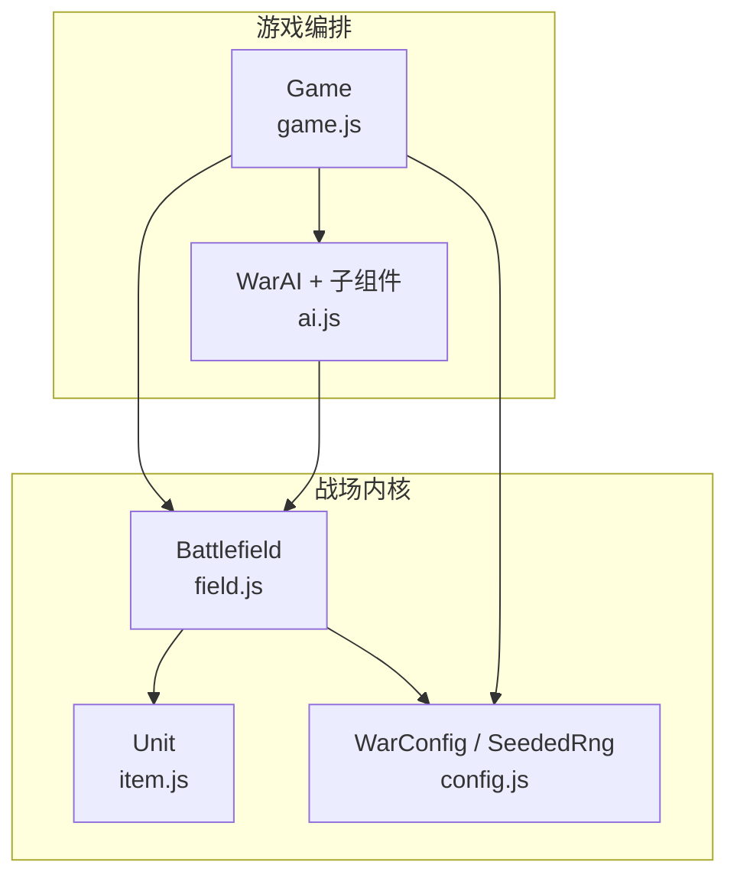
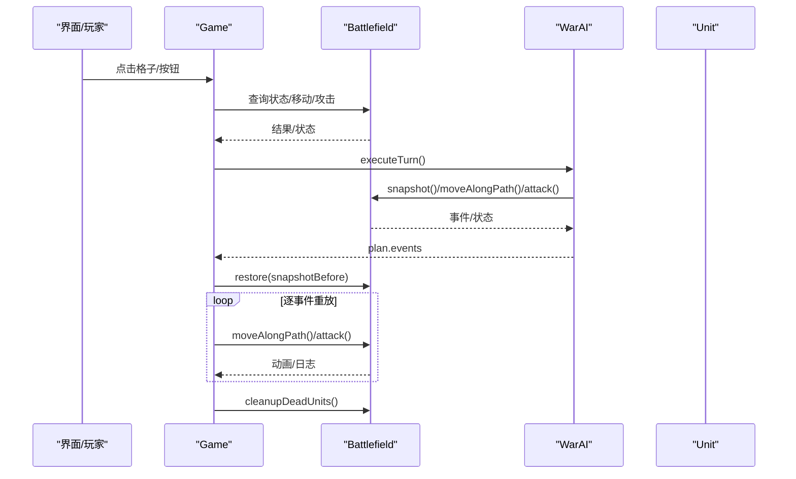
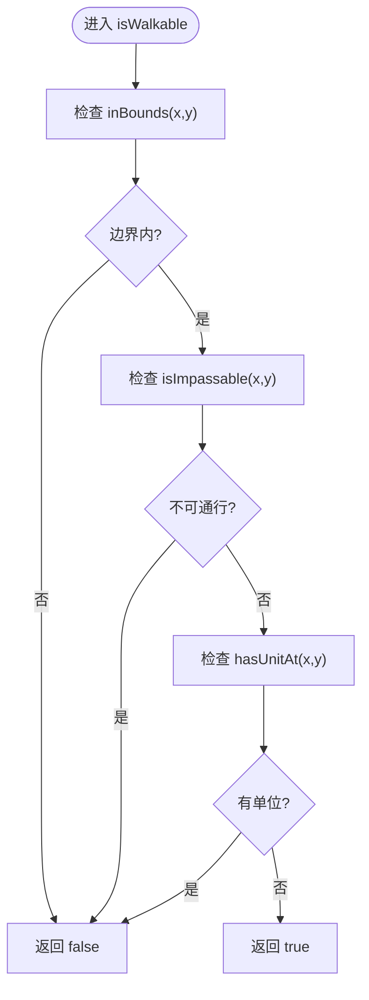
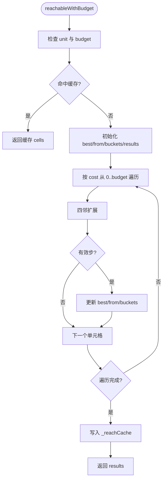
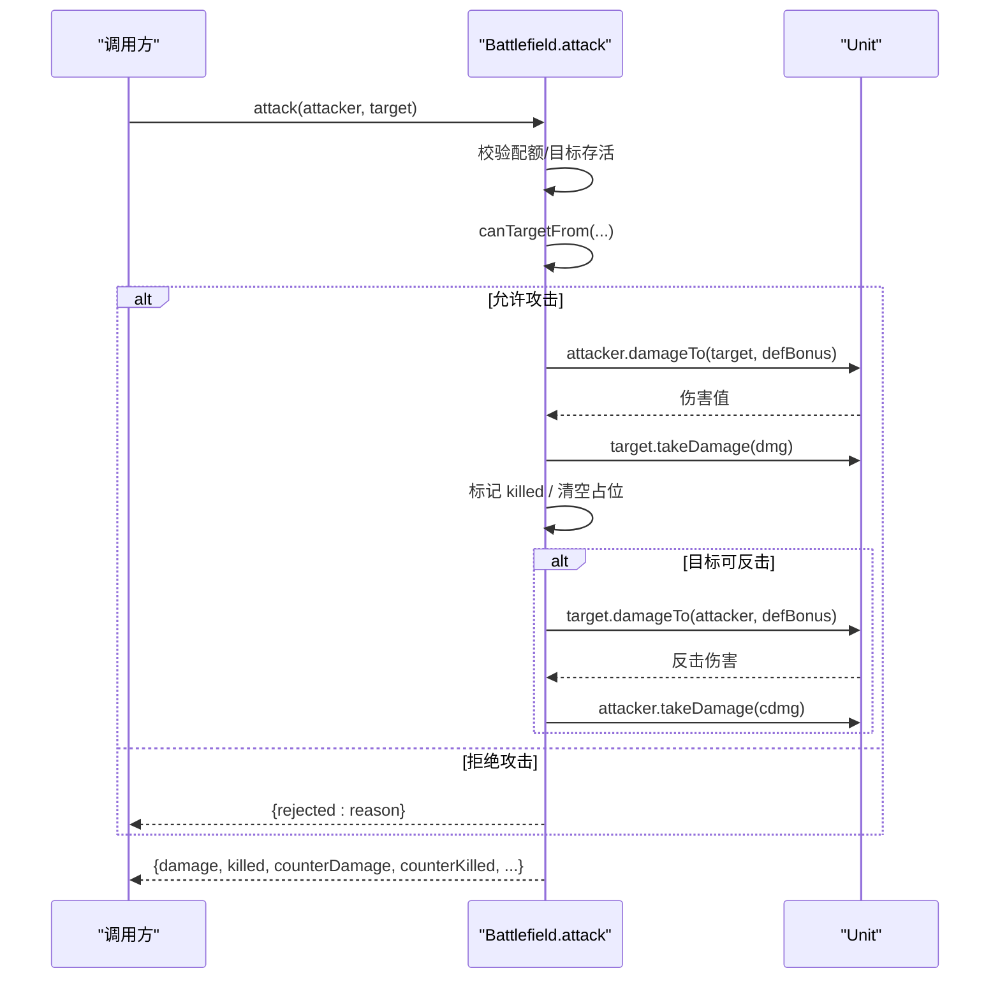
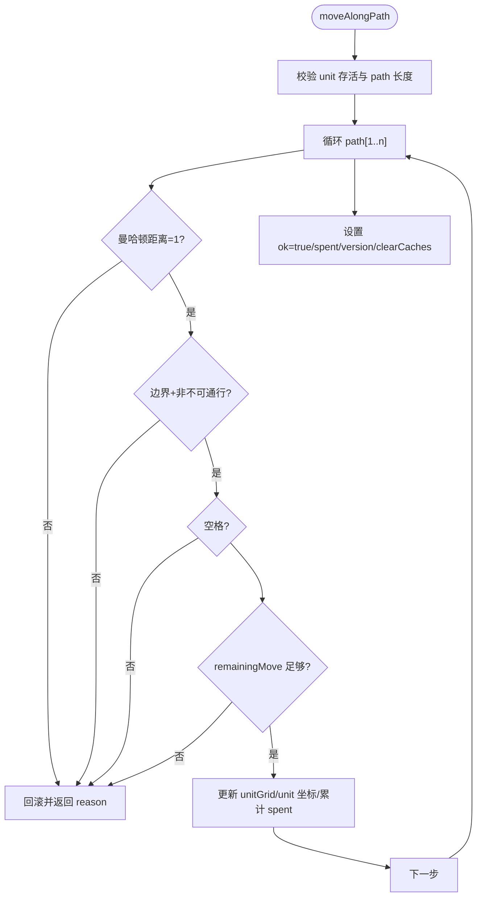
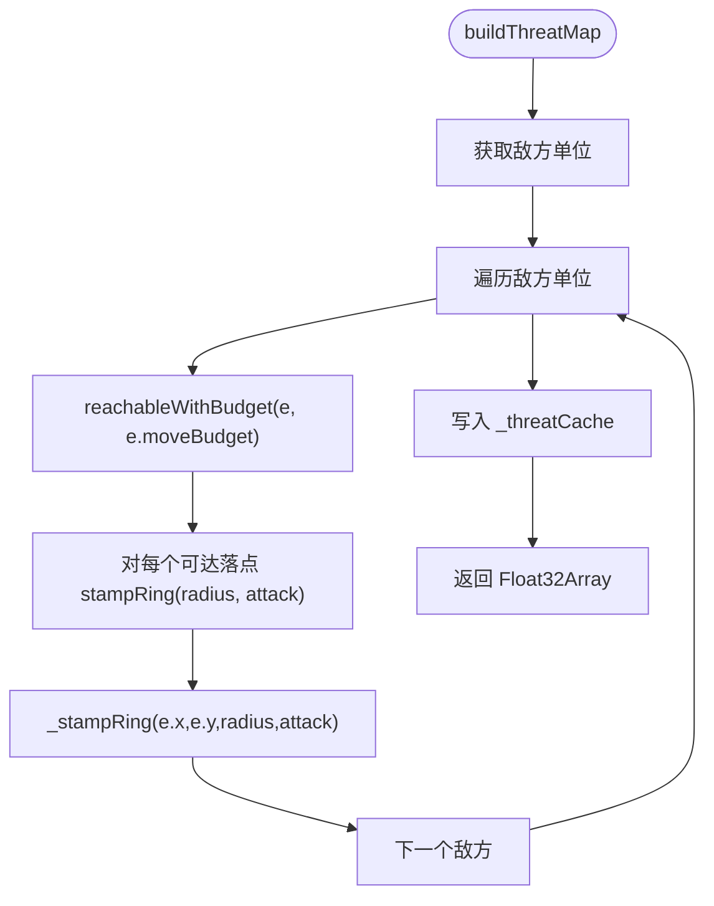
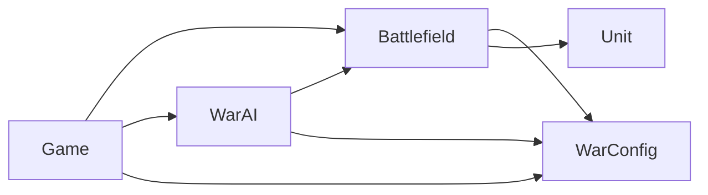

# 战场 API

<cite>
**本文引用的文件**   
- [field.js](file://war/war/field.js)
- [game.js](file://war/war/game.js)
- [ai.js](file://war/war/ai.js)
- [item.js](file://war/war/item.js)
- [config.js](file://war/war/config.js)
</cite>

## 目录
1. [引言](#引言)
2. [项目结构](#项目结构)
3. [核心组件](#核心组件)
4. [架构总览](#架构总览)
5. [详细组件分析](#详细组件分析)
6. [依赖关系分析](#依赖关系分析)
7. [性能与优化建议](#性能与优化建议)
8. [故障排查指南](#故障排查指南)
9. [结论](#结论)
10. [附录：API 速查表](#附录api-速查表)

## 引言
本文件为 WAR 项目的“战场管理系统”提供面向调用方的 API 文档，重点围绕 Battlefield 类的核心能力展开，包括：
- 战场初始化、地形生成、单位部署
- 空间推理：可达域计算、路径重建、威胁影响图构建
- 攻击判定与结算、移动结算
- 战场状态快照与回滚、胜负判断与局面评估
- 与 Game、AI、Unit、配置模块的协作方式

文档同时给出坐标系统、二维数组数据结构、边界处理等接口约定，并提供常见使用示例（查询战场状态、执行战术分析、获取战略信息等），以及性能优化建议和最佳实践。

## 项目结构
WAR 的 Web 端核心逻辑集中在 war/war 目录下，关键文件职责如下：
- field.js：战场核心类 Battlefield，负责地形、单位网格、规则结算与空间推理
- item.js：兵种 Unit，纯状态对象，封装属性、配额、伤害与反击判定
- config.js：全局配置 WarConfig，包含棋盘尺寸、地形定义、兵种模板、难度旋钮、评分权重与确定性随机数 SeededRng
- game.js：主游戏 Game，负责 UI 交互、回合流转、渲染与 AI 回合重放
- ai.js：AI 子系统，包含 Strategist、Enumerator、Scorer、Lookahead、WarAI 等分层组件

**图表来源**
- [field.js:11-32](file://war/war/field.js#L11-L32)
- [item.js:12-44](file://war/war/item.js#L12-L44)
- [config.js:12-103](file://war/war/config.js#L12-L103)
- [game.js:12-42](file://war/war/game.js#L12-L42)
- [ai.js:421-434](file://war/war/ai.js#L421-L434)

**章节来源**
- [field.js:1-622](file://war/war/field.js#L1-L622)
- [game.js:1-600](file://war/war/game.js#L1-L600)
- [ai.js:1-648](file://war/war/ai.js#L1-L648)
- [item.js:1-178](file://war/war/item.js#L1-L178)
- [config.js:1-146](file://war/war/config.js#L1-L146)

## 核心组件
- Battlefield：战场唯一写入者，维护 terrain 与 unitGrid 二维数组，提供地形生成、单位管理、可达域、威胁影响图、攻击与移动结算、快照回滚、胜负与评估等能力
- Unit：兵种状态对象，提供属性访问、配额管理、伤害计算、反击资格、序列化等
- Game：UI 与回合控制器，驱动 Battlefield 与 WarAI，负责事件重放与渲染
- WarAI：分层 AI，产出可重放的事件序列，驱动真实战场推进
- WarConfig：集中式配置，含棋盘、地形、兵种、难度旋钮、评分权重与确定性随机数

**章节来源**
- [field.js:11-32](file://war/war/field.js#L11-L32)
- [item.js:12-44](file://war/war/item.js#L12-L44)
- [game.js:12-42](file://war/war/game.js#L12-L42)
- [ai.js:421-434](file://war/war/ai.js#L421-L434)
- [config.js:12-103](file://war/war/config.js#L12-L103)

## 架构总览
Battlefield 是状态机核心，所有状态变更都通过其方法完成；Game 作为编排层，协调用户输入、AI 决策与渲染；AI 通过枚举候选动作、评分与浅层前瞻，输出可重放事件；Unit 仅暴露纯函数式伤害与反击判定，避免在 AI 推演中产生副作用。

**图表来源**
- [game.js:292-335](file://war/war/game.js#L292-L335)
- [ai.js:455-514](file://war/war/ai.js#L455-L514)
- [field.js:391-441](file://war/war/field.js#L391-L441)
- [field.js:343-383](file://war/war/field.js#L343-L383)

## 详细组件分析

### Battlefield 类 API 总览
Battlefield 提供以下关键能力：
- 网格基础：坐标校验、地形查询、通行性判断、单位查询
- 地形生成：对称地形生成、平坦场地
- 单位管理：添加/移除、存活过滤、阵营筛选、清理死亡单位、重置行动配额
- 空间推理：可达域计算、路径重建、移动位置兼容 API
- 攻击判定：视线、射程、目标列表、攻击结算
- 移动结算：沿路径移动、失败回滚、兼容移动 API
- 威胁影响图：按阵营构建、单格威胁查询、最大值
- 快照/回滚：保存/恢复、重建单位网格
- 胜负与评估：游戏结束、获胜方、物质分、战场信息、清空、默认编成、出生点查找

#### 坐标系统与二维数组数据结构
- 坐标系统：(x, y)，x 为列，y 为行；宽度 width，高度 height
- 地形数组：terrain[y][x] = 地形 key（如 'plain'、'forest'）
- 单位网格：unitGrid[y][x] = Unit | null
- 边界处理：inBounds(x, y) 统一校验；isImpassable 与 hasUnitAt 组合决定 isWalkable

**图表来源**
- [field.js:45-87](file://war/war/field.js#L45-L87)

**章节来源**
- [field.js:34-93](file://war/war/field.js#L34-L93)

#### 地形生成 API
- generateTerrain(seed, opts)：以 seed 进行确定性地形生成，左右镜像对称，密度可调
- flatten()：将全图设为平原，用于回归测试或规则验证

典型用法：
- 构造时自动调用 generateTerrain
- 测试场景用 flatten 快速清空地形

**章节来源**
- [field.js:95-136](file://war/war/field.js#L95-L136)

#### 单位部署与管理 API
- addUnit(unit)：添加单位到指定坐标，需满足边界、非不可通行、空格
- removeUnit(unit)：从 units 数组与 unitGrid 精确清除
- aliveUnits() / unitsOfCamp(camp)：存活单位与阵营单位过滤
- cleanupDeadUnits()：批量清理死亡单位并清空占位
- resetAllActions()：重置所有单位本回合配额
- setDefaultLayout(roster)：按默认编成左右镜像布阵
- findSpawnSpot(camp, index)：在出生区扫描可通行空格

典型用法：
- 手工放置：Game.handlePlacementClick -> battlefield.addUnit
- 一键布阵：Game.quickDeploy -> battlefield.setDefaultLayout

**章节来源**
- [field.js:138-210](file://war/war/field.js#L138-L210)
- [field.js:591-616](file://war/war/field.js#L591-L616)
- [game.js:180-197](file://war/war/game.js#L180-L197)
- [game.js:141-152](file://war/war/game.js#L141-L152)

#### 空间推理算法 API
- computeReachable(unit)：基于剩余机动点的 Dijkstra 可达域
- reachableWithBudget(unit, budget)：指定预算的可达域（威胁影响图用满预算）
- getMovablePositions(unit)：兼容旧 API，返回落点列表
- _reconstructPath(from, endNode, start)：内部路径重建

复杂度说明：
- 使用桶式优先队列（预算 <= 7），避免堆比较开销
- 时间复杂度近似 O(E + V log V)，但桶化后接近线性于边数
- 缓存策略：_reachCache 按 unit.id:budget 键存储，version 控制失效

**图表来源**
- [field.js:225-287](file://war/war/field.js#L225-L287)

**章节来源**
- [field.js:212-303](file://war/war/field.js#L212-L303)

#### 攻击判定与结算 API
- hasLineOfSight(ax, ay, bx, by)：视线判定（同行/同列中间格被阻挡则无视线）
- canTargetFrom(attacker, target, x, y)：站位到目标的攻击可行性
- getAttackableTargets(unit)：当前站位可打目标列表
- attack(attacker, target)：唯一伤害写入点，返回攻击结果对象

攻击流程要点：
- 先校验攻击配额与目标存活
- 再校验射程与视线
- 计算伤害并扣血，必要时清空目标占位
- 若目标存活且具备反击资格，触发反击

**图表来源**
- [field.js:343-383](file://war/war/field.js#L343-L383)
- [item.js:88-122](file://war/war/item.js#L88-L122)

**章节来源**
- [field.js:305-383](file://war/war/field.js#L305-L383)
- [item.js:88-122](file://war/war/item.js#L88-L122)

#### 移动结算 API
- moveAlongPath(unit, path)：沿路径逐步校验相邻、边界、通行、占用、机动点消耗
- moveUnit(unit, x, y)：兼容旧 API，内部走 computeReachable + moveAlongPath
- _rollbackMove(unit, result)：失败时撤销中途步骤，回到起点

移动流程要点：
- 每步校验曼哈顿距离为 1
- 检查边界、不可通行、单位占用
- 累加地形 moveCost，不超过 remainingMove
- 成功则更新 unitGrid 与 unit.x/y，失败则回滚

**图表来源**
- [field.js:391-441](file://war/war/field.js#L391-L441)

**章节来源**
- [field.js:385-450](file://war/war/field.js#L385-L450)

#### 威胁影响图 API
- buildThreatMap(camp)：按敌方单位满预算可达域外扩射程，累计攻击力到 Float32Array
- threatAt(camp, x, y)：单格威胁值查询
- maxThreat(camp)：归一化用最大值

实现要点：
- 使用 enemyCamp(camp) 获取敌方
- 对每个敌方单位，计算 reachableWithBudget(e, e.moveBudget)
- 对每个可达落点与当前位置，调用 _stampRing 累加攻击值
- 缓存 _threatCache[camp]，version 控制失效

**图表来源**
- [field.js:462-494](file://war/war/field.js#L462-L494)

**章节来源**
- [field.js:452-508](file://war/war/field.js#L452-L508)

#### 快照与回滚 API
- snapshot()：保存 units.toState()、nextUnitId、version
- restore(snap)：恢复 units 状态，重建 unitGrid，递增 version
- rebuildUnitGrid()：根据 units 重建 unitGrid

用途：
- AI 前瞻与回放：snapshot -> 真实推进 -> restore(before) -> 逐事件 replay -> restore(final)

**章节来源**
- [field.js:510-537](file://war/war/field.js#L510-L537)
- [game.js:292-335](file://war/war/game.js#L292-L335)

#### 胜负与评估 API
- isGameOver()：任一方单位数为 0 即结束
- getWinner()：返回获胜阵营或平局
- materialScore(camp)：按血量加权 aiValue 的物质差
- getBattlefieldInfo()：返回宽度、高度、单位数量、是否结束、获胜方
- clear()：清空 units 与 unitGrid

**章节来源**
- [field.js:539-584](file://war/war/field.js#L539-L584)

### Unit 类 API 概览
- 属性：id、type、player、x、y、maxHealth、health、attack、defense、attackRange、moveBudget、attackBudget、counterAttack、aiValue、symbol、name
- 配额：resetTurn、canMove、canAttackAgain、isExhausted
- 伤害与防御：damageTo、effectiveDefense、takeDamage
- 反击：canCounter
- 序列化：toState、restoreState、getInfo、getDisplayName

注意：
- Unit 不直接修改坐标；坐标与 unitGrid 的唯一写入者是 Battlefield
- damageTo 为纯函数，便于 AI 预估

**章节来源**
- [item.js:12-172](file://war/war/item.js#L12-L172)

### Game 与 AI 协作
- Game.executeAITurn：记录 before/final 快照，调用 ai.executeTurn，然后 restore(before) 逐事件重放
- WarAI.executeTurn：Strategist -> Enumerator -> Scorer -> Lookahead -> softmax 采样，产出 events
- replayEvent：渲染层按事件顺序调用 Battlefield.moveAlongPath/attack

**章节来源**
- [game.js:292-335](file://war/war/game.js#L292-L335)
- [ai.js:455-514](file://war/war/ai.js#L455-L514)
- [ai.js:634-643](file://war/war/ai.js#L634-L643)

## 依赖关系分析
- Battlefield 依赖：
  - WarConfig：棋盘尺寸、地形定义、兵种模板、难度旋钮、评分权重
  - Unit：单位状态与纯函数伤害/反击
- Game 依赖：
  - Battlefield：状态查询与变更
  - WarAI：回合决策与事件序列
  - WarConfig：配置读取
- WarAI 依赖：
  - Battlefield：可达域、威胁图、攻击/移动、快照/回滚
  - WarConfig：难度参数、权重、标尺

**图表来源**
- [field.js:11-32](file://war/war/field.js#L11-L32)
- [game.js:12-42](file://war/war/game.js#L12-L42)
- [ai.js:421-434](file://war/war/ai.js#L421-L434)
- [config.js:12-103](file://war/war/config.js#L12-L103)

**章节来源**
- [field.js:1-622](file://war/war/field.js#L1-L622)
- [game.js:1-600](file://war/war/game.js#L1-L600)
- [ai.js:1-648](file://war/war/ai.js#L1-L648)
- [config.js:1-146](file://war/war/config.js#L1-L146)

## 性能与优化建议
- 可达域缓存：_reachCache 按 unit.id:budget 键存储，避免重复计算；确保在版本变化时 clearCaches
- 威胁图缓存：_threatCache 按 camp 键存储，Float32Array 高效存储数值；maxThreat 用于归一化
- 桶式优先队列：预算较小（<=7）时使用桶代替堆，减少比较器开销
- 单位网格重建：cleanupDeadUnits 与 rebuildUnitGrid 仅在必要时机调用，避免全量重建
- 快照粒度：snapshot 仅保存 units.toState()，避免复制整个 Battlefield 对象
- 渲染优化：Game.renderBattlefield 使用 DocumentFragment 批量插入，减少 DOM 操作

最佳实践：
- 所有状态变更通过 Battlefield 方法，禁止外部直接修改 unitGrid 或单位坐标
- AI 推演使用 snapshot/restore，保持状态一致性
- 地形生成使用确定性种子，保证可复现性与回归测试稳定性

**章节来源**
- [field.js:214-217](file://war/war/field.js#L214-L217)
- [field.js:225-287](file://war/war/field.js#L225-L287)
- [field.js:462-494](file://war/war/field.js#L462-L494)
- [field.js:510-537](file://war/war/field.js#L510-L537)
- [game.js:400-463](file://war/war/game.js#L400-L463)

## 故障排查指南
常见问题与定位：
- 移动失败：检查 moveAlongPath 返回的 reason（not_adjacent、blocked、occupied、no_points）
- 攻击失败：检查 canTargetFrom 与 attack 返回的 rejected（out_of_range、not_allowed）
- 单位未更新：确认 addUnit/removeUnit/cleanupDeadUnits 是否正确调用，unitGrid 是否与 units 同步
- 可达域异常：检查 terrainAt 的 moveCost 与 isImpassable 配置，确认缓存是否及时失效
- 威胁图异常：检查 enemyCamp 与 reach 计算，确认 Float32Array 索引正确

调试建议：
- 使用 getBattlefieldInfo 与 updateUnitStats 查看战场与单位状态
- 开启 AI debug 模式，查看 decisions 与 top candidates 的 parts 分解
- 使用 flatten 或 generateTerrain(seed) 固定地形，便于复现问题

**章节来源**
- [field.js:391-441](file://war/war/field.js#L391-L441)
- [field.js:343-383](file://war/war/field.js#L343-L383)
- [game.js:573-586](file://war/war/game.js#L573-L586)
- [ai.js:542-558](file://war/war/ai.js#L542-L558)

## 结论
Battlefield 提供了完整的战场管理与空间推理能力，配合 Game 与 WarAI 形成可重放、可调试、可配置的战棋引擎。通过统一的写入入口、缓存机制与快照回滚，系统在性能与一致性之间取得平衡。调用方应遵循坐标系统、二维数组结构与边界处理约定，合理使用可达域、威胁影响图与攻击/移动结算 API，以获得稳定可靠的战术分析与战略信息。

## 附录：API 速查表

### Battlefield 关键方法
- 网格基础：inBounds、isValidPosition、terrainAt、terrainDefBonus、isImpassable、unitAt、getUnitAt、hasUnitAt、isWalkable、setTerrain
- 地形生成：generateTerrain、flatten
- 单位管理：addUnit、removeUnit、aliveUnits、unitsOfCamp、getPlayerUnits、getAllUnits、getPlayerUnitCount、enemyCamp、cleanupDeadUnits、resetAllActions、indexOfUnit
- 空间推理：computeReachable、reachableWithBudget、getMovablePositions
- 攻击判定：hasLineOfSight、canTargetFrom、getAttackableTargets、attack
- 移动结算：moveAlongPath、moveUnit
- 威胁影响图：buildThreatMap、threatAt、maxThreat
- 快照/回滚：snapshot、restore、rebuildUnitGrid
- 胜负与评估：isGameOver、getWinner、materialScore、getBattlefieldInfo、clear
- 布局辅助：setDefaultLayout、findSpawnSpot

### Unit 关键方法
- 属性访问：pos、distanceTo、static distance
- 配额：resetTurn、canMove、canAttackAgain、isExhausted
- 伤害与防御：damageTo、effectiveDefense、takeDamage
- 反击：canCounter
- 序列化：toState、restoreState、getInfo、getDisplayName

### Game 与 AI 协作
- Game：startNewGame、quickDeploy、handleCellClick、tryPlayerMove、tryPlayerAttack、orderWait、endTurn、executeAITurn、runAutoBattle、toggleAutoMode、renderBattlefield、updateUI、updateUnitStats
- WarAI：executeTurn、decide、setDifficulty、setSeed、getInfo
- replayEvent：按事件顺序重放移动与攻击

**章节来源**
- [field.js:34-616](file://war/war/field.js#L34-L616)
- [item.js:46-172](file://war/war/item.js#L46-L172)
- [game.js:124-586](file://war/war/game.js#L124-L586)
- [ai.js:421-643](file://war/war/ai.js#L421-L643)