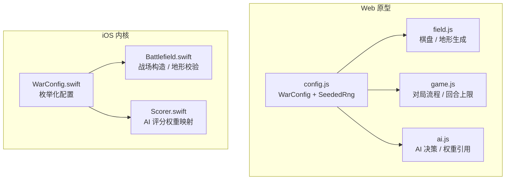
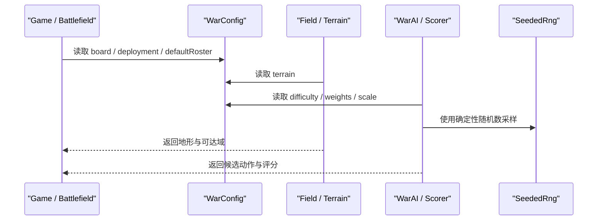
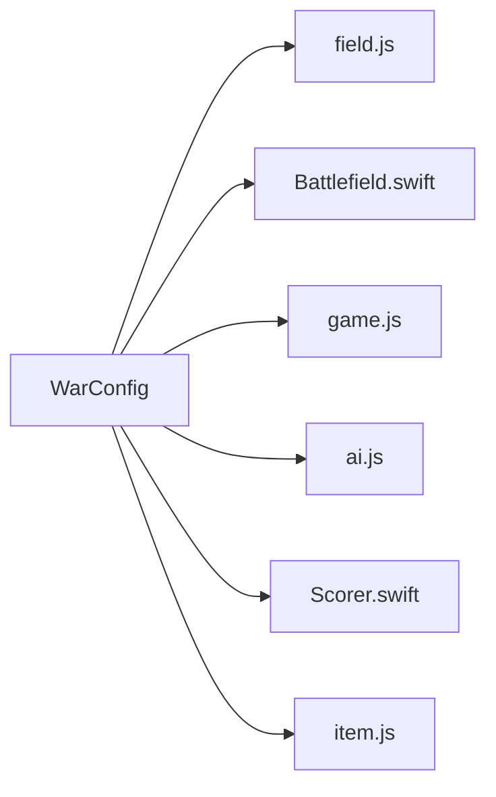

# 配置 API

<cite>
**本文引用的文件**   
- [config.js](file://war/war/config.js)
- [WarConfig.swift](file://war/ios/WarKit/Sources/WarKit/WarConfig.swift)
- [field.js](file://war/war/field.js)
- [game.js](file://war/war/game.js)
- [ai.js](file://war/war/ai.js)
- [Scorer.swift](file://war/ios/WarKit/Sources/WarKit/Scorer.swift)
- [Battlefield.swift](file://war/ios/WarKit/Sources/WarKit/Battlefield.swift)
</cite>

## 目录
1. [简介](#简介)
2. [项目结构](#项目结构)
3. [核心配置对象总览](#核心配置对象总览)
4. [架构概览](#架构概览)
5. [详细组件说明](#详细组件说明)
6. [依赖关系分析](#依赖关系分析)
7. [性能与可复现性](#性能与可复现性)
8. [自定义与扩展示例](#自定义与扩展示例)
9. [故障排查](#故障排查)
10. [结论](#结论)
11. [附录：版本兼容性](#附录版本兼容性)

## 简介
本文面向 WAR 项目的配置系统，目标是提供一份与源码同步的 API 文档。重点包括：
- WarConfig 全局配置对象的所有属性：board、terrain、unitTypes、difficulty、weights、scale、deployment、defaultRoster。
- SeededRng 确定性随机数类的完整接口说明。
- 每个配置项的数据结构、取值范围和业务含义。
- 实际配置修改示例：自定义兵种属性、调整难度参数、扩展地形类型。
- 两个实现分支（Web JS 与 iOS Swift）的差异与兼容说明。

WAR 的配置设计遵循“数值只出现一次”的原则：AI 评分、规则层、UI 都从同一份配置读取，避免多套难度对应多套算法。JS 端使用 `config.js` 中的对象常量；iOS 端使用 `WarConfig.swift` 中的枚举与静态常量。两者在语义上对齐，但字段名和扩展能力存在差异。

## 项目结构
WAR 仓库包含 Web 原型与 iOS 工程两个主要分支：
- Web 原型位于 `war/war/`，核心配置定义在 `config.js`，被 `field.js`、`game.js`、`ai.js` 等模块引用。
- iOS 工程位于 `war/ios/`，核心配置定义在 `WarKit/Sources/WarKit/WarConfig.swift`，被 `Battlefield.swift`、`Scorer.swift` 等内核模块引用。

**图表来源**
- [config.js:12-103](file://war/war/config.js#L12-L103)
- [WarConfig.swift:5-575](file://war/ios/WarKit/Sources/WarKit/WarConfig.swift#L5-L575)
- [field.js:12-102](file://war/war/field.js#L12-L102)
- [game.js:33-512](file://war/war/game.js#L33-L512)
- [ai.js:227-533](file://war/war/ai.js#L227-L533)
- [Battlefield.swift:65-98](file://war/ios/WarKit/Sources/WarKit/Battlefield.swift#L65-L98)
- [Scorer.swift:13-50](file://war/ios/WarKit/Sources/WarKit/Scorer.swift#L13-L50)

**章节来源**
- [config.js:1-146](file://war/war/config.js#L1-L146)
- [WarConfig.swift:1-576](file://war/ios/WarKit/Sources/WarKit/WarConfig.swift#L1-L576)

## 核心配置对象总览
WarConfig 是 WAR 引擎的权威数据源。它集中定义了棋盘尺寸、地形、兵种、难度、评分权重、归一化标尺、部署上限和默认编成。

| 配置项 | Web JS 位置 | iOS Swift 位置 | 业务含义 |
|---|---|---|---|
| board | `WarConfig.board` | `WarConfig.defaultBoard`、`WarConfig.boardSizes` | 棋盘宽高；iOS 支持多尺寸选择 |
| terrain | `WarConfig.terrain` | `WarConfig.terrains` | 地形机动消耗、防御加成、是否不可通行 |
| unitTypes | `WarConfig.unitTypes` | `WarConfig.unitTypes` | 兵种基础属性、价值、是否首领、是否可转职 |
| difficulty | `WarConfig.difficulty` | `WarConfig.difficulties` | AI 温度、前瞻、视野、噪声、预算、魔法等级 |
| weights | `WarConfig.weights` | `WarConfig.weights` | AI 评分各分项权重 |
| scale | `WarConfig.scale` | `WarConfig.scale` | 将不同量纲归一化到 `[0,1]` 的参考值 |
| deployment | `WarConfig.deployment` | `WarConfig.soldiersPerSide`、`WarConfig.maxUnitsPerSide`、`WarConfig.maxTurns` | 每方单位上限、最大回合数 |
| defaultRoster | `WarConfig.defaultRoster` | `WarConfig.defaultRoster` | 自动布阵与测试用的默认兵种序列 |

**章节来源**
- [config.js:12-103](file://war/war/config.js#L12-L103)
- [WarConfig.swift:9-255](file://war/ios/WarKit/Sources/WarKit/WarConfig.swift#L9-L255)

## 架构概览
配置系统通过“单一事实来源”驱动游戏逻辑。Web 端由 `config.js` 暴露全局对象；iOS 端由 `WarConfig.swift` 暴露枚举与静态常量。AI 评分器、战场构造、对局流程均直接消费这些配置。

**图表来源**
- [config.js:12-103](file://war/war/config.js#L12-L103)
- [WarConfig.swift:5-575](file://war/ios/WarKit/Sources/WarKit/WarConfig.swift#L5-L575)
- [field.js:12-102](file://war/war/field.js#L12-L102)
- [ai.js:227-533](file://war/war/ai.js#L227-L533)
- [Scorer.swift:13-50](file://war/ios/WarKit/Sources/WarKit/Scorer.swift#L13-L50)

## 详细组件说明

### 棋盘尺寸 board
- Web JS：`WarConfig.board.width`、`WarConfig.board.height`，默认 20×20。
- iOS Swift：`WarConfig.defaultBoard` 默认 14×14，并提供 `WarConfig.boardSizes` 可选尺寸集合。

| 字段 | 类型 | 取值范围 | 业务含义 |
|---|---|---|---|
| width | 整数 | 正整数 | 棋盘列数 |
| height | 整数 | 正整数 | 棋盘行数 |

- 默认值差异：Web 原型为 20×20，iOS 默认 14×14，便于竖屏手指点按。
- iOS 还支持多尺寸切换，适合不同屏幕节奏。

**章节来源**
- [config.js:13-16](file://war/war/config.js#L13-L16)
- [WarConfig.swift:9-27](file://war/ios/WarKit/Sources/WarKit/WarConfig.swift#L9-L27)

### 地形定义 terrain
- Web JS：`WarConfig.terrain` 是键到地形对象的映射。
- iOS Swift：`WarConfig.terrains` 是键到 `Terrain` 结构的映射，并额外提供颜色、展示顺序等 UI 相关常量。

| 字段 | 类型 | 取值范围 | 业务含义 |
|---|---|---|---|
| key | 字符串 | 唯一标识 | 地形键，用于地图数组与查找 |
| name | 字符串 | 非空 | 人类可读名称 |
| symbol | 字符串 | 单字符或空 | 棋盘显示符号 |
| moveCost | 整数 | ≥1 | 进入该地形消耗的机动点 |
| defBonus | 整数 | ≥0 | 在该地形上的防御加成百分比 |
| impassable | 布尔 | true/false | 单位是否不能进入；不可通行格子不计入可达域 |
| css / colorRGB | 样式或颜色 | 平台相关 | Web 用 CSS 类，iOS 用 RGB 三元组 |

默认地形包括平原、森林、山地、河流、岩壁。河流与岩壁为不可通行；森林与山地提供防御加成；山地移动代价更高。

**章节来源**
- [config.js:18-25](file://war/war/config.js#L18-L25)
- [WarConfig.swift:31-68](file://war/ios/WarKit/Sources/WarKit/WarConfig.swift#L31-L68)
- [field.js:56-102](file://war/war/field.js#L56-L102)
- [Battlefield.swift:74-86](file://war/ios/WarKit/Sources/WarKit/Battlefield.swift#L74-L86)

### 兵种类型 unitTypes
- Web JS：`WarConfig.unitTypes` 包含步兵、骑兵、弓兵。
- iOS Swift：`WarConfig.unitTypes` 扩展为首领、转职分支等更完整的体系，并提供升级、价格、魔法等配套配置。

| 字段 | 类型 | 取值范围 | 业务含义 |
|---|---|---|---|
| type / key | 字符串 | 唯一标识 | 兵种键 |
| name | 字符串 | 非空 | 兵种名称 |
| symbol | 字符串 | 单字符 | 棋盘显示符号 |
| maxHealth / hp | 整数 | >0 | 最大生命值 |
| attack / atk | 整数 | ≥0 | 攻击力 |
| defense / def | 整数 | ≥0 | 基础防御力 |
| attackRange | 整数 | ≥1 | 攻击射程 |
| moveBudget / moveRange | 整数 | ≥1 | 每回合机动点或移动范围 |
| attackBudget | 整数 | ≥1 | 每回合攻击次数 |
| counterAttack | 布尔 | true/false | 近战反击能力 |
| aiValue / value | 浮点数 | >0 | 战略价值，越高越值得优先处理 |
| isChief | 布尔 | false/true | 是否首领；每阵营通常仅一名 |
| cost | 整数 | ≥0 | 军费单价；首领通常为 0 |
| promotable | 布尔 | false/true | 是否只能由转职获得 |

Web 端的 `moveBudget` 与 `attackBudget` 体现“行动配额拆分”的设计：移动扣机动点，攻击不扣机动点。iOS 端则采用“火焰纹章式”每回合最多移动一次、攻击一次，并通过 `soldiersPerSide`、`maxAttacksPerTurn` 控制配额。

**章节来源**
- [config.js:27-55](file://war/war/config.js#L27-L55)
- [WarConfig.swift:72-163](file://war/ios/WarKit/Sources/WarKit/WarConfig.swift#L72-L163)
- [item.js:14-14](file://war/war/item.js#L14-L14)

### 难度设置 difficulty
- Web JS：`WarConfig.difficulty` 提供 easy、normal、hard、nightmare 四档。
- iOS Swift：`WarConfig.difficulties` 同样提供四档，但增加 budget 与 spellLevel。

| 字段 | 类型 | 取值范围 | 业务含义 |
|---|---|---|---|
| label / name | 字符串 | 非空 | 难度显示名称 |
| temperature | 浮点数 | 0~1 | softmax 温度；越大越随机，越小越保守 |
| lookahead | 整数 | 0/1/2 | 前瞻推演步数；0 只看即时收益 |
| vision | 整数或 Infinity | ≥1 或无限 | AI 能看到的敌方单位数量 |
| noise | 浮点数 | 0~1 | 命中或评分噪声幅度 |
| sampleEnemies | 整数 | ≥1 | Web 端采样敌人数量 |
| budget | 整数 | ≥0 | iOS 端本局军费，影响 AI 与玩家同价兵力强度 |
| spellLevel | 整数 | 0~3 | iOS 端敌方首领魔法等级 |

难度不再是换一套打分逻辑，而是同一评分函数下的正交旋钮：信息、随机度、前瞻、军费、魔法等级。

**章节来源**
- [config.js:57-63](file://war/war/config.js#L57-L63)
- [WarConfig.swift:354-391](file://war/ios/WarKit/Sources/WarKit/WarConfig.swift#L354-L391)
- [ai.js:437-447](file://war/war/ai.js#L437-L447)

### 评分权重 weights
- Web JS：`WarConfig.weights` 包含 damage、kill、overkill、targetValue、exposure、terrain、focus、counter、mobility、objective、support、waste、followup。
- iOS Swift：`WarConfig.weights` 扩展了更多维度，如 selfPreserve、surround、rangePenalty、engage、proximity、chiefBounty、heal、freeze、suicide、chiefPeril。

| 字段 | 类型 | 业务含义 |
|---|---|---|
| damage | 浮点数 | 期望伤害奖励 |
| kill | 浮点数 | 击杀额外奖励 |
| overkill | 负数 | 溢出伤害惩罚 |
| targetValue | 正数 | 目标兵种价值 |
| exposure | 负数 | 落入敌方威胁区的风险 |
| terrain | 正数 | 站位地形防御加成 |
| focus | 正数 | 集火协同 |
| counter / counterRisk | 负数 | 预期反击伤害或风险 |
| mobility | 正数 | 保留机动力 |
| objective | 正数 | 向战略目标推进 |
| support | 正数 | 支援友邻 |
| waste | 负数 | 浪费行动配额 |
| followup | 正数 | 前瞻推演局势增减 |
| selfPreserve | 负数 | 自身存活价值 |
| surround | 正数 | 合围同一目标 |
| rangePenalty | 负数 | 远程单位贴脸输出惩罚 |
| engage | 正数 | 无目标时的推进意愿 |
| proximity | 正数 | 无目标时靠近敌情 |
| chiefBounty | 正数 | 斩首赏金 |
| heal | 正数 | 治疗收益 |
| freeze | 正数 | 冰冻收益 |
| suicide | 负数 | 自杀门禁 |
| chiefPeril | 负数 | 首领死亡风险 |

权重在归一化后乘入最终评分，因此不存在某项数量级压倒另一项的问题。

**章节来源**
- [config.js:65-83](file://war/war/config.js#L65-L83)
- [WarConfig.swift:436-529](file://war/ios/WarKit/Sources/WarKit/WarConfig.swift#L436-L529)
- [Scorer.swift:13-50](file://war/ios/WarKit/Sources/WarKit/Scorer.swift#L13-L50)
- [ai.js:227-533](file://war/war/ai.js#L227-L533)

### 归一化标尺 scale
- Web JS：`WarConfig.scale` 提供 damageRef、threatRef、moveBudgetRef、terrainDefRef、supportRadius、objectiveDecay。
- iOS Swift：`WarConfig.scale` 提供更细粒度的标尺，包括 threatSaturation、exposureDecay、objectiveGain、supportHpThreshold、surroundUnit、maxNoise、valueRef。

| 字段 | 类型 | 业务含义 |
|---|---|---|
| damageRef | 整数 | 参考伤害，约等于一次重击 |
| threatRef / threatSaturation | 整数或浮点数 | 参考威胁值或威胁饱和阈值 |
| moveBudgetRef | 整数 | 最大兵种机动点参考 |
| terrainDefRef / maxDefBonus | 整数 | 最大地形防御加成参考 |
| supportRadius / supportHpThreshold | 整数 | 支援距离或濒危友军血量阈值 |
| objectiveDecay / objectiveGain | 浮点数 | 距目标区域多远开始失去牵引分或增益比例 |
| exposureDecay | 浮点数 | 暴露衰减系数 |
| surroundUnit | 浮点数 | 合围单位贡献系数 |
| maxNoise | 浮点数 | 最大噪声幅度 |
| valueRef | 浮点数 | 兵种价值归一化参考，普通兵种上限 |

**章节来源**
- [config.js:85-93](file://war/war/config.js#L85-L93)
- [WarConfig.swift:532-574](file://war/ios/WarKit/Sources/WarKit/WarConfig.swift#L532-L574)

### 战场布局 deployment
- Web JS：`WarConfig.deployment` 提供 `maxPerSide` 与 `maxTurns`。
- iOS Swift：对应常量分布在 `soldiersPerSide`、`maxUnitsPerSide`、`maxTurns`。

| 字段 | 类型 | 取值范围 | 业务含义 |
|---|---|---|---|
| maxPerSide | 整数 | ≥1 | Web 端每方单位上限 |
| soldiersPerSide | 整数 | ≥1 | iOS 端每方士兵上限（不含首领） |
| maxUnitsPerSide | 整数 | ≥1 | iOS 端每方单位总上限（含首领） |
| maxTurns | 整数 | ≥1 | 最大回合数 |

**章节来源**
- [config.js:95-99](file://war/war/config.js#L95-L99)
- [WarConfig.swift:341-350](file://war/ios/WarKit/Sources/WarKit/WarConfig.swift#L341-L350)
- [game.js:33-33](file://war/war/game.js#L33-L33)

### 默认编成 defaultRoster
- Web JS：`WarConfig.defaultRoster` 是兵种键数组，用于自动布阵与测试 fixture。
- iOS Swift：`WarConfig.defaultRoster` 是较短的士兵序列，适配 iPhone 小屏节奏。

默认编成决定初始阵容，常用于：
- 自动布阵。
- 单元测试固定输入。
- 快速验证 AI 行为。

**章节来源**
- [config.js:101-103](file://war/war/config.js#L101-L103)
- [WarConfig.swift:250-255](file://war/ios/WarKit/Sources/WarKit/WarConfig.swift#L250-L255)

## 依赖关系分析
配置对象被多个子系统消费：
- 棋盘与地形：`field.js`、`Battlefield.swift` 读取 `board`、`terrain`。
- 对局流程：`game.js` 读取 `deployment.maxTurns`。
- AI 决策：`ai.js`、`Scorer.swift` 读取 `difficulty`、`weights`、`scale`。
- 兵种与价格：`item.js`、Wallet 等读取 `unitTypes`、`cost`、`upgradeCost`。

**图表来源**
- [config.js:12-103](file://war/war/config.js#L12-L103)
- [WarConfig.swift:5-575](file://war/ios/WarKit/Sources/WarKit/WarConfig.swift#L5-L575)
- [field.js:12-102](file://war/war/field.js#L12-L102)
- [Battlefield.swift:65-98](file://war/ios/WarKit/Sources/WarKit/Battlefield.swift#L65-L98)
- [game.js:33-512](file://war/war/game.js#L33-L512)
- [ai.js:227-533](file://war/war/ai.js#L227-L533)
- [Scorer.swift:13-50](file://war/ios/WarKit/Sources/WarKit/Scorer.swift#L13-L50)
- [item.js:14-14](file://war/war/item.js#L14-L14)

**章节来源**
- [config.js:12-103](file://war/war/config.js#L12-L103)
- [WarConfig.swift:5-575](file://war/ios/WarKit/Sources/WarKit/WarConfig.swift#L5-L575)

## 性能与可复现性
- 确定性随机数：所有 AI 决策与地形生成必须通过 `SeededRng`，禁止直接使用 `Math.random()`。相同 seed 下，同一局面必然产生相同决策流，便于复现 bug 与回归测试。
- 权重归一化：所有分项先归一化到 `[0,1]`，再乘以权重，避免量纲失衡导致某一维度主导评分。
- 难度旋钮：通过 temperature、lookahead、vision、noise、budget、spellLevel 调节难度，而不是替换评分函数，保持算法稳定。

**章节来源**
- [config.js:105-139](file://war/war/config.js#L105-L139)
- [ai.js:427-447](file://war/war/ai.js#L427-L447)
- [field.js:102-102](file://war/war/field.js#L102-L102)

## 自定义与扩展示例

### 自定义兵种属性
目标：增强弓兵生存能力，同时提高其战略价值。

步骤：
1. 找到兵种定义位置：
   - Web JS：[config.js:48-54](file://war/war/config.js#L48-L54)
   - iOS Swift：[WarConfig.swift:118-121](file://war/ios/WarKit/Sources/WarKit/WarConfig.swift#L118-L121)
2. 调整字段：
   - 提高 `maxHealth` 或 `hp`。
   - 调整 `defense` 或 `def`。
   - 调整 `aiValue` 或 `value`。
3. 注意：
   - Web 端使用 `maxHealth`、`defense`、`aiValue`。
   - iOS 端使用 `hp`、`def`、`value`，并可能影响 `cost`、`promotable`、`isChief`。
4. 验证：
   - 运行单元测试或对战模拟，观察 AI 是否更重视弓兵、战斗结果是否符合预期。

**章节来源**
- [config.js:48-54](file://war/war/config.js#L48-L54)
- [WarConfig.swift:118-121](file://war/ios/WarKit/Sources/WarKit/WarConfig.swift#L118-L121)

### 调整难度参数
目标：让“困难”档更具前瞻性，同时降低随机犯错概率。

步骤：
1. 找到难度定义位置：
   - Web JS：[config.js:57-63](file://war/war/config.js#L57-L63)
   - iOS Swift：[WarConfig.swift:382-387](file://war/ios/WarKit/Sources/WarKit/WarConfig.swift#L382-L387)
2. 调整字段：
   - 提高 `lookahead`（例如从 1 提升到 2）。
   - 降低 `temperature`（例如从 0.10 降到 0.05）。
   - 调整 `vision`、`noise`、`budget`、`spellLevel`。
3. 注意：
   - 难度变化会影响 AI 的随机性、前瞻深度、可见信息与军费强度。
   - iOS 端还影响敌方首领魔法等级。

**章节来源**
- [config.js:57-63](file://war/war/config.js#L57-L63)
- [WarConfig.swift:382-387](file://war/ios/WarKit/Sources/WarKit/WarConfig.swift#L382-L387)
- [ai.js:437-447](file://war/war/ai.js#L437-L447)

### 扩展地形类型
目标：新增一种“沼泽”，高移动代价、低防御加成、可通行。

步骤：
1. 找到地形定义位置：
   - Web JS：[config.js:18-25](file://war/war/config.js#L18-L25)
   - iOS Swift：[WarConfig.swift:53-68](file://war/ios/WarKit/Sources/WarKit/WarConfig.swift#L53-L68)
2. 添加新地形条目：
   - Web JS：在 `terrain` 中添加 `swamp` 键，设置 `moveCost`、`defBonus`、`impassable`、`css`。
   - iOS Swift：在 `terrains` 中添加 `swamp`，设置 `colorRGB`，并在 `terrainOrder` 中排序。
3. 更新地图生成或测试 fixture：
   - 确保地图数组中使用新地形键。
   - 检查 `Battlefield` 或 `field.js` 是否能正确识别未知键并回退到默认地形。
4. 验证：
   - 移动单位进入沼泽应扣除相应机动点。
   - 防御加成应按配置生效。
   - 若设为不可通行，单位不应进入且不应计入可达域。

**章节来源**
- [config.js:18-25](file://war/war/config.js#L18-L25)
- [WarConfig.swift:53-68](file://war/ios/WarKit/Sources/WarKit/WarConfig.swift#L53-L68)
- [field.js:56-102](file://war/war/field.js#L56-L102)
- [Battlefield.swift:74-86](file://war/ios/WarKit/Sources/WarKit/Battlefield.swift#L74-L86)

## 故障排查
常见问题与定位建议：
- 棋盘尺寸不一致：检查 Web 端 `WarConfig.board` 与 iOS 端 `WarConfig.defaultBoard`、`boardSizes`。
- 地形无效：确认地形键存在于 `terrain` 或 `terrains`；未知键会回退到默认地形。
- AI 行为不稳定：确认所有随机调用走 `SeededRng`，并使用固定 seed。
- 难度调参无效：检查是否误改评分函数而非难度旋钮；确认 `temperature`、`lookahead`、`vision`、`noise`、`budget`、`spellLevel` 已更新。
- 权重失衡：检查归一化标尺 `scale` 是否与权重 `weights` 匹配；单项过高可能导致 AI 过度倾向某一行为。

**章节来源**
- [config.js:12-103](file://war/war/config.js#L12-L103)
- [WarConfig.swift:5-575](file://war/ios/WarKit/Sources/WarKit/WarConfig.swift#L5-L575)
- [field.js:56-102](file://war/war/field.js#L56-L102)
- [Battlefield.swift:74-86](file://war/ios/WarKit/Sources/WarKit/Battlefield.swift#L74-L86)
- [ai.js:427-447](file://war/war/ai.js#L427-L447)

## 结论
WAR 的配置系统以 WarConfig 为核心，统一了棋盘、地形、兵种、难度、权重、标尺、部署与默认编成。Web 与 iOS 两端在语义上保持一致，但 iOS 端提供了更丰富的数据结构与扩展能力。通过 SeededRng 保证确定性，通过归一化与正交旋钮保证 AI 行为可解释、可复现、可调参。

## 附录：版本兼容性
- Web JS 配置：
  - 入口：`config.js`。
  - 全局对象：`WarConfig`、`SeededRng`。
  - 浏览器环境挂到 `window`，Node 测试可直接导入。
- iOS Swift 配置：
  - 入口：`WarConfig.swift`。
  - 公开枚举与静态常量，供 `Battlefield`、`Scorer`、`Wallet` 等模块消费。
- 兼容性注意：
  - Web 端使用 `moveBudget`、`attackBudget`；iOS 端使用每回合行动配额常量。
  - Web 端 `scale` 字段较少；iOS 端 `scale` 更细粒度。
  - Web 端 `difficulty` 无 `budget`、`spellLevel`；iOS 端有。
  - 自定义兵种、地形、难度时，需同时考虑两端差异，或在桥接层做映射。

**章节来源**
- [config.js:141-145](file://war/war/config.js#L141-L145)
- [WarConfig.swift:1-576](file://war/ios/WarKit/Sources/WarKit/WarConfig.swift#L1-L576)