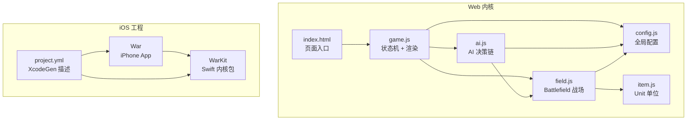
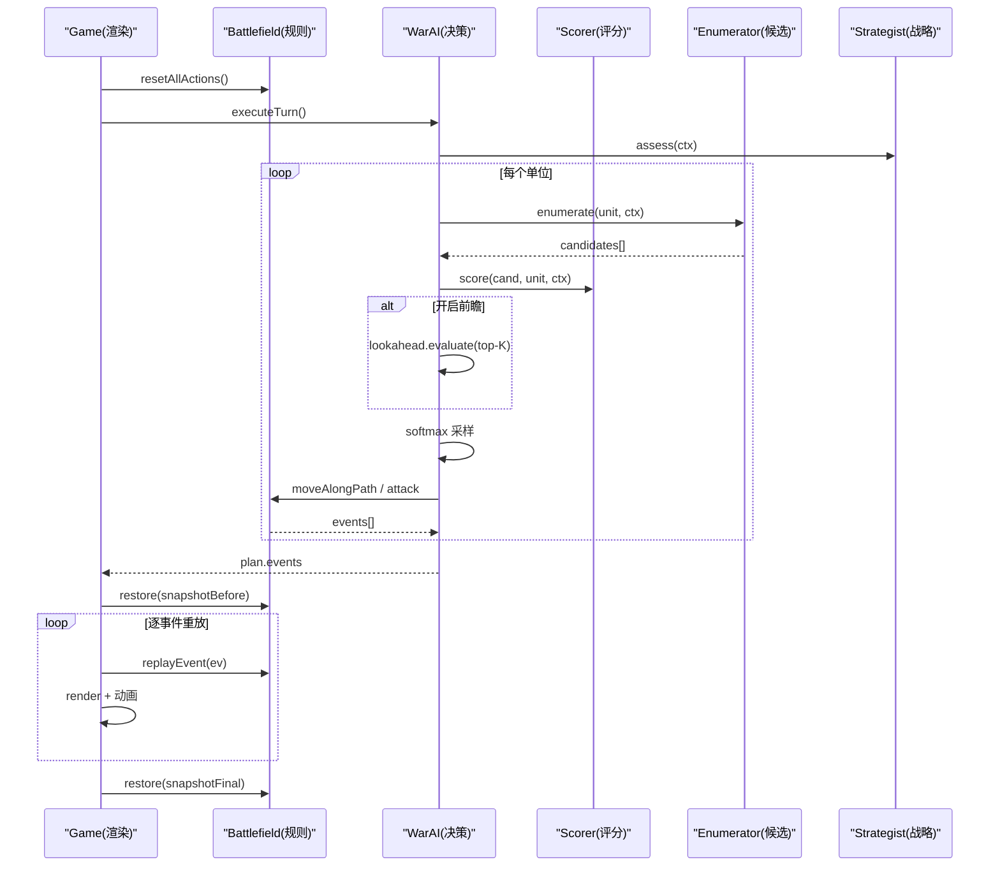
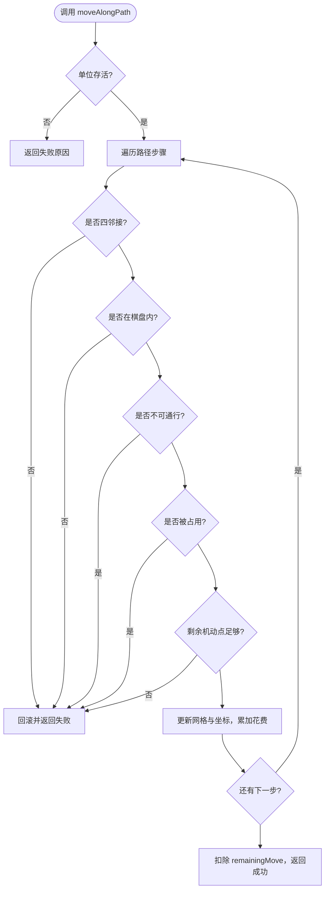
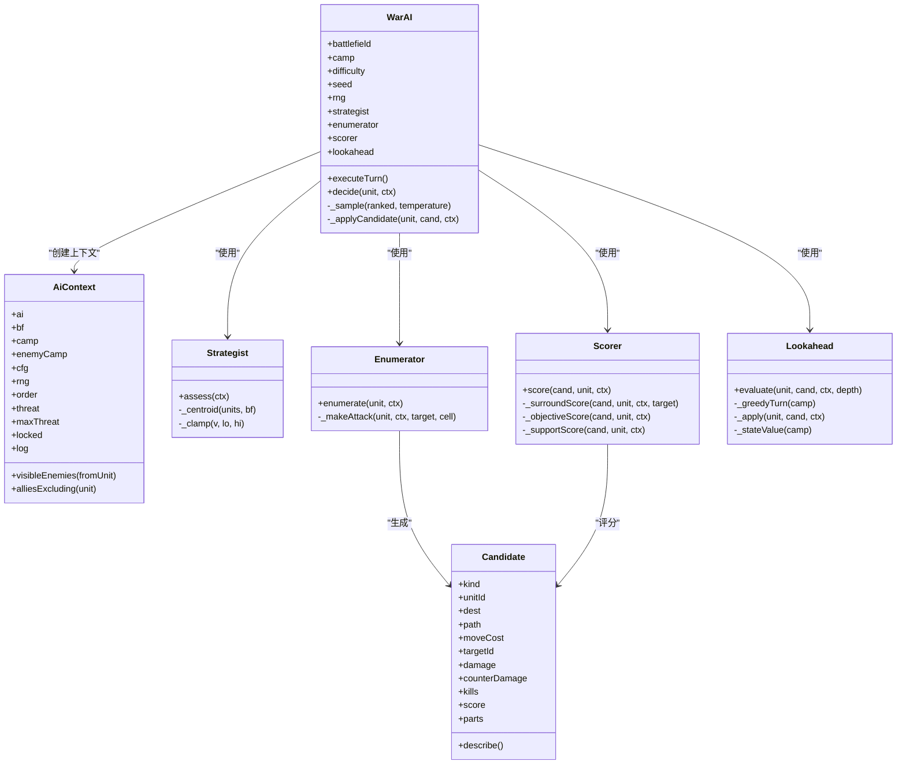
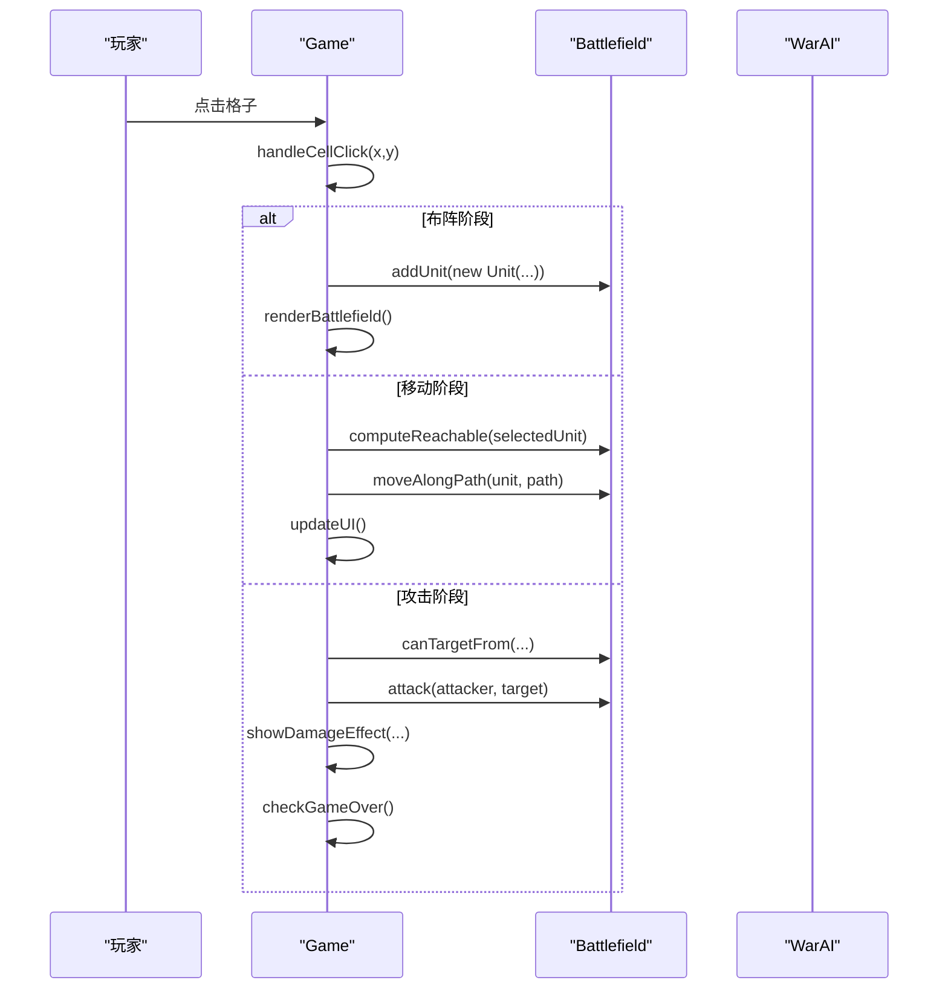
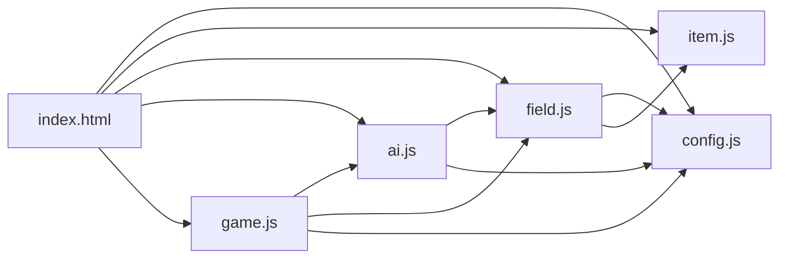

# 开发者指南

<cite>
**本文引用的文件**   
- [war/README.md](file://war/war/README.md)
- [package.json](file://war/war/package.json)
- [index.html](file://war/war/index.html)
- [config.js](file://war/war/config.js)
- [item.js](file://war/war/item.js)
- [field.js](file://war/war/field.js)
- [ai.js](file://war/war/ai.js)
- [game.js](file://war/war/game.js)
- [project.yml](file://war/ios/project.yml)
</cite>

## 目录
1. [引言](#引言)
2. [项目结构](#项目结构)
3. [环境搭建](#环境搭建)
4. [核心组件](#核心组件)
5. [架构总览](#架构总览)
6. [详细组件分析](#详细组件分析)
7. [依赖关系分析](#依赖关系分析)
8. [性能与调试](#性能与调试)
9. [扩展开发指南](#扩展开发指南)
10. [代码规范与最佳实践](#代码规范与最佳实践)
11. [常见问题排查](#常见问题排查)
12. [贡献与提交流程](#贡献与提交流程)
13. [结论](#结论)

## 引言
本指南面向 WAR 项目的 Web 与 iOS 开发者，目标是帮助你快速完成环境搭建、理解内核架构、扩展兵种/AI/地形系统，并掌握调试、性能分析与提交规范。项目采用“纯前端零依赖”的 JS 内核（可移植到 Swift），配合 iOS SwiftUI/SpriteKit 外壳；Web 端可直接在浏览器运行，iOS 端通过 XcodeGen 生成工程后构建。

## 项目结构
仓库包含两个主要子系统：
- Web 战棋原型：位于 war/war，使用 HTML/CSS/JS，零依赖，可在 Node 或浏览器直接运行。
- iOS 应用与内核包：位于 war/ios，War 为 iPhone App 外壳，WarKit 为纯逻辑 Swift Package。

**图示来源**
- [index.html:262-266](file://war/war/index.html#L262-L266)
- [game.js:12-42](file://war/war/game.js#L12-L42)
- [ai.js:421-434](file://war/war/ai.js#L421-L434)
- [field.js:11-32](file://war/war/field.js#L11-L32)
- [config.js:12-103](file://war/war/config.js#L12-L103)
- [project.yml:1-8](file://war/ios/project.yml#L1-L8)

**章节来源**
- [war/README.md:103-112](file://war/war/README.md#L103-L112)
- [project.yml:1-8](file://war/ios/project.yml#L1-L8)

## 环境搭建
### Node.js 与 Web 端
- 安装 Node.js（推荐 LTS）。
- 进入 war/war 目录。
- 启动本地服务：`npm start`（默认端口 5173）。
- 打开浏览器访问 http://localhost:5173。
- 运行回归测试：`npm test`。
- 语法检查：`npm run check`。

说明：
- package.json 提供 `start`、`test`、`check` 脚本。
- Web 内核不依赖 DOM 的文件（config.js / item.js / field.js / ai.js）可被 Node 直接加载用于测试。

**章节来源**
- [package.json:6-10](file://war/war/package.json#L6-L10)
- [war/README.md:39-47](file://war/war/README.md#L39-L47)

### Xcode 与 iOS 工程
- 安装 Xcode（支持 iOS 17+）。
- 安装 XcodeGen：`brew install xcodegen`。
- 进入 war/ios 目录，执行 `xcodegen generate` 生成 War.xcodeproj。
- 用 Xcode 打开工程，选择 War scheme，连接真机或模拟器即可运行。

说明：
- project.yml 定义部署目标、包依赖、Bundle ID、签名团队等。
- WarKit 作为 Swift Package 被 War 应用依赖，便于在 macOS 上 `swift test` 验证内核。

**章节来源**
- [project.yml:1-7](file://war/ios/project.yml#L1-L7)
- [project.yml:11-25](file://war/ios/project.yml#L11-L25)
- [project.yml:35-47](file://war/ios/project.yml#L35-L47)

## 核心组件
- config.js：集中定义棋盘尺寸、地形、兵种、难度旋钮、评分权重、归一化标尺、随机数种子类。
- item.js：Unit 单位模型，封装属性、配额、伤害计算、反击判定、序列化。
- field.js：Battlefield 战场，负责地形、占位、移动、攻击、可达域、威胁影响图、快照回滚。
- ai.js：AI 分层（Strategist → Enumerator → Scorer → Lookahead → WarAI），输出可重放事件序列。
- game.js：游戏状态机、DOM 渲染、AI 回合播放、自动战斗、调试可视化。

这些模块职责清晰、耦合低，适合独立扩展和测试。

**章节来源**
- [config.js:12-103](file://war/war/config.js#L12-L103)
- [item.js:12-44](file://war/war/item.js#L12-L44)
- [field.js:11-32](file://war/war/field.js#L11-L32)
- [ai.js:1-13](file://war/war/ai.js#L1-L13)
- [game.js:1-11](file://war/war/game.js#L1-L11)

## 架构总览
WAR 内核遵循“单一写入者”原则：坐标与占位仅由 Battlefield.moveAlongPath 修改，血量与死亡仅由 Battlefield.attack 修改；AI 通过 snapshot()/restore() 做轻量前瞻，避免复制战场对象。

**图示来源**
- [game.js:291-335](file://war/war/game.js#L291-L335)
- [ai.js:455-514](file://war/war/ai.js#L455-L514)
- [ai.js:517-560](file://war/war/ai.js#L517-L560)
- [field.js:391-429](file://war/war/field.js#L391-L429)
- [field.js:343-383](file://war/war/field.js#L343-L383)

## 详细组件分析

### 配置层（config.js）
- 棋盘尺寸集中在 WarConfig.board。
- 地形 key 与属性（防御加成、机动消耗、不可通行）统一维护。
- 兵种模板定义生命、攻防、射程、预算、反击能力、AI 价值。
- 难度以 vision/temperature/lookahead 三个正交旋钮表达，不再换算法。
- 评分权重与归一化标尺分离，便于调参。
- SeededRng 提供确定性随机，保证同 seed 同决策。

建议：
- 新增数值只改 config.js，不要在业务逻辑中硬编码。
- 调整难度时优先调旋钮与权重，不要写分支算法。

**章节来源**
- [config.js:12-103](file://war/war/config.js#L12-L103)
- [config.js:109-139](file://war/war/config.js#L109-L139)

### 单位模型（item.js）
- Unit 是纯状态对象，不直接修改坐标与网格。
- 将 AP 拆成 moveBudget 与 attackBudget，避免伪约束。
- damageTo/effectiveDefense/canAttack/canCounter 等均为纯函数或无副作用方法。
- toState/restoreState 支持快照与回滚。

扩展点：
- 新增兵种时在 config.js 添加模板，无需改动 Unit 构造逻辑。
- 如需新增状态（如护盾、buff），应在 Unit 增加字段并在 toState/restoreState 同步。

**章节来源**
- [item.js:12-44](file://war/war/item.js#L12-L44)
- [item.js:86-122](file://war/war/item.js#L86-L122)
- [item.js:126-149](file://war/war/item.js#L126-L149)

### 战场与规则（field.js）
- 唯一写入者：moveAlongPath 校验邻接、空格、地形消耗并扣机动点；attack 结算伤害与反击。
- 空间推理：computeReachable/reachableWithBudget 基于桶式优先队列实现 Dijkstra；buildThreatMap 按敌方完整机动预算外扩射程。
- 快照/回滚：snapshot/restore 支持 AI 前瞻与动画重放。
- 胜负判断：isGameOver/getWinner 基于双方存活单位数量。

关键流程：

**图示来源**
- [field.js:391-441](file://war/war/field.js#L391-L441)

**章节来源**
- [field.js:11-32](file://war/war/field.js#L11-L32)
- [field.js:219-287](file://war/war/field.js#L219-L287)
- [field.js:305-383](file://war/war/field.js#L305-L383)
- [field.js:452-508](file://war/war/field.js#L452-L508)
- [field.js:512-537](file://war/war/field.js#L512-L537)

### AI 决策链（ai.js）
- Strategist：根据物质差、兵种构成、最弱单位决定本轮战略（进攻/防守/冲锋/撤退/包抄）与目标区、集火目标。
- Enumerator：对每个单位枚举 (落点 × 动作) 候选，包括原地攻击、移动后攻击、纯机动、待命。
- Scorer：对所有候选用同一套归一化公式打分，含伤害、击杀、过量、目标价值、暴露风险、地形、集火、反击风险、机动保留、战略牵引、支援、待命惩罚、前瞻修正。
- Lookahead：对 top-K 候选进行 1~2 ply 浅推演，用局势评估修正分数。
- WarAI：编排整个阵营回合，产出可重放事件序列。

**图示来源**
- [ai.js:16-41](file://war/war/ai.js#L16-L41)
- [ai.js:44-124](file://war/war/ai.js#L44-L124)
- [ai.js:127-151](file://war/war/ai.js#L127-L151)
- [ai.js:159-221](file://war/war/ai.js#L159-L221)
- [ai.js:224-335](file://war/war/ai.js#L224-L335)
- [ai.js:341-418](file://war/war/ai.js#L341-L418)
- [ai.js:421-628](file://war/war/ai.js#L421-L628)

**章节来源**
- [ai.js:1-13](file://war/war/ai.js#L1-L13)
- [ai.js:455-514](file://war/war/ai.js#L455-L514)
- [ai.js:517-560](file://war/war/ai.js#L517-L560)
- [ai.js:572-591](file://war/war/ai.js#L572-L591)

### 渲染与状态机（game.js）
- Game 管理布阵阶段、选择/移动/攻击模式、自动战斗、AI vs 玩家。
- 渲染层读取 Battlefield 的可达域、威胁图、AI 最优落点，叠加可视化。
- AI 回合通过 snapshot/restore 与事件重放确保动画与真实决策一致。
- 提供策略线、决策日志、速度控制、种子输入等调试工具。

典型交互流程：

**图示来源**
- [game.js:156-241](file://war/war/game.js#L156-L241)
- [game.js:400-463](file://war/war/game.js#L400-L463)

**章节来源**
- [game.js:12-42](file://war/war/game.js#L12-L42)
- [game.js:291-335](file://war/war/game.js#L291-L335)
- [game.js:555-586](file://war/war/game.js#L555-L586)

## 依赖关系分析
- index.html 顺序加载 config.js → item.js → field.js → ai.js → game.js。
- game.js 依赖 WarConfig、Battlefield、WarAI。
- ai.js 依赖 Battlefield、WarConfig、SeededRng。
- field.js 依赖 WarConfig、Unit。
- item.js 依赖 WarConfig。
- iOS 侧 War 应用依赖 WarKit 包，二者通过公开 API 解耦。

**图示来源**
- [index.html:262-266](file://war/war/index.html#L262-L266)
- [game.js:12-42](file://war/war/game.js#L12-L42)
- [ai.js:421-434](file://war/war/ai.js#L421-L434)
- [field.js:11-32](file://war/war/field.js#L11-L32)

**章节来源**
- [index.html:262-266](file://war/war/index.html#L262-L266)

## 性能与调试
- 可达域使用桶式优先队列，避免比较器开销，适合小预算寻路。
- 威胁影响图缓存于 Float32Array，按版本失效，避免重复计算。
- AI 仅在 top-K 候选上做浅层前瞻，防止指数爆炸。
- 渲染层使用 DocumentFragment 批量插入节点，减少重排。
- 调试面板支持：
  - 可达域、威胁热力图、AI 最优落点可视化。
  - 策略线与决策日志（top-5 候选及分项得分）。
  - 地形种子与 AI 种子可调，便于复现问题。

建议：
- 大棋盘或大规模对战时，关闭不必要的 overlay（威胁/候选）以降低渲染压力。
- 使用 npm test 跑回归测试，确保规则与 AI 行为稳定。

**章节来源**
- [field.js:219-287](file://war/war/field.js#L219-L287)
- [field.js:452-508](file://war/war/field.js#L452-L508)
- [ai.js:524-538](file://war/war/ai.js#L524-L538)
- [game.js:400-463](file://war/war/game.js#L400-L463)
- [war/README.md:82-92](file://war/war/README.md#L82-L92)

## 扩展开发指南

### 新增兵种类型
步骤：
1. 在 config.js 的 unitTypes 中添加新兵种模板，包含 name/symbol/maxHealth/attack/defense/attackRange/moveBudget/attackBudget/counterAttack/aiValue。
2. 在 index.html 的兵种下拉框中添加对应 option。
3. 如需在 CSS 中区分外观，为 .unit.<type> 添加样式。
4. 运行 npm test 与手动测试，确认移动/攻击/反击/预算正常。

参考位置：
- 兵种模板定义：[config.js:33-55](file://war/war/config.js#L33-L55)
- 页面下拉选项：[index.html:171-175](file://war/war/index.html#L171-L175)
- 单位样式：[index.html:69-80](file://war/war/index.html#L69-L80)

注意事项：
- 保持 aiValue 合理，避免过强或过弱导致 AI 倾向失衡。
- 若新增状态（如护盾），需在 Unit.toState/restoreState 同步。

**章节来源**
- [config.js:33-55](file://war/war/config.js#L33-L55)
- [index.html:171-175](file://war/war/index.html#L171-L175)
- [index.html:69-80](file://war/war/index.html#L69-L80)
- [item.js:126-149](file://war/war/item.js#L126-L149)

### 自定义 AI 策略
步骤：
1. 在 ai.js 的 Strategist.assess 中扩展战略判断逻辑（例如新增“骚扰”“诱敌”策略）。
2. 在 Scorer 中新增评分项或调整权重，使新策略有相应收益。
3. 通过 difficulty 旋钮（vision/temperature/lookahead）与 weights 调节强度，避免写分支算法。
4. 使用决策日志观察候选排序与分项得分，验证策略效果。

参考位置：
- 战略层：[ai.js:44-124](file://war/war/ai.js#L44-L124)
- 评分层：[ai.js:224-335](file://war/war/ai.js#L224-L335)
- 难度旋钮：[config.js:57-63](file://war/war/config.js#L57-L63)
- 权重表：[config.js:69-83](file://war/war/config.js#L69-L83)

注意事项：
- 所有候选走同一评分通道，避免“先打再走”的贪心缺陷。
- 新增评分项需考虑量纲，使用 scale 归一化后再乘权重。

**章节来源**
- [ai.js:44-124](file://war/war/ai.js#L44-L124)
- [ai.js:224-335](file://war/war/ai.js#L224-L335)
- [config.js:57-83](file://war/war/config.js#L57-L83)

### 扩展地形系统
步骤：
1. 在 config.js 的 terrain 中添加新地形 key，设置 name/symbol/defBonus/moveCost/impassable/css。
2. 在 index.html 的 CSS 中为新地形添加背景样式。
3. 在 battlefield.generateTerrain 中调整生成概率分布，使新地形出现频率合理。
4. 测试移动消耗、防御加成、不可通行与镜像对称性。

参考位置：
- 地形定义：[config.js:18-25](file://war/war/config.js#L18-L25)
- 地形样式：[index.html:50-53](file://war/war/index.html#L50-L53)
- 地形生成：[field.js:101-126](file://war/war/field.js#L101-L126)

注意事项：
- impassable=true 的地形不会出现在可达域中。
- 地图左右镜像保证公平性，新增地形应尊重该约束。

**章节来源**
- [config.js:18-25](file://war/war/config.js#L18-L25)
- [index.html:50-53](file://war/war/index.html#L50-L53)
- [field.js:101-126](file://war/war/field.js#L101-L126)

## 代码规范与最佳实践
- 命名约定：
  - 类名使用 PascalCase（如 Battlefield、WarAI、Unit）。
  - 常量与配置对象使用大写前缀（WarConfig）。
  - 私有方法以下划线开头（如 _centroid、_stampRing）。
- 文件组织：
  - 配置集中：config.js。
  - 模型与规则分离：item.js、field.js。
  - AI 分层：ai.js。
  - 渲染与状态机：game.js。
- 注释规范：
  - 文件头说明职责与设计原则。
  - 关键算法与边界条件附注释（如 P0 修复说明）。
- 错误处理：
  - 移动失败返回 reason，渲染层提示用户。
  - 攻击拒绝返回 rejected，避免非法操作。
- 性能优化：
  - 使用缓存与版本失效机制。
  - 渲染批量更新（DocumentFragment）。
  - AI 限制前瞻深度与候选数量。

**章节来源**
- [war/README.md:49-80](file://war/war/README.md#L49-L80)
- [field.js:391-441](file://war/war/field.js#L391-L441)
- [field.js:343-383](file://war/war/field.js#L343-L383)
- [game.js:400-463](file://war/war/game.js#L400-L463)

## 常见问题排查
- 移动免费或无限走：
  - 检查是否绕过 Battlefield.moveAlongPath，确保坐标与 grid 的唯一写入者正确。
  - 确认 remainingMove 扣减与路径校验生效。
- AI 斜穿或跨格：
  - 检查路径是否为四邻接且步长为 1。
  - 确认 reachableWithBudget 与 moveAlongPath 的 cost 累加逻辑。
- 弓兵贴脸吃亏：
  - 查看 Scorer 中对远程单位贴脸的暴露惩罚是否生效。
- 威胁图异常：
  - 检查 buildThreatMap 是否使用敌方完整 moveBudget。
  - 确认缓存版本与战场 version 同步。
- 随机结果不可复现：
  - 确保所有随机源使用 SeededRng，禁止 Math.random。
  - 固定 terrainSeed 与 aiSeed 进行回归测试。

**章节来源**
- [war/README.md:49-80](file://war/war/README.md#L49-L80)
- [field.js:219-287](file://war/war/field.js#L219-L287)
- [field.js:452-508](file://war/war/field.js#L452-L508)
- [config.js:109-139](file://war/war/config.js#L109-L139)

## 贡献与提交流程
- 分支策略：
  - 主分支保护，功能开发在 feature/* 分支进行。
- 提交信息：
  - 使用语义化提交（feat/fix/chore/docs/test）。
  - 简要说明变更影响范围（如新增兵种、调整权重）。
- 测试要求：
  - 新增规则或 AI 逻辑必须补充或更新 tests/kernel.test.mjs。
  - 确保 npm test 全部通过。
- 代码审查：
  - 提交 PR 前自测 npm run check 与 npm test。
  - 关注 diff 中的配置与权重变更，避免破坏平衡。
- iOS 相关：
  - 修改 WarKit 后在 macOS 上 swift test 验证。
  - 更新 project.yml 后重新生成工程并构建。

**章节来源**
- [package.json:6-10](file://war/war/package.json#L6-L10)
- [war/README.md:39-47](file://war/war/README.md#L39-L47)
- [project.yml:1-7](file://war/ios/project.yml#L1-L7)

## 结论
WAR 项目通过清晰的模块划分与“单一写入者”规则，实现了可扩展的战棋内核与稳定的 AI 决策链。开发者应优先在 config.js 中集中维护数值，在 ai.js 中以评分与旋钮方式调整难度，在 field.js 中严格遵循移动与攻击的边界条件。借助调试面板与回归测试，可以快速定位问题并验证扩展效果。iOS 端通过 WarKit 复用内核逻辑，便于跨平台验证与发布。