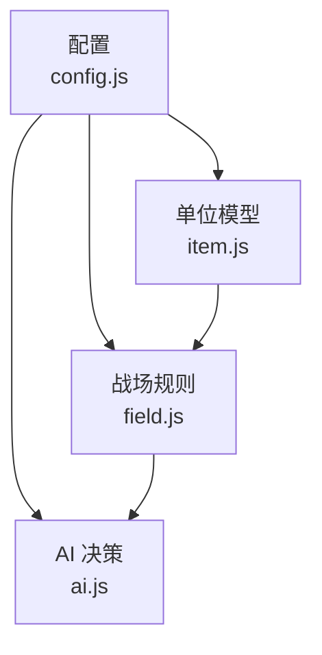
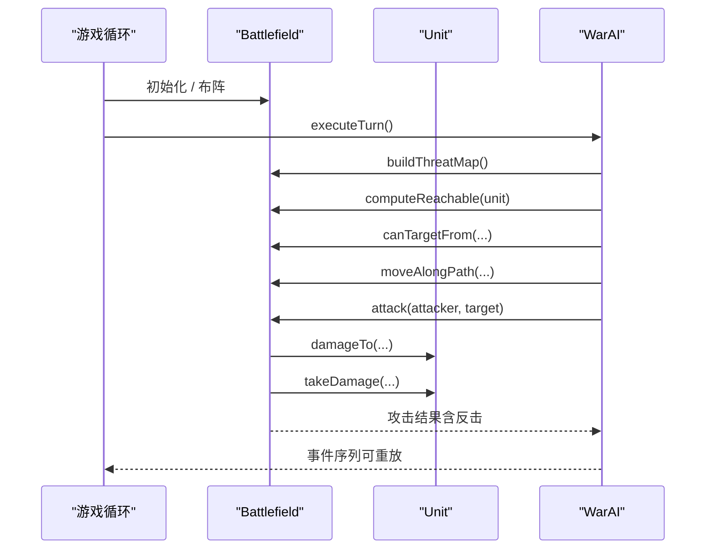
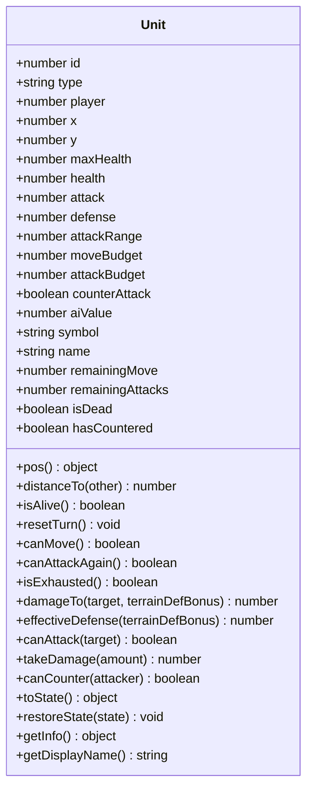
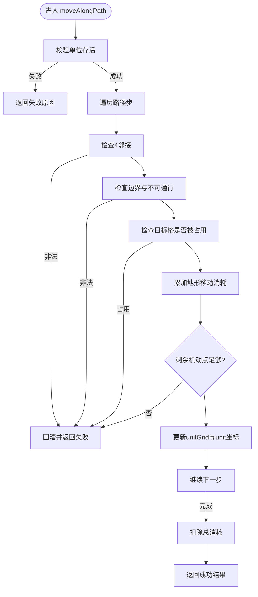
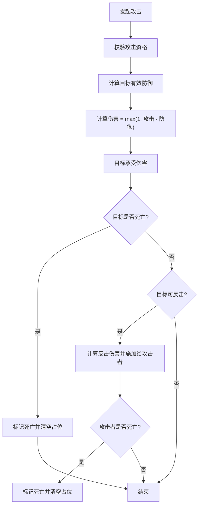
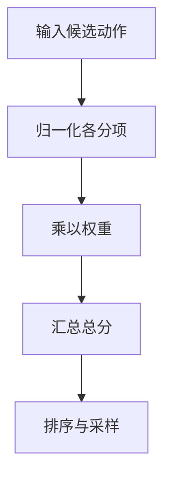
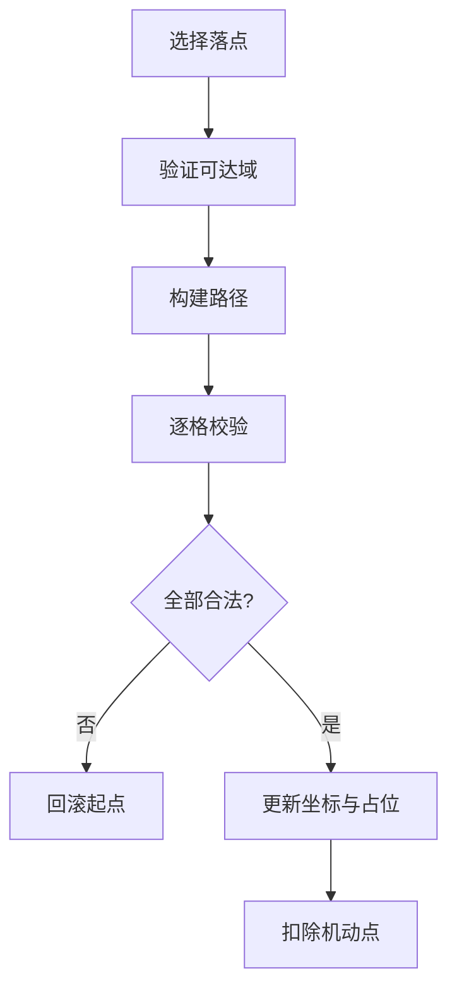
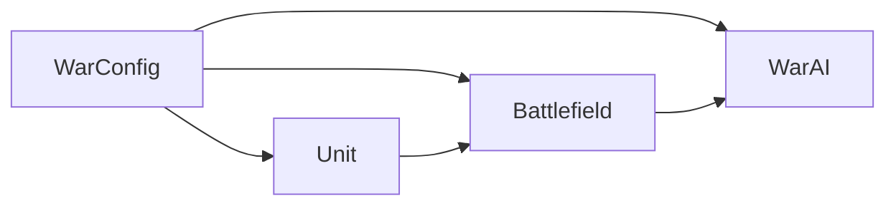

# 单位系统

<cite>
**本文引用的文件**   
- [item.js](file://war/war/item.js)
- [field.js](file://war/war/field.js)
- [config.js](file://war/war/config.js)
- [ai.js](file://war/war/ai.js)
- [README.md](file://war/war/README.md)
</cite>

## 目录
1. [引言](#引言)
2. [项目结构](#项目结构)
3. [核心组件](#核心组件)
4. [架构总览](#架构总览)
5. [详细组件分析](#详细组件分析)
6. [依赖关系分析](#依赖关系分析)
7. [性能与复杂度](#性能与复杂度)
8. [API 使用示例](#api-使用示例)
9. [故障排查](#故障排查)
10. [结论](#结论)

## 引言
本文件为 WAR 游戏的“单位系统”提供完整技术文档。重点覆盖以下内容：
- Unit 类的设计模式与纯状态对象理念
- 单位生命周期管理与回合内状态变更机制
- 三种基础兵种（步兵、骑兵、弓兵）的属性体系
- 伤害计算、反击系统与单位价值评估算法
- 单位与战场交互：移动规则、攻击范围、地形影响
- 面向创建、操作与查询的 API 使用示例

该设计强调“单一写入者”原则：坐标与占位只由 Battlefield 修改，Unit 退化为纯状态对象；行动力拆分为独立预算，避免旧版“移动免费”和“远程单位走一步就射不了箭”的规则漏洞。

**章节来源**
- [README.md:37-101](file://war/war/README.md#L37-L101)

## 项目结构
WAR 内核采用“配置 + 模型 + 战场 + AI + 游戏循环”的分层组织：
- config.js：全局数值定义（棋盘、地形、兵种、难度旋钮、评分权重、随机种子）
- item.js：Unit 纯状态对象（属性、配额、伤害、序列化）
- field.js：Battlefield 战场（地形、占位、移动、攻击、可达域、威胁图、快照）
- ai.js：AI 决策分层（战略、枚举、评分、前瞻、编排）
- README.md：需求说明、重构说明、运行方式与文件职责

**图表来源**
- [config.js:12-103](file://war/war/config.js#L12-L103)
- [item.js:12-172](file://war/war/item.js#L12-L172)
- [field.js:11-617](file://war/war/field.js#L11-L617)
- [ai.js:15-647](file://war/war/ai.js#L15-L647)

**章节来源**
- [README.md:103-112](file://war/war/README.md#L103-L112)

## 核心组件
- Unit：纯状态单位对象，封装属性、配额、伤害、反击判定与序列化。
- Battlefield：战场容器，负责地形、单位占位、移动结算、攻击结算、可达域、威胁影响图、胜负判断与物质分评估。
- WarConfig：唯一数值源，包含棋盘尺寸、地形参数、兵种模板、难度旋钮、评分权重与归一化标尺。
- AI 分层：Strategist（战略）、Enumerator（候选枚举）、Scorer（效用评分）、Lookahead（浅推演）、WarAI（编排）。

这些组件共同实现“纯函数式伤害计算 + 单一写入者战场 + 可回滚快照”的可测试内核。

**章节来源**
- [item.js:1-178](file://war/war/item.js#L1-L178)
- [field.js:1-622](file://war/war/field.js#L1-L622)
- [config.js:1-146](file://war/war/config.js#L1-L146)
- [ai.js:1-648](file://war/war/ai.js#L1-L648)

## 架构总览
下图展示单位系统在运行时如何协作：

**图表来源**
- [field.js:225-383](file://war/war/field.js#L225-L383)
- [ai.js:455-514](file://war/war/ai.js#L455-L514)

## 详细组件分析

### Unit 类：纯状态对象与生命周期
Unit 是“纯状态对象”，不直接修改战场网格或坐标；所有副作用由 Battlefield 统一处理。其生命周期包括：
- 构造：从 WarConfig.unitTypes 加载兵种模板，初始化生命值、攻防、射程、机动/攻击配额等。
- 回合重置：每回合开始时恢复 remainingMove、remainingAttacks 与 hasCountered。
- 存活判定：health <= 0 时 isDead = true，但仍在 units 数组中直到清理。
- 序列化：toState/restoreState 支持快照与回滚。

**图表来源**
- [item.js:12-172](file://war/war/item.js#L12-L172)

**章节来源**
- [item.js:12-172](file://war/war/item.js#L12-L172)

### Battlefield：战场、移动与攻击
Battlefield 是“单一写入者”，保证：
- 坐标与占位只能通过 moveAlongPath 更新，并同步扣减机动点。
- 血量与死亡只能通过 attack 更新，并从 unitGrid 精确移除。
- 通过 snapshot/restore 支持 AI 浅推演的可回滚模拟。

关键能力：
- 地形生成与查询：generateTerrain、terrainAt、terrainDefBonus、isImpassable。
- 单位管理：addUnit、removeUnit、cleanupDeadUnits、unitsOfCamp。
- 空间推理：computeReachable/reachableWithBudget（Dijkstra + 桶优先队列）、hasLineOfSight、canTargetFrom。
- 攻击结算：attack（主击 + 反击），返回结构化结果。
- 威胁影响图：buildThreatMap（按敌方满预算可达域外扩射程，累计攻击力）。
- 胜负与评估：isGameOver、getWinner、materialScore。

**图表来源**
- [field.js:391-441](file://war/war/field.js#L391-L441)

**章节来源**
- [field.js:11-617](file://war/war/field.js#L11-L617)

### 兵种属性体系：步兵、骑兵、弓兵
兵种模板集中在 WarConfig.unitTypes，核心属性如下：
- 生命值 maxHealth：决定生存上限。
- 攻击力 attack：基础伤害来源。
- 防御力 defense：与地形防御加成叠加后参与伤害减免。
- 攻击范围 attackRange：近战为 1，远程为 2。
- 机动点 moveBudget：每回合可用移动预算，按地形 moveCost 累扣。
- 攻击配额 attackBudget：每回合可攻击次数。
- 反击 counterAttack：是否具备反击能力。
- AI 价值 aiValue：用于价值评估与集火优先级。

| 兵种 | 生命值 | 攻击力 | 防御力 | 攻击范围 | 机动点 | 攻击配额 | 反击 | AI 价值 |
|---|---:|---:|---:|---:|---:|---:|---:|---:|
| 步兵 | 100 | 40 | 12 | 1 | 4 | 1 | 是 | 1.00 |
| 骑兵 | 90 | 50 | 10 | 1 | 7 | 1 | 是 | 1.15 |
| 弓兵 | 60 | 45 | 6 | 2 | 4 | 1 | 否 | 1.35 |

**章节来源**
- [config.js:33-55](file://war/war/config.js#L33-L55)

### 伤害计算与反击系统
伤害计算在 Unit.damageTo 中实现，考虑目标有效防御（自身防御 + 地形防御加成），并保证最小伤害为 1。反击由 Battlefield.attack 触发，满足以下条件：
- 目标未被击杀
- 目标具备反击能力
- 攻击者在目标射程内
- 目标本回合尚未反击过

反击伤害同样基于 Unit.damageTo，并计入攻击结果中的 counterDamage 与 counterKilled。

**图表来源**
- [item.js:88-122](file://war/war/item.js#L88-L122)
- [field.js:343-383](file://war/war/field.js#L343-L383)

**章节来源**
- [item.js:88-122](file://war/war/item.js#L88-L122)
- [field.js:343-383](file://war/war/field.js#L343-L383)

### 单位价值评估算法
评估围绕“期望净伤害、致死奖励、浪费惩罚、目标价值、暴露风险、地形收益、集火协同、反击风险、机动力保留、战略目标、支援距离、待命惩罚、前瞻增益”等维度进行加权求和。所有分项先归一化到 [0,1]，再乘以权重，避免量纲失衡。

- 伤害类：damage、kill、overkill、targetValue、counter
- 位置类：exposure、terrain、waste、mobility
- 协同类：surround、objective、support
- 前瞻类：followup（仅 lookahead > 0 时生效）

**图表来源**
- [ai.js:224-335](file://war/war/ai.js#L224-L335)
- [config.js:69-93](file://war/war/config.js#L69-L93)

**章节来源**
- [ai.js:224-335](file://war/war/ai.js#L224-L335)
- [config.js:69-93](file://war/war/config.js#L69-L93)

### 单位与战场交互：移动、攻击范围与地形
- 移动规则：moveAlongPath 逐步校验 4 邻接、边界、不可通行、单位阻挡、地形消耗与机动预算；失败时回滚，确保无部分副作用。
- 攻击范围：canTargetFrom 结合 Unit.distance 与 hasLineOfSight（同行/同列且中间格无单位遮挡）判定。
- 地形影响：不同地形具有不同的 moveCost 与 defBonus；water/wall 为不可通行；forest/hill 提供防御加成。

**图表来源**
- [field.js:225-287](file://war/war/field.js#L225-L287)
- [field.js:391-441](file://war/war/field.js#L391-L441)
- [field.js:311-328](file://war/war/field.js#L311-L328)
- [config.js:19-25](file://war/war/config.js#L19-L25)

**章节来源**
- [field.js:225-287](file://war/war/field.js#L225-L287)
- [field.js:311-328](file://war/war/field.js#L311-L328)
- [field.js:391-441](file://war/war/field.js#L391-L441)
- [config.js:19-25](file://war/war/config.js#L19-L25)

## 依赖关系分析
- Unit 依赖 WarConfig.unitTypes 获取兵种模板。
- Battlefield 依赖 WarConfig.terrain 与 board 尺寸，以及 SeededRng 生成地形。
- AI 依赖 Battlefield 提供的空间推理与结算接口，并通过 WarConfig.difficulty 与 weights/scale 控制策略与评分。

**图表来源**
- [config.js:12-103](file://war/war/config.js#L12-L103)
- [item.js:12-44](file://war/war/item.js#L12-L44)
- [field.js:11-32](file://war/war/field.js#L11-L32)
- [ai.js:421-434](file://war/war/ai.js#L421-L434)

**章节来源**
- [config.js:12-103](file://war/war/config.js#L12-L103)
- [item.js:12-44](file://war/war/item.js#L12-L44)
- [field.js:11-32](file://war/war/field.js#L11-L32)
- [ai.js:421-434](file://war/war/ai.js#L421-L434)

## 性能与复杂度
- 可达域计算：使用桶式优先队列（预算较小）近似 Dijkstra，时间复杂度约 O(B * (V + E))，其中 B 为机动预算，V/E 为网格节点与边数。
- 威胁影响图：对敌方每个单位的满预算可达域进行环形扩散，时间复杂度约 O(N_enemies * Reach_cells * Ring_size)。
- 攻击与反击：O(1) 伤害计算，O(1) 状态更新。
- 快照与回滚：snapshot/restore 为 O(U)，U 为单位数量。

整体在 20×20 棋盘上，单回合 AI 决策通常在毫秒级，适合前端实时交互。

**章节来源**
- [field.js:225-287](file://war/war/field.js#L225-L287)
- [field.js:462-508](file://war/war/field.js#L462-L508)
- [field.js:512-529](file://war/war/field.js#L512-L529)

## API 使用示例
以下示例以“创建单位、移动、攻击、查询状态”为主线，展示常用 API 调用流程。为避免泄露具体代码内容，仅提供调用步骤与路径引用。

- 创建战场与布阵
  - 初始化战场：new Battlefield(width, height, seed)
  - 设置默认编成：battlefield.setDefaultLayout(WarConfig.defaultRoster)
  - 参考路径：[field.js:591-602](file://war/war/field.js#L591-L602)、[config.js:101-103](file://war/war/config.js#L101-L103)

- 添加单位
  - 创建单位：new Unit(type, player, x, y, id)
  - 加入战场：battlefield.addUnit(unit)
  - 参考路径：[item.js:12-44](file://war/war/item.js#L12-L44)、[field.js:140-156](file://war/war/field.js#L140-L156)

- 查询单位信息
  - 获取单位详情：unit.getInfo()
  - 获取显示名称：unit.getDisplayName()
  - 参考路径：[item.js:151-171](file://war/war/item.js#L151-L171)

- 移动单位
  - 计算可达域：battlefield.computeReachable(unit)
  - 沿路径移动：battlefield.moveAlongPath(unit, path)
  - 兼容移动：battlefield.moveUnit(unit, x, y)
  - 参考路径：[field.js:225-287](file://war/war/field.js#L225-L287)、[field.js:391-441](file://war/war/field.js#L391-L441)、[field.js:444-450](file://war/war/field.js#L444-L450)

- 攻击目标
  - 查询可攻击目标：battlefield.getAttackableTargets(unit)
  - 执行攻击：battlefield.attack(attacker, target)
  - 参考路径：[field.js:331-338](file://war/war/field.js#L331-L338)、[field.js:343-383](file://war/war/field.js#L343-L383)

- 回合重置与清理
  - 重置行动配额：battlefield.resetAllActions()
  - 清理死亡单位：battlefield.cleanupDeadUnits()
  - 参考路径：[field.js:201-205](file://war/war/field.js#L201-L205)、[field.js:189-199](file://war/war/field.js#L189-L199)

- AI 回合执行
  - 创建 AI：new WarAI(battlefield, camp, { difficulty, seed })
  - 执行整回合：ai.executeTurn()
  - 参考路径：[ai.js:421-434](file://war/war/ai.js#L421-L434)、[ai.js:455-514](file://war/war/ai.js#L455-L514)

**章节来源**
- [field.js:140-156](file://war/war/field.js#L140-L156)
- [field.js:225-287](file://war/war/field.js#L225-L287)
- [field.js:331-383](file://war/war/field.js#L331-L383)
- [field.js:391-450](file://war/war/field.js#L391-L450)
- [field.js:591-602](file://war/war/field.js#L591-L602)
- [item.js:12-44](file://war/war/item.js#L12-L44)
- [item.js:151-171](file://war/war/item.js#L151-L171)
- [ai.js:421-434](file://war/war/ai.js#L421-L434)
- [ai.js:455-514](file://war/war/ai.js#L455-L514)
- [config.js:101-103](file://war/war/config.js#L101-L103)

## 故障排查
常见问题与定位建议：
- 移动免费或无限走：确认是否通过 Battlefield.moveAlongPath 更新坐标与占位，并确保扣减 remainingMove。
  - 参考路径：[field.js:391-441](file://war/war/field.js#L391-L441)
- 远程单位无法射击：检查 canTargetFrom 与 hasLineOfSight，确认视线是否被单位遮挡。
  - 参考路径：[field.js:311-328](file://war/war/field.js#L311-L328)
- 反击异常：确认目标具备反击能力、未在本回合反击过，且攻击者在射程内。
  - 参考路径：[item.js:117-122](file://war/war/item.js#L117-L122)、[field.js:371-378](file://war/war/field.js#L371-L378)
- 地形不可通行：检查 terrain.impassable 与 isWalkable 逻辑。
  - 参考路径：[field.js:85-87](file://war/war/field.js#L85-L87)、[config.js:19-25](file://war/war/config.js#L19-L25)
- AI 决策不稳定：确认使用 SeededRng 而非 Math.random()，并固定 seed。
  - 参考路径：[config.js:109-139](file://war/war/config.js#L109-L139)

**章节来源**
- [field.js:85-87](file://war/war/field.js#L85-L87)
- [field.js:311-328](file://war/war/field.js#L311-L328)
- [field.js:371-378](file://war/war/field.js#L371-L378)
- [field.js:391-441](file://war/war/field.js#L391-L441)
- [item.js:117-122](file://war/war/item.js#L117-L122)
- [config.js:109-139](file://war/war/config.js#L109-L139)

## 结论
WAR 的单位系统以“纯状态 Unit + 单一写入者 Battlefield + 集中配置 WarConfig”为核心，实现了清晰的生命周期管理、稳健的移动与攻击结算、可扩展的兵种属性体系与可复现的 AI 决策流程。通过归一化的效用评分与浅层前瞻，AI 能在多权衡下做出稳定决策；而快照与回滚机制则为调试与可视化提供了坚实基础。