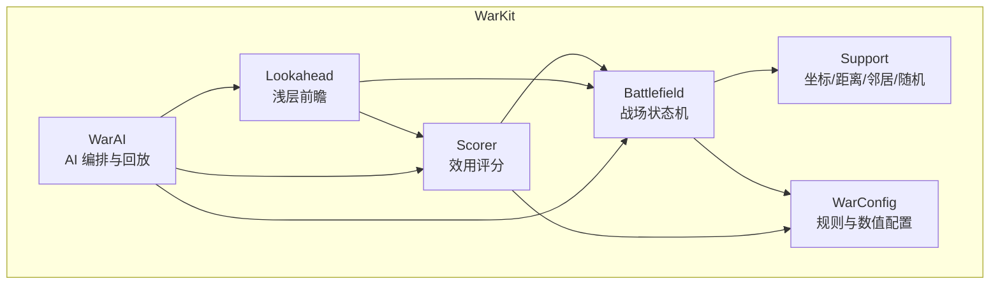
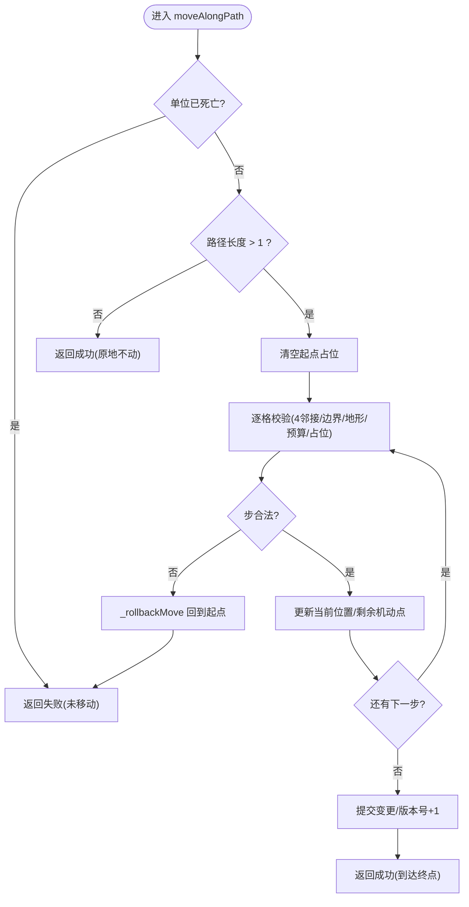
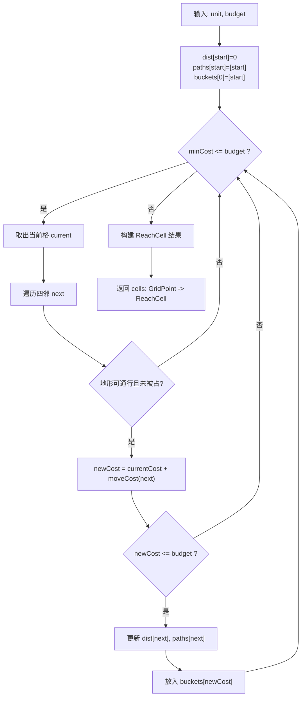
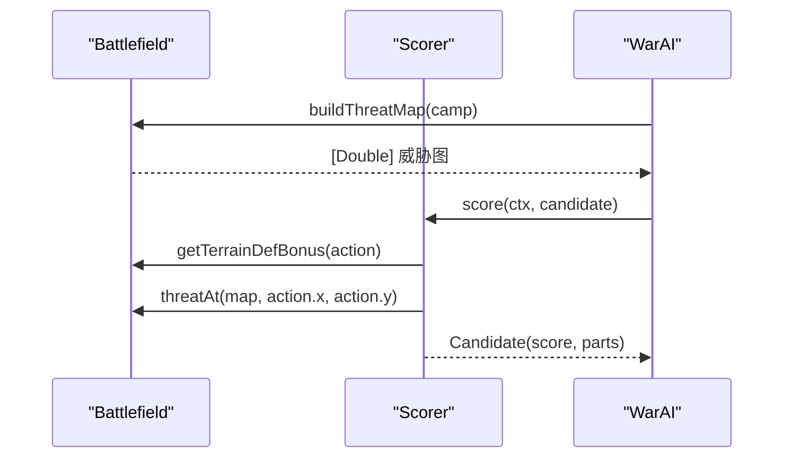
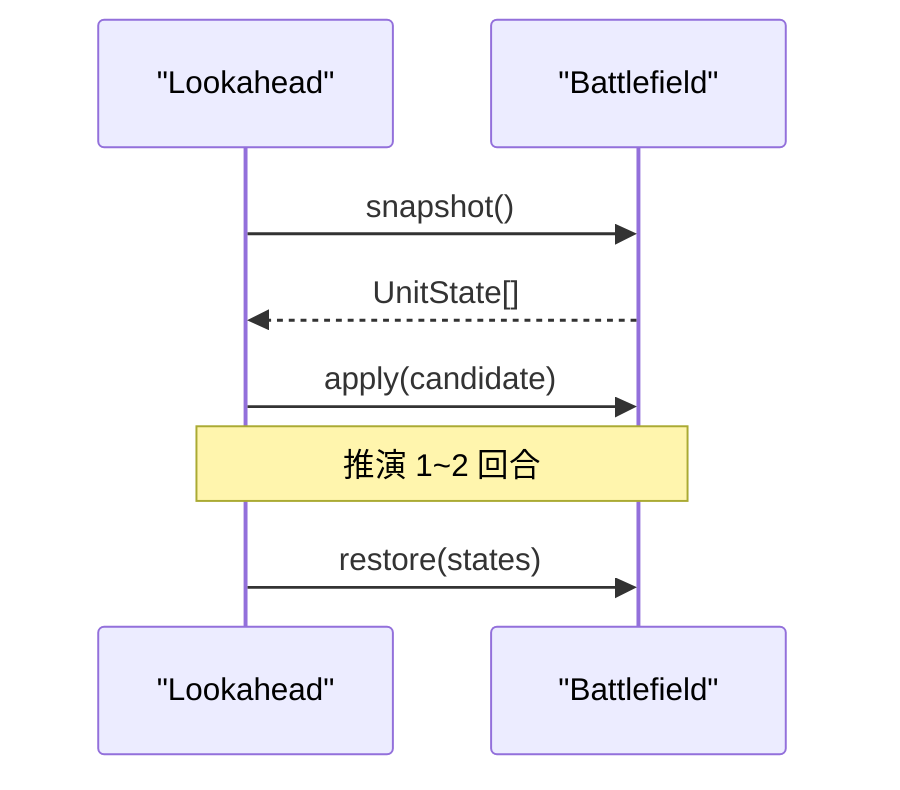
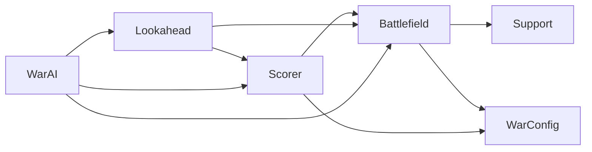

# 战场管理系统

<cite>
**本文引用的文件**   
- [Battlefield.swift](file://war/ios/WarKit/Sources/WarKit/Battlefield.swift)
- [Lookahead.swift](file://war/ios/WarKit/Sources/WarKit/Lookahead.swift)
- [Scorer.swift](file://war/ios/WarKit/Sources/WarKit/Scorer.swift)
- [WarAI.swift](file://war/ios/WarKit/Sources/WarKit/WarAI.swift)
- [Support.swift](file://war/ios/WarKit/Sources/WarKit/Support.swift)
- [WarConfig.swift](file://war/ios/WarKit/Sources/WarKit/WarConfig.swift)
</cite>

## 目录
1. [引言](#引言)
2. [项目结构](#项目结构)
3. [核心组件](#核心组件)
4. [架构总览](#架构总览)
5. [详细组件分析](#详细组件分析)
6. [依赖关系分析](#依赖关系分析)
7. [性能与复杂度](#性能与复杂度)
8. [故障排查指南](#故障排查指南)
9. [结论](#结论)
10. [附录：API 使用指南](#附录api-使用指南)

## 引言
本文件系统性地梳理 WAR 游戏的战场管理系统，围绕 Battlefield 类的架构设计、唯一状态写入者（Single Writer）模式、二维网格空间数据结构、可达域计算、威胁影响图生成、空间推理机制、快照与回滚、地形对移动与战斗的影响，以及面向 AI 前瞻推演的支持进行说明。文档同时给出战场查询、状态更新和事件处理的 API 使用建议，帮助读者从“概念理解”逐步深入到“代码级实现”。

## 项目结构
WAR 的 iOS 内核位于 WarKit 模块中，战场管理相关代码集中在以下文件：
- Battlefield.swift：战场状态机、地形与单位索引、移动/攻击/施法结算、可达域与威胁图、快照/回滚、地图生成与布阵。
- Support.swift：坐标 GridPoint、曼哈顿距离、四邻邻居、确定性随机数 SeededRng。
- WarConfig.swift：棋盘尺寸、地形表、兵种表、魔法表、难度与评分权重等规则配置。
- Scorer.swift：候选动作效用评分器，将多维指标归一化后加权汇总。
- Lookahead.swift：浅层前瞻推演，对 top-K 候选做 1~2 回合 rollout。
- WarAI.swift：AI 编排层，串联枚举、评分、前瞻、采样与执行，并输出可重放事件。



**图表来源**
- [Battlefield.swift:46-96](file://war/ios/WarKit/Sources/WarKit/Battlefield.swift#L46-L96)
- [Support.swift:3-33](file://war/ios/WarKit/Sources/WarKit/Support.swift#L3-L33)
- [WarConfig.swift:5-65](file://war/ios/WarKit/Sources/WarKit/WarConfig.swift#L5-L65)
- [Scorer.swift:1-11](file://war/ios/WarKit/Sources/WarKit/Scorer.swift#L1-L11)
- [Lookahead.swift:3-23](file://war/ios/WarKit/Sources/WarKit/Lookahead.swift#L3-L23)
- [WarAI.swift:1-16](file://war/ios/WarKit/Sources/WarKit/WarAI.swift#L1-L16)

**章节来源**
- [Battlefield.swift:46-96](file://war/ios/WarKit/Sources/WarKit/Battlefield.swift#L46-L96)
- [WarConfig.swift:5-65](file://war/ios/WarKit/Sources/WarKit/WarConfig.swift#L5-L65)

## 核心组件
- Battlefield：战场状态机，维护地形二维数组、单位数组与单位网格索引；提供基础查询、视线判定、可达域计算、威胁影响图、移动/攻击/施法结算、成长与转职、终局判定、快照/回滚、地图生成与布阵。
- Support：GridPoint 坐标、Grid 工具方法（曼哈顿距离、四邻）、SeededRng 确定性随机。
- WarConfig：棋盘尺寸、地形定义、兵种属性、升级与转职、魔法效果、回合上限、难度档位、评分权重与归一化标尺。
- Scorer：将候选动作的多项指标归一化到 [0,1]，按权重加权求和，并加入低难度抖动。
- Lookahead：对 top-K 候选进行 1~2 回合浅层 rollout，评估状态价值变化，调整候选分数。
- WarAI：串联决策流程（枚举→评分→前瞻→采样→执行），输出 TurnPlan 与 AiEvent，并提供 Replay 回放接口。

**章节来源**
- [Battlefield.swift:46-96](file://war/ios/WarKit/Sources/WarKit/Battlefield.swift#L46-L96)
- [Support.swift:3-76](file://war/ios/WarKit/Sources/WarKit/Support.swift#L3-L76)
- [WarConfig.swift:5-576](file://war/ios/WarKit/Sources/WarKit/WarConfig.swift#L5-L576)
- [Scorer.swift:1-268](file://war/ios/WarKit/Sources/WarKit/Scorer.swift#L1-L268)
- [Lookahead.swift:3-168](file://war/ios/WarKit/Sources/WarKit/Lookahead.swift#L3-L168)
- [WarAI.swift:1-233](file://war/ios/WarKit/Sources/WarKit/WarAI.swift#L1-L233)

## 架构总览
Battlefield 作为“唯一状态写入者”，所有可变状态变更都通过其公开方法完成；AI 在推演中也复用这些方法，从而保证“玩家看到的规则”与“AI 计算的规则”完全一致。

```mermaid
classDiagram
class Battlefield {
+int width
+int height
-string[][] terrain
-WarUnit[] units
-WarUnit?[][] unitGrid
-int version
+isInside(x,y) bool
+getTerrain(x,y) Terrain
+computeReachable(unit) map
+moveAlongPath(unit,path) MoveResult
+attack(attacker,target) AttackResult
+castSpell(caster,spellKey,target) SpellResult
+snapshot() UnitState[]
+restore(states) void
+matchOutcome(forTurnOf camp) MatchOutcome
}
class Support {
<<enum>> Grid {
+manhattan(a,b) int
+neighbors4(p,width,height) GridPoint[]
}
<<struct>> GridPoint {
+int x
+int y
}
<<struct>> SeededRng {
+next() double
+int(upper) int
}
}
class WarConfig {
<<enum>>
+BoardSize defaultBoard
+Terrain terrains[key]
+UnitStat unitTypes[key]
+SpellStat spells[key]
+Difficulty difficulties[key]
+Weights weights
+Scale scale
}
Battlefield --> Support : "使用坐标/邻居/随机"
Battlefield --> WarConfig : "读取地形/兵种/魔法/权重"
```

**图表来源**
- [Battlefield.swift:46-96](file://war/ios/WarKit/Sources/WarKit/Battlefield.swift#L46-L96)
- [Support.swift:3-76](file://war/ios/WarKit/Sources/WarKit/Support.swift#L3-L76)
- [WarConfig.swift:5-576](file://war/ios/WarKit/Sources/WarKit/WarConfig.swift#L5-L576)

## 详细组件分析

### Battlefield：唯一状态写入者与职责边界
- 数据模型
  - 地形：`terrain[y][x]`，行优先二维数组，缺格或未知 key 补默认平原。
  - 单位：`units` 数组为主数据源，`unitGrid[y][x]` 为派生索引；击杀只清空 grid 位置，不删除数组元素，以保证下标稳定，便于快照/回滚对齐。
  - 版本缓存：`version` 用于失效可达域与威胁图缓存；任何写操作都会 `version += 1`。
- 唯一写入点
  - 移动：`moveAlongPath` 是唯一扣减机动点的入口，非法路径会回滚到起点且不扣点。
  - 伤害：`attack` 是唯一伤害写入点，含反击与击杀清位。
  - 施法：`castSpell` 是魔法唯一写入点，只有首领能施法，且与普攻互斥。
  - 成长/转职：`allocate`、`promote` 是属性点与转职的唯一写入点。
- 设计约定
  - 单位以 `units` 为准，`unitGrid` 仅索引；击杀不清数组，避免快照错位。
  - 可达域/影响图带版本缓存，写操作使缓存失效。
  - 所有 AI 推演复用 Battlefield 的方法，确保规则一致性。



**图表来源**
- [Battlefield.swift:327-388](file://war/ios/WarKit/Sources/WarKit/Battlefield.swift#L327-L388)

**章节来源**
- [Battlefield.swift:46-96](file://war/ios/WarKit/Sources/WarKit/Battlefield.swift#L46-L96)
- [Battlefield.swift:327-388](file://war/ios/WarKit/Sources/WarKit/Battlefield.swift#L327-L388)

### 二维网格战场的空间数据结构
- 地形分布
  - 默认地形键为“平原”，自定义地形缺失或未知 key 时补平原。
  - 地形包含移动消耗、防御加成、是否不可通行等属性。
- 单位部署
  - 初始化时过滤越界、死亡、重复占位的单位；`unitGrid` 与 `terrain` 同构。
  - 布阵阶段通过 `placeArmy` 与 `setDefaultLayout` 落位，首领免费且必带，士兵按出生区顺序放置。
- 坐标映射
  - 坐标采用左上角原点，x 向右、y 向下；曼哈顿距离与四邻邻居由 Grid 提供。
  - 可达域计算使用桶式优先队列（cost 为整数，值域极小）。

```mermaid
erDiagram
GRIDPOINT {
int x
int y
}
TERRAIN {
string key
string name
int moveCost
int defBonus
bool impassable
}
UNIT {
int id
int camp
string typeKey
int hp
int atk
int def
int moveRange
int attackRange
bool isChief
}
BATTLEFIELD {
int width
int height
string[][] terrain
UNIT[] units
UNIT?[][] unitGrid
}
BATTLEFIELD ||--o{ UNIT : "拥有"
BATTLEFIELD ||--|| GRIDPOINT : "坐标范围"
BATTLEFIELD ||--o{ TERRAIN : "引用"
```

**图表来源**
- [Battlefield.swift:46-96](file://war/ios/WarKit/Sources/WarKit/Battlefield.swift#L46-L96)
- [Support.swift:3-33](file://war/ios/WarKit/Sources/WarKit/Support.swift#L3-L33)
- [WarConfig.swift:31-65](file://war/ios/WarKit/Sources/WarKit/WarConfig.swift#L31-L65)

**章节来源**
- [Battlefield.swift:65-96](file://war/ios/WarKit/Sources/WarKit/Battlefield.swift#L65-L96)
- [Support.swift:3-33](file://war/ios/WarKit/Sources/WarKit/Support.swift#L3-L33)
- [WarConfig.swift:31-65](file://war/ios/WarKit/Sources/WarKit/WarConfig.swift#L31-L65)

### 可达域计算算法
- 算法要点
  - 基于 Dijkstra 思想，使用桶式优先队列（因 cost 为整数且值域很小）。
  - 预算参数化：`reachableWithBudget` 显式传入预算，避免改单位状态绕缓存。
  - 冻结单位返回空可达域；死亡单位也返回空。
  - 结果包含每格的累计消耗与完整路径（4 邻接，禁止斜走）。
- 缓存策略
  - 按单位 id 缓存 `(cells, version, budget)`；当 `version` 或 `budget` 变化时失效。



**图表来源**
- [Battlefield.swift:242-297](file://war/ios/WarKit/Sources/WarKit/Battlefield.swift#L242-L297)

**章节来源**
- [Battlefield.swift:242-297](file://war/ios/WarKit/Sources/WarKit/Battlefield.swift#L242-L297)

### 威胁影响图生成与空间推理
- 威胁图
  - 对指定阵营的所有存活单位，以其满行动状态（`moveRange`）计算可达域，再以攻击射程为半径累加攻击力到各格。
  - 结果为一维数组 `map[y*width+x]`，带版本缓存。
- 空间推理
  - 结合中心质量（materialScore 加权重心）与威胁图，AI 在评分与前瞻中判断推进方向与风险暴露。
  - 评分器将威胁暴露度、地形防御加成、目标价值、反击风险等多项指标归一化后加权。



**图表来源**
- [Battlefield.swift:299-325](file://war/ios/WarKit/Sources/WarKit/Battlefield.swift#L299-L325)
- [Scorer.swift:187-205](file://war/ios/WarKit/Sources/WarKit/Scorer.swift#L187-L205)
- [WarAI.swift:18-28](file://war/ios/WarKit/Sources/WarKit/WarAI.swift#L18-L28)

**章节来源**
- [Battlefield.swift:299-325](file://war/ios/WarKit/Sources/WarKit/Battlefield.swift#L299-L325)
- [Scorer.swift:187-205](file://war/ios/WarKit/Sources/WarKit/Scorer.swift#L187-L205)

### 战场状态快照与回滚机制
- 快照
  - `snapshot()` 返回每个单位的序列化状态数组，用于 AI 前瞻与回放。
- 回滚
  - `restore(states)` 按 `units` 下标对齐恢复单位状态，重建 `unitGrid`，并递增 `version`。
- 用途
  - AI 对 top-K 候选应用动作后，用 snapshot/restore 包裹 rollout，保证每次推演前后状态一致。



**图表来源**
- [Lookahead.swift:34-59](file://war/ios/WarKit/Sources/WarKit/Lookahead.swift#L34-L59)
- [Battlefield.swift:678-690](file://war/ios/WarKit/Sources/WarKit/Battlefield.swift#L678-L690)

**章节来源**
- [Lookahead.swift:34-59](file://war/ios/WarKit/Sources/WarKit/Lookahead.swift#L34-L59)
- [Battlefield.swift:678-690](file://war/ios/WarKit/Sources/WarKit/Battlefield.swift#L678-L690)

### 地形对单位移动与战斗的影响
- 移动消耗
  - 不同地形有不同的 `moveCost`；水与墙不可通行（`impassable=true`，`moveCost=99`）。
  - 可达域与移动结算均读取地形移动消耗。
- 防御加成
  - 地形提供 `defBonus`，影响攻击伤害结算（通过 `damageTo` 与 `getTerrainDefBonus`）。
  - 评分器将地形防御加成纳入位置评分，鼓励占据有利地形。

**章节来源**
- [WarConfig.swift:31-65](file://war/ios/WarKit/Sources/WarKit/WarConfig.swift#L31-L65)
- [Battlefield.swift:105-121](file://war/ios/WarKit/Sources/WarKit/Battlefield.swift#L105-L121)
- [Scorer.swift:207-209](file://war/ios/WarKit/Sources/WarKit/Scorer.swift#L207-L209)

### 战场查询、状态更新与事件处理 API 使用指南
- 查询
  - 边界与地形：`isInside`、`getTerrain`、`getTerrainDefBonus`、`getMoveCost`、`isPassable`、`isCellAvailable`。
  - 单位：`hasUnitAt`、`getUnitAt`、`findUnitById`、`unitsOfCamp`、`chief(of:)`、`isChiefLost`。
  - 空间：`cellsInRadius`、`centerOfMass`、`materialScore`。
- 状态更新
  - 移动：`moveAlongPath(unit, path)`，返回 `MoveResult`。
  - 攻击：`attack(attacker, target)`，返回 `AttackResult`。
  - 施法：`castSpell(caster, spellKey, at target.position)`，返回 `SpellResult`。
  - 成长/转职：`allocate(unit, track)`、`promote(unit, to branchKey)`。
  - 回合控制：`beginTurn(camp)`、`wait(unit)`。
  - 快照/回滚：`snapshot()`、`restore(states)`。
- 事件处理
  - AI 执行回合产出 `TurnPlan` 与 `AiEvent` 序列；渲染层通过 `Replay.apply(bf, event)` 回放，调用同一套 Battlefield 方法，保证动画与决策一致。

**章节来源**
- [Battlefield.swift:98-170](file://war/ios/WarKit/Sources/WarKit/Battlefield.swift#L98-L170)
- [Battlefield.swift:327-580](file://war/ios/WarKit/Sources/WarKit/Battlefield.swift#L327-L580)
- [WarAI.swift:61-181](file://war/ios/WarKit/Sources/WarKit/WarAI.swift#L61-L181)
- [WarAI.swift:201-233](file://war/ios/WarKit/Sources/WarKit/WarAI.swift#L201-L233)

## 依赖关系分析
- 耦合与内聚
  - Battlefield 高内聚于战场状态与规则；对外仅提供有限且语义明确的 API。
  - Support 与 WarConfig 为纯函数/配置型依赖，降低耦合。
  - Scorer 与 Lookahead 依赖 Battlefield 的查询与状态变更能力，但不直接修改状态（除 apply 外）。
- 外部依赖
  - 所有数值与规则统一在 WarConfig，避免分散硬编码。
  - 确定性随机 SeededRng 保障 AI 行为可复现。



**图表来源**
- [Battlefield.swift:46-96](file://war/ios/WarKit/Sources/WarKit/Battlefield.swift#L46-L96)
- [Support.swift:3-76](file://war/ios/WarKit/Sources/WarKit/Support.swift#L3-L76)
- [WarConfig.swift:5-576](file://war/ios/WarKit/Sources/WarKit/WarConfig.swift#L5-L576)
- [Scorer.swift:1-268](file://war/ios/WarKit/Sources/WarKit/Scorer.swift#L1-L268)
- [Lookahead.swift:3-168](file://war/ios/WarKit/Sources/WarKit/Lookahead.swift#L3-L168)
- [WarAI.swift:1-233](file://war/ios/WarKit/Sources/WarKit/WarAI.swift#L1-L233)

**章节来源**
- [WarAI.swift:1-28](file://war/ios/WarKit/Sources/WarKit/WarAI.swift#L1-L28)
- [Scorer.swift:1-11](file://war/ios/WarKit/Sources/WarKit/Scorer.swift#L1-L11)
- [Lookahead.swift:3-23](file://war/ios/WarKit/Sources/WarKit/Lookahead.swift#L3-L23)

## 性能与复杂度
- 可达域计算
  - 时间复杂度近似 O(V+E)，其中 V 为可达格数，E 为边数（四邻）；使用桶式优先队列优化常数。
  - 空间复杂度 O(V) 存储 dist、paths 与 buckets。
- 威胁影响图
  - 对每个单位计算可达域并叠加半径影响，整体复杂度与单位数 × 可达域大小 × 半径面积相关；带版本缓存减少重复计算。
- 评分与前瞻
  - 评分器对候选逐项计算，复杂度与候选数 × 指标数量线性相关。
  - 前瞻对 top-K 候选进行 1~2 回合 rollout，K 固定为较小值，控制搜索成本。

[本节为通用性能讨论，不直接分析具体文件]

## 故障排查指南
- 移动异常
  - 检查路径是否为 4 邻接、是否越界、地形是否可通行、预算是否足够、目标格是否被占。
  - 参考：`moveAlongPath` 的校验链与 `_rollbackMove`。
- 攻击无效
  - 检查双方阵营、存活状态、攻击次数、视线、射程；确认 `canAttackFrom` 与 `hasLineOfSight`。
  - 参考：`attack` 的守卫条件与反击逻辑。
- 施法失败
  - 检查施法者是否为首领、是否携带该魔法、充能是否足够、射程与视线、目标是否存在且符合阵营限制。
  - 参考：`castSpell` 的守卫链与效果分支。
- 快照/回滚错位
  - 确保只在布阵阶段增删单位；战斗中击杀不清数组元素，避免下标偏移。
  - 参考：`removeForPlacement` 注释与 `restore` 的实现。

**章节来源**
- [Battlefield.swift:327-388](file://war/ios/WarKit/Sources/WarKit/Battlefield.swift#L327-L388)
- [Battlefield.swift:390-442](file://war/ios/WarKit/Sources/WarKit/Battlefield.swift#L390-L442)
- [Battlefield.swift:492-556](file://war/ios/WarKit/Sources/WarKit/Battlefield.swift#L492-L556)
- [Battlefield.swift:594-607](file://war/ios/WarKit/Sources/WarKit/Battlefield.swift#L594-L607)

## 结论
Battlefield 通过严格的状态写入边界与版本化缓存，实现了可预测、可复现的战场模拟；配合 Support 与 WarConfig 提供的空间与规则抽象，Scorer 与 Lookahead 能在有限算力下做出稳健决策；WarAI 将决策流程与回放机制打通，形成从“计算”到“呈现”的一致性闭环。该系统在架构上强调单一职责、数据与规则分离、以及可测试性，适合扩展新的地形、兵种与魔法效果。

[本节为总结性内容，不直接分析具体文件]

## 附录：API 使用指南
- 初始化与布局
  - 使用 `Battlefield(width,height,terrain,units)` 初始化；或通过 `generateTerrain` 生成对称地形，再用 `setDefaultLayout` 或 `placeArmy` 布阵。
- 查询接口
  - 地形：`getTerrain`、`getTerrainDefBonus`、`getMoveCost`、`isPassable`、`isCellAvailable`。
  - 单位：`hasUnitAt`、`getUnitAt`、`findUnitById`、`unitsOfCamp`、`chief(of:)`、`isChiefLost`。
  - 空间：`cellsInRadius`、`centerOfMass`、`materialScore`。
- 状态更新
  - 移动：`moveAlongPath(unit, path)` → `MoveResult`。
  - 攻击：`attack(attacker, target)` → `AttackResult`。
  - 施法：`castSpell(caster, spellKey, at target.position)` → `SpellResult`。
  - 成长/转职：`allocate(unit, track)`、`promote(unit, to branchKey)`。
  - 回合控制：`beginTurn(camp)`、`wait(unit)`。
  - 快照/回滚：`snapshot()`、`restore(states)`。
- 事件回放
  - 使用 `Replay.apply(bf, event)` 回放 `AiEvent`，确保动画与决策一致。

**章节来源**
- [Battlefield.swift:65-96](file://war/ios/WarKit/Sources/WarKit/Battlefield.swift#L65-L96)
- [Battlefield.swift:98-170](file://war/ios/WarKit/Sources/WarKit/Battlefield.swift#L98-L170)
- [Battlefield.swift:327-580](file://war/ios/WarKit/Sources/WarKit/Battlefield.swift#L327-L580)
- [WarAI.swift:201-233](file://war/ios/WarKit/Sources/WarKit/WarAI.swift#L201-L233)