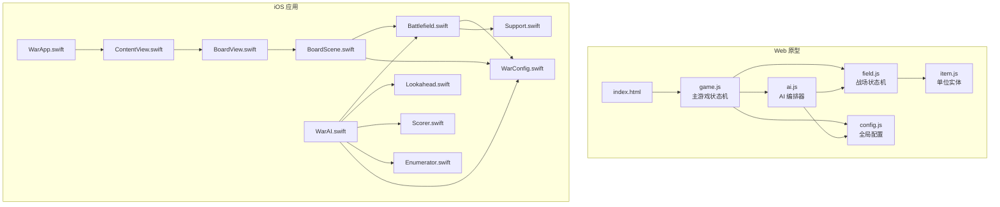
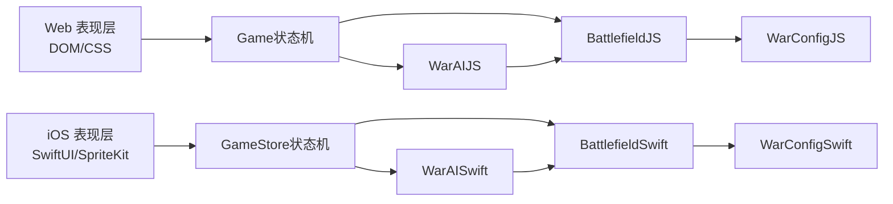
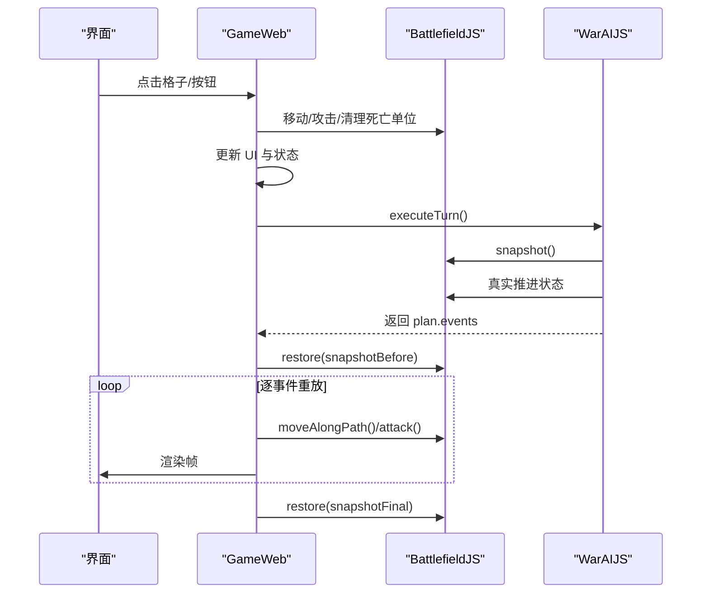
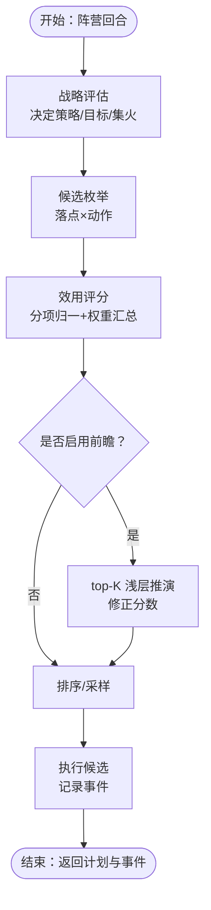
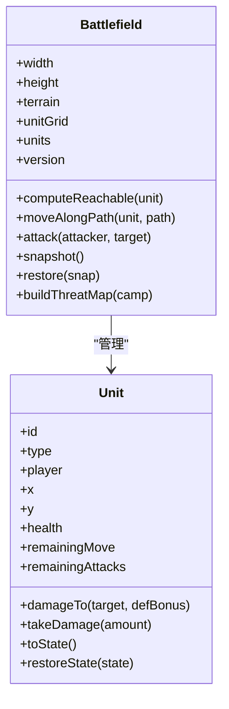
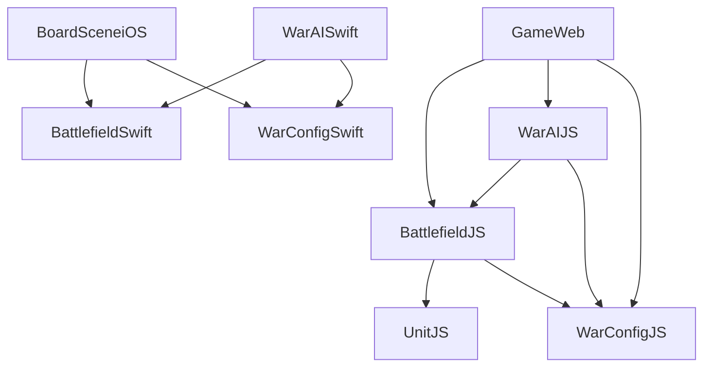
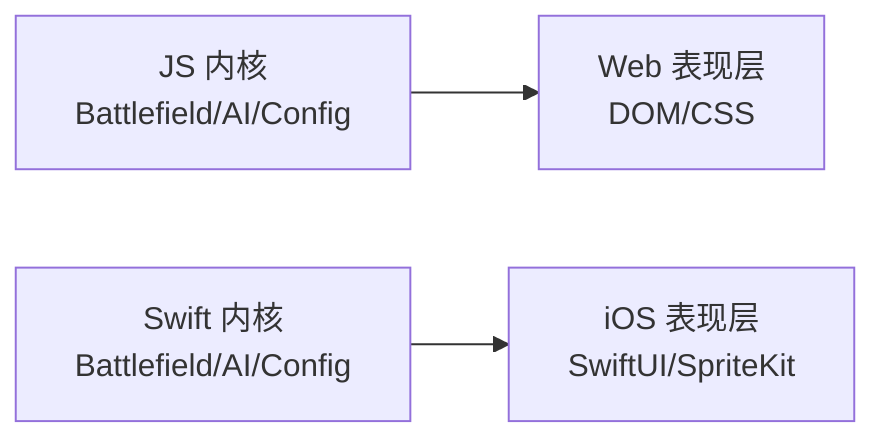

# 核心架构设计

<cite>
**本文引用的文件**   
- [game.js](file://war/war/game.js)
- [ai.js](file://war/war/ai.js)
- [field.js](file://war/war/field.js)
- [item.js](file://war/war/item.js)
- [config.js](file://war/war/config.js)
- [index.html](file://war/war/index.html)
- [Battlefield.swift](file://war/ios/WarKit/Sources/WarKit/Battlefield.swift)
- [WarAI.swift](file://war/ios/WarKit/Sources/WarKit/WarAI.swift)
- [Lookahead.swift](file://war/ios/WarKit/Sources/WarKit/Lookahead.swift)
- [Scorer.swift](file://war/ios/WarKit/Sources/WarKit/Scorer.swift)
- [Enumerator.swift](file://war/ios/WarKit/Sources/WarKit/Enumerator.swift)
- [Support.swift](file://war/ios/WarKit/Sources/WarKit/Support.swift)
- [WarConfig.swift](file://war/ios/WarKit/Sources/WarKit/WarConfig.swift)
- [BoardScene.swift](file://war/ios/War/Rendering/BoardScene.swift)
- [BoardView.swift](file://war/ios/War/Rendering/BoardView.swift)
- [ContentView.swift](file://war/ios/War/UI/ContentView.swift)
- [WarApp.swift](file://war/ios/War/WarApp.swift)
</cite>

## 目录
1. [引言](#引言)
2. [项目结构](#项目结构)
3. [核心组件](#核心组件)
4. [架构总览](#架构总览)
5. [详细组件分析](#详细组件分析)
6. [依赖关系分析](#依赖关系分析)
7. [性能与可复现性](#性能与可复现性)
8. [跨平台适配策略](#跨平台适配策略)
9. [故障排查指南](#故障排查指南)
10. [结论](#结论)

## 引言
本仓库实现了一个双端（Web Canvas / iOS SpriteKit）战棋游戏，其核心目标是把“规则、AI、表现”解耦：  
- 表现层负责渲染与交互（HTML DOM + CSS；iOS SwiftUI + SpriteKit）。  
- 业务逻辑层是 AI 决策引擎（战略 → 候选枚举 → 效用评分 → 浅层前瞻 → softmax 采样）。  
- 数据访问层是战场状态机（地形、单位、移动/攻击结算、可达域、威胁影响图、快照/回滚）。  

系统通过纯逻辑内核驱动两个平台，保证同一局面、同一随机种子下，Web 与 iOS 的决策与回放一致。

## 项目结构
仓库按“平台外壳 + 共享内核”组织：  
- Web 原型位于 war/war，包含 HTML/CSS 与 JS 内核（Game、AI、Field、Item、Config）。  
- iOS 应用位于 war/ios，包含 WarKit（Swift 内核）和 War（SwiftUI/SpriteKit 表现层）。  
- 两套内核在职责上对齐：JS 侧 Battlefield/Unit/AI 与 Swift 侧 Battlefield/WarUnit/WarAI 一一对应。

**图表来源**  
- [index.html:262-266](file://war/war/index.html#L262-L266)  
- [game.js:12-42](file://war/war/game.js#L12-L42)  
- [ai.js:421-434](file://war/war/ai.js#L421-L434)  
- [field.js:11-32](file://war/war/field.js#L11-L32)  
- [item.js:12-44](file://war/war/item.js#L12-L44)  
- [config.js:12-103](file://war/war/config.js#L12-L103)  
- [WarApp.swift:9-32](file://war/ios/War/WarApp.swift#L9-L32)  
- [ContentView.swift:14-89](file://war/ios/War/UI/ContentView.swift#L14-L89)  
- [BoardView.swift:13-72](file://war/ios/War/Rendering/BoardView.swift#L13-L72)  
- [BoardScene.swift:11-79](file://war/ios/War/Rendering/BoardScene.swift#L11-L79)  
- [Battlefield.swift:54-96](file://war/ios/WarKit/Sources/WarKit/Battlefield.swift#L54-L96)  
- [WarAI.swift:11-28](file://war/ios/WarKit/Sources/WarKit/WarAI.swift#L11-L28)  
- [WarConfig.swift:5-24](file://war/ios/WarKit/Sources/WarKit/WarConfig.swift#L5-L24)  
- [Support.swift:3-33](file://war/ios/WarKit/Sources/WarKit/Support.swift#L3-L33)

**章节来源**  
- [index.html:262-266](file://war/war/index.html#L262-L266)  
- [WarApp.swift:9-32](file://war/ios/War/WarApp.swift#L9-L32)

## 核心组件
- 主游戏（Game）：管理回合阶段、用户交互、自动对战循环，并协调 AI 执行与重放。  
- 战场（Battlefield）：唯一的状态写入点，封装地形、单位网格、移动/攻击结算、可达域、威胁影响图、快照/回滚。  
- 单位（Unit / WarUnit）：纯状态对象，提供伤害计算、配额、序列化接口。  
- AI 编排（WarAI / ai.js）：战略评估、候选枚举、效用评分、浅层前瞻、softmax 采样，输出可重放事件序列。  
- 配置（WarConfig / config.js）：棋盘、地形、兵种、难度旋钮、权重与标尺的唯一权威定义。  
- 表现层：Web 使用 DOM 渲染棋盘与 UI；iOS 使用 SwiftUI + SpriteKit 渲染棋盘、叠加层与动画。

**章节来源**  
- [game.js:12-42](file://war/war/game.js#L12-L42)  
- [field.js:11-32](file://war/war/field.js#L11-L32)  
- [item.js:12-44](file://war/war/item.js#L12-L44)  
- [ai.js:421-434](file://war/war/ai.js#L421-L434)  
- [WarAI.swift:11-28](file://war/ios/WarKit/Sources/WarKit/WarAI.swift#L11-L28)  
- [config.js:12-103](file://war/war/config.js#L12-L103)  
- [WarConfig.swift:5-24](file://war/ios/WarKit/Sources/WarKit/WarConfig.swift#L5-L24)

## 架构总览
系统采用分层架构：  
- 表现层：Web Canvas/DOM 与 iOS SpriteKit/SwiftUI。  
- 控制层：Game（Web）与 GameStore（iOS，由 ContentView 持有），负责状态机流转与 UI 更新。  
- 业务层：AI 编排器（WarAI / ai.js），将战场状态转化为可重放的事件计划。  
- 数据层：Battlefield（field.js / Battlefield.swift），维护战场状态并提供确定性 API。

**图表来源**  
- [game.js:292-335](file://war/war/game.js#L292-L335)  
- [ai.js:455-514](file://war/war/ai.js#L455-L514)  
- [field.js:391-429](file://war/war/field.js#L391-L429)  
- [Battlefield.swift:332-381](file://war/ios/WarKit/Sources/WarKit/Battlefield.swift#L332-L381)  
- [WarAI.swift:64-181](file://war/ios/WarKit/Sources/WarKit/WarAI.swift#L64-L181)  
- [config.js:12-103](file://war/war/config.js#L12-L103)  
- [WarConfig.swift:352-388](file://war/ios/WarKit/Sources/WarKit/WarConfig.swift#L352-L388)

## 详细组件分析

### 主游戏（Game）与战场（Battlefield）交互
Game 作为状态机，负责：  
- 布阵阶段与战斗阶段的切换。  
- 玩家点击处理（放置、选择、移动、攻击、待命）。  
- 回合结束与自动对战循环。  
- 调用 AI 执行回合，并通过快照/回滚逐事件重放动画。

**图表来源**  
- [game.js:292-335](file://war/war/game.js#L292-L335)  
- [ai.js:455-514](file://war/war/ai.js#L455-L514)  
- [field.js:391-429](file://war/war/field.js#L391-L429)

**章节来源**  
- [game.js:156-241](file://war/war/game.js#L156-L241)  
- [game.js:255-335](file://war/war/game.js#L255-L335)

### AI 编排器（WarAI / ai.js）
AI 的分层流程：  
- 战略层（Strategist）：判断本轮整体策略（进攻/防守/包抄/撤退）、目标区、集火目标。  
- 候选枚举（Enumerator）：为每个单位生成“落点 × 动作”组合（攻击、移动后攻击、纯机动、待命）。  
- 效用评分（Scorer）：对候选打分，分项归一化到 [0,1]，再乘以权重汇总。  
- 浅层前瞻（Lookahead）：对 top-K 候选做 1~2 ply 推演，修正分数。  
- 采样与执行：softmax 温度控制随机度，产出可重放事件序列。

**图表来源**  
- [ai.js:44-124](file://war/war/ai.js#L44-L124)  
- [ai.js:159-221](file://war/war/ai.js#L159-L221)  
- [ai.js:224-335](file://war/war/ai.js#L224-L335)  
- [ai.js:341-418](file://war/war/ai.js#L341-L418)  
- [ai.js:455-514](file://war/war/ai.js#L455-L514)

**章节来源**  
- [ai.js:421-648](file://war/war/ai.js#L421-L648)  
- [WarAI.swift:11-233](file://war/ios/WarKit/Sources/WarKit/WarAI.swift#L11-L233)

### 战场状态机（Battlefield）
Battlefield 是单一写入者（Single Writer Pattern）：  
- 坐标与占位只能通过 moveAlongPath 修改。  
- 血量与死亡只能通过 attack 修改。  
- 可达域与威胁影响图带版本缓存，写操作使缓存失效。  
- 支持 snapshot/restore，供 AI 前瞻与回放使用。

**图表来源**  
- [field.js:11-32](file://war/war/field.js#L11-L32)  
- [field.js:391-429](file://war/war/field.js#L391-L429)  
- [field.js:512-529](file://war/war/field.js#L512-L529)  
- [item.js:12-44](file://war/war/item.js#L12-L44)  
- [Battlefield.swift:54-96](file://war/ios/WarKit/Sources/WarKit/Battlefield.swift#L54-L96)  
- [Battlefield.swift:332-381](file://war/ios/WarKit/Sources/WarKit/Battlefield.swift#L332-L381)  
- [Battlefield.swift:680-690](file://war/ios/WarKit/Sources/WarKit/Battlefield.swift#L680-L690)

**章节来源**  
- [field.js:391-429](file://war/war/field.js#L391-L429)  
- [field.js:512-529](file://war/war/field.js#L512-L529)  
- [Battlefield.swift:332-381](file://war/ios/WarKit/Sources/WarKit/Battlefield.swift#L332-L381)  
- [Battlefield.swift:680-690](file://war/ios/WarKit/Sources/WarKit/Battlefield.swift#L680-L690)

### 单位实体（Unit / WarUnit）
单位是纯状态对象，不直接修改坐标或网格，所有副作用由 Battlefield 统一处理。  
- 提供 damageTo 纯函数用于 AI 预估。  
- 提供 toState/restoreState 用于快照/回滚。  
- 区分 moveBudget 与 attackBudget，避免旧版 AP 池导致的伪约束。

**章节来源**  
- [item.js:12-178](file://war/war/item.js#L12-L178)  
- [WarConfig.swift:109-163](file://war/ios/WarKit/Sources/WarKit/WarConfig.swift#L109-L163)

### 配置中心（WarConfig / config.js）
配置集中定义棋盘、地形、兵种、难度旋钮、权重与标尺。  
- 难度由 vision/temperature/lookahead 三个正交旋钮控制，而非多套算法。  
- 权重项已归一化到 [0,1]，避免量纲失衡。  
- 提供 SeededRng 确保确定性随机。

**章节来源**  
- [config.js:12-146](file://war/war/config.js#L12-L146)  
- [WarConfig.swift:352-576](file://war/ios/WarKit/Sources/WarKit/WarConfig.swift#L352-L576)

## 依赖关系分析
- Game 依赖 Battlefield 与 WarAI，同时读取 WarConfig。  
- WarAI 依赖 Battlefield、WarConfig，内部组合 Strategist/Enumerator/Scorer/Lookahead。  
- Battlefield 依赖 WarConfig，提供 Unit 管理。  
- iOS 表现层依赖 WarKit（Battlefield/WarAI/WarConfig），不直接耦合规则细节。

**图表来源**  
- [game.js:12-42](file://war/war/game.js#L12-L42)  
- [ai.js:421-434](file://war/war/ai.js#L421-L434)  
- [field.js:11-32](file://war/war/field.js#L11-L32)  
- [BoardScene.swift:11-79](file://war/ios/War/Rendering/BoardScene.swift#L11-L79)  
- [WarAI.swift:11-28](file://war/ios/WarKit/Sources/WarKit/WarAI.swift#L11-L28)

**章节来源**  
- [game.js:12-42](file://war/war/game.js#L12-L42)  
- [ai.js:421-434](file://war/war/ai.js#L421-L434)  
- [field.js:11-32](file://war/war/field.js#L11-L32)  
- [BoardScene.swift:11-79](file://war/ios/War/Rendering/BoardScene.swift#L11-L79)  
- [WarAI.swift:11-28](file://war/ios/WarKit/Sources/WarKit/WarAI.swift#L11-L28)

## 性能与可复现性
- 可达域使用桶式优先队列（Dijkstra），避免堆比较开销。  
- 威胁影响图与可达域带版本缓存，写操作使缓存失效。  
- AI 仅对 top-K 候选做浅层前瞻，避免指数爆炸。  
- 所有随机来自 SeededRng，同 seed 必得同决策，便于回归测试与回放。

**章节来源**  
- [field.js:225-287](file://war/war/field.js#L225-L287)  
- [field.js:462-508](file://war/war/field.js#L462-L508)  
- [ai.js:341-418](file://war/war/ai.js#L341-L418)  
- [config.js:109-139](file://war/war/config.js#L109-L139)  
- [Support.swift:35-75](file://war/ios/WarKit/Sources/WarKit/Support.swift#L35-L75)

## 跨平台适配策略
- 纯逻辑内核：JS 与 Swift 分别实现 Battlefield/WarAI/WarConfig，但职责与接口对齐。  
- 表现层隔离：Web 用 DOM/CSS，iOS 用 SwiftUI/SpriteKit，不直接耦合规则。  
- 数据流向：表现层只消费 BattleFrame/BoardFrame 等视图模型，内核负责状态变更。  
- 随机源：两端均使用 SeededRng，保证回放一致性。

**图表来源**  
- [index.html:262-266](file://war/war/index.html#L262-L266)  
- [WarApp.swift:9-32](file://war/ios/War/WarApp.swift#L9-L32)  
- [BoardView.swift:13-72](file://war/ios/War/Rendering/BoardView.swift#L13-L72)  
- [config.js:12-146](file://war/war/config.js#L12-L146)  
- [WarConfig.swift:5-24](file://war/ios/WarKit/Sources/WarKit/WarConfig.swift#L5-L24)

**章节来源**  
- [index.html:262-266](file://war/war/index.html#L262-L266)  
- [WarApp.swift:9-32](file://war/ios/War/WarApp.swift#L9-L32)  
- [BoardView.swift:13-72](file://war/ios/War/Rendering/BoardView.swift#L13-L72)

## 故障排查指南
- 移动失败：检查路径是否 4 邻接、是否越界、是否被占、是否超出机动预算。  
- 攻击失败：检查是否已行动过、目标是否存活、射程与视线是否满足。  
- 回放不一致：确认 snapshot/restore 是否对齐 units 数组下标，以及事件顺序是否与推演一致。  
- AI 行为异常：检查难度旋钮（vision/temperature/lookahead）与权重配置，确认 SeededRng 种子一致。

**章节来源**  
- [field.js:391-429](file://war/war/field.js#L391-L429)  
- [field.js:343-383](file://war/war/field.js#L343-L383)  
- [field.js:512-529](file://war/war/field.js#L512-L529)  
- [ai.js:455-514](file://war/war/ai.js#L455-L514)  
- [config.js:57-83](file://war/war/config.js#L57-L83)

## 结论
本架构通过分层设计与关键模式（单一职责、策略模式、快照/回滚、Single Writer Pattern）实现了 Web 与 iOS 双平台部署。核心优势包括：  
- 规则与表现解耦，便于扩展新平台。  
- AI 决策可重放、可回归测试。  
- 难度由正交旋钮控制，调参集中且可预测。  
- 性能优化到位，适合移动端实时交互。