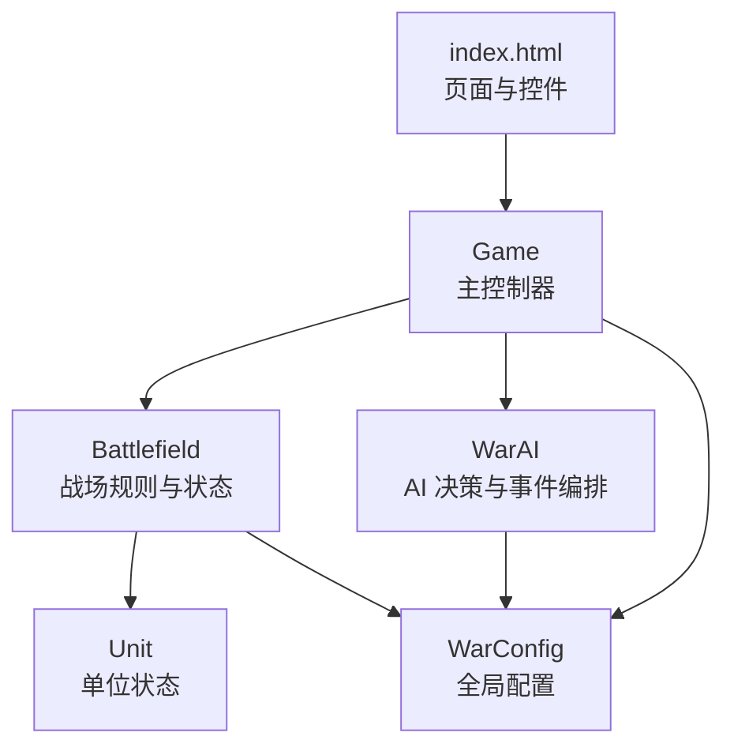
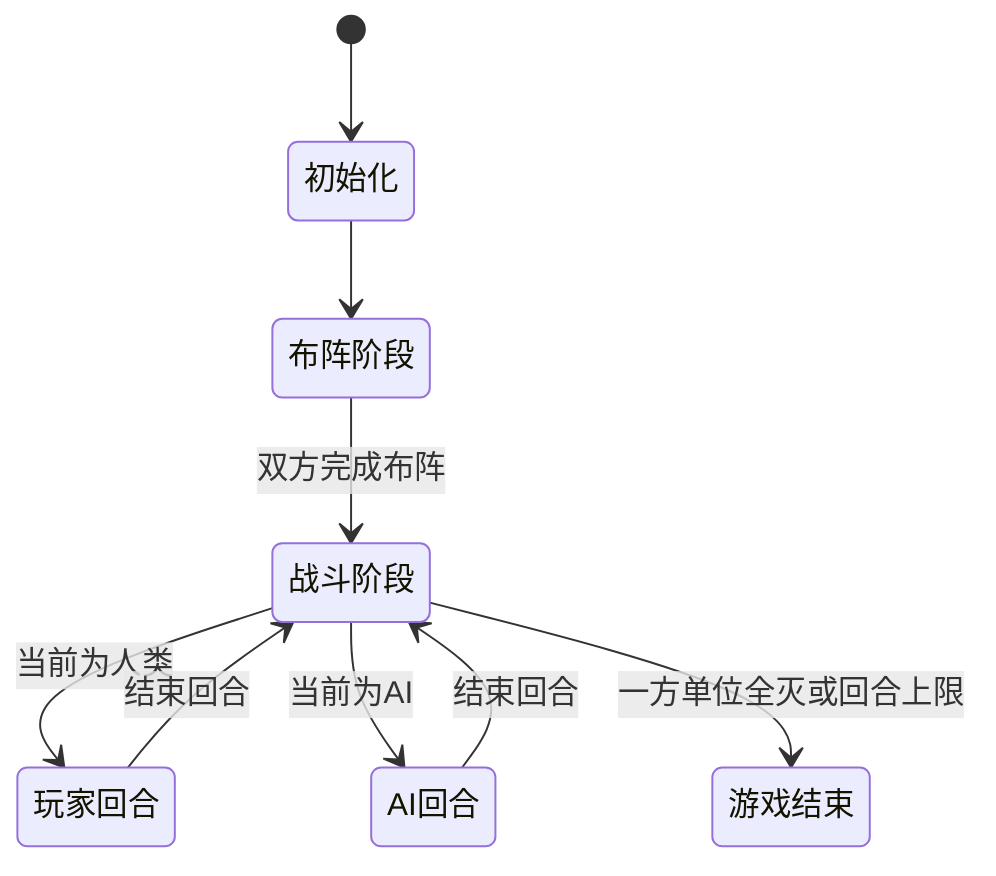
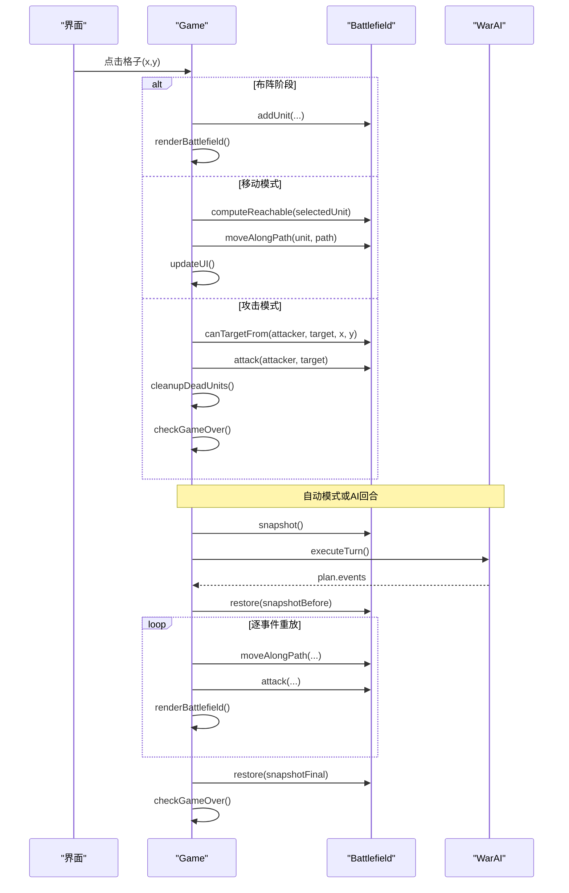
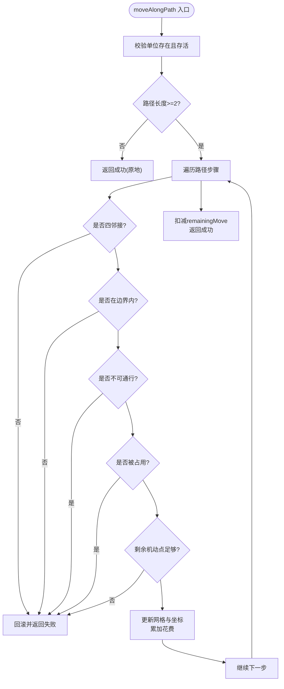
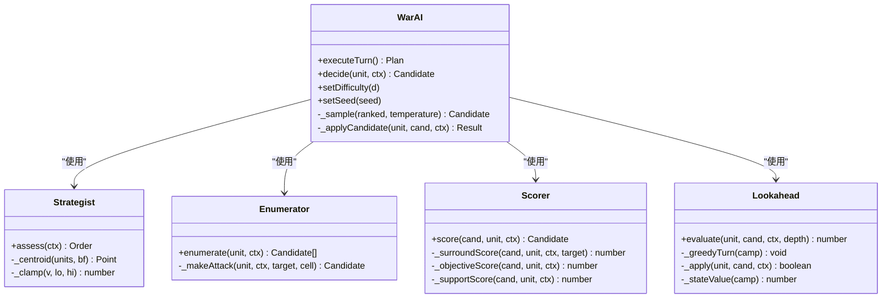
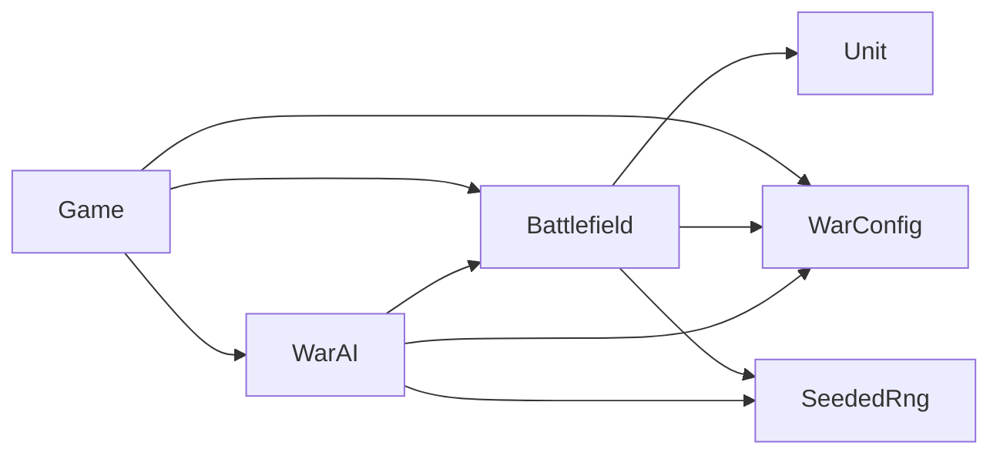

# 游戏状态机

<cite>
**本文引用的文件**   
- [game.js](file://war/war/game.js)
- [ai.js](file://war/war/ai.js)
- [field.js](file://war/war/field.js)
- [item.js](file://war/war/item.js)
- [config.js](file://war/war/config.js)
- [index.html](file://war/war/index.html)
</cite>

## 目录
1. [引言](#引言)
2. [项目结构](#项目结构)
3. [核心组件](#核心组件)
4. [架构总览](#架构总览)
5. [详细组件分析](#详细组件分析)
6. [依赖关系分析](#依赖关系分析)
7. [性能与复杂度](#性能与复杂度)
8. [故障排查与异常恢复](#故障排查与异常恢复)
9. [结论](#结论)
10. [附录：API 使用示例](#附录api-使用示例)

## 引言
本文围绕 WAR 游戏的 Web 原型，系统化梳理主控制器 Game 的架构设计与回合制状态机。重点包括：
- 回合流转：布阵、玩家回合、AI 决策、行动执行、回合结束、胜负判定。
- 输入处理：点击选择、移动确认、攻击指令、待命与结束回合。
- 双人对战模式：手动双人、AI 对战玩家、自动 AI 对战。
- 初始化、启动控制与状态查询 API。
- 错误处理与异常恢复策略，包括路径回滚、快照重放与 UI 提示。

## 项目结构
WAR 的 Web 原型由 HTML 页面加载若干 JS 模块组成，核心逻辑集中在 war 子目录下：
- config.js：全局配置（棋盘尺寸、地形、兵种、难度旋钮、评分权重、随机数）。
- item.js：单位 Unit，纯状态对象，提供伤害计算、配额管理、序列化。
- field.js：战场 Battlefield，唯一的状态写入入口，负责地形、寻路、攻击、威胁图、快照。
- ai.js：AI 子系统，包含战略层、候选枚举、评分、浅层前瞻与事件编排。
- game.js：主控制器 Game，连接 UI、战场、AI，驱动回合状态机。
- index.html：页面结构与样式，挂载脚本并暴露交互控件。

**图表来源**
- [index.html:262-266](file://war/war/index.html#L262-L266)
- [game.js:12-42](file://war/war/game.js#L12-L42)
- [field.js:11-32](file://war/war/field.js#L11-L32)
- [ai.js:421-434](file://war/war/ai.js#L421-L434)
- [item.js:12-44](file://war/war/item.js#L12-L44)
- [config.js:12-103](file://war/war/config.js#L12-L103)

**章节来源**
- [index.html:1-269](file://war/war/index.html#L1-L269)
- [config.js:1-146](file://war/war/config.js#L1-L146)

## 核心组件
- Game：主控制器，维护游戏模式、当前玩家、选中单位、AI 开关、自动模式、回合计数等；负责 UI 绑定、事件分发、回合流转、渲染与日志。
- Battlefield：战场模型，封装地形、单位网格、可达域、攻击结算、威胁影响图、快照/回滚、胜负判定。
- Unit：单位实体，定义属性、配额、伤害计算、反击资格、序列化。
- WarAI：AI 编排器，组合 Strategist、Enumerator、Scorer、Lookahead，输出可重放的事件序列。
- WarConfig：全局配置，集中棋盘、地形、兵种、难度、权重、标尺、默认编成与确定性随机源。

**章节来源**
- [game.js:12-42](file://war/war/game.js#L12-L42)
- [field.js:11-32](file://war/war/field.js#L11-L32)
- [item.js:12-44](file://war/war/item.js#L12-L44)
- [ai.js:421-434](file://war/war/ai.js#L421-L434)
- [config.js:12-103](file://war/war/config.js#L12-L103)

## 架构总览
Game 作为“状态机 + 渲染 + AI 回合播放”的协调者，遵循以下流程：
- 初始化：创建 Battlefield，重建 AI，渲染棋盘，更新 UI。
- 布阵阶段：玩家按己方出生区放置单位，或一键默认编成。
- 战斗阶段：玩家或 AI 轮流行动，每回合重置单位配额。
- 自动模式：循环执行 AI 回合，直到达到回合上限或一方全灭。
- 胜负判定：根据单位数量或回合上限决定结果。

**图表来源**
- [game.js:124-152](file://war/war/game.js#L124-L152)
- [game.js:255-285](file://war/war/game.js#L255-L285)
- [game.js:337-346](file://war/war/game.js#L337-L346)
- [field.js:541-551](file://war/war/field.js#L541-L551)

## 详细组件分析

### Game 主控制器
职责：
- 生命周期：构造、UI 初始化、事件监听、新游戏、快速布阵。
- 输入处理：单元格点击、按钮操作、模式切换、种子与速度调节。
- 回合流转：结束回合、自动战斗、AI 回合执行、胜负检查。
- 渲染与反馈：绘制棋盘、显示可达域/威胁图/AI 最优落点、伤害浮动、策略行与决策日志。

关键方法：
- startNewGame：重置模式、玩家、回合计数，重建战场与 AI，渲染并更新 UI。
- quickDeploy：设置默认编成，跳过手工布阵，进入战斗阶段。
- handleCellClick：根据当前模式分派到布阵点击、移动确认、攻击指令或单位选择。
- tryPlayerMove / tryPlayerAttack：校验可达性与目标合法性，调用 Battlefield 执行动作，清理死亡单位，触发胜负检查。
- endTurn：处理布阵阶段结束与战斗阶段回合切换，必要时触发自动战斗或 AI 回合。
- executeAITurn：记录快照，真实推进状态，生成计划事件，回滚后逐事件重放动画，最终恢复终态。
- runAutoBattle：循环执行 AI 回合，直至结束条件。
- checkGameOver / endGameByTurnLimit：统一胜负与回合上限处理。

**图表来源**
- [game.js:156-241](file://war/war/game.js#L156-L241)
- [game.js:292-335](file://war/war/game.js#L292-L335)
- [field.js:391-429](file://war/war/field.js#L391-L429)
- [field.js:343-383](file://war/war/field.js#L343-L383)
- [ai.js:455-514](file://war/war/ai.js#L455-L514)

**章节来源**
- [game.js:12-42](file://war/war/game.js#L12-L42)
- [game.js:124-152](file://war/war/game.js#L124-L152)
- [game.js:156-241](file://war/war/game.js#L156-L241)
- [game.js:255-335](file://war/war/game.js#L255-L335)
- [game.js:337-396](file://war/war/game.js#L337-L396)

### Battlefield 战场模型
职责：
- 网格基础：边界检查、地形查询、单位占位、通行性判断。
- 地形生成：对称随机地形，支持平坦化与版本缓存失效。
- 单位管理：添加、移除、存活过滤、阵营筛选、批量清理死亡单位、回合配额重置。
- 空间推理：Dijkstra 可达域（桶式优先队列）、路径重建、威胁影响图构建与归一化。
- 攻击判定：视线检测、目标合法性、伤害结算、反击、死亡清理。
- 移动结算：路径校验、逐步移动、失败回滚、预算扣除。
- 快照/回滚：保存/恢复单位状态，重建单位网格，保证 AI 前瞻一致性。
- 胜负评估：单位数量比较、物质分计算、信息导出。

关键方法：
- generateTerrain：镜像对称地形生成，版本递增，清空缓存。
- computeReachable / reachableWithBudget：基于机动预算的可达域搜索，返回带路径与代价的结果。
- buildThreatMap：以敌方满预算可达域为基础，叠加射程环的攻击力累计。
- attack：唯一伤害写入点，含主击与反击，立即清理死亡单位占位格。
- moveAlongPath：唯一坐标写入点，逐步校验邻接、障碍、占用、地形消耗，失败时回滚。
- snapshot / restore：保存/恢复单位状态，重建单位网格，确保 AI 回放一致。
- isGameOver / getWinner：根据单位数量判定胜负。

**图表来源**
- [field.js:391-441](file://war/war/field.js#L391-L441)

**章节来源**
- [field.js:11-32](file://war/war/field.js#L11-L32)
- [field.js:97-136](file://war/war/field.js#L97-L136)
- [field.js:140-205](file://war/war/field.js#L140-L205)
- [field.js:225-287](file://war/war/field.js#L225-L287)
- [field.js:311-383](file://war/war/field.js#L311-L383)
- [field.js:391-441](file://war/war/field.js#L391-L441)
- [field.js:462-508](file://war/war/field.js#L462-L508)
- [field.js:512-537](file://war/war/field.js#L512-L537)
- [field.js:541-577](file://war/war/field.js#L541-L577)

### Unit 单位实体
职责：
- 属性与类型：从配置加载兵种统计，分配 ID、位置、血量、攻防、射程、预算、反击能力、AI 价值、符号与名称。
- 位置与距离：提供静态距离计算与相对距离方法。
- 配额管理：回合开始时重置机动与攻击配额，提供移动/攻击可用性判断。
- 伤害与防御：纯函数 damageTo，结合目标地形防御加成计算期望伤害；effectiveDefense 汇总防御值。
- 反击资格：近战、存活、未反击过、攻击者在射程内。
- 序列化：toState/restoreState 用于快照与回滚。

关键点：
- 不再自行修改坐标，避免旧版“移动不扣点数”和“网格不同步”的问题。
- 独立 moveBudget 与 attackBudget，消除“移动即不能攻击”的伪约束。

**章节来源**
- [item.js:12-44](file://war/war/item.js#L12-L44)
- [item.js:67-84](file://war/war/item.js#L67-L84)
- [item.js:88-122](file://war/war/item.js#L88-L122)
- [item.js:126-149](file://war/war/item.js#L126-L149)

### WarAI 与决策流水线
职责：
- 战略层 Strategist：评估兵力差、兵种对比、最脆单位、集火目标、战略目标区域。
- 候选枚举 Enumerator：对每个单位生成 (落点 × 动作) 组合，包括原地攻击、移动后攻击、纯机动、待命。
- 评分 Scorer：统一量纲的效用评分，包含伤害、击杀、浪费、目标价值、暴露风险、地形、协同、机动保留、战略牵引等。
- 浅层前瞻 Lookahead：对 top-K 候选进行 1~2 ply 推演，用局势增减修正分数。
- 编排 WarAI：softmax 采样选择候选，应用到真实战场，记录可重放事件序列。

关键方法：
- executeTurn：产出 order（战略），遍历单位生成候选，评分、前瞻、采样，应用候选并记录事件。
- decide：单单位决策流程，枚举 → 评分 → 可选前瞻 → softmax 采样。
- _sample：温度控制的 softmax 采样，T→0 退化为 argmax。
- replayEvent：根据事件序列在渲染层恢复状态，确保动画与决策严格对应。

**图表来源**
- [ai.js:44-124](file://war/war/ai.js#L44-L124)
- [ai.js:159-221](file://war/war/ai.js#L159-L221)
- [ai.js:224-335](file://war/war/ai.js#L224-L335)
- [ai.js:341-418](file://war/war/ai.js#L341-L418)
- [ai.js:421-617](file://war/war/ai.js#L421-L617)

**章节来源**
- [ai.js:15-41](file://war/war/ai.js#L15-L41)
- [ai.js:44-124](file://war/war/ai.js#L44-L124)
- [ai.js:159-221](file://war/war/ai.js#L159-L221)
- [ai.js:224-335](file://war/war/ai.js#L224-L335)
- [ai.js:341-418](file://war/war/ai.js#L341-L418)
- [ai.js:421-617](file://war/war/ai.js#L421-L617)
- [ai.js:634-643](file://war/war/ai.js#L634-L643)

### 配置与随机源
- WarConfig：集中定义棋盘尺寸、地形类型与特性、兵种属性、难度旋钮（vision/temperature/lookahead）、评分权重与归一化标尺、部署限制、默认编成。
- SeededRng：确定性随机数生成器，用于地形生成与 AI 决策，保证同 seed 必得同结果，便于回归测试与复现。

**章节来源**
- [config.js:12-103](file://war/war/config.js#L12-L103)
- [config.js:109-139](file://war/war/config.js#L109-L139)

## 依赖关系分析
- Game 依赖：
  - Battlefield：状态变更、寻路、攻击、威胁图、快照。
  - WarAI：回合决策与事件编排。
  - WarConfig：全局参数。
  - DOM：事件监听与渲染。
- Battlefield 依赖：
  - Unit：单位状态与属性。
  - WarConfig：地形、兵种、部署限制。
  - SeededRng：地形生成。
- WarAI 依赖：
  - Battlefield：状态读取与模拟。
  - WarConfig：难度、权重、标尺。
  - SeededRng：决策采样。

**图表来源**
- [game.js:12-42](file://war/war/game.js#L12-L42)
- [field.js:11-32](file://war/war/field.js#L11-L32)
- [ai.js:421-434](file://war/war/ai.js#L421-L434)
- [config.js:12-103](file://war/war/config.js#L12-L103)

**章节来源**
- [game.js:12-42](file://war/war/game.js#L12-L42)
- [field.js:11-32](file://war/war/field.js#L11-L32)
- [ai.js:421-434](file://war/war/ai.js#L421-L434)
- [config.js:12-103](file://war/war/config.js#L12-L103)

## 性能与复杂度
- 可达域计算：
  - 使用桶式优先队列，预算上限较小（最大兵种机动点为 7），时间复杂度近似 O(B * N)，B 为预算，N 为地图格子数。
  - 缓存命中依赖 version 令牌，避免重复计算。
- 威胁影响图：
  - 对敌方所有单位计算满预算可达域，再叠加射程环攻击力，复杂度约为 O(E * B * N)，E 为敌方单位数。
- AI 决策：
  - 候选枚举：O(U * (R + T))，U 为单位数，R 为可达落点数，T 为目标数。
  - 评分：线性扫描候选，O(C)。
  - 前瞻：仅对 top-K 候选做 1~2 ply 推演，K 通常很小，开销可控。
  - 采样：softmax 计算 O(K)。
- 渲染：
  - 每次重绘遍历整个棋盘，O(W * H)，W、H 为棋盘宽高。
  - 可达域与威胁图按需计算，避免无谓开销。

优化建议：
- 在大棋盘或高单位密度场景下，可考虑增量更新威胁图与可达域缓存。
- 自动模式下适当降低预览开销（如关闭威胁图或候选标记）。
- 将频繁 DOM 操作合并为 DocumentFragment，已实现于 Game.renderBattlefield。

[本节为通用性能讨论，不直接分析具体代码文件]

## 故障排查与异常恢复
- 移动失败回滚：
  - moveAlongPath 在每一步前校验邻接、边界、通行性、占用与预算，失败时通过 _rollbackMove 撤销中途步骤，确保调用方不受部分副作用影响。
- 攻击拒绝与范围校验：
  - attack 返回 rejected 原因（如 not_allowed、out_of_range），Game.tryPlayerAttack 根据 rejected 提示用户。
- 快照与回滚一致性：
  - Battlefield.snapshot/restore 保存单位状态并重建单位网格，AI 前瞻与回放均依赖此机制，确保动画与真实决策一致。
- UI 提示与闪烁：
  - Game.flash 临时覆盖 turnIndicator 文本，定时恢复，用于提示非法操作或失败原因。
- 自动模式中断：
  - runAutoBattle 在每回合结束后检查 autoMode 标志，允许外部停止自动战斗。
- 胜负与回合上限：
  - checkGameOver 与 endGameByTurnLimit 统一处理胜利、平局与回合上限，关闭自动模式并更新 UI。

**章节来源**
- [field.js:391-441](file://war/war/field.js#L391-L441)
- [field.js:343-383](file://war/war/field.js#L343-L383)
- [field.js:512-537](file://war/war/field.js#L512-L537)
- [game.js:223-241](file://war/war/game.js#L223-L241)
- [game.js:544-551](file://war/war/game.js#L544-L551)
- [game.js:337-346](file://war/war/game.js#L337-L346)
- [game.js:379-396](file://war/war/game.js#L379-L396)

## 结论
WAR 的 Web 原型通过 Game 主控制器串联 UI、战场与 AI，形成清晰的回合制状态机。Battlefield 作为唯一状态写入入口，确保移动与攻击的规则一致性；WarAI 采用分层决策流水线，兼顾可读性与可解释性；WarConfig 集中配置，使难度与平衡调参更直观。整体设计强调可重放、可调试与可回归，适合进一步扩展为完整的双人对战或人机对战产品。

[本节为总结性内容，不直接分析具体代码文件]

## 附录：API 使用示例
以下为常见用法说明（不展示代码内容，仅提供路径参考）：

- 初始化与启动
  - 页面加载后自动创建 Game 实例，可通过 window.game 访问。
  - 参考：[index.html:262-266](file://war/war/index.html#L262-L266)、[game.js:597-599](file://war/war/game.js#L597-L599)

- 新游戏与快速布阵
  - 调用 Game.startNewGame 重置游戏。
  - 调用 Game.quickDeploy 使用默认编成直接进入战斗阶段。
  - 参考：[game.js:124-152](file://war/war/game.js#L124-L152)

- 玩家输入处理
  - 点击格子：Game.handleCellClick(x, y)
  - 移动确认：Game.tryPlayerMove(x, y)
  - 攻击指令：Game.tryPlayerAttack(target)
  - 待命：Game.orderWait()
  - 参考：[game.js:156-241](file://war/war/game.js#L156-L241)

- 回合控制
  - 结束回合：Game.endTurn()
  - 执行 AI 回合：Game.executeAITurn()
  - 自动战斗：Game.toggleAutoMode()、Game.runAutoBattle()
  - 参考：[game.js:255-335](file://war/war/game.js#L255-L335)、[game.js:337-354](file://war/war/game.js#L337-L354)

- 状态查询
  - 战场信息：Battlefield.getBattlefieldInfo()
  - 胜负判定：Battlefield.isGameOver()、Battlefield.getWinner()
  - 单位信息：Unit.getInfo()
  - 参考：[field.js:567-577](file://war/war/field.js#L567-L577)、[field.js:541-551](file://war/war/field.js#L541-L551)、[item.js:151-167](file://war/war/item.js#L151-L167)

- 难度与模式
  - 设置 AI 难度：WarAI.setDifficulty(d)
  - 设置模式：Game.updateGameMode()（manual / ai_vs_player / auto）
  - 参考：[ai.js:440-443](file://war/war/ai.js#L440-L443)、[game.js:356-372](file://war/war/game.js#L356-L372)

- 错误与提示
  - 使用 Game.flash(msg) 显示临时提示。
  - 参考：[game.js:544-551](file://war/war/game.js#L544-L551)