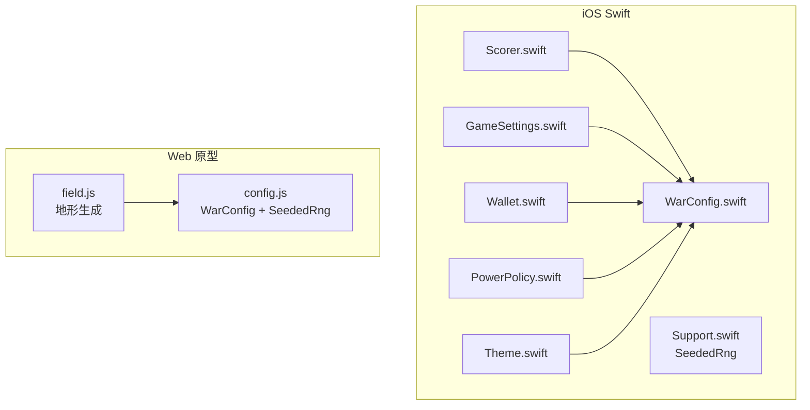
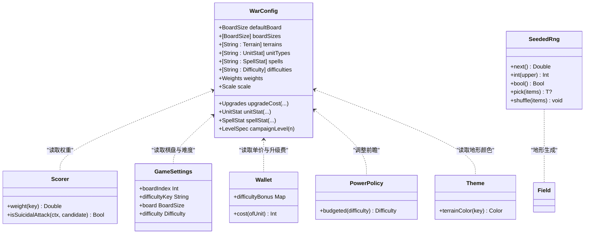
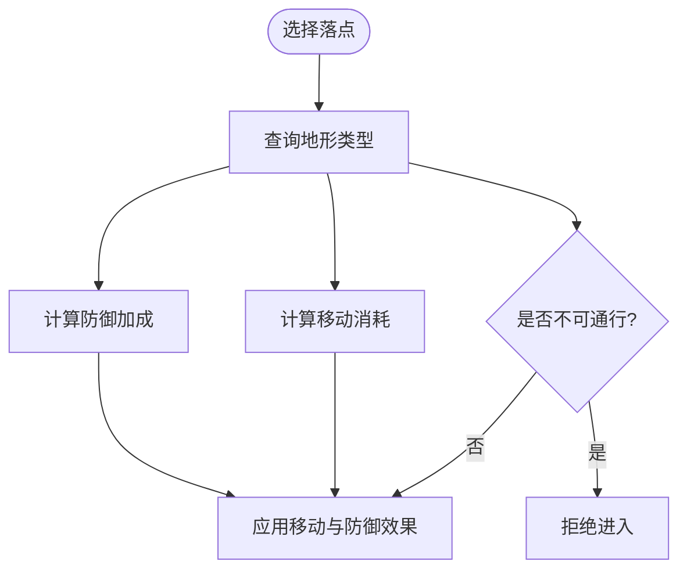
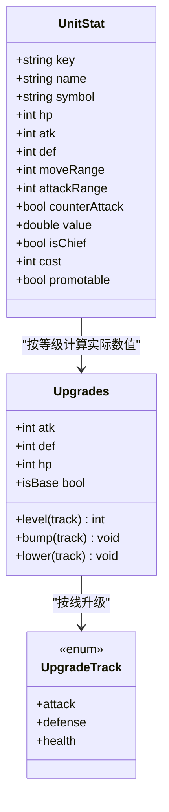
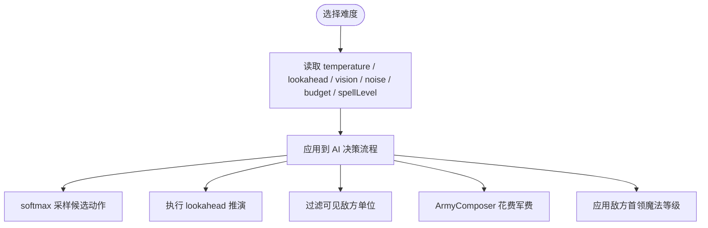
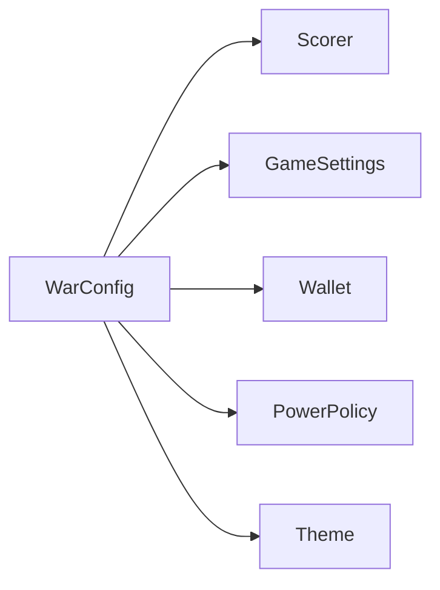

# 配置管理系统

<cite>
**本文引用的文件**   
- [WarConfig.swift](file://war/ios/WarKit/Sources/WarKit/WarConfig.swift)
- [config.js](file://war/war/config.js)
- [Support.swift](file://war/ios/WarKit/Sources/WarKit/Support.swift)
- [field.js](file://war/war/field.js)
- [Scorer.swift](file://war/ios/WarKit/Sources/WarKit/Scorer.swift)
- [GameSettings.swift](file://war/ios/War/Model/GameSettings.swift)
- [Wallet.swift](file://war/ios/War/Model/Wallet.swift)
- [PowerPolicy.swift](file://war/ios/War/Support/PowerPolicy.swift)
- [Theme.swift](file://war/ios/War/Support/Theme.swift)
</cite>

## 目录
1. [引言](#引言)
2. [项目结构](#项目结构)
3. [核心组件](#核心组件)
4. [架构总览](#架构总览)
5. [详细组件分析](#详细组件分析)
6. [依赖关系分析](#依赖关系分析)
7. [性能与可复现性](#性能与可复现性)
8. [配置扩展指南](#配置扩展指南)
9. [数值平衡设计模式](#数值平衡设计模式)
10. [使用示例与最佳实践](#使用示例与最佳实践)
11. [故障排查](#故障排查)
12. [结论](#结论)

## 引言
本文件面向 WAR 游戏的配置管理系统，聚焦以下目标：
- 解释 WarConfig 全局配置对象的设计理念与结构：棋盘尺寸、地形系统、兵种属性、难度旋钮、评分权重集中管理。
- 阐述三条设计原则：所有数值只出现一次；难度通过正交旋钮（vision/temperature/lookahead）控制；棋盘尺寸统一定义。
- 说明 SeededRng 确定性随机数生成器的实现原理及其在 AI 决策和地形生成中的关键作用。
- 提供配置扩展指南与数值平衡设计模式，并给出具体配置示例和使用方法。

WAR 同时存在两套实现：
- iOS 内核 Swift 版本以 `WarConfig` 枚举为中心，承载全部规则与数值。
- Web/Node 原型 JS 版本以 `WarConfig` 对象与 `SeededRng` 类为核心，用于早期原型与测试。

两者共同体现“单一权威源”的配置思想，但细节字段与默认值因平台差异而不同。

## 项目结构
配置相关代码主要分布在以下位置：
- iOS Swift 内核：`WarKit/Sources/WarKit/WarConfig.swift`
- iOS 辅助工具：`WarKit/Sources/WarKit/Support.swift`（含 `SeededRng`）
- Web 原型：`war/config.js`（含 `WarConfig` 与 `SeededRng`）
- Web 地形生成：`war/field.js`（使用 JS `SeededRng` 生成对称地图）
- iOS 评分器：`WarKit/Sources/WarKit/Scorer.swift`（读取 `WarConfig.weights`）
- iOS UI 与模型：`GameSettings.swift`、`Wallet.swift`、`PowerPolicy.swift`、`Theme.swift`（消费配置）

**图表来源**
- [WarConfig.swift:5-575](file://war/ios/WarKit/Sources/WarKit/WarConfig.swift#L5-L575)
- [Support.swift:35-75](file://war/ios/WarKit/Sources/WarKit/Support.swift#L35-L75)
- [config.js:12-145](file://war/war/config.js#L12-L145)
- [field.js:95-121](file://war/war/field.js#L95-L121)
- [Scorer.swift:13-50](file://war/ios/WarKit/Sources/WarKit/Scorer.swift#L13-L50)
- [GameSettings.swift:29-48](file://war/ios/War/Model/GameSettings.swift#L29-L48)
- [Wallet.swift:12-13](file://war/ios/War/Model/Wallet.swift#L12-L13)
- [PowerPolicy.swift:60-67](file://war/ios/War/Support/PowerPolicy.swift#L60-L67)
- [Theme.swift:4-24](file://war/ios/War/Support/Theme.swift#L4-L24)

**章节来源**
- [WarConfig.swift:5-575](file://war/ios/WarKit/Sources/WarKit/WarConfig.swift#L5-L575)
- [config.js:1-145](file://war/war/config.js#L1-L145)

## 核心组件
本节从“单一权威源”的角度，梳理 War 配置系统的核心构件。

### WarConfig：全局配置枚举
Swift 版 `WarConfig` 是一个集中式配置枚举，包含：
- 棋盘尺寸：`boardSizes`、`defaultBoard`、`deployColumnCount`
- 地形系统：`Terrain` 结构体、`terrains` 字典、`terrainOrder`、`defaultTerrainKey`
- 兵种属性：`UnitStat`、`unitTypes`、`chiefTypeKey`、`unitTypeOrder`、`defaultRoster`
- 升级系统：`Upgrades`、`UpgradeTrack`、每级增益常量、升级费用函数、实际数值计算函数
- 魔法系统：`SpellStat`、`spells`、`spellOrder`、等级上限、实际生效数值函数、升级费用函数、每回合施法次数
- 回合规则：每回合攻击配额、士兵上限、单位上限、最大回合数
- AI 难度：`Difficulty`、难度表、默认难度、展示顺序
- 闯关关卡公式：`LevelSpec`、`campaignLevel`
- 评分权重：`Weights`、`weights`、归一化标尺 `Scale`、`scale`

JS 版 `WarConfig` 是早期原型的全局对象，包含棋盘、地形、兵种、难度旋钮、评分权重、归一化标尺、部署上限、默认编成等。

**章节来源**
- [WarConfig.swift:5-575](file://war/ios/WarKit/Sources/WarKit/WarConfig.swift#L5-L575)
- [config.js:12-103](file://war/war/config.js#L12-L103)

### SeededRng：确定性随机数生成器
Swift 版 `SeededRng` 基于 mulberry32 算法，提供：
- `next()`：返回 [0,1) 浮点
- `int(upper)`：返回 [0, upper) 整数
- `bool()`：布尔采样
- `pick(items)`：从数组中选取元素
- `shuffle(items)`：原地洗牌

JS 版 `SeededRng` 同样基于 mulberry32，提供 `next()`、`int(n)`、`pick(arr)`、`shuffle(arr)`。

**章节来源**
- [Support.swift:35-75](file://war/ios/WarKit/Sources/WarKit/Support.swift#L35-L75)
- [config.js:105-139](file://war/war/config.js#L105-L139)

## 架构总览
配置系统位于游戏内核与 UI 之间，承担“规则与数值唯一权威源”的职责。

**图表来源**
- [WarConfig.swift:5-575](file://war/ios/WarKit/Sources/WarKit/WarConfig.swift#L5-L575)
- [Support.swift:35-75](file://war/ios/WarKit/Sources/WarKit/Support.swift#L35-L75)
- [Scorer.swift:13-50](file://war/ios/WarKit/Sources/WarKit/Scorer.swift#L13-L50)
- [GameSettings.swift:29-48](file://war/ios/War/Model/GameSettings.swift#L29-L48)
- [Wallet.swift:12-13](file://war/ios/War/Model/Wallet.swift#L12-L13)
- [PowerPolicy.swift:60-67](file://war/ios/War/Support/PowerPolicy.swift#L60-L67)
- [Theme.swift:4-24](file://war/ios/War/Support/Theme.swift#L4-L24)
- [field.js:95-121](file://war/war/field.js#L95-L121)

## 详细组件分析

### 棋盘尺寸与部署区
- 棋盘尺寸由 `WarConfig.boardSizes` 定义，支持多档切换；默认尺寸为 14×14，适合 iPhone 竖屏手指操作。
- 部署区占左右各 3 列，确保双方出生区对称且稳定。
- JS 原型中棋盘为 20×20，体现平台差异；iOS 内核更强调移动端体验。

**章节来源**
- [WarConfig.swift:9-27](file://war/ios/WarKit/Sources/WarKit/WarConfig.swift#L9-L27)
- [config.js:12-16](file://war/war/config.js#L12-L16)

### 地形系统
地形由 `Terrain` 结构体描述，包含键名、名称、符号、移动消耗、防御加成、是否不可通行、显示颜色。
- 平原：低移动成本、无防御加成
- 森林：中等移动成本、中等防御加成
- 山地：高移动成本、高防御加成
- 河流：不可通行
- 城墙：不可通行

地形展示顺序由 `terrainOrder` 固定，避免字典无序导致 UI 图例不稳定。

**图表来源**
- [WarConfig.swift:31-68](file://war/ios/WarKit/Sources/WarKit/WarConfig.swift#L31-L68)
- [field.js:89-121](file://war/war/field.js#L89-L121)

**章节来源**
- [WarConfig.swift:31-68](file://war/ios/WarKit/Sources/WarKit/WarConfig.swift#L31-L68)
- [field.js:89-121](file://war/war/field.js#L89-L121)

### 兵种属性与升级系统
兵种由 `UnitStat` 描述，包含生命值、攻击力、防御力、移动范围、攻击范围、反击能力、战略价值、是否首领、单价、是否可转职等。
- 基础兵种：步兵、骑兵、弓兵
- 首领：commander，具有最高战略价值，且只有它能施法
- 转职分支：近卫、枪兵、重骑兵、游骑、弩兵、游侠、王者、圣骑士

升级系统采用三条独立等级线：攻击、防御、生命。每级增益为线性比例，升级费用随等级递增。升级不改变 `value`，从而保持 AI 目标选择的稳定性。

**图表来源**
- [WarConfig.swift:72-163](file://war/ios/WarKit/Sources/WarKit/WarConfig.swift#L72-L163)
- [WarConfig.swift:176-248](file://war/ios/WarKit/Sources/WarKit/WarConfig.swift#L176-L248)

**章节来源**
- [WarConfig.swift:72-163](file://war/ios/WarKit/Sources/WarKit/WarConfig.swift#L72-L163)
- [WarConfig.swift:176-248](file://war/ios/WarKit/Sources/WarKit/WarConfig.swift#L176-L248)

### 魔法系统
魔法由 `SpellStat` 描述，包含效果类型（伤害、治疗、冰冻）、射程、威力、溅射、解锁费用、充能费用等。
- 火球：伤害 + 溅射
- 治疗：恢复友军血量
- 冰冻：冻结敌方单位一回合

魔法等级影响实际生效数值，满级时射程提升。升级费用随等级线性增长。

**章节来源**
- [WarConfig.swift:259-339](file://war/ios/WarKit/Sources/WarKit/WarConfig.swift#L259-L339)

### 回合规则与资源上限
- 每回合行动配额：火焰纹章式“移动 1 次 + 攻击 1 次”，而非统一 AP 池。
- 每方士兵上限：不含首领；单位总上限 = 士兵 + 1 首领。
- 最大回合数：防止无限拖延。

**章节来源**
- [WarConfig.swift:343-350](file://war/ios/WarKit/Sources/WarKit/WarConfig.swift#L343-L350)

### AI 难度旋钮
难度由 `Difficulty` 结构体描述，包含：
- temperature：softmax 随机度，越大越容易犯错
- lookahead：前瞻 rollout 层数，0=只看即时收益
- vision：AI 能看清的敌方单位数，越小越盲
- noise：命中随机波动幅度
- budget：本局军费，交给 ArmyComposer 花
- spellLevel：敌方首领魔法等级

难度表包含简单、普通、困难、噩梦四档，默认难度为普通。

**图表来源**
- [WarConfig.swift:354-391](file://war/ios/WarKit/Sources/WarKit/WarConfig.swift#L354-L391)

**章节来源**
- [WarConfig.swift:354-391](file://war/ios/WarKit/Sources/WarKit/WarConfig.swift#L354-L391)

### 闯关关卡公式
关卡参数由关数 n 的纯函数导出，保证固定、可复现：
- 第 1…4 关依次走简单/普通/困难/噩梦
- 敌军属性按公式成长：每 2 关三线各 +1
- 地图与 AI seed 随关数线性变化
- 魔法档次与三线成长同节奏，但不跟难度档回退

**章节来源**
- [WarConfig.swift:398-432](file://war/ios/WarKit/Sources/WarKit/WarConfig.swift#L398-L432)

### 评分权重与归一化标尺
评分权重由 `Weights` 描述，涵盖伤害、击杀、溢出伤害惩罚、自身存活、目标价值、暴露风险、地形、集火、反击风险、机动、合围、战略目标、支援、浪费行动、远程贴脸惩罚、推进意愿、靠近敌情、斩首赏金、治疗收益、冰冻收益、自杀门禁、首领死亡风险等。
归一化标尺 `Scale` 将不同量纲的分项统一到 [0,1]，包括参考伤害、威胁饱和值、机动预算参考、最大地形防御加成、暴露衰减、战略目标增益、支援阈值、合围单位系数、最大噪声、兵种价值参考等。

**章节来源**
- [WarConfig.swift:434-574](file://war/ios/WarKit/Sources/WarKit/WarConfig.swift#L434-L574)
- [Scorer.swift:13-50](file://war/ios/WarKit/Sources/WarKit/Scorer.swift#L13-L50)

## 依赖关系分析
配置系统被多个模块消费：
- 评分器 `Scorer` 读取 `WarConfig.weights`
- 设置界面 `GameSettings` 读取 `WarConfig.boardSizes` 与 `WarConfig.difficulties`
- 钱包 `Wallet` 读取 `WarConfig.unitTypes[].cost` 与 `WarConfig.upgradeCost`
- 性能策略 `PowerPolicy` 根据设备能力调整 `difficulty.lookahead`
- 主题 `Theme` 读取 `WarConfig.terrains` 的颜色

**图表来源**
- [Scorer.swift:13-50](file://war/ios/WarKit/Sources/WarKit/Scorer.swift#L13-L50)
- [GameSettings.swift:29-48](file://war/ios/War/Model/GameSettings.swift#L29-L48)
- [Wallet.swift:12-13](file://war/ios/War/Model/Wallet.swift#L12-L13)
- [PowerPolicy.swift:60-67](file://war/ios/War/Support/PowerPolicy.swift#L60-L67)
- [Theme.swift:4-24](file://war/ios/War/Support/Theme.swift#L4-L24)

**章节来源**
- [Scorer.swift:13-50](file://war/ios/WarKit/Sources/WarKit/Scorer.swift#L13-L50)
- [GameSettings.swift:29-48](file://war/ios/War/Model/GameSettings.swift#L29-L48)
- [Wallet.swift:12-13](file://war/ios/War/Model/Wallet.swift#L12-L13)
- [PowerPolicy.swift:60-67](file://war/ios/War/Support/PowerPolicy.swift#L60-L67)
- [Theme.swift:4-24](file://war/ios/War/Support/Theme.swift#L4-L24)

## 性能与可复现性
- 确定性随机数：`SeededRng` 保证同一 seed 下整场战斗完全可复现，这是回归测试与决策日志回放的前提。
- 地形生成：JS 原型中使用 `SeededRng` 生成对称地图，确保公平性与可复现性。
- AI 决策：softmax 采样与 lookahead rollout 都依赖 `SeededRng`，避免 Math.random() 导致的不可复现行为。

**章节来源**
- [Support.swift:35-75](file://war/ios/WarKit/Sources/WarKit/Support.swift#L35-L75)
- [config.js:105-139](file://war/war/config.js#L105-L139)
- [field.js:95-121](file://war/war/field.js#L95-L121)

## 配置扩展指南
### 新增地形
1. 在 `WarConfig.terrains` 中添加新地形条目，包含 key、name、symbol、moveCost、defBonus、impassable、colorRGB。
2. 更新 `terrainOrder`，确保 UI 图例稳定。
3. 如需在 JS 原型中同步，更新 `config.js` 的 `terrain` 对象。

### 新增兵种
1. 在 `WarConfig.unitTypes` 中添加新兵种，设定 hp、atk、def、moveRange、attackRange、counterAttack、value、cost、promotable。
2. 如为首领或转职分支，设置 `isChief` 或 `promotable`。
3. 更新 `unitTypeOrder`，仅对可购买的基础兵种排序。
4. 如需在 JS 原型中同步，更新 `config.js` 的 `unitTypes` 对象。

### 新增魔法
1. 在 `WarConfig.spells` 中添加新魔法，设定 effect、range、power、splash、splashRadius、unlockCost、chargeCost。
2. 更新 `spellOrder`，确保商店页稳定。
3. 如需在 JS 原型中同步，更新 `config.js` 的对应部分。

### 调整难度旋钮
1. 修改 `WarConfig.difficulties` 中对应难度的 temperature、lookahead、vision、noise、budget、spellLevel。
2. 如需动态调整，可通过 `PowerPolicy.budgeted` 降低 lookahead。

### 调整评分权重
1. 修改 `WarConfig.weights` 中对应分项权重。
2. 如需调整归一化标尺，修改 `WarConfig.scale` 中对应参考值。

**章节来源**
- [WarConfig.swift:53-68](file://war/ios/WarKit/Sources/WarKit/WarConfig.swift#L53-L68)
- [WarConfig.swift:109-163](file://war/ios/WarKit/Sources/WarKit/WarConfig.swift#L109-L163)
- [WarConfig.swift:297-339](file://war/ios/WarKit/Sources/WarKit/WarConfig.swift#L297-L339)
- [WarConfig.swift:382-391](file://war/ios/WarKit/Sources/WarKit/WarConfig.swift#L382-L391)
- [WarConfig.swift:501-574](file://war/ios/WarKit/Sources/WarKit/WarConfig.swift#L501-L574)
- [config.js:18-25](file://war/war/config.js#L18-L25)
- [config.js:33-55](file://war/war/config.js#L33-L55)
- [PowerPolicy.swift:60-67](file://war/ios/War/Support/PowerPolicy.swift#L60-L67)

## 数值平衡设计模式
### 单一权威源
所有数值集中在 `WarConfig`，避免 AI 与规则层各自维护一套数值，防止“三套难度 = 三份算法”。

### 正交难度旋钮
难度不再换打分逻辑，而是通过 vision、temperature、lookahead、noise、budget、spellLevel 等正交旋钮调节 AI 行为。

### 归一化评分
评分权重先归一化到 [0,1]，再乘以权重，避免某项数量级压倒另一项。

### 线性升级与价值恒定
兵种升级按三条独立等级线线性增长，但 `value` 恒定，保持 AI 目标选择稳定。

### 对称地图与可复现性
地形生成以中轴镜像对称，结合 `SeededRng` 保证公平性与可复现性。

**章节来源**
- [WarConfig.swift:3-5](file://war/ios/WarKit/Sources/WarKit/WarConfig.swift#L3-L5)
- [config.js:4-10](file://war/war/config.js#L4-L10)
- [WarConfig.swift:168-248](file://war/ios/WarKit/Sources/WarKit/WarConfig.swift#L168-L248)
- [WarConfig.swift:434-574](file://war/ios/WarKit/Sources/WarKit/WarConfig.swift#L434-L574)
- [field.js:95-121](file://war/war/field.js#L95-L121)

## 使用示例与最佳实践
### 读取棋盘尺寸
- 在 iOS 设置界面中，通过 `WarConfig.boardSizes` 获取可选棋盘尺寸，并通过 `defaultBoard` 设置默认值。
- 在 JS 原型中，直接读取 `WarConfig.board.width` 与 `WarConfig.board.height`。

### 读取地形信息
- 通过 `WarConfig.terrains[key]` 获取地形属性，如 moveCost、defBonus、impassable。
- 在 UI 中通过 `terrainOrder` 遍历显示图例。

### 读取兵种属性
- 通过 `WarConfig.unitTypes[key]` 获取兵种基础属性。
- 通过 `WarConfig.unitStat(key, upgrades)` 获取升级后的实际属性。

### 读取难度配置
- 通过 `WarConfig.difficulties[key]` 获取难度旋钮参数。
- 通过 `WarConfig.defaultDifficultyKey` 获取默认难度。

### 使用确定性随机数
- 在 iOS 中，创建 `SeededRng(seed)` 实例，调用 `next()`、`int()`、`pick()`、`shuffle()`。
- 在 JS 中，创建 `new SeededRng(seed)` 实例，调用相同方法。

**章节来源**
- [WarConfig.swift:19-27](file://war/ios/WarKit/Sources/WarKit/WarConfig.swift#L19-L27)
- [WarConfig.swift:53-68](file://war/ios/WarKit/Sources/WarKit/WarConfig.swift#L53-L68)
- [WarConfig.swift:109-163](file://war/ios/WarKit/Sources/WarKit/WarConfig.swift#L109-L163)
- [WarConfig.swift:382-391](file://war/ios/WarKit/Sources/WarKit/WarConfig.swift#L382-L391)
- [Support.swift:35-75](file://war/ios/WarKit/Sources/WarKit/Support.swift#L35-L75)
- [config.js:12-16](file://war/war/config.js#L12-L16)
- [config.js:105-139](file://war/war/config.js#L105-L139)

## 故障排查
### 问题：AI 行为不可复现
- 检查是否使用了 `Math.random()` 或系统随机源，应改用 `SeededRng`。
- 确认传入的 seed 一致，尤其是地形生成与 AI 决策路径。

### 问题：地形不对称或不公平
- 检查地形生成是否使用 `SeededRng` 并按中轴镜像对称。
- 确认不可通行地形未误设为可通行。

### 问题：兵种升级后 AI 目标选择异常
- 检查 `value` 是否随升级变化，应保持恒定。
- 检查升级费用函数是否正确拒绝首领或不可升级兵种。

### 问题：评分权重失衡
- 检查权重是否已归一化到 [0,1]。
- 检查 `scale` 参考值是否与当前数值规模匹配。

**章节来源**
- [Support.swift:35-75](file://war/ios/WarKit/Sources/WarKit/Support.swift#L35-L75)
- [config.js:105-139](file://war/war/config.js#L105-L139)
- [field.js:95-121](file://war/war/field.js#L95-L121)
- [WarConfig.swift:231-248](file://war/ios/WarKit/Sources/WarKit/WarConfig.swift#L231-L248)
- [WarConfig.swift:434-574](file://war/ios/WarKit/Sources/WarKit/WarConfig.swift#L434-L574)

## 结论
WAR 的配置管理系统以 `WarConfig` 为核心，实现了数值与规则的集中化管理，遵循“所有数值只出现一次”的设计原则。难度通过正交旋钮控制，棋盘尺寸统一定义，评分权重与归一化标尺确保 AI 决策的稳定性和可调节性。`SeededRng` 提供确定性随机数，保障 AI 决策与地形生成的可复现性。通过扩展指南与数值平衡设计模式，开发者可以安全地调整游戏内容，同时保持系统的一致性与可维护性。