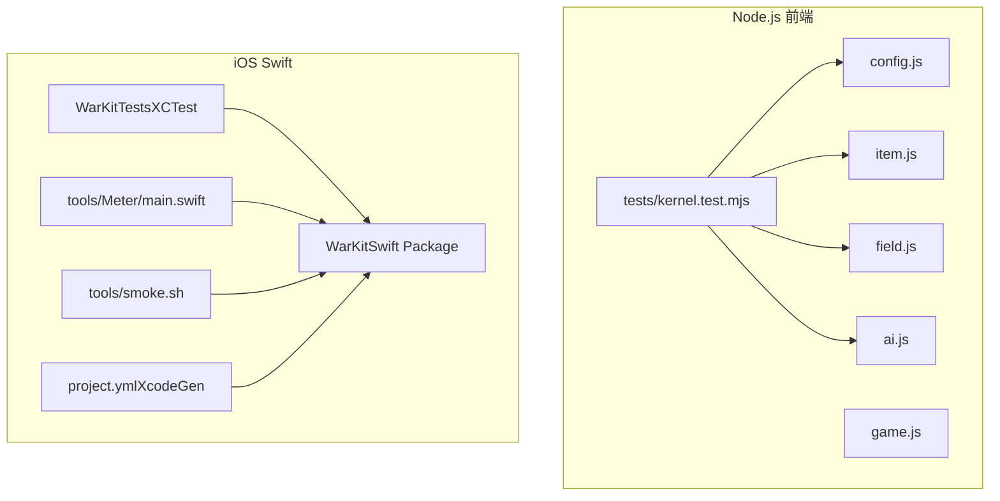
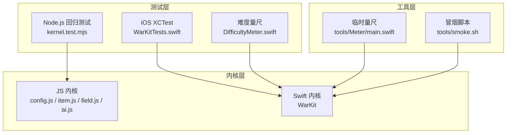
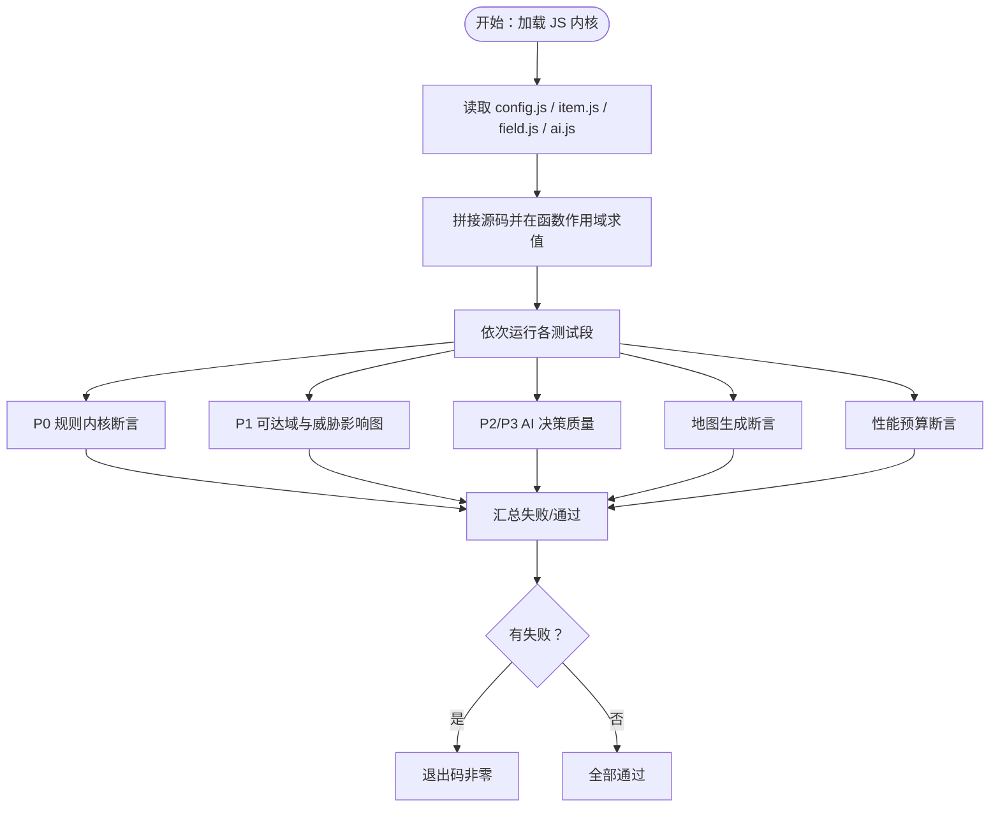
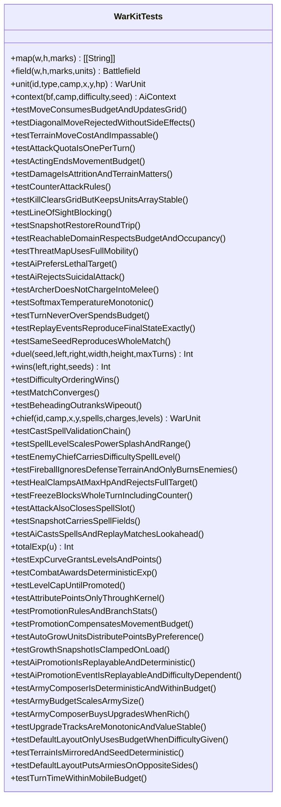
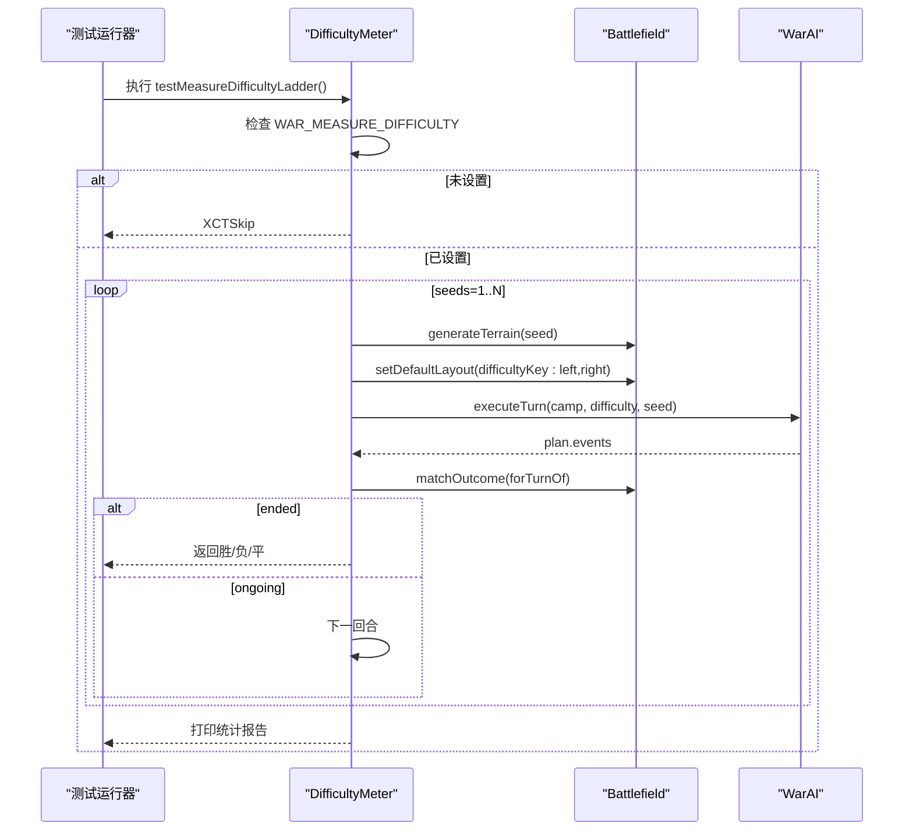
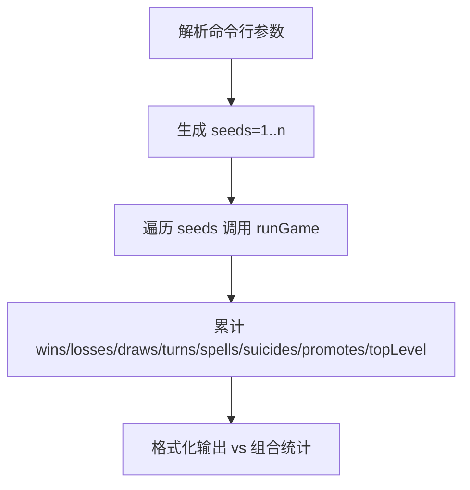
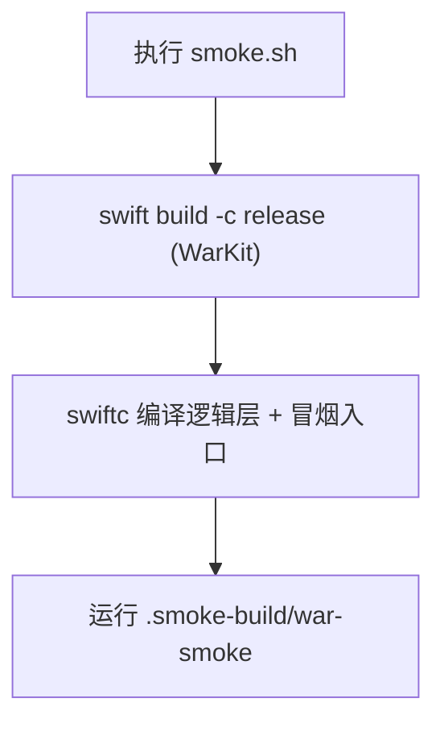
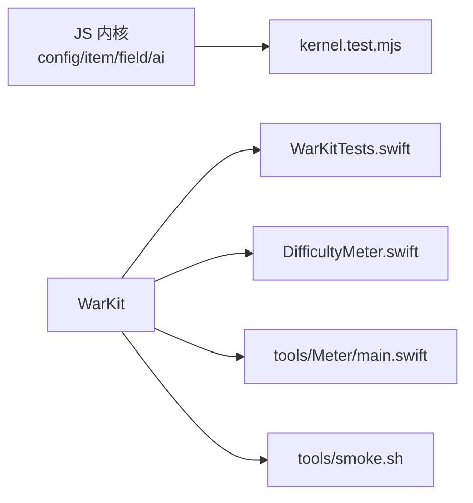
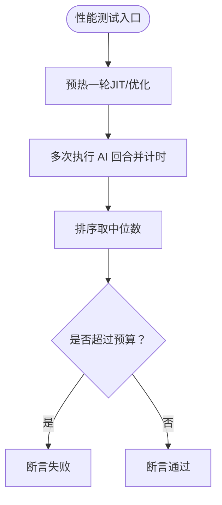

# 测试与质量保证

<cite>
**本文引用的文件**   
- [war/README.md](file://war/war/README.md)
- [war/package.json](file://war/war/package.json)
- [tests/kernel.test.mjs](file://war/war/tests/kernel.test.mjs)
- [project.yml](file://war/ios/project.yml)
- [WarKitTests.swift](file://war/ios/WarKit/Tests/WarKitTests/WarKitTests.swift)
- [DifficultyMeter.swift](file://war/ios/WarKit/Tests/WarKitTests/DifficultyMeter.swift)
- [main.swift（工具量尺）](file://war/ios/tools/Meter/main.swift)
- [smoke.sh](file://war/ios/tools/smoke.sh)
</cite>

## 目录
1. [引言](#引言)
2. [项目结构](#项目结构)
3. [核心测试组件](#核心测试组件)
4. [架构总览](#架构总览)
5. [详细组件分析](#详细组件分析)
6. [依赖关系分析](#依赖关系分析)
7. [性能与基准测试](#性能与基准测试)
8. [测试编写指南](#测试编写指南)
9. [覆盖率、持续集成与自动化配置](#覆盖率持续集成与自动化配置)
10. [故障排查](#故障排查)
11. [结论](#结论)

## 引言
本仓库是一个回合制战棋 AI 原型，同时提供 Node.js 前端内核和 iOS Swift 内核。测试与质量保证体系围绕两条主线展开：
- Node.js 回归测试套件：覆盖规则、AI 决策、地图生成与性能预算，用于验证 JS 原型内核的正确性与可移植性。
- iOS 单元测试与性能门槛：通过 XCTest 对 Swift WarKit 进行规则回归、AI 行为断言、魔法/成长/经济系统验收，并提供难度档位量尺与冒烟脚本。

文档目标包括：
- 解释 Node.js 27 项规则/AI 回归测试的覆盖范围与执行方式。
- 说明 iOS 端单元测试框架、测试策略与 DifficultyMeter 性能工具的使用方法。
- 给出新增功能测试、性能基准与回归测试的编写指南。
- 明确测试覆盖率要求、持续集成流程与自动化配置建议。

## 项目结构
仓库采用“双内核 + 双测试”的组织方式：
- war/war：Node.js 前端内核与零依赖回归测试。
- war/ios：Swift Package WarKit（纯逻辑内核）、iPhone App 外壳、XcodeGen 工程描述、iOS 测试与工具脚本。

**图表来源**
- [war/README.md:103-112](file://war/war/README.md#L103-L112)
- [project.yml:4-7](file://war/ios/project.yml#L4-L7)

**章节来源**
- [war/README.md:37-112](file://war/war/README.md#L37-L112)
- [project.yml:1-69](file://war/ios/project.yml#L1-L69)

## 核心测试组件
本节聚焦两个测试入口及其职责边界：
- Node.js 回归测试：`tests/kernel.test.mjs`，直接加载并运行 `config.js / item.js / field.js / ai.js`，断言移动/攻击配额、可达域、威胁影响图、AI 决策质量、地图对称性与性能预算。
- iOS XCTest：`WarKitTests.swift` 与 `DifficultyMeter.swift`，覆盖移动/攻击、快照回滚、可达域、威胁图、AI 候选排序、温度随机、整局收敛、斩首判据、魔法、成长转职、军费配兵、地图生成与性能门槛；`DifficultyMeter` 作为可调样本量的难度档位量尺。

**章节来源**
- [tests/kernel.test.mjs:1-28](file://war/war/tests/kernel.test.mjs#L1-L28)
- [WarKitTests.swift:1-37](file://war/ios/WarKit/Tests/WarKitTests/WarKitTests.swift#L1-L37)
- [DifficultyMeter.swift:1-13](file://war/ios/WarKit/Tests/WarKitTests/DifficultyMeter.swift#L1-L13)

## 架构总览
从测试视角看，系统由“内核层 + 测试层 + 工具层”构成：
- 内核层：JS 侧 `config/item/field/ai`；Swift 侧 WarKit（Battlefield、WarAI、Scorer、Lookahead、Enumerator、WarConfig 等）。
- 测试层：JS 回归测试与 iOS XCTest。
- 工具层：iOS 临时量尺 `tools/Meter/main.swift` 与无头冒烟脚本 `tools/smoke.sh`。

**图表来源**
- [tests/kernel.test.mjs:14-28](file://war/war/tests/kernel.test.mjs#L14-L28)
- [WarKitTests.swift:1-37](file://war/ios/WarKit/Tests/WarKitTests/WarKitTests.swift#L1-L37)
- [DifficultyMeter.swift:13-45](file://war/ios/WarKit/Tests/WarKitTests/DifficultyMeter.swift#L13-L45)
- [main.swift（工具量尺）:1-38](file://war/ios/tools/Meter/main.swift#L1-L38)
- [smoke.sh:1-37](file://war/ios/tools/smoke.sh#L1-L37)

## 详细组件分析

### Node.js 回归测试套件（27 项规则/AI 测试）
该测试套件以“缺陷驱动”的方式组织，每条断言对应一次修复或一个关键不变式。主要覆盖维度如下：
- 规则内核：移动按地形扣点、机动不足拒绝移动且无副作用、路径仅 4 邻接、可达域不超过预算、攻击配额一回合一次、伤害受地形防御加成、近战反击与弓兵无反击、击杀后腾格、视线阻挡、快照/回滚一致性。
- 空间推理：威胁影响图在敌方火力覆盖为正、安全格为零；威胁图基于敌方完整机动力而非当前射程；森林拖慢机动；不可通行地形不入可达域。
- AI 行为：优先击杀、远程不贴脸、整回合移动消耗不超预算、同种子决策序列逐字节一致、softmax 温度单调控制犯错率、高难度胜率优势、前瞻提升强度、回合收敛、胜负判定与死者不复生。
- 地图生成：左右镜像对称、同种子一致不同种子不同、双方出生区互通。
- 性能预算：单阵营 nightmare 前瞻档每回合中位数 < 20ms。

**图表来源**
- [tests/kernel.test.mjs:14-28](file://war/war/tests/kernel.test.mjs#L14-L28)
- [tests/kernel.test.mjs:98-551](file://war/war/tests/kernel.test.mjs#L98-L551)
- [tests/kernel.test.mjs:553-563](file://war/war/tests/kernel.test.mjs#L553-L563)

**章节来源**
- [tests/kernel.test.mjs:1-563](file://war/war/tests/kernel.test.mjs#L1-L563)
- [war/README.md:37-91](file://war/war/README.md#L37-L91)

### iOS 单元测试框架与测试策略
iOS 测试基于 XCTest，并通过 `@testable import WarKit` 访问内核 API。测试策略强调：
- 规则回归与 P0 门禁：移动/攻击配额、快照回滚、斩首优先于歼灭、施法与普攻互斥等。
- AI 行为断言：候选排序、自杀过滤、温度随机单调性、回合预算不超支、事件重放与同 seed 复现。
- 系统扩展：魔法（火球/治疗/冰冻）、成长与转职、军费配兵与预算单调性、地图生成与默认布阵。
- 性能门槛：release 构建下 18×18 满编 7v7 普通/困难 < 20ms，噩梦 < 40ms。

**图表来源**
- [WarKitTests.swift:1-1219](file://war/ios/WarKit/Tests/WarKitTests/WarKitTests.swift#L1-L1219)

**章节来源**
- [WarKitTests.swift:1-1219](file://war/ios/WarKit/Tests/WarKitTests/WarKitTests.swift#L1-L1219)

### DifficultyMeter 性能与难度量尺
`DifficultyMeter` 是独立的可跳过测试类，用于标定难度档位之间的胜率阶梯。它通过环境变量开关：
- `WAR_MEASURE_DIFFICULTY=1`：启用测试。
- `WAR_MEASURE_SEEDS`：调整样本数（默认 40）。

其设计要点：
- 轮流先手：根据 seed 奇偶决定 left/right 的 camp，避免固定先手偏差。
- 与主测试同口径：使用相同终局判据与默认布阵入口，确保阈值回填有效。
- 输出四组相邻难度对比及自对弈噪声基线。

**图表来源**
- [DifficultyMeter.swift:13-71](file://war/ios/WarKit/Tests/WarKitTests/DifficultyMeter.swift#L13-L71)

**章节来源**
- [DifficultyMeter.swift:1-73](file://war/ios/WarKit/Tests/WarKitTests/DifficultyMeter.swift#L1-L73)

### 临时量尺 tools/Meter/main.swift
这是一个不入库的临时量尺，用于调参与观测整局指标：
- 输入：命令行参数指定样本数（默认 20），可选 `adjacent` 只跑相邻难度。
- 输出：胜率、平均回合数、停滞局数、平均每局施法次数、自杀率、转职率、最高等级等。
- 用途：配合评分权重、前瞻结构、地形生成改动后的快速回归观察。

**图表来源**
- [main.swift（工具量尺）:1-72](file://war/ios/tools/Meter/main.swift#L1-L72)

**章节来源**
- [main.swift（工具量尺）:1-72](file://war/ios/tools/Meter/main.swift#L1-L72)

### 无头冒烟脚本 tools/smoke.sh
该脚本在 macOS 上编译并运行 App 的逻辑层，无需 iOS 模拟器：
- 编译 WarKit release。
- 使用 swiftc 将 Model/Support 与 tools/Smoke/main.swift 链接到 WarKit。
- 运行冒烟程序，验证 GameStore/BoardFrame/Theme 等逻辑契约。

**图表来源**
- [smoke.sh:1-37](file://war/ios/tools/smoke.sh#L1-L37)

**章节来源**
- [smoke.sh:1-37](file://war/ios/tools/smoke.sh#L1-L37)

## 依赖关系分析
测试与内核之间的依赖关系清晰且低耦合：
- Node.js 测试直接读取本地源文件并拼接求值，不引入外部依赖。
- iOS 测试通过 SPM 包 `WarKit` 访问公开 API，UI 与渲染层不在测试范围内。
- 工具脚本依赖 WarKit 编译产物，但不进入正式测试集。

**图表来源**
- [tests/kernel.test.mjs:14-28](file://war/war/tests/kernel.test.mjs#L14-L28)
- [WarKitTests.swift:1-37](file://war/ios/WarKit/Tests/WarKitTests/WarKitTests.swift#L1-L37)
- [DifficultyMeter.swift:1-13](file://war/ios/WarKit/Tests/WarKitTests/DifficultyMeter.swift#L1-L13)
- [main.swift（工具量尺）:1-3](file://war/ios/tools/Meter/main.swift#L1-L3)
- [smoke.sh:1-37](file://war/ios/tools/smoke.sh#L1-L37)

**章节来源**
- [tests/kernel.test.mjs:1-28](file://war/war/tests/kernel.test.mjs#L1-L28)
- [WarKitTests.swift:1-37](file://war/ios/WarKit/Tests/WarKitTests/WarKitTests.swift#L1-L37)

## 性能与基准测试
性能测试贯穿两端：
- Node.js：nightmare 前瞻档 20v20 每阵营回合中位数 < 20ms，预热一轮后再采样，取中位数与最大值输出。
- iOS：release 构建下 18×18 满编 7v7 普通/困难 < 20ms，噩梦 < 40ms；debug 构建跳过性能门槛以避免误报。

**图表来源**
- [tests/kernel.test.mjs:519-551](file://war/war/tests/kernel.test.mjs#L519-L551)
- [WarKitTests.swift:1175-1217](file://war/ios/WarKit/Tests/WarKitTests/WarKitTests.swift#L1175-L1217)

**章节来源**
- [tests/kernel.test.mjs:519-551](file://war/war/tests/kernel.test.mjs#L519-L551)
- [WarKitTests.swift:1175-1217](file://war/ios/WarKit/Tests/WarKitTests/WarKitTests.swift#L1175-L1217)

## 测试编写指南

### 为新功能添加测试用例
建议遵循以下原则：
- 对齐内核入口：新增能力应通过现有公共 API（如 Battlefield.moveAlongPath、attack、castSpell、executeTurn、snapshot/restore）进行测试，避免绕过入口写字段。
- 覆盖不变式：至少包含一条“状态不变式”断言（例如剩余配额不得为负、预算不超支、快照回滚一致）。
- 覆盖边界条件：非法输入、越界档位、不可通行地形、满血/残血、反伤/无反伤、视线阻挡等。
- 可复现性：涉及随机时，固定 SeededRng 起点或全局 seed，断言同 seed 结果一致。
- 性能门槛：若新功能可能影响 AI 决策成本，补充 release 性能断言或记录基准数据。

参考路径：
- 规则与配额：[WarKitTests.swift:39-188](file://war/ios/WarKit/Tests/WarKitTests/WarKitTests.swift#L39-L188)
- AI 候选与温度：[WarKitTests.swift:225-319](file://war/ios/WarKit/Tests/WarKitTests/WarKitTests.swift#L225-L319)
- 魔法与快照：[WarKitTests.swift:518-764](file://war/ios/WarKit/Tests/WarKitTests/WarKitTests.swift#L518-L764)
- 成长与转职：[WarKitTests.swift:766-1017](file://war/ios/WarKit/Tests/WarKitTests/WarKitTests.swift#L766-L1017)
- 军费与地图：[WarKitTests.swift:1019-1173](file://war/ios/WarKit/Tests/WarKitTests/WarKitTests.swift#L1019-L1173)

**章节来源**
- [WarKitTests.swift:39-188](file://war/ios/WarKit/Tests/WarKitTests/WarKitTests.swift#L39-L188)
- [WarKitTests.swift:225-319](file://war/ios/WarKit/Tests/WarKitTests/WarKitTests.swift#L225-L319)
- [WarKitTests.swift:518-764](file://war/ios/WarKit/Tests/WarKitTests/WarKitTests.swift#L518-L764)
- [WarKitTests.swift:766-1017](file://war/ios/WarKit/Tests/WarKitTests/WarKitTests.swift#L766-L1017)
- [WarKitTests.swift:1019-1173](file://war/ios/WarKit/Tests/WarKitTests/WarKitTests.swift#L1019-L1173)

### 如何进行性能基准测试与回归测试
- Node.js：
  - 使用 `node tests/kernel.test.mjs` 运行 27 项回归测试，其中包含 nightmare 前瞻档的性能预算断言。
  - 如需单独观察性能，可在测试文件中增加更多样本或扩大棋盘规模，但需同步更新预算阈值。
- iOS：
  - 使用 `swift test -c release` 运行性能门槛断言（debug 构建会跳过）。
  - 使用 `tools/Meter/main.swift` 进行临时量测，观察胜率、停滞、施法、自杀、转职与等级分布。
  - 使用 `DifficultyMeter` 重新标定难度档位阈值，命令示例见文件注释。

参考路径：
- Node.js 性能断言：[tests/kernel.test.mjs:519-551](file://war/war/tests/kernel.test.mjs#L519-L551)
- iOS 性能断言：[WarKitTests.swift:1175-1217](file://war/ios/WarKit/Tests/WarKitTests/WarKitTests.swift#L1175-L1217)
- 临时量尺用法：[main.swift（工具量尺）:40-72](file://war/ios/tools/Meter/main.swift#L40-L72)
- 难度量尺用法：[DifficultyMeter.swift:4-12](file://war/ios/WarKit/Tests/WarKitTests/DifficultyMeter.swift#L4-L12)

**章节来源**
- [tests/kernel.test.mjs:519-551](file://war/war/tests/kernel.test.mjs#L519-L551)
- [WarKitTests.swift:1175-1217](file://war/ios/WarKit/Tests/WarKitTests/WarKitTests.swift#L1175-L1217)
- [main.swift（工具量尺）:40-72](file://war/ios/tools/Meter/main.swift#L40-L72)
- [DifficultyMeter.swift:4-12](file://war/ios/WarKit/Tests/WarKitTests/DifficultyMeter.swift#L4-L12)

## 覆盖率、持续集成与自动化配置

### 测试覆盖率要求
- 规则与配额：必须覆盖移动/攻击配额、地形代价、反击、视线阻挡、快照回滚等不变式。
- AI 行为：必须覆盖候选排序、自杀过滤、温度随机单调性、预算不超支、事件重放与同 seed 复现。
- 系统扩展：魔法校验链、等级上限与转职、军费预算单调性、地图对称性与通路。
- 性能：release 构建下的回合耗时门槛必须通过。

这些要求已在现有测试中体现为具体断言与阈值，建议在新增功能时延续同一风格：
- 用最小夹具构造场景。
- 断言不变式与边界条件。
- 必要时加入 release 性能断言。

**章节来源**
- [WarKitTests.swift:39-188](file://war/ios/WarKit/Tests/WarKitTests/WarKitTests.swift#L39-L188)
- [WarKitTests.swift:225-319](file://war/ios/WarKit/Tests/WarKitTests/WarKitTests.swift#L225-L319)
- [WarKitTests.swift:518-764](file://war/ios/WarKit/Tests/WarKitTests/WarKitTests.swift#L518-L764)
- [WarKitTests.swift:766-1017](file://war/ios/WarKit/Tests/WarKitTests/WarKitTests.swift#L766-L1017)
- [WarKitTests.swift:1019-1173](file://war/ios/WarKit/Tests/WarKitTests/WarKitTests.swift#L1019-L1173)
- [WarKitTests.swift:1175-1217](file://war/ios/WarKit/Tests/WarKitTests/WarKitTests.swift#L1175-L1217)

### 持续集成流程与自动化测试配置
建议 CI 流程包含以下步骤：
- Node.js：
  - 语法检查：`npm run check`。
  - 回归测试：`npm test`（即 `node tests/kernel.test.mjs`）。
- iOS：
  - 构建 WarKit：`cd ios && swift build -c release`。
  - 运行 XCTest：`cd ios && swift test -c release`。
  - 难度量尺（可选）：`WAR_MEASURE_DIFFICULTY=1 swift test -c release --filter DifficultyMeter`。
  - 冒烟脚本：`sh ios/tools/smoke.sh`。
  - XcodeGen（可选）：`brew install xcodegen && cd ios && xcodegen generate`。

相关配置与说明：
- Node.js scripts：[package.json:6-10](file://war/war/package.json#L6-L10)
- iOS 工程描述与部署目标：[project.yml:8-25](file://war/ios/project.yml#L8-L25)
- 难度量尺环境变量：[DifficultyMeter.swift:4-12](file://war/ios/WarKit/Tests/WarKitTests/DifficultyMeter.swift#L4-L12)
- 冒烟脚本步骤：[smoke.sh:10-37](file://war/ios/tools/smoke.sh#L10-L37)

**章节来源**
- [package.json:6-10](file://war/war/package.json#L6-L10)
- [project.yml:8-25](file://war/ios/project.yml#L8-L25)
- [DifficultyMeter.swift:4-12](file://war/ios/WarKit/Tests/WarKitTests/DifficultyMeter.swift#L4-L12)
- [smoke.sh:10-37](file://war/ios/tools/smoke.sh#L10-L37)

## 故障排查
常见问题与定位方法：
- Node.js 测试失败：
  - 查看控制台输出的失败条目与异常堆栈，通常能直接定位到具体断言与原因。
  - 若移动免费或 AI 无限走回归出现，重点检查 moveAlongPath 与 attack 的配额与网格同步。
- iOS 测试失败：
  - 关注 P0 标记的用例，尤其是移动配额、攻击配额、快照回滚、斩首判据与魔法校验链。
  - 若事件重放不一致，检查 Replay.apply 与 snapshot/restore 是否携带所有字段（含魔法充能与 stunned）。
- 性能门槛失败：
  - 确认是否在 release 构建下运行；debug 构建会跳过性能断言。
  - 检查是否预热一轮再采样，避免 JIT 抖动导致误报。
- 难度量尺阈值漂移：
  - 使用 `WAR_MEASURE_DIFFICULTY=1` 重新测量，并根据输出回填 `testDifficultyOrderingWins` 中的阈值。

参考路径：
- Node.js 失败汇总：[tests/kernel.test.mjs:553-563](file://war/war/tests/kernel.test.mjs#L553-L563)
- iOS P0 门禁与快照：[WarKitTests.swift:39-188](file://war/ios/WarKit/Tests/WarKitTests/WarKitTests.swift#L39-L188)
- iOS 事件重放与魔法快照：[WarKitTests.swift:518-764](file://war/ios/WarKit/Tests/WarKitTests/WarKitTests.swift#L518-L764)
- iOS 性能门槛与跳过逻辑：[WarKitTests.swift:1175-1217](file://war/ios/WarKit/Tests/WarKitTests/WarKitTests.swift#L1175-L1217)
- 难度量尺测量开关：[DifficultyMeter.swift:59-71](file://war/ios/WarKit/Tests/WarKitTests/DifficultyMeter.swift#L59-L71)

**章节来源**
- [tests/kernel.test.mjs:553-563](file://war/war/tests/kernel.test.mjs#L553-L563)
- [WarKitTests.swift:39-188](file://war/ios/WarKit/Tests/WarKitTests/WarKitTests.swift#L39-L188)
- [WarKitTests.swift:518-764](file://war/ios/WarKit/Tests/WarKitTests/WarKitTests.swift#L518-L764)
- [WarKitTests.swift:1175-1217](file://war/ios/WarKit/Tests/WarKitTests/WarKitTests.swift#L1175-L1217)
- [DifficultyMeter.swift:59-71](file://war/ios/WarKit/Tests/WarKitTests/DifficultyMeter.swift#L59-L71)

## 结论
本项目的测试与质量保证体系以“缺陷驱动 + 不变式门禁 + 性能门槛”为核心：
- Node.js 回归测试确保 JS 内核的规则正确性与 AI 行为稳定性，并为 Swift 移植提供验收门槛。
- iOS XCTest 覆盖规则、AI、魔法、成长、经济与地图生成，并通过 DifficultyMeter 与 tools/Meter 提供可调的量尺与临时观测。
- 建议在新增功能时沿用现有夹具风格，补齐不变式、边界条件与性能门槛，并在 CI 中统一执行 Node.js 与 iOS 测试、冒烟脚本与可选的难度量尺。