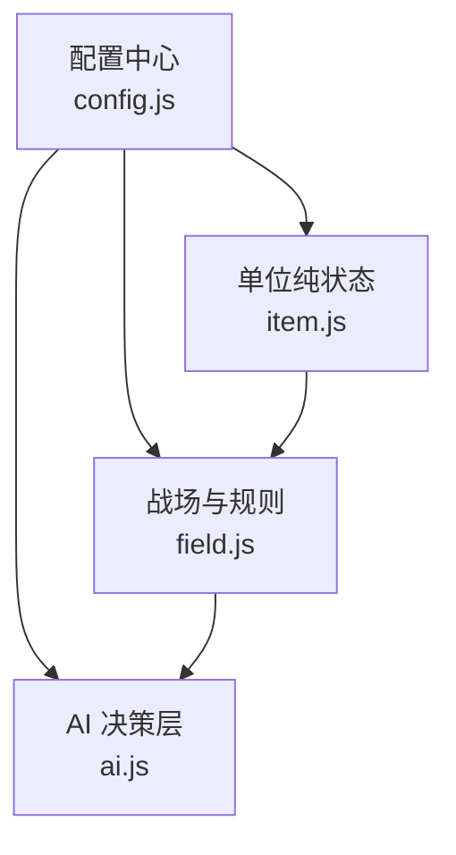
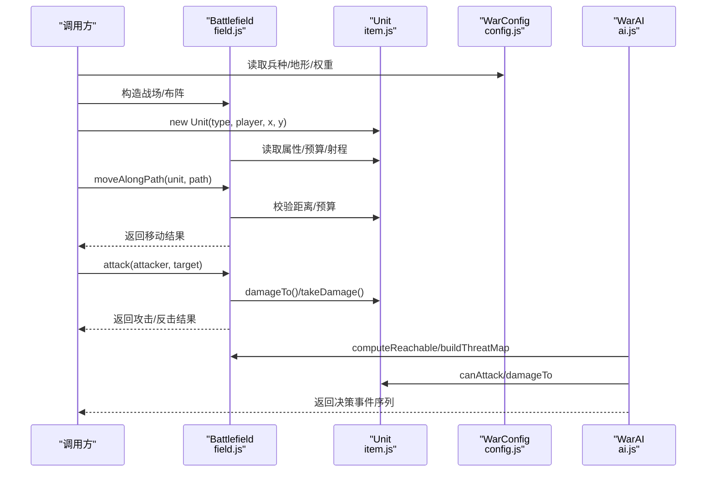
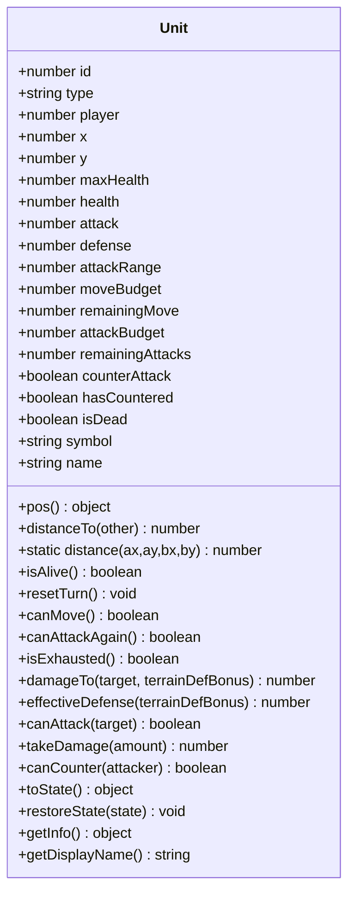
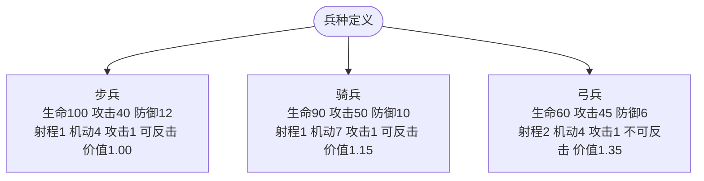
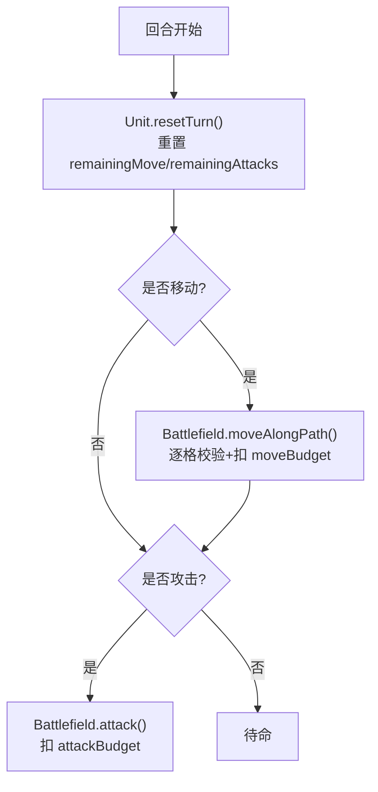
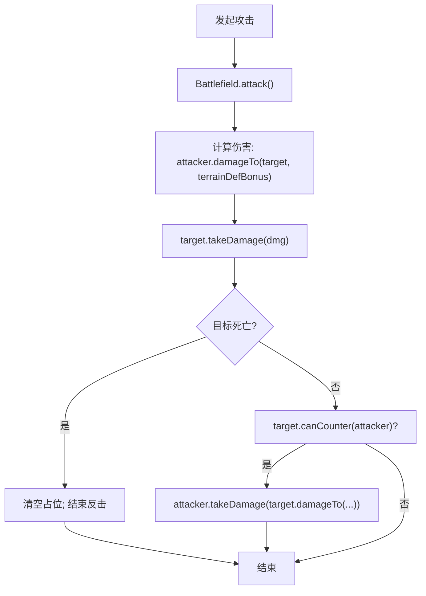
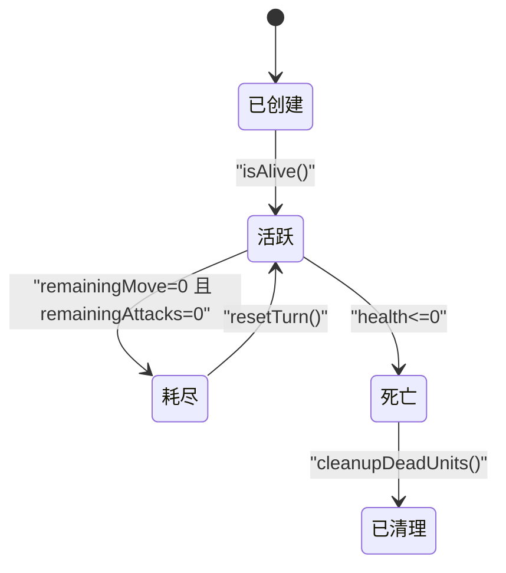
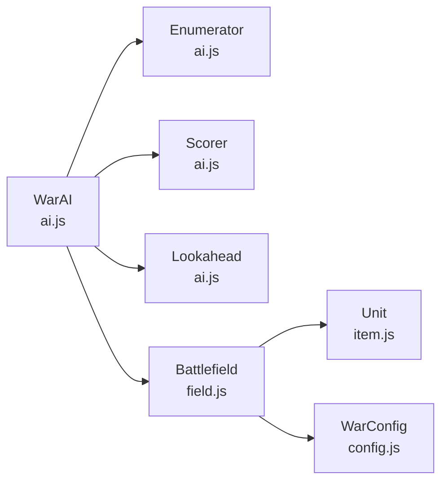
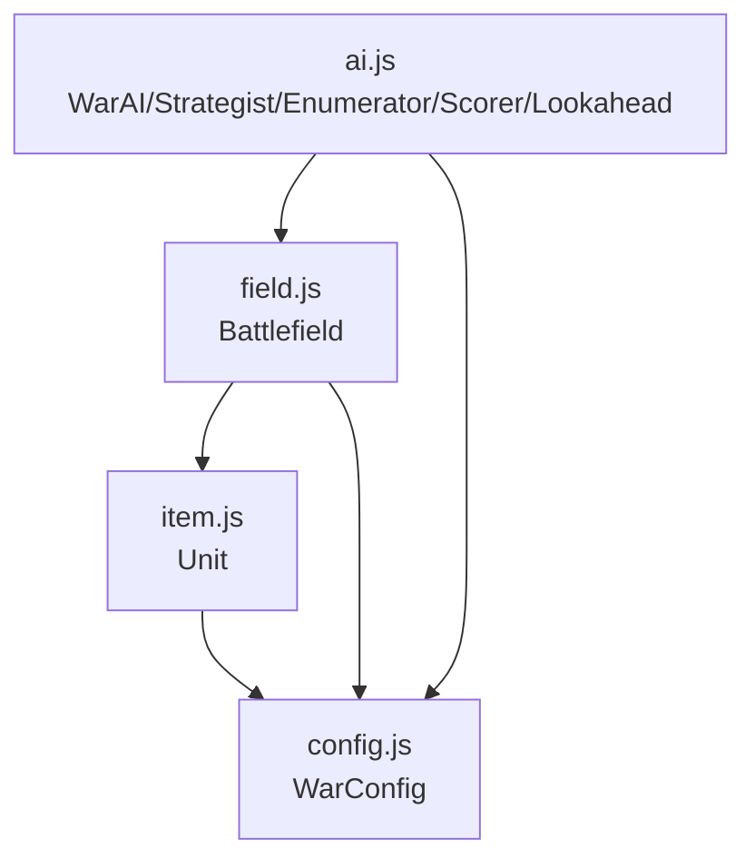

# 单位系统

<cite>
**本文引用的文件**   
- [config.js](file://war/war/config.js)
- [item.js](file://war/war/item.js)
- [field.js](file://war/war/field.js)
- [ai.js](file://war/war/ai.js)
- [README.md](file://war/war/README.md)
</cite>

## 目录
1. [引言](#引言)
2. [项目结构](#项目结构)
3. [核心组件](#核心组件)
4. [架构总览](#架构总览)
5. [详细组件分析](#详细组件分析)
6. [依赖关系分析](#依赖关系分析)
7. [性能考量](#性能考量)
8. [故障排查指南](#故障排查指南)
9. [结论](#结论)
10. [附录：使用示例与最佳实践](#附录使用示例与最佳实践)

## 引言
本技术文档聚焦 WAR 游戏的“单位系统”，围绕 Unit 纯状态对象的设计理念、数据结构、三种基础兵种（步兵、骑兵、弓兵）的属性体系，以及行动配额控制机制（移动预算 moveBudget 与攻击预算 attackBudget 的分离设计）展开。同时说明伤害计算算法、反击机制、兵种价值评估，并给出创建单位、执行移动与攻击操作的代码路径指引。最后补充单位状态管理、生命周期以及与 AI、战场系统的交互接口。

## 项目结构
WAR 内核采用“配置 + 纯状态 + 规则引擎 + AI”的分层组织方式：
- config.js：集中定义棋盘尺寸、地形、兵种属性、难度旋钮、评分权重与随机数生成器。
- item.js：Unit 纯状态对象，封装单位属性、配额、伤害与反击判定等纯函数式能力。
- field.js：Battlefield 战场类，负责地形、占位、移动与攻击结算、可达域、威胁影响图、快照与回滚。
- ai.js：AI 分层（战略、枚举、评分、前瞻、编排），基于同一套评分函数通过三个正交旋钮调节难度。
- README.md：需求背景、重构说明与运行测试入口。

图示来源
- [config.js:12-103](file://war/war/config.js#L12-L103)
- [item.js:12-172](file://war/war/item.js#L12-L172)
- [field.js:11-617](file://war/war/field.js#L11-L617)
- [ai.js:15-647](file://war/war/ai.js#L15-L647)

章节来源
- [README.md:37-112](file://war/war/README.md#L37-L112)

## 核心组件
- Unit（纯状态对象）
  - 职责：承载单位类型、阵营、坐标、生命值、攻防、射程、预算、反击资格、存活状态；提供距离、伤害、反击、序列化等纯函数式方法。
  - 关键设计：不直接修改自身坐标与网格占位；所有状态变更由 Battlefield 统一写入，避免双写不一致。
- Battlefield（战场）
  - 职责：维护地形与单位占位网格；提供移动、攻击、可达域、威胁影响图、快照/回滚、胜负判断与物质分评估。
  - 关键设计：单一写入者原则；坐标与占位仅通过 moveAlongPath() 更新，血量与死亡仅通过 attack() 更新。
- AI（WarAI 及其子模块）
  - 职责：将“单位 × 落点 × 动作”全部摊开为候选，用统一评分函数打分，可选浅层推演修正分数，最终 softmax 采样执行。
  - 关键设计：难度 = vision / temperature / lookahead 三个正交旋钮；全程确定性随机。

章节来源
- [item.js:12-172](file://war/war/item.js#L12-L172)
- [field.js:11-617](file://war/war/field.js#L11-L617)
- [ai.js:15-647](file://war/war/ai.js#L15-L647)

## 架构总览
下图展示单位系统在运行时与 AI、战场、配置的交互关系。

图示来源
- [config.js:12-103](file://war/war/config.js#L12-L103)
- [item.js:12-172](file://war/war/item.js#L12-L172)
- [field.js:11-617](file://war/war/field.js#L11-L617)
- [ai.js:421-647](file://war/war/ai.js#L421-L647)

## 详细组件分析

### Unit 纯状态对象设计与数据结构
- 设计理念
  - 纯状态：Unit 只保存数据与无副作用的方法（如 distanceTo、damageTo、canAttack）。
  - 单一写入者：坐标与占位由 Battlefield 统一修改，避免旧版“移动免费”的 P0 缺陷。
  - 预算分离：moveBudget 与 attackBudget 独立，消除“走过一格就不能射击”的伪约束。
- 核心字段
  - 身份与位置：id、type、player、x、y
  - 战斗属性：maxHealth、health、attack、defense、attackRange
  - 行动配额：moveBudget、remainingMove、attackBudget、remainingAttacks
  - 行为标志：counterAttack、hasCountered、isDead
  - 显示信息：symbol、name
- 关键方法
  - resetTurn：每回合重置 remainingMove、remainingAttacks、hasCountered
  - canMove/canAttackAgain/isExhausted：配额检查
  - damageTo/effectiveDefense：伤害与防御计算（含地形加成）
  - takeDamage：扣血与死亡标记
  - canCounter：反击资格判定
  - toState/restoreState：快照与恢复
  - getInfo/getDisplayName：调试与 UI 展示

图示来源
- [item.js:12-172](file://war/war/item.js#L12-L172)

章节来源
- [item.js:12-172](file://war/war/item.js#L12-L172)

### 三种基础兵种属性体系
- 步兵（infantry）
  - 高生命、中等攻击与防御、近战（射程 1）、可反击、基准价值 1.00
- 骑兵（cavalry）
  - 较高攻击、较低防御、近战（射程 1）、高机动（moveBudget 7）、可反击、价值 1.15
- 弓兵（archer）
  - 低生命与防御、远程（射程 2）、不可反击、价值 1.35（优先集火目标）

图示来源
- [config.js:33-55](file://war/war/config.js#L33-L55)

章节来源
- [config.js:33-55](file://war/war/config.js#L33-L55)

### 行动配额控制机制（moveBudget 与 attackBudget）
- 设计动机
  - 旧版统一 AP 池导致“移动不扣点数”和“弓兵走一步就再也打不了箭”两类问题。
  - 现拆分为：
    - moveBudget：按地形 moveCost 累加扣除的移动预算
    - attackBudget：每回合可攻击次数，攻击不消耗机动点
- 运行机制
  - Unit.resetTurn 每回合重置 remainingMove 与 remainingAttacks
  - Battlefield.moveAlongPath 逐步校验邻接、空格、地形消耗，失败时回滚
  - Battlefield.attack 仅在成功命中后递减 remainingAttacks

图示来源
- [item.js:67-84](file://war/war/item.js#L67-L84)
- [field.js:391-449](file://war/war/field.js#L391-L449)
- [field.js:343-383](file://war/war/field.js#L343-L383)

章节来源
- [README.md:93-98](file://war/war/README.md#L93-L98)
- [item.js:67-84](file://war/war/item.js#L67-L84)
- [field.js:391-449](file://war/war/field.js#L391-L449)
- [field.js:343-383](file://war/war/field.js#L343-L383)

### 伤害计算、反击机制与兵种价值评估
- 伤害计算
  - Unit.damageTo(target, terrainDefBonus) = max(1, attacker.attack - target.effectiveDefense(terrainDefBonus))
  - effectiveDefense = defense + terrainDefBonus
  - Battlefield.attack 中根据目标所在格地形防御加成计算实际伤害，并调用 Unit.takeDamage
- 反击机制
  - Unit.canCounter(attacker)：需满足 counterAttack=true、存活、未反击过、且攻击者在自身射程内
  - Battlefield.attack 在击杀判定后对存活目标进行反击，记录 counterDamage 与 counterKilled
- 兵种价值评估
  - WarConfig.unitTypes.aiValue：用于目标价值、物质分与 AI 集火优先级
  - Battlefield.materialScore：按 (health/maxHealth)*aiValue 加权计算双方势力差值

图示来源
- [item.js:88-122](file://war/war/item.js#L88-L122)
- [field.js:343-383](file://war/war/field.js#L343-L383)
- [config.js:33-55](file://war/war/config.js#L33-L55)
- [field.js:557-565](file://war/war/field.js#L557-L565)

章节来源
- [item.js:88-122](file://war/war/item.js#L88-L122)
- [field.js:343-383](file://war/war/field.js#L343-L383)
- [config.js:33-55](file://war/war/config.js#L33-L55)
- [field.js:557-565](file://war/war/field.js#L557-L565)

### 单位状态管理与生命周期
- 生命周期阶段
  - 创建：new Unit(...) 从 WarConfig.unitTypes 初始化静态属性，复制动态属性到实例
  - 活跃：isAlive 为真，参与移动/攻击/反击
  - 耗尽：isExhausted 为真（remainingMove<=0 且 remainingAttacks<=0）
  - 死亡：health<=0 时 isDead=true，Battlefield.removeUnit/cleanupDeadUnits 清理占位
  - 回合重置：Battlefield.resetAllActions 调用 Unit.resetTurn
- 序列化与快照
  - Unit.toState/restoreState 配合 Battlefield.snapshot/restore 实现 AI 前瞻回滚

图示来源
- [item.js:12-44](file://war/war/item.js#L12-L44)
- [item.js:67-84](file://war/war/item.js#L67-L84)
- [field.js:188-205](file://war/war/field.js#L188-L205)
- [field.js:512-529](file://war/war/field.js#L512-L529)

章节来源
- [item.js:12-44](file://war/war/item.js#L12-L44)
- [item.js:67-84](file://war/war/item.js#L67-L84)
- [field.js:188-205](file://war/war/field.js#L188-L205)
- [field.js:512-529](file://war/war/field.js#L512-L529)

### 与其他系统的交互接口
- 与配置系统（WarConfig）
  - 兵种模板、地形参数、权重与缩放标尺、难度旋钮、默认编成
- 与战场系统（Battlefield）
  - 移动：moveAlongPath(unit, path)
  - 攻击：attack(attacker, target)
  - 空间推理：computeReachable/reachableWithBudget、buildThreatMap
  - 快照/回滚：snapshot/restore
- 与 AI 系统（WarAI）
  - 候选枚举：Enumerator.enumerate
  - 评分：Scorer.score（归一化权重）
  - 前瞻：Lookahead.evaluate（浅层推演）
  - 决策执行：WarAI.executeTurn/decide/_applyCandidate

图示来源
- [ai.js:15-647](file://war/war/ai.js#L15-L647)
- [field.js:11-617](file://war/war/field.js#L11-L617)
- [item.js:12-172](file://war/war/item.js#L12-L172)
- [config.js:12-103](file://war/war/config.js#L12-L103)

章节来源
- [ai.js:15-647](file://war/war/ai.js#L15-L647)
- [field.js:11-617](file://war/war/field.js#L11-L617)
- [item.js:12-172](file://war/war/item.js#L12-L172)
- [config.js:12-103](file://war/war/config.js#L12-L103)

## 依赖关系分析
- 耦合与内聚
  - Unit 高度内聚于自身状态与纯函数方法，几乎不依赖外部可变状态
  - Battlefield 作为唯一写入者，聚合地形、占位与规则，对外暴露稳定 API
  - AI 依赖 Battlefield 提供的空间推理与状态快照，依赖 WarConfig 的数值与权重
- 外部依赖
  - 浏览器环境：window.WarConfig/window.SeededRng
  - Node 环境：module.exports 暴露 Unit/Battlefield/AI 相关类

图示来源
- [item.js:12-172](file://war/war/item.js#L12-L172)
- [field.js:11-617](file://war/war/field.js#L11-L617)
- [ai.js:15-647](file://war/war/ai.js#L15-L647)
- [config.js:12-146](file://war/war/config.js#L12-L146)

章节来源
- [item.js:12-172](file://war/war/item.js#L12-L172)
- [field.js:11-617](file://war/war/field.js#L11-L617)
- [ai.js:15-647](file://war/war/ai.js#L15-L647)
- [config.js:12-146](file://war/war/config.js#L12-L146)

## 性能考量
- 可达域计算
  - 使用桶式优先队列（预算上限较小）替代二叉堆，减少比较开销
  - 缓存 _reachCache 与 _threatCache，按 version 失效
- 威胁影响图
  - 以 Float32Array 存储，按敌方完整机动预算外扩射程，避免重复计算
- 快照/回滚
  - 仅拷贝 units 数组的 toState 列表，重建 unitGrid 而非深拷贝整个战场
- AI 决策
  - 只对 top-K 候选做浅层推演，softmax 温度控制随机性，避免指数爆炸

[本节为通用性能讨论，不直接分析具体文件]

## 故障排查指南
- 常见问题定位
  - 移动免费或无限移动：确认是否通过 Battlefield.moveAlongPath 移动，而非 Unit.move
  - 攻击不扣点数：确认 Battlefield.attack 是否被调用，且 attacker.remainingAttacks 正确递减
  - 斜穿/瞬移：确保路径相邻校验与地形消耗校验生效
  - 包围评分异常：确认 AI 上无 unit 属性的误用，改为 this.unit 或传入上下文
- 建议步骤
  - 使用 Battlefield.flatten() 与 tests/kernel.test.mjs 回归验证
  - 开启 AI.debug 输出，查看候选评分 breakdown 与选择原因
  - 通过 snapshot/restore 重放 AI 回合，对比渲染与逻辑一致性

章节来源
- [README.md:49-62](file://war/war/README.md#L49-L62)
- [field.js:391-449](file://war/war/field.js#L391-L449)
- [field.js:343-383](file://war/war/field.js#L343-L383)
- [ai.js:542-558](file://war/war/ai.js#L542-L558)

## 结论
WAR 的单位系统以 Unit 纯状态对象为核心，结合 Battlefield 的单一写入者与 WarConfig 的集中数值定义，实现了清晰的状态边界与稳定的规则语义。通过将行动配额拆分为 moveBudget 与 attackBudget，消除了旧版的伪约束与规则漏洞；通过伤害纯函数与反击机制，使 AI 能在不改变状态的前提下预估期望净伤害。AI 层以候选枚举 + 统一评分 + 浅层前瞻的方式，兼顾了可解释性与可复现性。整体架构便于移植与扩展，适合继续引入更多兵种、地形与战术策略。

[本节为总结性内容，不直接分析具体文件]

## 附录：使用示例与最佳实践
- 创建单位实例
  - 参考路径：[item.js:12-44](file://war/war/item.js#L12-L44)
  - 要点：从 WarConfig.unitTypes 获取静态属性，设置玩家、坐标与 ID
- 执行移动操作
  - 参考路径：[field.js:391-449](file://war/war/field.js#L391-L449)
  - 要点：先 computeReachable 得到可达路径，再 moveAlongPath 逐步校验与扣点
- 执行攻击操作
  - 参考路径：[field.js:343-383](file://war/war/field.js#L343-L383)
  - 要点：校验射程与视线，计算伤害与反击，更新剩余攻击配额
- 回合重置与清理
  - 参考路径：[field.js:201-205](file://war/war/field.js#L201-L205)、[field.js:188-199](file://war/war/field.js#L188-L199)
- AI 决策与重放
  - 参考路径：[ai.js:455-514](file://war/war/ai.js#L455-L514)、[ai.js:634-643](file://war/war/ai.js#L634-L643)

[本节为使用指引，不直接分析具体文件]