# 战场管理系统

<cite>
**本文引用的文件**   
- [Battlefield.swift](file://war/ios/WarKit/Sources/WarKit/Battlefield.swift)
- [Support.swift](file://war/ios/WarKit/Sources/WarKit/Support.swift)
- [WarConfig.swift](file://war/ios/WarKit/Sources/WarKit/WarConfig.swift)
- [Enumerator.swift](file://war/ios/WarKit/Sources/WarKit/Enumerator.swift)
- [Lookahead.swift](file://war/ios/WarKit/Sources/WarKit/Lookahead.swift)
- [Scorer.swift](file://war/ios/WarKit/Sources/WarKit/Scorer.swift)
- [WarAI.swift](file://war/ios/WarKit/Sources/WarKit/WarAI.swift)
</cite>

## 目录
1. [引言](#引言)
2. [项目结构](#项目结构)
3. [核心组件](#核心组件)
4. [架构总览](#架构总览)
5. [详细组件分析](#详细组件分析)
6. [依赖关系分析](#依赖关系分析)
7. [性能与内存优化](#性能与内存优化)
8. [故障排查指南](#故障排查指南)
9. [结论](#结论)

## 引言
本技术文档围绕 WAR 游戏的战场管理系统展开，重点解析 Battlefield 类的二维网格管理、地形系统、可达域计算、威胁影响图生成以及空间推理能力。同时说明 AI 决策管线如何复用同一套内核规则，确保“推演结果”和“真实执行结果”完全一致。文末提供初始化、地形生成与空间查询的实践路径，并总结性能优化策略与内存管理最佳实践。

## 项目结构
WARKit 是 iOS 端的核心库，包含战场内核、AI 决策、评分与前瞻等模块：
- 战场内核：Battlefield.swift（网格、单位、移动、攻击、施法、快照、地图生成）
- 基础工具：Support.swift（坐标、曼哈顿距离、四邻、确定性随机）
- 配置中心：WarConfig.swift（棋盘尺寸、地形、兵种、魔法、难度、权重、标尺）
- 候选枚举：Enumerator.swift（为每个单位生成动作候选）
- 评分层：Scorer.swift（多维效用评分）
- 前瞻层：Lookahead.swift（浅层 rollout 评估）
- AI 编排：WarAI.swift（战略→枚举→评分→前瞻→采样→执行）

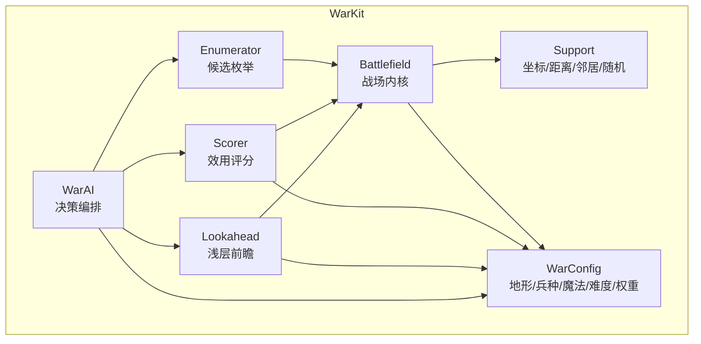

**图表来源**
- [Battlefield.swift:46-96](file://war/ios/WarKit/Sources/WarKit/Battlefield.swift#L46-L96)
- [Support.swift:3-33](file://war/ios/WarKit/Sources/WarKit/Support.swift#L3-L33)
- [WarConfig.swift:5-65](file://war/ios/WarKit/Sources/WarKit/WarConfig.swift#L5-L65)
- [Enumerator.swift:9-104](file://war/ios/WarKit/Sources/WarKit/Enumerator.swift#L9-L104)
- [Scorer.swift:11-257](file://war/ios/WarKit/Sources/WarKit/Scorer.swift#L11-L257)
- [Lookahead.swift:9-61](file://war/ios/WarKit/Sources/WarKit/Lookahead.swift#L9-L61)
- [WarAI.swift:11-28](file://war/ios/WarKit/Sources/WarKit/WarAI.swift#L11-L28)

**章节来源**
- [Battlefield.swift:46-96](file://war/ios/WarKit/Sources/WarKit/Battlefield.swift#L46-L96)
- [WarConfig.swift:5-65](file://war/ios/WarKit/Sources/WarKit/WarConfig.swift#L5-L65)

## 核心组件
- Battlefield：战场状态机，封装二维网格、单位数组、索引表、版本缓存、移动/攻击/施法结算、可达域、威胁图、终局判定、快照回滚、地图生成与布阵。
- Support：GridPoint 坐标、Grid 曼哈顿距离与四邻、SeededRng 确定性随机。
- WarConfig：棋盘尺寸、地形定义、兵种属性、升级与转职、魔法、回合上限、难度档位、评分权重与归一化标尺。
- Enumerator：基于可达域枚举“移动/攻击/移动+攻击/施法/待命”候选，控制候选数量与优先级。
- Scorer：对候选进行多维度评分，统一量纲到 [0,1]，加权汇总并加入抖动。
- Lookahead：对 top-K 候选做 1~2 回合浅层推演，修正即时评分的偏差。
- WarAI：串联“枚举→评分→前瞻→采样→执行”，输出可重放事件序列。

**章节来源**
- [Battlefield.swift:46-96](file://war/ios/WarKit/Sources/WarKit/Battlefield.swift#L46-L96)
- [Support.swift:3-75](file://war/ios/WarKit/Sources/WarKit/Support.swift#L3-L75)
- [WarConfig.swift:5-65](file://war/ios/WarKit/Sources/WarKit/WarConfig.swift#L5-L65)
- [Enumerator.swift:9-104](file://war/ios/WarKit/Sources/WarKit/Enumerator.swift#L9-L104)
- [Scorer.swift:11-257](file://war/ios/WarKit/Sources/WarKit/Scorer.swift#L11-L257)
- [Lookahead.swift:9-61](file://war/ios/WarKit/Sources/WarKit/Lookahead.swift#L9-L61)
- [WarAI.swift:11-28](file://war/ios/WarKit/Sources/WarKit/WarAI.swift#L11-L28)

## 架构总览
Battlefield 作为唯一权威的状态机，所有可变状态变更都通过其方法完成；AI 在推演中复用这些方法，保证“所见即所得”。

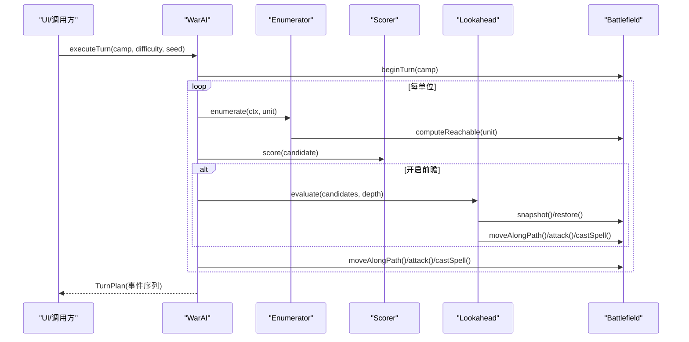

**图表来源**
- [WarAI.swift:64-181](file://war/ios/WarKit/Sources/WarKit/WarAI.swift#L64-L181)
- [Enumerator.swift:14-104](file://war/ios/WarKit/Sources/WarKit/Enumerator.swift#L14-L104)
- [Scorer.swift:57-257](file://war/ios/WarKit/Sources/WarKit/Scorer.swift#L57-L257)
- [Lookahead.swift:26-61](file://war/ios/WarKit/Sources/WarKit/Lookahead.swift#L26-L61)
- [Battlefield.swift:194-208](file://war/ios/WarKit/Sources/WarKit/Battlefield.swift#L194-L208)
- [Battlefield.swift:332-381](file://war/ios/WarKit/Sources/WarKit/Battlefield.swift#L332-L381)
- [Battlefield.swift:395-442](file://war/ios/WarKit/Sources/WarKit/Battlefield.swift#L395-L442)
- [Battlefield.swift:493-556](file://war/ios/WarKit/Sources/WarKit/Battlefield.swift#L493-L556)

## 详细组件分析

### Battlefield 类与二维网格管理
- 网格约定：`terrain[y][x]` 行优先，`unitGrid[y][x]` 同构，便于 O(1) 查询占位。
- 单位存储：`units` 数组稳定下标用于快照对齐；`unitGrid` 仅派生索引，击杀后从 grid 摘除但保留 units 元素（标记死亡）。
- 版本缓存：`version` 递增使可达域与威胁图失效，避免脏读。
- 边界与通行：isInside、isPassable、isCellAvailable 组合判断格子可用性。
- 视线与射程：hasLineOfSight 检查中间格是否被不可通行地形阻挡；canAttackFrom 综合射程、视线与阵营。

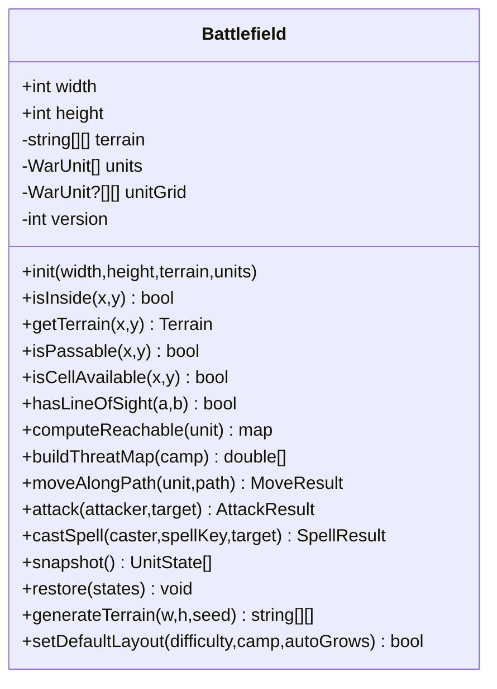

**图表来源**
- [Battlefield.swift:46-96](file://war/ios/WarKit/Sources/WarKit/Battlefield.swift#L46-L96)
- [Battlefield.swift:100-146](file://war/ios/WarKit/Sources/WarKit/Battlefield.swift#L100-L146)
- [Battlefield.swift:213-240](file://war/ios/WarKit/Sources/WarKit/Battlefield.swift#L213-L240)
- [Battlefield.swift:244-297](file://war/ios/WarKit/Sources/WarKit/Battlefield.swift#L244-L297)
- [Battlefield.swift:302-325](file://war/ios/WarKit/Sources/WarKit/Battlefield.swift#L302-L325)
- [Battlefield.swift:332-381](file://war/ios/WarKit/Sources/WarKit/Battlefield.swift#L332-L381)
- [Battlefield.swift:395-442](file://war/ios/WarKit/Sources/WarKit/Battlefield.swift#L395-L442)
- [Battlefield.swift:493-556](file://war/ios/WarKit/Sources/WarKit/Battlefield.swift#L493-L556)
- [Battlefield.swift:680-690](file://war/ios/WarKit/Sources/WarKit/Battlefield.swift#L680-L690)
- [Battlefield.swift:696-725](file://war/ios/WarKit/Sources/WarKit/Battlefield.swift#L696-L725)
- [Battlefield.swift:763-807](file://war/ios/WarKit/Sources/WarKit/Battlefield.swift#L763-L807)

**章节来源**
- [Battlefield.swift:46-96](file://war/ios/WarKit/Sources/WarKit/Battlefield.swift#L46-L96)
- [Battlefield.swift:100-146](file://war/ios/WarKit/Sources/WarKit/Battlefield.swift#L100-L146)
- [Battlefield.swift:213-240](file://war/ios/WarKit/Sources/WarKit/Battlefield.swift#L213-L240)

### 地形系统与不可通行处理
- 地形类型：平原、森林、山地、河流、城墙，分别定义移动成本、防御加成、是否不可通行及颜色。
- 默认值：缺省地形键为“平原”，未知 key 也补平原，渲染层不会读到 nil。
- 不可通行：水与墙 moveCost=99 且 impassable=true；isPassable 直接拒绝；移动时若 cost>=99 则视为不可通行。
- 防御加成：getTerrainDefBonus 返回 defBonus，参与伤害减免与评分项 terrain。

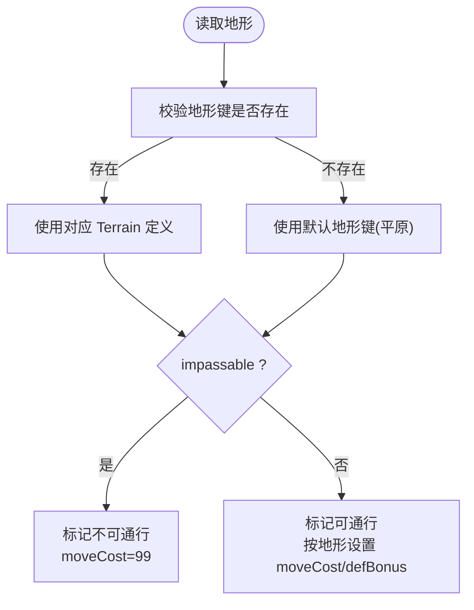

**图表来源**
- [WarConfig.swift:31-65](file://war/ios/WarKit/Sources/WarKit/WarConfig.swift#L31-L65)
- [Battlefield.swift:74-86](file://war/ios/WarKit/Sources/WarKit/Battlefield.swift#L74-L86)
- [Battlefield.swift:105-121](file://war/ios/WarKit/Sources/WarKit/Battlefield.swift#L105-L121)

**章节来源**
- [WarConfig.swift:31-65](file://war/ios/WarKit/Sources/WarKit/WarConfig.swift#L31-L65)
- [Battlefield.swift:74-86](file://war/ios/WarKit/Sources/WarKit/Battlefield.swift#L74-L86)
- [Battlefield.swift:105-121](file://war/ios/WarKit/Sources/WarKit/Battlefield.swift#L105-L121)

### 可达域计算算法（Dijkstra + 桶式优先队列）
- 输入：单位与剩余机动点预算。
- 核心：以 Grid.neighbors4 扩展四邻，累加 getMoveCost(next)，跳过不可通行与被占格（自身离开允许），用桶式优先队列按整数 cost 推进。
- 输出：[GridPoint: ReachCell]，含累计消耗与完整路径（4 邻接，不斜走）。
- 缓存：按 (unit.id, version, budget) 命中，避免重复计算。

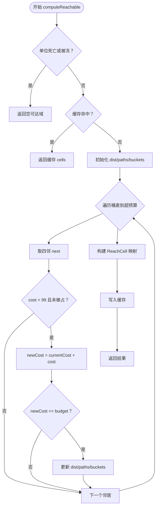

**图表来源**
- [Battlefield.swift:244-297](file://war/ios/WarKit/Sources/WarKit/Battlefield.swift#L244-L297)
- [Support.swift:13-33](file://war/ios/WarKit/Sources/WarKit/Support.swift#L13-L33)

**章节来源**
- [Battlefield.swift:244-297](file://war/ios/WarKit/Sources/WarKit/Battlefield.swift#L244-L297)
- [Support.swift:13-33](file://war/ios/WarKit/Sources/WarKit/Support.swift#L13-L33)

### 威胁影响图生成算法
- 目标：计算指定阵营对全场每格的威胁值。
- 步骤：
  1) 遍历该阵营存活单位，以其满机动范围计算 reachableWithBudget。
  2) 对每个可达点 p，以 attackRange 为半径扫描 cellsInRadius。
  3) 将 enemy.atk 累加到 map[c.y * width + c.x]。
- 缓存：按 camp 与 version 缓存，避免重复计算。

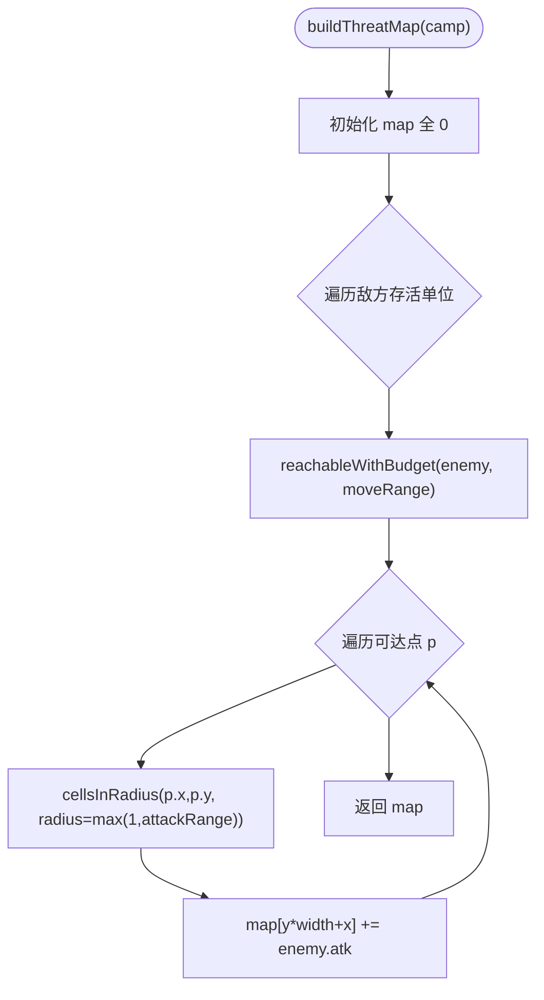

**图表来源**
- [Battlefield.swift:302-325](file://war/ios/WarKit/Sources/WarKit/Battlefield.swift#L302-L325)

**章节来源**
- [Battlefield.swift:302-325](file://war/ios/WarKit/Sources/WarKit/Battlefield.swift#L302-L325)

### 空间推理能力（位置查询、范围检测、碰撞检测）
- 位置查询：hasUnitAt/getUnitAt 通过 unitGrid 快速定位；findUnitById 按 id 查找。
- 范围检测：cellsInRadius 生成曼哈顿半径内所有格；centerOfMass 计算兵力重心。
- 碰撞检测：isCellAvailable 结合 isPassable 与 unitGrid 判空；moveAlongPath 逐格校验 4 邻接、越界、地形消耗、预算、占位。

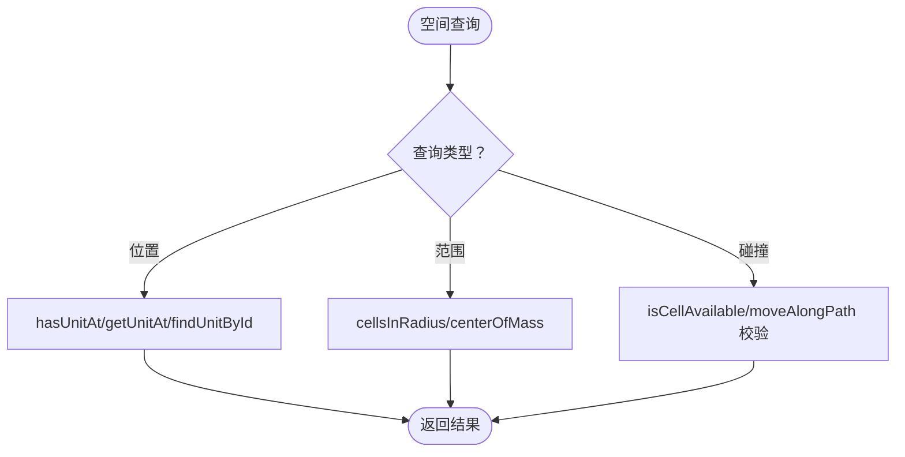

**图表来源**
- [Battlefield.swift:136-186](file://war/ios/WarKit/Sources/WarKit/Battlefield.swift#L136-L186)
- [Battlefield.swift:332-381](file://war/ios/WarKit/Sources/WarKit/Battlefield.swift#L332-L381)

**章节来源**
- [Battlefield.swift:136-186](file://war/ios/WarKit/Sources/WarKit/Battlefield.swift#L136-L186)
- [Battlefield.swift:332-381](file://war/ios/WarKit/Sources/WarKit/Battlefield.swift#L332-L381)

### 移动与攻击结算流程
- 移动：moveAlongPath 严格校验 4 邻接、越界、地形消耗、预算不足、占位；失败时回滚到起点且不扣点。
- 攻击：attack 校验阵营、剩余攻击次数、冰冻、射程与视线；结算伤害、反击、经验、击杀清位；成功后清零本回合其他配额。

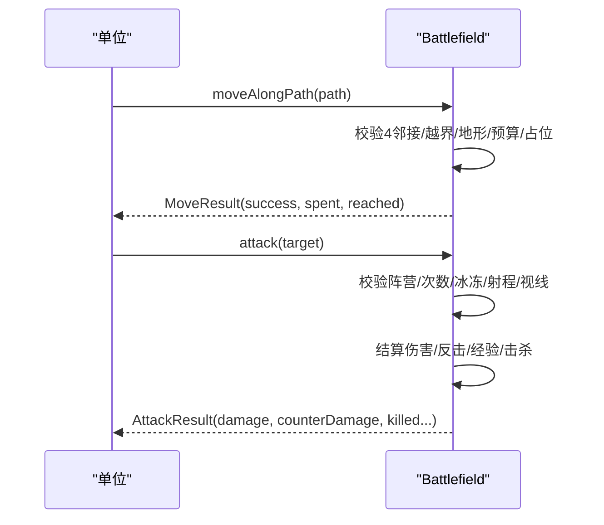

**图表来源**
- [Battlefield.swift:332-381](file://war/ios/WarKit/Sources/WarKit/Battlefield.swift#L332-L381)
- [Battlefield.swift:395-442](file://war/ios/WarKit/Sources/WarKit/Battlefield.swift#L395-L442)

**章节来源**
- [Battlefield.swift:332-381](file://war/ios/WarKit/Sources/WarKit/Battlefield.swift#L332-L381)
- [Battlefield.swift:395-442](file://war/ios/WarKit/Sources/WarKit/Battlefield.swift#L395-L442)

### 施法结算与效果
- 前置校验：只有首领能施法；携带魔法；未冰冻；有充能与剩余施法次数；射程与视线满足；目标存在且符合敌我关系。
- 资源扣除：成功才扣充能与剩余施法次数，并清零攻击与移动配额。
- 效果分支：伤害（固定值，无视防御与地形）、治疗（按实际回复量给经验）、冰冻（冻结目标一回合）。
- 溅射：只烧敌方，不影响己方与施法者。

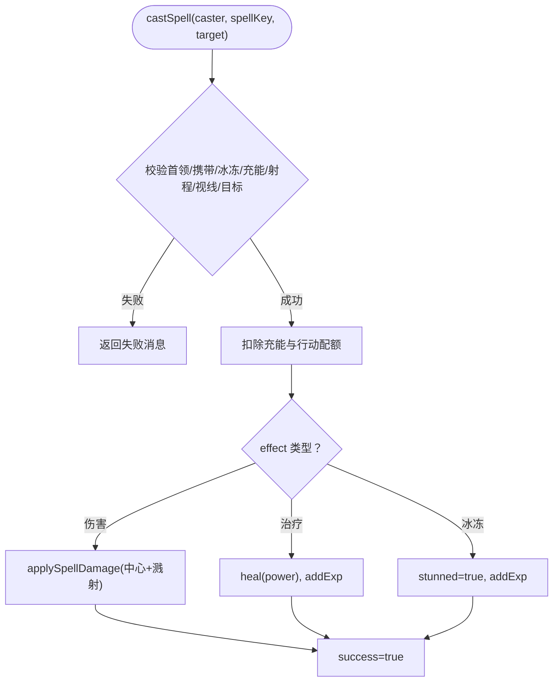

**图表来源**
- [Battlefield.swift:493-556](file://war/ios/WarKit/Sources/WarKit/Battlefield.swift#L493-L556)
- [Battlefield.swift:559-570](file://war/ios/WarKit/Sources/WarKit/Battlefield.swift#L559-L570)

**章节来源**
- [Battlefield.swift:493-556](file://war/ios/WarKit/Sources/WarKit/Battlefield.swift#L493-L556)
- [Battlefield.swift:559-570](file://war/ios/WarKit/Sources/WarKit/Battlefield.swift#L559-L570)

### 地图生成与布阵
- generateTerrain：左右镜像地形，保留两侧出生区；中央两列保底通路。
- findSpawnSpot：按阵营顺序在出生区内找空格，退化为全场任意空格。
- setDefaultLayout/placeArmy：按 ArmyComposer 计划落位士兵与首领，首领免费且必带，id 规则固定。

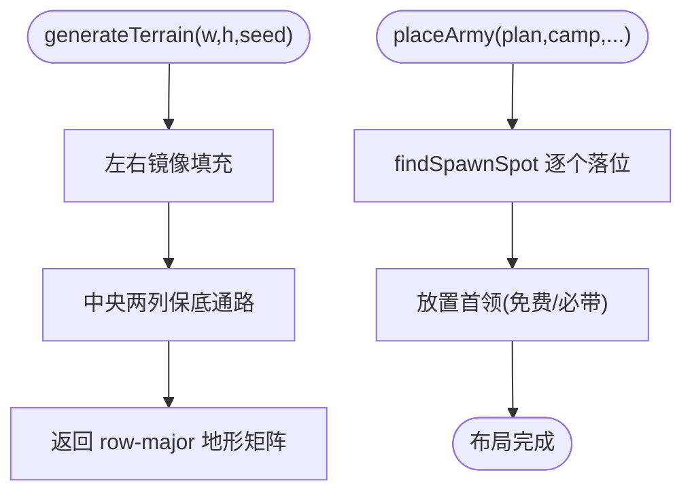

**图表来源**
- [Battlefield.swift:696-725](file://war/ios/WarKit/Sources/WarKit/Battlefield.swift#L696-L725)
- [Battlefield.swift:729-753](file://war/ios/WarKit/Sources/WarKit/Battlefield.swift#L729-L753)
- [Battlefield.swift:763-807](file://war/ios/WarKit/Sources/WarKit/Battlefield.swift#L763-L807)

**章节来源**
- [Battlefield.swift:696-725](file://war/ios/WarKit/Sources/WarKit/Battlefield.swift#L696-L725)
- [Battlefield.swift:729-753](file://war/ios/WarKit/Sources/WarKit/Battlefield.swift#L729-L753)
- [Battlefield.swift:763-807](file://war/ios/WarKit/Sources/WarKit/Battlefield.swift#L763-L807)

### 概念性概览
下图展示一个典型“移动→攻击→施法”的决策与执行流，强调内核方法的唯一性与可复现性。

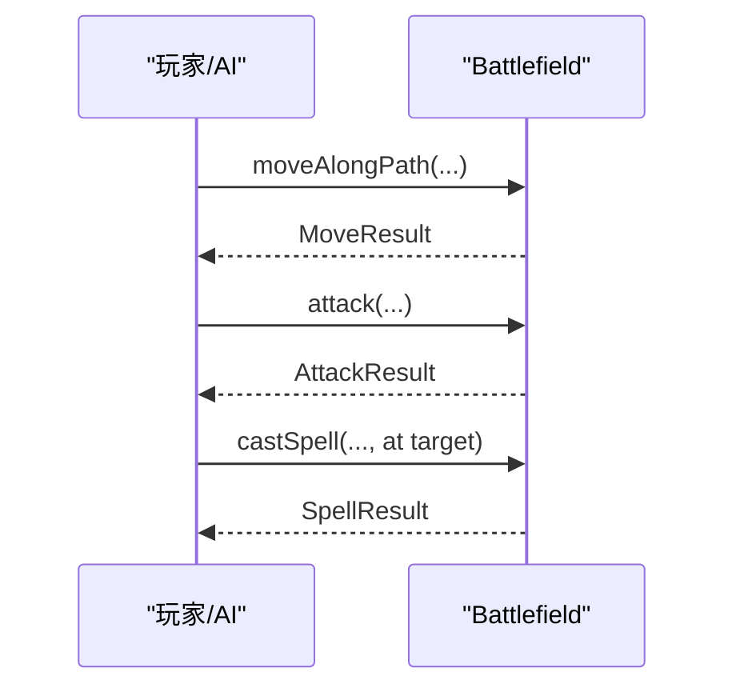

（此图为概念流程，不对应具体代码结构）

## 依赖关系分析
- Battlefield 依赖 Support（坐标/距离/邻居）与 WarConfig（地形/兵种/魔法/难度/权重）。
- Enumerator 依赖 Battlefield 的可达域与空间查询。
- Scorer 依赖 Battlefield 与 WarConfig 的权重与标尺。
- Lookahead 依赖 Battlefield 的快照/恢复与动作方法。
- WarAI 串联上述模块，并以 SeededRng 保证随机可复现。

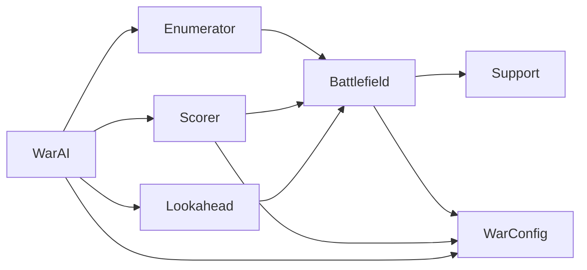

**图表来源**
- [Battlefield.swift:46-96](file://war/ios/WarKit/Sources/WarKit/Battlefield.swift#L46-L96)
- [Support.swift:3-33](file://war/ios/WarKit/Sources/WarKit/Support.swift#L3-L33)
- [WarConfig.swift:5-65](file://war/ios/WarKit/Sources/WarKit/WarConfig.swift#L5-L65)
- [Enumerator.swift:14-104](file://war/ios/WarKit/Sources/WarKit/Enumerator.swift#L14-L104)
- [Scorer.swift:57-257](file://war/ios/WarKit/Sources/WarKit/Scorer.swift#L57-L257)
- [Lookahead.swift:26-61](file://war/ios/WarKit/Sources/WarKit/Lookahead.swift#L26-L61)
- [WarAI.swift:64-181](file://war/ios/WarKit/Sources/WarKit/WarAI.swift#L64-L181)

**章节来源**
- [WarAI.swift:64-181](file://war/ios/WarKit/Sources/WarKit/WarAI.swift#L64-L181)

## 性能与内存优化
- 可达域缓存：按 (unit.id, version, budget) 命中，避免重复 Dijkstra；任何写操作 bump version 使其失效。
- 威胁图缓存：按 camp 与 version 缓存，避免重复扫描。
- 桶式优先队列：移动成本为小整数，使用 buckets 替代堆，降低常数开销。
- 候选裁剪：Enumerator.maxCandidatesPerUnit 限制候选数，优先保留攻击与施法候选。
- 浅层前瞻：Lookahead.topK=4，depth≤2，手机帧预算内平衡质量与速度。
- 内存管理：
  - 使用二维数组表示网格，O(1) 访问；单位数组保持下标稳定，快照/回滚无需重建。
  - 避免在热路径频繁分配大对象；路径与受击列表尽量复用或及时释放。
  - 地形矩阵与单位网格同构，减少转换开销。

**章节来源**
- [Battlefield.swift:244-297](file://war/ios/WarKit/Sources/WarKit/Battlefield.swift#L244-L297)
- [Battlefield.swift:302-325](file://war/ios/WarKit/Sources/WarKit/Battlefield.swift#L302-L325)
- [Enumerator.swift:11-12](file://war/ios/WarKit/Sources/WarKit/Enumerator.swift#L11-L12)
- [Lookahead.swift:9-15](file://war/ios/WarKit/Sources/WarKit/Lookahead.swift#L9-L15)

## 故障排查指南
- 移动失败：
  - 非 4 邻接：检查 path 相邻格是否为曼哈顿距离 1。
  - 超出边界：确认 next 在 isInside 范围内。
  - 地形不可通行：getMoveCost(next) >= 99。
  - 预算不足：cost > remainingMove，停在当前格。
  - 被占位：unitGrid[next.y][next.x] 非空且非死单位。
- 攻击失败：
  - 阵营相同、目标死亡、无剩余攻击次数、冰冻、射程或视线不满足。
- 施法失败：
  - 非首领、未携带魔法、冰冻、无充能、射程/视线不满足、目标不符合敌我关系。
- 缓存不一致：
  - 检查 write 操作是否增加 version；预算变化需重新计算可达域。

**章节来源**
- [Battlefield.swift:332-381](file://war/ios/WarKit/Sources/WarKit/Battlefield.swift#L332-L381)
- [Battlefield.swift:395-442](file://war/ios/WarKit/Sources/WarKit/Battlefield.swift#L395-L442)
- [Battlefield.swift:493-556](file://war/ios/WarKit/Sources/WarKit/Battlefield.swift#L493-L556)

## 结论
Battlefield 作为单一权威状态机，通过严格的网格约定、版本化缓存与唯一写入点设计，确保了移动、攻击、施法的确定性与可复现性。配合 Enumerator、Scorer、Lookahead 与 WarAI，形成从战术枚举到战略评分再到浅层推演的完整决策链。地形系统、可达域与威胁图为核心基础设施，支撑空间推理与 AI 行为一致性。通过缓存、候选裁剪与浅层前瞻，系统在移动端实现了良好的性能与体验平衡。