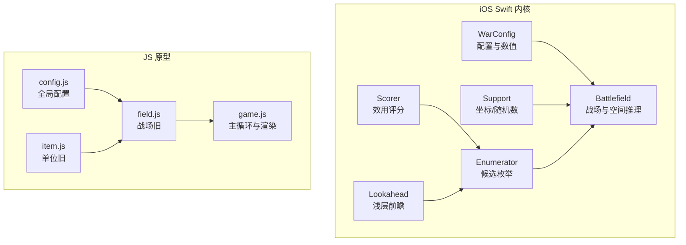
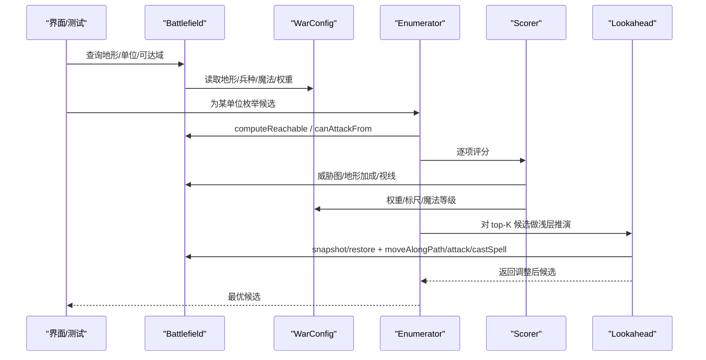
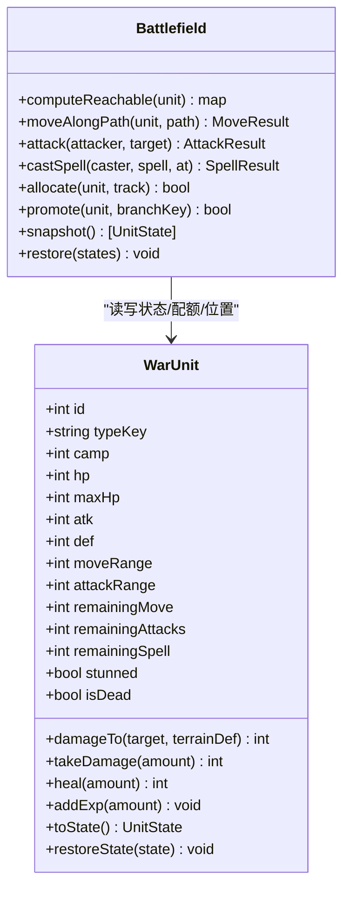
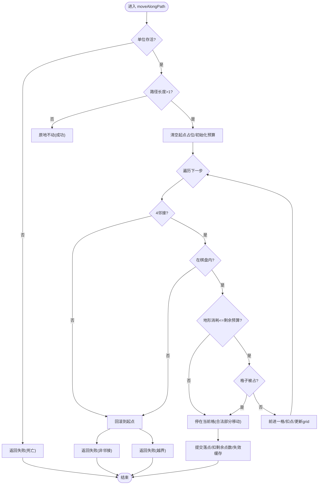
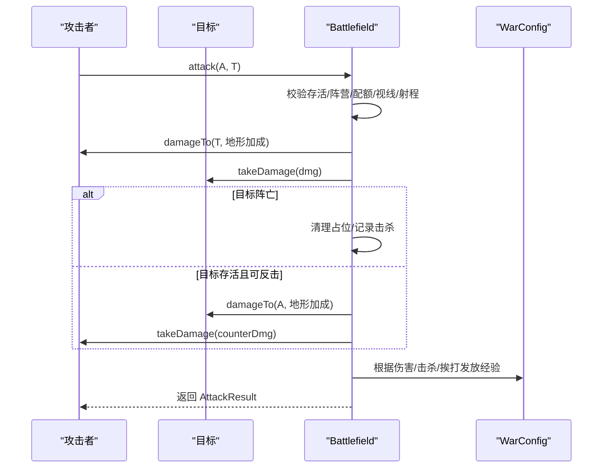
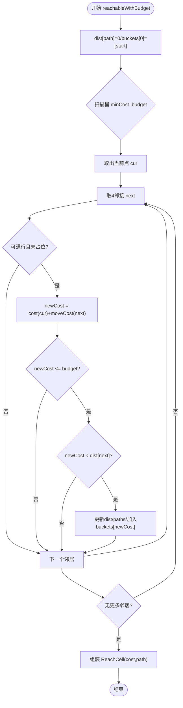
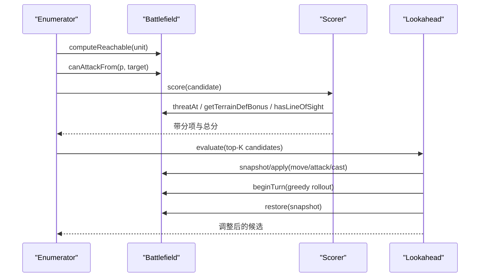
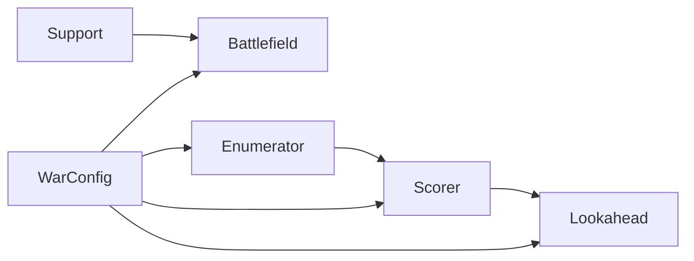

# 游戏引擎核心

<cite>
**本文引用的文件**   
- [WarConfig.swift](file://war/ios/WarKit/Sources/WarKit/WarConfig.swift)
- [Battlefield.swift](file://war/ios/WarKit/Sources/WarKit/Battlefield.swift)
- [Support.swift](file://war/ios/WarKit/Sources/WarKit/Support.swift)
- [Enumerator.swift](file://war/ios/WarKit/Sources/WarKit/Enumerator.swift)
- [Lookahead.swift](file://war/ios/WarKit/Sources/WarKit/Lookahead.swift)
- [Scorer.swift](file://war/ios/WarKit/Sources/WarKit/Scorer.swift)
- [config.js](file://war/war/config.js)
- [field.js](file://war/war/field.js)
- [item.js](file://war/war/item.js)
- [game.js](file://war/war/game.js)
</cite>

## 目录
1. [简介](#简介)
2. [项目结构](#项目结构)
3. [核心组件](#核心组件)
4. [架构总览](#架构总览)
5. [详细组件分析](#详细组件分析)
6. [依赖关系分析](#依赖关系分析)
7. [性能与扩展实践](#性能与扩展实践)
8. [故障排查指南](#故障排查指南)
9. [结论](#结论)

## 简介
本技术文档聚焦 WAR 游戏引擎的核心子系统：配置管理系统 WarConfig、单位系统 Unit（含数值成长与兵种体系）、战场管理系统 Battlefield（二维网格、可达域与威胁影响图），以及伤害计算、行动配额控制、地形系统与 AI 候选枚举/评分/前瞻流程。文档同时覆盖 iOS Swift 内核与 JS 原型两套实现，帮助读者理解设计动机、数据流与关键算法，并给出扩展兵种、新增地形的具体路径与最佳实践。

## 项目结构
仓库包含两条主线：
- iOS Swift 内核：以 WarKit 为核心，提供可复现、可回放、带快照回滚的回合制战棋规则与 AI。
- JS 原型：浏览器端演示与早期规则原型，便于快速验证概念。

**图表来源**
- [WarConfig.swift:1-576](file://war/ios/WarKit/Sources/WarKit/WarConfig.swift#L1-L576)
- [Battlefield.swift:1-809](file://war/ios/WarKit/Sources/WarKit/Battlefield.swift#L1-L809)
- [Support.swift:1-76](file://war/ios/WarKit/Sources/WarKit/Support.swift#L1-L76)
- [Enumerator.swift:1-126](file://war/ios/WarKit/Sources/WarKit/Enumerator.swift#L1-L126)
- [Scorer.swift:1-268](file://war/ios/WarKit/Sources/WarKit/Scorer.swift#L1-L268)
- [Lookahead.swift:1-168](file://war/ios/WarKit/Sources/WarKit/Lookahead.swift#L1-L168)
- [config.js:1-146](file://war/war/config.js#L1-L146)
- [field.js:1-622](file://war/war/field.js#L1-L622)
- [item.js:1-178](file://war/war/item.js#L1-L178)
- [game.js:1-600](file://war/war/game.js#L1-L600)

**章节来源**
- [WarConfig.swift:1-576](file://war/ios/WarKit/Sources/WarKit/WarConfig.swift#L1-L576)
- [Battlefield.swift:1-809](file://war/ios/WarKit/Sources/WarKit/Battlefield.swift#L1-L809)
- [config.js:1-146](file://war/war/config.js#L1-L146)
- [field.js:1-622](file://war/war/field.js#L1-L622)
- [item.js:1-178](file://war/war/item.js#L1-L178)
- [game.js:1-600](file://war/war/game.js#L1-L600)

## 核心组件
- 配置管理 WarConfig：棋盘尺寸、地形表、兵种表、升级线、魔法表、难度旋钮、AI 权重与归一化标尺，是数值与规则的权威来源。
- 单位 WarUnit（Swift）/ Unit（JS）：纯状态对象，携带属性、配额、成长与序列化；不直接修改坐标或 grid，由 Battlefield 统一写入。
- 战场 Battlefield：二维网格、通行性、视线、可达域（Dijkstra + 桶式优先队列）、威胁影响图、移动/攻击/施法结算、终局判定、快照/回滚、地图生成与布阵。
- AI 管线：Enumerator 枚举候选 → Scorer 分项评分 → Lookahead 对 top-K 做浅层推演 → 选择最优动作。

**章节来源**
- [WarConfig.swift:1-576](file://war/ios/WarKit/Sources/WarKit/WarConfig.swift#L1-L576)
- [Battlefield.swift:1-809](file://war/ios/WarKit/Sources/WarKit/Battlefield.swift#L1-L809)
- [item.js:1-178](file://war/war/item.js#L1-L178)

## 架构总览
下图展示 Swift 内核中“配置 → 战场 → AI”的调用链与数据流向。

**图表来源**
- [Battlefield.swift:242-556](file://war/ios/WarKit/Sources/WarKit/Battlefield.swift#L242-L556)
- [WarConfig.swift:257-339](file://war/ios/WarKit/Sources/WarKit/WarConfig.swift#L257-L339)
- [Enumerator.swift:14-104](file://war/ios/WarKit/Sources/WarKit/Enumerator.swift#L14-L104)
- [Scorer.swift:57-256](file://war/ios/WarKit/Sources/WarKit/Scorer.swift#L57-L256)
- [Lookahead.swift:26-60](file://war/ios/WarKit/Sources/WarKit/Lookahead.swift#L26-L60)

## 详细组件分析

### 配置管理 WarConfig
- 棋盘与部署：默认 14×14，支持多尺寸；每方出生区占左右各 3 列。
- 地形 Terrain：key/name/symbol/moveCost/defBonus/impassable/colorRGB；内置平原/森林/山地/河流/城墙。
- 兵种 UnitStat：hp/atk/def/moveRange/attackRange/counterAttack/value/isChief/cost/promotable；基础兵种与转职分支分离。
- 升级 Upgrades：攻/防/生命三条独立等级线，线性倍率增长；value 恒定，避免 AI 目标排序漂移。
- 魔法 SpellStat：damage/heal/stun 三类效果；威力/溅射随等级缩放，射程在顶档 +1；充能与解锁成本分离。
- 难度 Difficulty：temperature/lookahead/vision/noise/budget/spellLevel 五个正交旋钮；闯关 LevelSpec 由关数纯函数导出。
- 评分权重 Weights 与标尺 Scale：所有分项归一到 [0,1]，权重即最终贡献上限；valueRef 用于将首领价值钳制到普通兵种上限，额外倾向通过 chiefBounty 表达。

扩展建议
- 新增兵种：在 unitTypes 中添加条目，设置 promotable/cost/isChief 等标志；如需转职分支，确保 isChief 与原兵种一致。
- 新增地形：在 terrains 添加 key，并在 terrainOrder 中稳定排序；注意 impassable 与 moveCost 对可达域的影响。
- 新增魔法：在 spells 添加条目，并通过 spellStat(level:) 暴露给 AI 与 UI，保证口径一致。

**章节来源**
- [WarConfig.swift:9-68](file://war/ios/WarKit/Sources/WarKit/WarConfig.swift#L9-L68)
- [WarConfig.swift:70-163](file://war/ios/WarKit/Sources/WarKit/WarConfig.swift#L70-L163)
- [WarConfig.swift:168-248](file://war/ios/WarKit/Sources/WarKit/WarConfig.swift#L168-L248)
- [WarConfig.swift:257-339](file://war/ios/WarKit/Sources/WarKit/WarConfig.swift#L257-L339)
- [WarConfig.swift:352-432](file://war/ios/WarKit/Sources/WarKit/WarConfig.swift#L352-L432)
- [WarConfig.swift:434-574](file://war/ios/WarKit/Sources/WarKit/WarConfig.swift#L434-L574)

### 单位系统（纯状态对象与属性体系）
- Swift 侧 WarUnit：作为纯状态对象，携带 id/typeKey/camp/hp/maxHp/atk/def/moveRange/attackRange/remainingMove/remainingAttacks/remainingSpell/stunned/isDead 等字段；提供 damageTo、takeDamage、heal、addExp、toState/restoreState 等方法；成长与转职由 Battlefield.allocate/promote 唯一写入。
- JS 侧 Unit：同样为纯状态对象，拆分为 moveBudget 与 attackBudget 两个独立预算；damageTo/effectiveDefense/takeDamage/canCounter 等均为纯函数或只读查询。

关键点
- 坐标与 grid 的唯一写入者是 Battlefield，避免旧版“移动不扣点/更新 grid 不扣点”的双写不一致。
- 伤害计算使用同一口径（WarUnit.damageTo / Unit.damageTo），AI 预估与真实结果保持一致。
- 成长与转职不可逆且受关卡限制，确保策略深度与平衡。

**图表来源**
- [Battlefield.swift:444-480](file://war/ios/WarKit/Sources/WarKit/Battlefield.swift#L444-L480)
- [Battlefield.swift:390-442](file://war/ios/WarKit/Sources/WarKit/Battlefield.swift#L390-L442)

**章节来源**
- [Battlefield.swift:390-480](file://war/ios/WarKit/Sources/WarKit/Battlefield.swift#L390-L480)
- [item.js:12-178](file://war/war/item.js#L12-L178)

### 战场管理系统（二维网格与空间推理）
- 网格约定：row-major，terrain[y][x] 与 unitGrid[y][x] 同构；未知 key 或越界回退到默认地形。
- 通行性与可用格：isPassable/isCellAvailable/isAvailable 区分地形阻挡与单位占位。
- 视线 hasLineOfSight：相邻/对角放行；长距离按插值检查中间格是否被不可通行地形阻挡。
- 可达域 computeReachable/reachableWithBudget：基于 Dijkstra + 桶式优先队列（cost 为整数且值域小），缓存键含版本与机动力预算，避免低预算误用满预算结果。
- 威胁影响图 buildThreatMap：对敌方单位以完整机动预算可达域外扩射程，累加攻击力形成风险热力图，供评分项 exposure 使用。
- 移动/攻击/施法：moveAlongPath 逐格校验 4 邻接、边界、地形消耗与占位，失败回滚；attack 处理反击与击杀清位；castSpell 固定伤害、溅射只伤敌方、与普攻互斥。
- 终局规则：斩首优先于士兵全灭；两败俱伤比物质分。

**图表来源**
- [Battlefield.swift:327-381](file://war/ios/WarKit/Sources/WarKit/Battlefield.swift#L327-L381)

**章节来源**
- [Battlefield.swift:46-128](file://war/ios/WarKit/Sources/WarKit/Battlefield.swift#L46-L128)
- [Battlefield.swift:175-225](file://war/ios/WarKit/Sources/WarKit/Battlefield.swift#L175-L225)
- [Battlefield.swift:242-320](file://war/ios/WarKit/Sources/WarKit/Battlefield.swift#L242-L320)
- [Battlefield.swift:327-442](file://war/ios/WarKit/Sources/WarKit/Battlefield.swift#L327-L442)
- [Battlefield.swift:630-676](file://war/ios/WarKit/Sources/WarKit/Battlefield.swift#L630-L676)

### 伤害计算机制与行动配额控制
- 伤害公式：实际伤害 = max(1, 攻击 - (防御 + 地形防御加成))；魔法伤害为固定值，不受防御与地形减伤影响。
- 反击：仅当目标具备反击能力、未被反击过、且攻击者在目标射程内时触发；反击伤害同样走同一伤害函数。
- 行动配额：每回合“移动 1 次 + 攻击 1 次”，移动与攻击配额独立；施法与普攻互斥，出手即结束本回合行动。
- 经验与成长：hitExp/killExp/sufferedExp/healExp/freezeExp 统一入口；allocate/promote 是唯一属性点与转职写入点。

**图表来源**
- [Battlefield.swift:390-442](file://war/ios/WarKit/Sources/WarKit/Battlefield.swift#L390-L442)
- [WarConfig.swift:421-432](file://war/ios/WarKit/Sources/WarKit/WarConfig.swift#L421-L432)

**章节来源**
- [Battlefield.swift:390-442](file://war/ios/WarKit/Sources/WarKit/Battlefield.swift#L390-L442)
- [WarConfig.swift:341-350](file://war/ios/WarKit/Sources/WarKit/WarConfig.swift#L341-L350)

### 地形系统与可达域计算
- 地形类型：平原/森林/山地/河流/城墙，分别定义 moveCost/defBonus/impassable。
- 可达域：Dijkstra + 桶式优先队列，时间复杂度近似 O(E log V)，但桶优化后接近 O(E + V)；缓存键包含版本与机动力预算，避免脏读。
- 威胁影响图：对敌方单位以完整机动预算可达域外扩射程，累加攻击力；缓存按阵营与版本失效。

**图表来源**
- [Battlefield.swift:259-297](file://war/ios/WarKit/Sources/WarKit/Battlefield.swift#L259-L297)

**章节来源**
- [Battlefield.swift:242-320](file://war/ios/WarKit/Sources/WarKit/Battlefield.swift#L242-L320)

### AI 候选枚举、评分与前瞻
- 枚举 Enumerator：从可达域外扩射程生成“移动/攻击/移动+攻击/施法/待命”候选；对集火目标给予先验加分；过滤自杀着法；超预算时优先保留攻击类候选。
- 评分 Scorer：分项一律归一到 [0,1]，乘以权重求和；包含伤害/击杀/溢出/自身存活/目标价值/暴露风险/地形/集火/反击风险/机动保留/包围/战略牵引/支援/浪费/远程贴脸惩罚/推进意愿/靠近敌情/斩首赏金/治疗/冰冻/自杀门禁/首领危险等。
- 前瞻 Lookahead：对 top-K 候选进行 1~2 回合浅层推演，评估物质差与终局项（斩首），再回滚恢复原状。

**图表来源**
- [Enumerator.swift:14-104](file://war/ios/WarKit/Sources/WarKit/Enumerator.swift#L14-L104)
- [Scorer.swift:57-256](file://war/ios/WarKit/Sources/WarKit/Scorer.swift#L57-L256)
- [Lookahead.swift:26-60](file://war/ios/WarKit/Sources/WarKit/Lookahead.swift#L26-L60)

**章节来源**
- [Enumerator.swift:1-126](file://war/ios/WarKit/Sources/WarKit/Enumerator.swift#L1-L126)
- [Scorer.swift:1-268](file://war/ios/WarKit/Sources/WarKit/Scorer.swift#L1-L268)
- [Lookahead.swift:1-168](file://war/ios/WarKit/Sources/WarKit/Lookahead.swift#L1-L168)

## 依赖关系分析
- WarConfig 是静态权威源，被 Battlefield、Enumerator、Scorer、Lookahead 共同读取。
- Battlefield 依赖 Support（GridPoint/Grid/SeededRng）进行坐标与随机数操作。
- AI 管线依赖 Battlefield 提供的单一写入接口（move/attack/cast/snapshot/restore），保证决策与执行一致性。
- JS 原型中 config.js 提供全局配置，field.js 实现旧版 Battlefield，item.js 实现旧版 Unit，game.js 驱动主循环与渲染。

**图表来源**
- [WarConfig.swift:1-576](file://war/ios/WarKit/Sources/WarKit/WarConfig.swift#L1-L576)
- [Battlefield.swift:1-809](file://war/ios/WarKit/Sources/WarKit/Battlefield.swift#L1-L809)
- [Support.swift:1-76](file://war/ios/WarKit/Sources/WarKit/Support.swift#L1-L76)
- [Enumerator.swift:1-126](file://war/ios/WarKit/Sources/WarKit/Enumerator.swift#L1-L126)
- [Scorer.swift:1-268](file://war/ios/WarKit/Sources/WarKit/Scorer.swift#L1-L268)
- [Lookahead.swift:1-168](file://war/ios/WarKit/Sources/WarKit/Lookahead.swift#L1-L168)

**章节来源**
- [WarConfig.swift:1-576](file://war/ios/WarKit/Sources/WarKit/WarConfig.swift#L1-L576)
- [Battlefield.swift:1-809](file://war/ios/WarKit/Sources/WarKit/Battlefield.swift#L1-L809)
- [Support.swift:1-76](file://war/ios/WarKit/Sources/WarKit/Support.swift#L1-L76)
- [Enumerator.swift:1-126](file://war/ios/WarKit/Sources/WarKit/Enumerator.swift#L1-L126)
- [Scorer.swift:1-268](file://war/ios/WarKit/Sources/WarKit/Scorer.swift#L1-L268)
- [Lookahead.swift:1-168](file://war/ios/WarKit/Sources/WarKit/Lookahead.swift#L1-L168)

## 性能与扩展实践
- 可达域缓存：按单位 id + 版本 + 机动力预算缓存，避免重复计算；任何写操作递增 version 使缓存失效。
- 威胁图缓存：按阵营 + 版本缓存，减少每帧重复构建。
- 桶式优先队列：因 moveCost 为小整数，避免堆开销，提升可达域计算速度。
- 候选裁剪：单单位候选上限 120，优先保留攻击类候选，防止移动端超时。
- 浅层前瞻：只对 top-K=4 候选做 1~2 步推演，兼顾质量与性能。
- 扩展兵种：
  - 在 WarConfig.unitTypes 中添加新条目，合理设置 value/cost/promotable/isChief。
  - 若为转职分支，确保 promotable=true 且与基础兵种 isChief 一致。
  - 如需军费购买，确保不在 unitTypeOrder 之外且 cost>0。
- 新增地形：
  - 在 WarConfig.terrains 添加 key，并在 terrainOrder 中稳定排序。
  - 谨慎设置 impassable 与 moveCost，避免阻塞中央通路；必要时在 generateTerrain 中保底开敞。
- 新增魔法：
  - 在 WarConfig.spells 添加条目，并通过 spellStat(level:) 暴露给 AI 与 UI。
  - 注意 chargeCost/unlockCost 与 maxSpellLevel 的平衡。

**章节来源**
- [Battlefield.swift:242-320](file://war/ios/WarKit/Sources/WarKit/Battlefield.swift#L242-L320)
- [Enumerator.swift:11-12](file://war/ios/WarKit/Sources/WarKit/Enumerator.swift#L11-L12)
- [Lookahead.swift:10-15](file://war/ios/WarKit/Sources/WarKit/Lookahead.swift#L10-L15)
- [WarConfig.swift:53-68](file://war/ios/WarKit/Sources/WarKit/WarConfig.swift#L53-L68)
- [WarConfig.swift:109-163](file://war/ios/WarKit/Sources/WarKit/WarConfig.swift#L109-L163)
- [WarConfig.swift:297-339](file://war/ios/WarKit/Sources/WarKit/WarConfig.swift#L297-L339)

## 故障排查指南
- 移动无效或卡住：
  - 检查路径是否为 4 邻接、是否超出边界、是否遇到不可通行地形或被占格。
  - 确认机动力预算是否足够；部分移动会停在当前格。
- 攻击失败：
  - 检查射程、视线、阵营、存活状态与攻击配额；确认目标可反击条件。
- 施法失败：
  - 只有首领可施法；需携带该魔法且有充能；目标需在射程内且有视线；伤害/治疗/冰冻的目标阵营与状态需符合规则。
- AI 行为异常：
  - 检查候选枚举是否被自杀门禁过滤；查看评分分项与权重是否合理；确认前瞻 depth 与 topK 设置。
- 重放不一致：
  - 确认随机源使用 SeededRng；检查快照/回滚是否按 units 下标对齐；避免中途删除数组元素。

**章节来源**
- [Battlefield.swift:327-442](file://war/ios/WarKit/Sources/WarKit/Battlefield.swift#L327-L442)
- [Battlefield.swift:482-556](file://war/ios/WarKit/Sources/WarKit/Battlefield.swift#L482-L556)
- [Enumerator.swift:76-104](file://war/ios/WarKit/Sources/WarKit/Enumerator.swift#L76-L104)
- [Scorer.swift:42-55](file://war/ios/WarKit/Sources/WarKit/Scorer.swift#L42-L55)
- [Battlefield.swift:678-690](file://war/ios/WarKit/Sources/WarKit/Battlefield.swift#L678-L690)

## 结论
WAR 引擎以 WarConfig 为唯一权威配置源，Battlefield 作为唯一状态写入点，配合纯状态单位与确定性随机源，实现了可回放、可重放的回合制战棋规则。AI 管线通过枚举→评分→浅层前瞻的流程，在保证性能的同时获得稳定的决策质量。扩展兵种、地形与魔法只需在 WarConfig 中集中调参，即可贯穿 UI、AI 与规则层，保持口径一致。建议在扩展时遵循“单项归一、权重可控、入口唯一”的原则，以确保数值平衡与行为可预测。