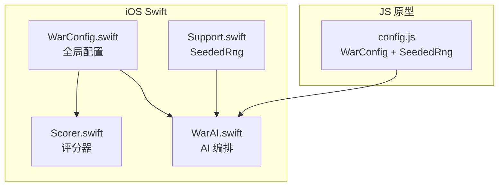
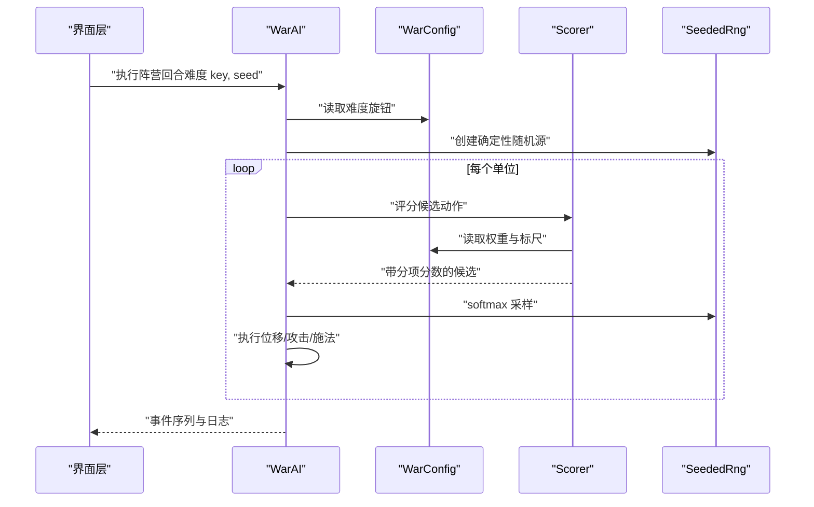
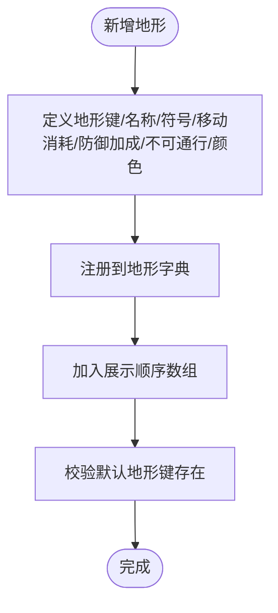
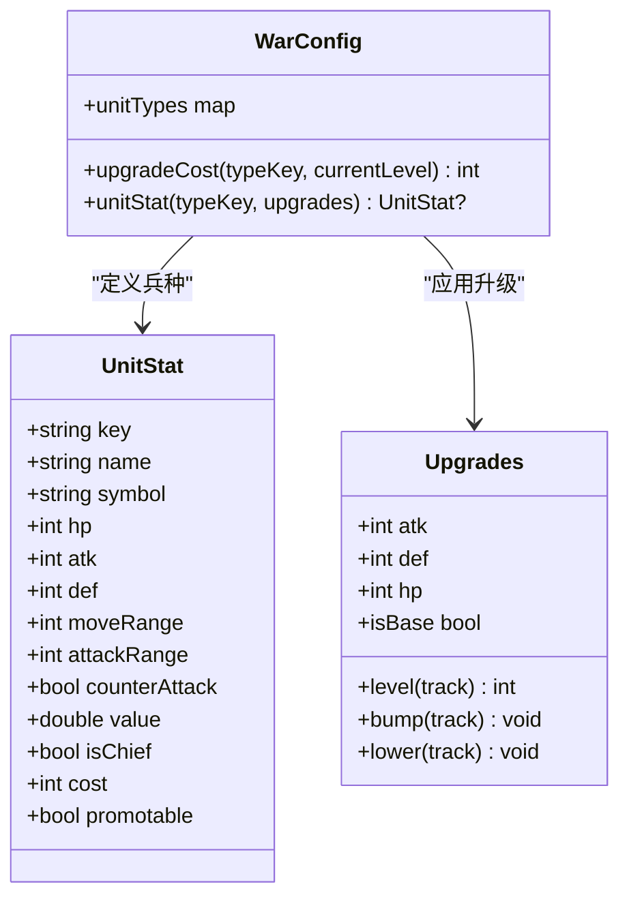
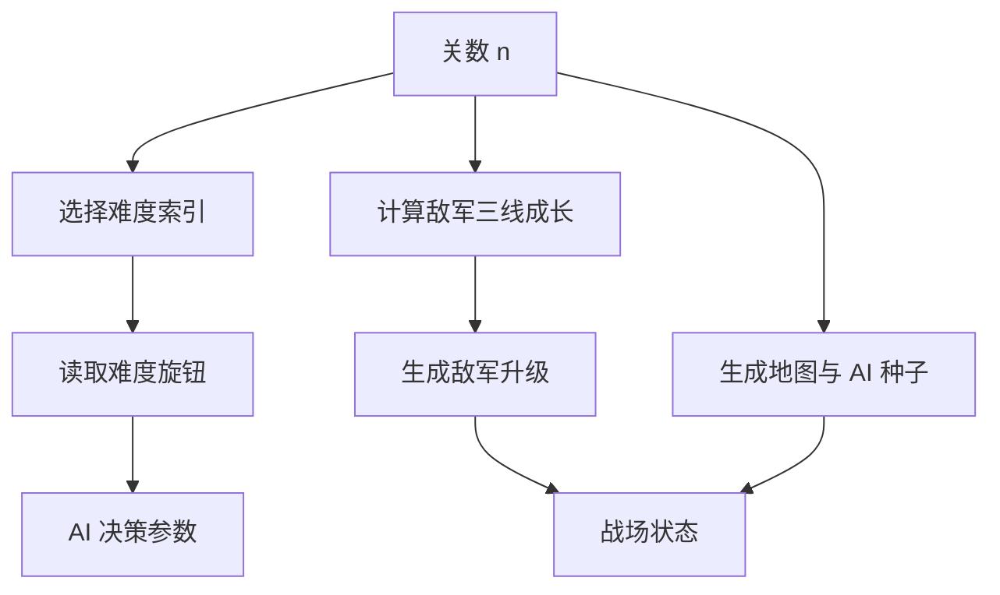
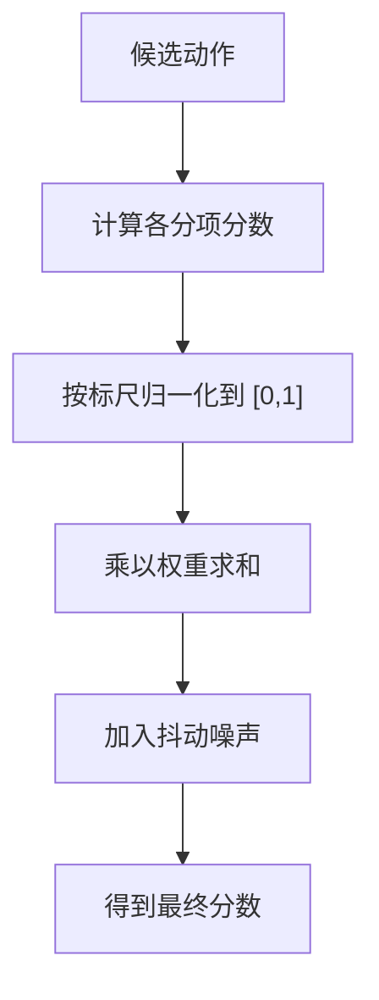
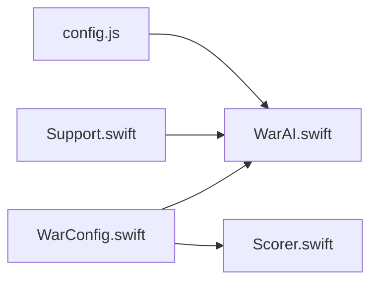

# 配置管理系统

<cite>
**本文引用的文件**   
- [WarConfig.swift](file://war/ios/WarKit/Sources/WarKit/WarConfig.swift)
- [config.js](file://war/war/config.js)
- [Support.swift](file://war/ios/WarKit/Sources/WarKit/Support.swift)
- [Scorer.swift](file://war/ios/WarKit/Sources/WarKit/Scorer.swift)
- [WarAI.swift](file://war/ios/WarKit/Sources/WarKit/WarAI.swift)
</cite>

## 目录
1. [引言](#引言)
2. [项目结构](#项目结构)
3. [核心组件](#核心组件)
4. [架构总览](#架构总览)
5. [详细组件分析](#详细组件分析)
6. [依赖关系分析](#依赖关系分析)
7. [性能与数值平衡](#性能与数值平衡)
8. [扩展指南与最佳实践](#扩展指南与最佳实践)
9. [故障排查](#故障排查)
10. [结论](#结论)

## 引言
本技术文档围绕 WAR 游戏的配置管理系统展开，重点解释以下方面：
- WarConfig 全局配置对象的结构设计：棋盘尺寸、地形系统、兵种属性、难度旋钮与评分权重。
- 确定性随机数生成器 SeededRng 的实现原理与使用场景。
- 数值平衡设计原则：归一化标尺的作用与权重调整机制。
- 如何扩展新地形类型、添加新兵种和调整 AI 难度参数。
- 配置系统的扩展点与调参最佳实践，确保数值调优的可维护性。

该配置系统采用“单一权威定义”的设计：所有数值只出现在配置层，AI 与规则层不再各自维护一套副本，从而避免多套难度对应多套算法的问题。

## 项目结构
WAR 的配置系统在两个实现中并存：
- iOS Swift 端：以枚举 `WarConfig` 集中定义全部数值与规则。
- JS 原型端：以对象 `WarConfig` 和类 `SeededRng` 提供浏览器与 Node 测试环境下的等价配置与随机源。

**图表来源**
- [WarConfig.swift:5-575](file://war/ios/WarKit/Sources/WarKit/WarConfig.swift#L5-L575)
- [Support.swift:35-75](file://war/ios/WarKit/Sources/WarKit/Support.swift#L35-L75)
- [Scorer.swift:1-268](file://war/ios/WarKit/Sources/WarKit/Scorer.swift#L1-L268)
- [WarAI.swift:1-233](file://war/ios/WarKit/Sources/WarKit/WarAI.swift#L1-L233)
- [config.js:12-145](file://war/war/config.js#L12-L145)

**章节来源**
- [WarConfig.swift:5-575](file://war/ios/WarKit/Sources/WarKit/WarConfig.swift#L5-L575)
- [config.js:12-145](file://war/war/config.js#L12-L145)

## 核心组件
本节聚焦配置系统的核心构件：
- 棋盘与部署：棋盘尺寸、默认尺寸、每方出生列数、回合上限、单位上限等。
- 地形系统：地形键、名称、符号、移动消耗、防御加成、是否不可通行、颜色。
- 兵种系统：基础兵种与转职分支的属性、价值、成本、可升级线。
- 魔法系统：伤害、治疗、冰冻三类魔法的等级、威力、溅射、解锁与充能成本。
- 难度旋钮：温度、前瞻、视野、噪声、军费、首领魔法等级。
- 评分权重与归一化标尺：分项权重的语义与统一量纲的参考值。

**章节来源**
- [WarConfig.swift:9-27](file://war/ios/WarKit/Sources/WarKit/WarConfig.swift#L9-L27)
- [WarConfig.swift:31-68](file://war/ios/WarKit/Sources/WarKit/WarConfig.swift#L31-L68)
- [WarConfig.swift:72-163](file://war/ios/WarKit/Sources/WarKit/WarConfig.swift#L72-L163)
- [WarConfig.swift:259-339](file://war/ios/WarKit/Sources/WarKit/WarConfig.swift#L259-L339)
- [WarConfig.swift:352-391](file://war/ios/WarKit/Sources/WarKit/WarConfig.swift#L352-L391)
- [WarConfig.swift:434-574](file://war/ios/WarKit/Sources/WarKit/WarConfig.swift#L434-L574)

## 架构总览
配置系统通过 WarConfig 向 AI 与评分层暴露统一的数值口径；AI 在决策时读取难度旋钮，并使用确定性随机源进行采样与推演。

**图表来源**
- [WarAI.swift:64-187](file://war/ios/WarKit/Sources/WarKit/WarAI.swift#L64-L187)
- [Scorer.swift:57-256](file://war/ios/WarKit/Sources/WarKit/Scorer.swift#L57-L256)
- [WarConfig.swift:352-391](file://war/ios/WarKit/Sources/WarKit/WarConfig.swift#L352-L391)
- [Support.swift:35-75](file://war/ios/WarKit/Sources/WarKit/Support.swift#L35-L75)

## 详细组件分析

### 棋盘与部署配置
- 棋盘尺寸支持多种规格，默认 14×14，适合竖屏手指操作。
- 每方出生区占左侧或右侧若干列，便于对称开局。
- 单回合行动配额为“移动一次 + 攻击一次”，而非统一 AP 池，避免移动与攻击互相白嫖。
- 每方士兵上限不含首领，回合上限固定。

这些配置直接决定战场规模、布阵节奏与 AI 搜索空间大小。

**章节来源**
- [WarConfig.swift:9-27](file://war/ios/WarKit/Sources/WarKit/WarConfig.swift#L9-L27)
- [WarConfig.swift:341-350](file://war/ios/WarKit/Sources/WarKit/WarConfig.swift#L341-L350)

### 地形系统
地形由键、名称、符号、移动消耗、防御加成、是否不可通行与颜色组成。常见地形包括平原、森林、山地、河流与城墙。不可通行地形不会进入可达域，也不参与移动计算。

新增地形时，应同时更新字典、展示顺序与默认地形键，保证 UI 图例稳定且逻辑一致。

**图表来源**
- [WarConfig.swift:31-68](file://war/ios/WarKit/Sources/WarKit/WarConfig.swift#L31-L68)

**章节来源**
- [WarConfig.swift:31-68](file://war/ios/WarKit/Sources/WarKit/WarConfig.swift#L31-L68)

### 兵种属性与升级线
兵种包含基础属性与战略价值，以及是否为首领、成本、是否可由转职获得等标志。基础兵种与转职分支共享同一数据结构，但转职分支不在货架上，只能通过等级达到条件后转职获得。

升级系统按三条独立等级线增长：攻击、防御、生命。每条线的增益是线性倍率，value 保持恒定，以保证 AI 的目标价值与物质分口径稳定。

**图表来源**
- [WarConfig.swift:72-163](file://war/ios/WarKit/Sources/WarKit/WarConfig.swift#L72-L163)
- [WarConfig.swift:176-248](file://war/ios/WarKit/Sources/WarKit/WarConfig.swift#L176-L248)

**章节来源**
- [WarConfig.swift:72-163](file://war/ios/WarKit/Sources/WarKit/WarConfig.swift#L72-L163)
- [WarConfig.swift:176-248](file://war/ios/WarKit/Sources/WarKit/WarConfig.swift#L176-L248)

### 魔法系统
魔法分为伤害、治疗、冰冻三种效果。只有首领可以施放。魔法等级影响威力与溅射，并在满级时增加射程。解锁成本与充能成本分别控制跨局购买与本局消耗。

评分层对魔法伤害复用普攻的伤害与目标价值尺度，避免两套口径导致 AI 摇摆。

**章节来源**
- [WarConfig.swift:259-339](file://war/ios/WarKit/Sources/WarKit/WarConfig.swift#L259-L339)
- [Scorer.swift:132-165](file://war/ios/WarKit/Sources/WarKit/Scorer.swift#L132-L165)

### 难度旋钮与闯关公式
难度由四个正交旋钮构成：
- 温度：softmax 随机度，越大越容易犯错。
- 前瞻：rollout 层数，0 只看即时收益，更高则进行多步推演。
- 视野：AI 能看见的敌方单位数量，越小越盲。
- 噪声：命中随机波动幅度。

此外还有军费和首领魔法等级，作为强度来源但不改变兵种基础数值。闯关关卡通过关数纯函数导出敌军升级、地图种子与 AI 种子，保证可复现。

**图表来源**
- [WarConfig.swift:352-432](file://war/ios/WarKit/Sources/WarKit/WarConfig.swift#L352-L432)

**章节来源**
- [WarConfig.swift:352-432](file://war/ios/WarKit/Sources/WarKit/WarConfig.swift#L352-L432)

### 评分权重与归一化标尺
评分层遵循两条铁律：
- 分项一律取 [0,1] 的幅值，符号由权重决定。
- 伤害预估与结算使用同一个伤害函数，避免 AI 评分与实际结果出现第二套口径。

权重项涵盖伤害、击杀、溢出伤害惩罚、自身存活、目标价值、暴露风险、地形加成、集火、反击风险、机动力、合围、战略目标、支援、浪费、远程贴脸惩罚、推进意愿、靠近敌情、斩首赏金、治疗、冰冻、自杀门禁与首领死亡风险。

归一化标尺将不同量纲的分项统一到 [0,1]，例如参考伤害、威胁饱和值、最大机动点、最大地形防御加成、目标价值参考等。

**图表来源**
- [Scorer.swift:57-256](file://war/ios/WarKit/Sources/WarKit/Scorer.swift#L57-L256)
- [WarConfig.swift:434-574](file://war/ios/WarKit/Sources/WarKit/WarConfig.swift#L434-L574)

**章节来源**
- [Scorer.swift:1-268](file://war/ios/WarKit/Sources/WarKit/Scorer.swift#L1-L268)
- [WarConfig.swift:434-574](file://war/ios/WarKit/Sources/WarKit/WarConfig.swift#L434-L574)

## 依赖关系分析
配置系统与其他模块的依赖如下：
- WarAI 依赖 WarConfig 的难度旋钮与兵种/魔法配置。
- Scorer 依赖 WarConfig 的权重与标尺。
- Support.SeededRng 被 WarAI 用于 softmax 采样与前瞻 rollout。
- JS 原型中的 config.js 提供 WarConfig 与 SeededRng，供浏览器与 Node 测试使用。

**图表来源**
- [WarConfig.swift:5-575](file://war/ios/WarKit/Sources/WarKit/WarConfig.swift#L5-L575)
- [WarAI.swift:1-233](file://war/ios/WarKit/Sources/WarKit/WarAI.swift#L1-L233)
- [Scorer.swift:1-268](file://war/ios/WarKit/Sources/WarKit/Scorer.swift#L1-L268)
- [Support.swift:35-75](file://war/ios/WarKit/Sources/WarKit/Support.swift#L35-L75)
- [config.js:12-145](file://war/war/config.js#L12-L145)

**章节来源**
- [WarAI.swift:1-233](file://war/ios/WarKit/Sources/WarKit/WarAI.swift#L1-L233)
- [Scorer.swift:1-268](file://war/ios/WarKit/Sources/WarKit/Scorer.swift#L1-L268)
- [Support.swift:35-75](file://war/ios/WarKit/Sources/WarKit/Support.swift#L35-L75)
- [config.js:12-145](file://war/war/config.js#L12-L145)

## 性能与数值平衡
- 确定性随机源保证同一种局面每次结果相同，便于回归测试与回放。
- 分值量级约在百位级别，softmax 采样时使用温度连续控制的尺度因子，避免低温度与高温度掉成同一分布。
- 权重与标尺分离，使调参更直观：先调标尺保证分项在 [0,1]，再调权重调节行为倾向。
- 难度旋钮不改变兵种基础数值，而是通过信息、随机性与搜索深度削弱 AI，玩家感知差异更自然。

**章节来源**
- [WarAI.swift:30-59](file://war/ios/WarKit/Sources/WarKit/WarAI.swift#L30-L59)
- [Scorer.swift:1-11](file://war/ios/WarKit/Sources/WarKit/Scorer.swift#L1-L11)
- [Support.swift:35-75](file://war/ios/WarKit/Sources/WarKit/Support.swift#L35-L75)

## 扩展指南与最佳实践

### 扩展新地形类型
步骤建议：
1. 在 WarConfig 的地形字典中添加新地形的键、名称、符号、移动消耗、防御加成、不可通行标志与颜色。
2. 更新地形展示顺序数组，确保 UI 图例稳定。
3. 校验默认地形键仍指向有效地形。
4. 运行回归测试，确认可达域与移动消耗计算正确。

参考路径：
- [WarConfig.swift:31-68](file://war/ios/WarKit/Sources/WarKit/WarConfig.swift#L31-L68)

### 添加新兵种
步骤建议：
1. 在 unitTypes 字典中添加兵种属性：hp、atk、def、moveRange、attackRange、counterAttack、value、isChief、cost、promotable。
2. 若为基础兵种，加入 unitTypeOrder 以便在布阵选择器中出现。
3. 若为转职分支，设置 promotable 为真，并确保不在货架上。
4. 验证升级费用与 stat 计算函数返回正确数值。
5. 运行评分与 AI 测试，确保目标价值与行为倾向符合预期。

参考路径：
- [WarConfig.swift:72-163](file://war/ios/WarKit/Sources/WarKit/WarConfig.swift#L72-L163)
- [WarConfig.swift:176-248](file://war/ios/WarKit/Sources/WarKit/WarConfig.swift#L176-L248)

### 调整 AI 难度参数
步骤建议：
1. 在 difficulties 字典中调整 temperature、lookahead、vision、noise、budget、spellLevel。
2. 如需新增难度档，同时更新 difficultyOrder 展示顺序。
3. 运行胜率与后悔值回归测试，确保单调性与稳定性。
4. 关注 softmax 采样温度与噪声对行为的影响，避免低难度档出现必死着法。

参考路径：
- [WarConfig.swift:352-391](file://war/ios/WarKit/Sources/WarKit/WarConfig.swift#L352-L391)
- [WarAI.swift:30-59](file://war/ios/WarKit/Sources/WarKit/WarAI.swift#L30-L59)

### 调整评分权重与归一化标尺
步骤建议：
1. 先检查分项是否已归一化到 [0,1]，必要时调整 scale 中的参考值。
2. 再调整 weights 中对应项的权重，观察 AI 行为变化。
3. 针对特定行为（如集火、推进、保护濒危友军）微调相关权重。
4. 运行评分与回放测试，确保分项贡献与最终分数一致。

参考路径：
- [WarConfig.swift:434-574](file://war/ios/WarKit/Sources/WarKit/WarConfig.swift#L434-L574)
- [Scorer.swift:57-256](file://war/ios/WarKit/Sources/WarKit/Scorer.swift#L57-L256)

### 最佳实践
- 所有数值只改 WarConfig，避免在 AI 或规则层硬编码。
- 使用确定性随机源，禁止 Math.random 或平台随机 API。
- 权重与标尺分离，先调标尺再调权重。
- 难度旋钮正交，不改变兵种基础数值。
- 新增内容需同步更新展示顺序与默认值，保证 UI 与逻辑一致。
- 回归测试覆盖难度单调性、随机复现与评分一致性。

**章节来源**
- [WarConfig.swift:5-575](file://war/ios/WarKit/Sources/WarKit/WarConfig.swift#L5-L575)
- [WarAI.swift:1-233](file://war/ios/WarKit/Sources/WarKit/WarAI.swift#L1-L233)
- [Scorer.swift:1-268](file://war/ios/WarKit/Sources/WarKit/Scorer.swift#L1-L268)
- [Support.swift:35-75](file://war/ios/WarKit/Sources/WarKit/Support.swift#L35-L75)
- [config.js:12-145](file://war/war/config.js#L12-L145)

## 故障排查
常见问题与定位方法：
- AI 偶尔送死：检查 suicide 与 chiefPeril 权重，以及枚举层是否硬过滤反击必杀自己且打不死目标的候选。
- 双方僵持不接战：检查 exposure 与 proximity 权重，避免负分项过大导致绕行。
- 魔法与普攻口径不一致：确认魔法评分复用普攻的伤害与目标价值尺度。
- 随机结果不可复现：确认所有随机调用走 SeededRng，未使用平台随机 API。
- 难度旋钮失效：检查 softmax 温度尺度因子是否连续控制，避免下限截断导致分布相同。

参考路径：
- [Scorer.swift:42-55](file://war/ios/WarKit/Sources/WarKit/Scorer.swift#L42-L55)
- [Scorer.swift:187-205](file://war/ios/WarKit/Sources/WarKit/Scorer.swift#L187-L205)
- [WarAI.swift:30-59](file://war/ios/WarKit/Sources/WarKit/WarAI.swift#L30-L59)
- [Support.swift:35-75](file://war/ios/WarKit/Sources/WarKit/Support.swift#L35-L75)

**章节来源**
- [Scorer.swift:42-55](file://war/ios/WarKit/Sources/WarKit/Scorer.swift#L42-L55)
- [Scorer.swift:187-205](file://war/ios/WarKit/Sources/WarKit/Scorer.swift#L187-L205)
- [WarAI.swift:30-59](file://war/ios/WarKit/Sources/WarKit/WarAI.swift#L30-L59)
- [Support.swift:35-75](file://war/ios/WarKit/Sources/WarKit/Support.swift#L35-L75)

## 结论
WAR 的配置管理系统以 WarConfig 为核心，集中定义棋盘、地形、兵种、魔法、难度与评分权重，并通过归一化标尺与正交难度旋钮实现可维护的数值平衡。确定性随机源 SeededRng 保障 AI 决策的可复现性。扩展新地形、新兵种与难度参数时，应遵循单一权威定义、权重与标尺分离、展示顺序同步与回归测试覆盖的最佳实践，确保调参过程稳定可控。