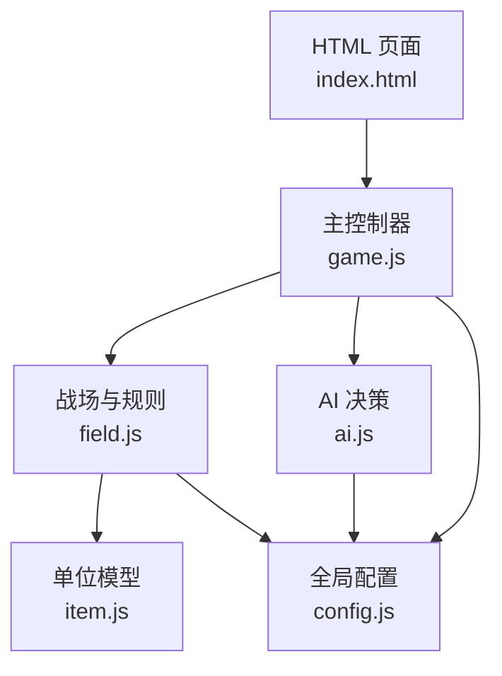
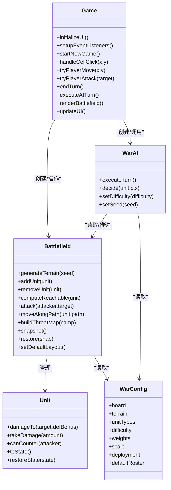
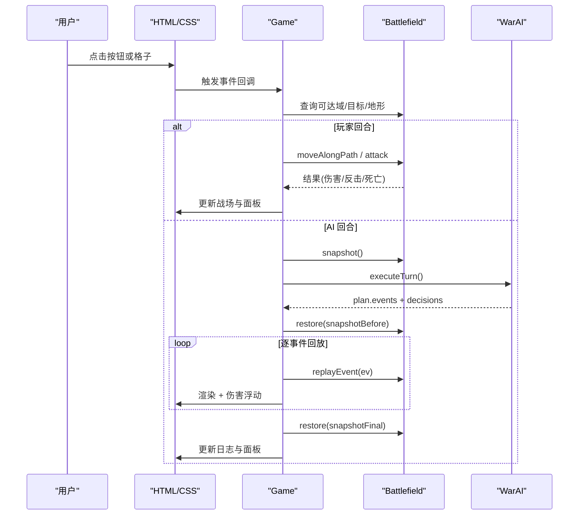
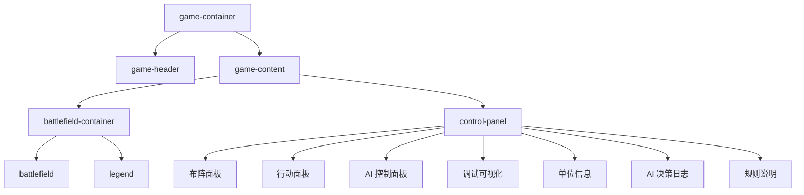
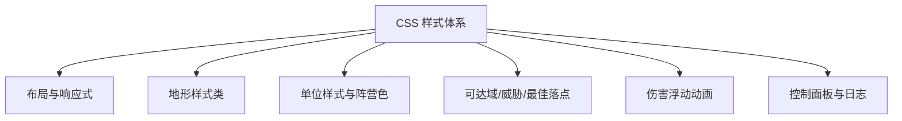
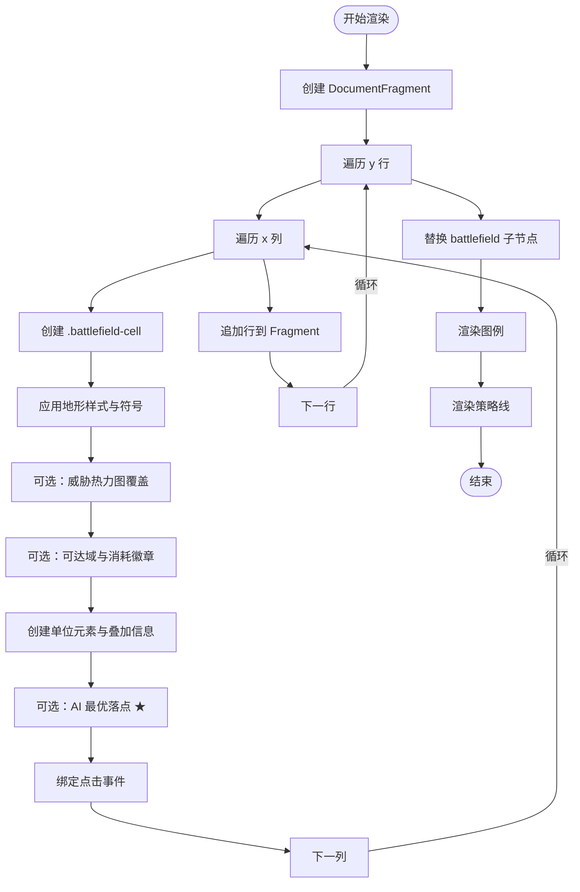
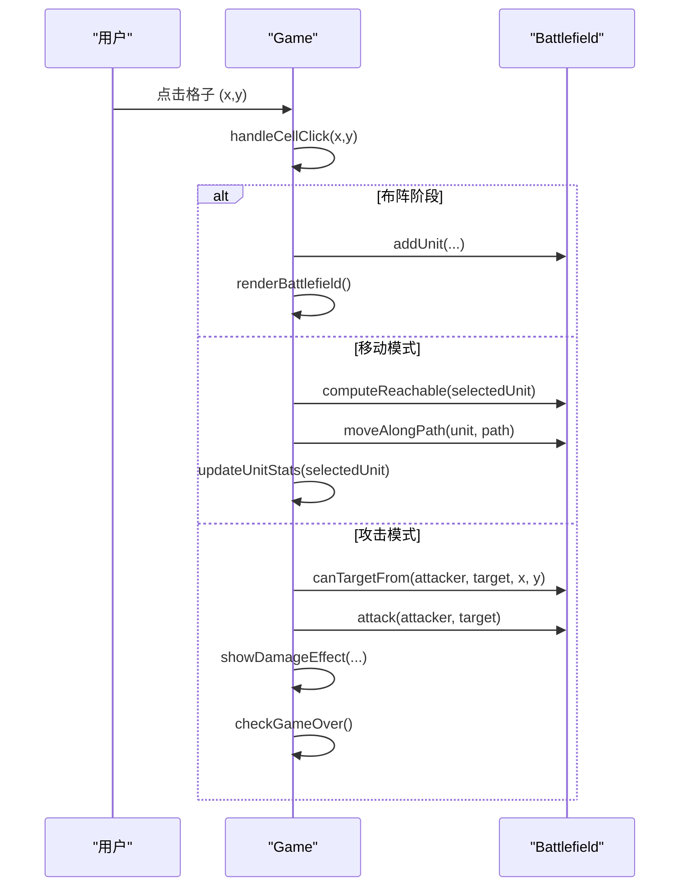
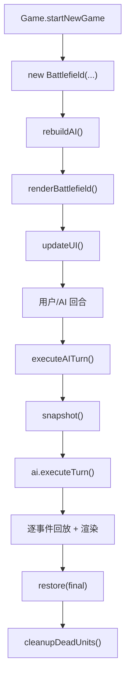
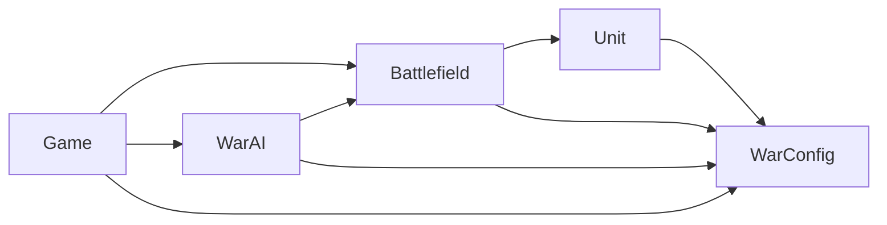

# Web 前端界面

<cite>
**本文引用的文件**   
- [index.html](file://war/war/index.html)
- [game.js](file://war/war/game.js)
- [field.js](file://war/war/field.js)
- [item.js](file://war/war/item.js)
- [config.js](file://war/war/config.js)
- [ai.js](file://war/war/ai.js)
</cite>

## 目录
1. [引言](#引言)
2. [项目结构](#项目结构)
3. [核心组件](#核心组件)
4. [架构总览](#架构总览)
5. [详细组件分析](#详细组件分析)
6. [依赖关系分析](#依赖关系分析)
7. [性能与兼容性](#性能与兼容性)
8. [故障排查](#故障排查)
9. [结论](#结论)

## 引言
本文件面向 WAR 游戏的 Web 前端实现，目标是帮助开发者快速理解并扩展该战棋游戏的浏览器端界面。文档覆盖以下方面：
- HTML 页面结构与布局组织：游戏容器、战场区域、控制面板的语义划分与响应式策略。
- CSS 样式系统：单位样式、地形样式、可达域与威胁可视化、伤害浮动动画等。
- 渲染机制：当前使用 DOM + CSS 渲染战场网格与单位；说明为何未采用 Canvas，以及未来迁移到 Canvas 的建议。
- 用户交互：点击事件、模式切换、自动战斗、调试可视化开关等。
- UI 组件与自定义方法：如何扩展面板、日志、统计信息。
- 与游戏逻辑层的集成：Game、Battlefield、Unit、AI 的职责边界与数据流。
- 性能优化技巧与浏览器兼容性注意事项。

## 项目结构
WAR 的 Web 前端位于 `war/war` 目录，采用“单页应用 + 多脚本模块”的组织方式：
- `index.html`：页面骨架、内联样式、UI 控件与脚本加载顺序。
- `config.js`：全局配置（棋盘尺寸、地形、兵种、难度旋钮、评分权重、确定性随机数）。
- `item.js`：单位模型 Unit，纯状态对象，负责属性、配额、伤害计算与序列化。
- `field.js`：战场 Battlefield，封装地形生成、单位管理、空间推理（可达域、威胁图）、攻击与移动结算、快照回滚。
- `ai.js`：AI 决策层，包含战略评估、候选枚举、效用评分、浅层前瞻、回合编排与可重放事件。
- `game.js`：主控制器 Game，绑定 UI、处理用户输入、驱动回合流转、渲染战场与面板、控制 AI 播放。

**图表来源**
- [index.html:150-266](file://war/war/index.html#L150-L266)
- [game.js:12-42](file://war/war/game.js#L12-L42)
- [field.js:11-32](file://war/war/field.js#L11-L32)
- [item.js:12-44](file://war/war/item.js#L12-L44)
- [ai.js:421-434](file://war/war/ai.js#L421-L434)
- [config.js:12-103](file://war/war/config.js#L12-L103)

**章节来源**
- [index.html:1-269](file://war/war/index.html#L1-L269)
- [game.js:1-600](file://war/war/game.js#L1-L600)
- [field.js:1-622](file://war/war/field.js#L1-L622)
- [item.js:1-178](file://war/war/item.js#L1-L178)
- [config.js:1-146](file://war/war/config.js#L1-L146)
- [ai.js:1-648](file://war/war/ai.js#L1-L648)

## 核心组件
本节从前端视角梳理关键类与职责，强调它们如何共同支撑 UI 与交互。

- Game：主控制器。负责初始化 UI、绑定事件、创建 Battlefield 与 WarAI、处理布阵/选择/移动/攻击/结束回合、驱动自动战斗、渲染战场与面板、显示伤害浮动与提示。
- Battlefield：战场与规则引擎。提供地形生成、单位增删、可达域计算、攻击判定、移动结算、威胁影响图、胜负判断、快照回滚、默认编成。
- Unit：单位模型。定义兵种属性、行动配额、伤害计算、反击资格、状态序列化。
- WarAI：AI 决策器。按难度旋钮（视野、温度、前瞻）执行战略评估、候选枚举、效用评分、浅层推演，输出可重放事件序列。
- WarConfig：全局配置。集中棋盘、地形、兵种、难度、评分权重、缩放标尺、部署上限、默认编成与确定性随机数 SeededRng。

**图表来源**
- [game.js:12-42](file://war/war/game.js#L12-L42)
- [field.js:11-32](file://war/war/field.js#L11-L32)
- [item.js:12-44](file://war/war/item.js#L12-L44)
- [ai.js:421-434](file://war/war/ai.js#L421-L434)
- [config.js:12-103](file://war/war/config.js#L12-L103)

**章节来源**
- [game.js:12-600](file://war/war/game.js#L12-L600)
- [field.js:11-622](file://war/war/field.js#L11-L622)
- [item.js:12-178](file://war/war/item.js#L12-L178)
- [ai.js:421-648](file://war/war/ai.js#L421-L648)
- [config.js:12-146](file://war/war/config.js#L12-L146)

## 架构总览
WAR 的前端采用“DOM 渲染 + 事件驱动”的架构。Game 作为协调者，将用户输入映射为 Battlefield 的状态变更，并通过 WarAI 驱动对手回合。AI 返回可重放的事件序列，Game 在回合前快照与回合后快照之间逐事件回放，保证动画与真实决策一致。

**图表来源**
- [game.js:291-335](file://war/war/game.js#L291-L335)
- [ai.js:455-514](file://war/war/ai.js#L455-L514)
- [ai.js:634-643](file://war/war/ai.js#L634-L643)
- [field.js:391-429](file://war/war/field.js#L391-L429)
- [field.js:343-383](file://war/war/field.js#L343-L383)

## 详细组件分析

### HTML 结构设计
- 根容器 `.game-container` 居中展示，背景渐变，圆角阴影。
- 头部 `.game-header` 显示标题。
- 主体 `.game-content` 使用 Flex 布局，左侧战场区 `.battlefield-container`，右侧控制面板 `.control-panel`。
- 战场区包含标题、`.battlefield` 网格容器、图例 `.legend`。
- 控制面板分为多个 `.panel-block`：
  - 布阵：兵种选择、放置单位、一键默认布阵。
  - 行动：移动、攻击、待命、结束回合、新游戏。
  - AI 控制：模式（手动/AI vs 玩家/自动）、难度、地形种子、决策种子、节奏滑块、执行 AI、自动战斗开关。
  - 调试可视化：可达域、威胁热力图、AI 最优落点★、策略线。
  - 单位信息：选中单位详情。
  - AI 决策日志：top-5 候选与打分分解。
  - 规则说明。

**图表来源**
- [index.html:150-258](file://war/war/index.html#L150-L258)

**章节来源**
- [index.html:150-266](file://war/war/index.html#L150-L266)

### CSS 样式系统
- 响应式布局：`.game-content` 使用 flex 与 wrap，战场区最小宽度 400px，控制面板固定宽度 340px。
- 战场网格：`.battlefield-row` 行容器，`.battlefield-cell` 单元格，支持悬停高亮、选中态、可达域高亮、地形样式类（森林、山地、河流、岩壁）。
- 单位样式：`.unit` 基础样式，按兵种形状区分（步兵圆形、骑兵方形、弓兵菱形），按阵营着色（player1/player2），目标高亮边框。
- 单位信息叠加：`.unit-info` 显示血量，`.unit-ap` 显示机动与攻击配额。
- 地形标记与成本徽章：`.terrain-mark` 显示地形符号，`.cost-badge` 显示移动消耗。
- AI 最优落点标记：`.ai-best` 显示“★”。
- 伤害浮动动画：`.damage-float` 与 `@keyframes damageFloat`，反击伤害使用 `.counter` 变体。
- 控制面板样式：区块化面板、按钮组、回合指示器、图例、统计行、策略线、日志样式、规则文本。

**图表来源**
- [index.html:7-147](file://war/war/index.html#L7-L147)

**章节来源**
- [index.html:7-147](file://war/war/index.html#L7-L147)

### 渲染机制与“Canvas 渲染实现”说明
当前实现并未使用 Canvas，而是通过 DOM 节点构建战场网格与单位元素，配合 CSS 完成视觉呈现。Game.renderBattlefield 动态创建 DocumentFragment，遍历 Battlefield 的宽高，为每个格子生成 div，附加地形样式、可达域标记、单位元素、AI 最优落点标记，并绑定点击事件。

若未来需要迁移到 Canvas，建议：
- 使用 requestAnimationFrame 驱动帧循环，避免频繁 DOM 重建。
- 将 Battlefield 的 terrain/unitGrid 直接映射为 Canvas 绘制指令。
- 对单位与地形进行离屏缓存，减少重复绘制。
- 将伤害浮动改为粒子系统或轻量级 DOM 叠加层，保持高性能。

当前渲染流程如下：

**图表来源**
- [game.js:400-463](file://war/war/game.js#L400-L463)

**章节来源**
- [game.js:400-463](file://war/war/game.js#L400-L463)

### 用户交互处理机制
- 点击事件：Game.handleCellClick 根据当前模式（placement/select/move/attack）分发到放置、选择、移动、攻击分支。
- 移动：tryPlayerMove 校验可达域，调用 Battlefield.moveAlongPath，失败时给出原因提示。
- 攻击：tryPlayerAttack 校验射程与视线，调用 Battlefield.attack，显示伤害浮动与反击效果，清理死亡单位，检查胜负。
- 待命：orderWait 清空选定单位的剩余配额。
- 回合流转：endTurn 处理布阵阶段与常规回合切换，重置行动配额，更新 UI，必要时触发自动战斗或 AI 回合。
- 自动战斗：toggleAutoMode 切换 autoMode 与 aiEnabled，runAutoBattle 循环执行 AI 回合与结束回合。
- 调试可视化：overlay 开关控制 reach/threat/candidates 的渲染。

**图表来源**
- [game.js:156-241](file://war/war/game.js#L156-L241)
- [field.js:225-287](file://war/war/field.js#L225-L287)
- [field.js:343-383](file://war/war/field.js#L343-L383)

**章节来源**
- [game.js:156-241](file://war/war/game.js#L156-L241)
- [game.js:255-335](file://war/war/game.js#L255-L335)

### UI 组件使用示例与自定义方法
- 新增面板区块：在 index.html 的控制面板中添加新的 `.panel-block`，并在 game.js 的 initializeUI 中获取对应 DOM 引用，在 setupEventListeners 中绑定事件。
- 扩展单位信息：在 updateUnitStats 中追加字段，例如额外状态或 Buff。
- 扩展 AI 日志：在 setLog 中解析更多 parts 字段，或在 PART_NAMES 中增加中文映射。
- 自定义地形样式：在 config.js 的 terrain 中新增 key，并在 index.html 的 CSS 中添加对应样式类。
- 自定义难度旋钮：在 config.js 的 difficulty 中新增条目，并在 ai.js 的 Scorer/Strategist 中适配行为。

**章节来源**
- [index.html:164-258](file://war/war/index.html#L164-L258)
- [game.js:46-78](file://war/war/game.js#L46-L78)
- [game.js:517-531](file://war/war/game.js#L517-L531)
- [config.js:18-25](file://war/war/config.js#L18-L25)
- [config.js:57-63](file://war/war/config.js#L57-L63)

### 与游戏逻辑层的集成方式
- Game 持有 Battlefield 与两个 WarAI 实例，分别对应玩家 1 与玩家 2。
- Game.startNewGame 创建新 Battlefield，rebuildAI 重建 AI 实例，渲染战场并更新 UI。
- Game.executeAITurn 记录回合前后快照，调用 ai.executeTurn 获取 plan.events，恢复至回合前状态逐事件回放，最后恢复最终快照。
- Battlefield 是状态变更的唯一入口，所有移动与攻击都通过其方法执行，确保 grid 与单位数组一致性。
- Unit 提供纯函数伤害计算与状态序列化，便于 AI 预估与快照回滚。
- WarConfig 集中所有数值与行为参数，避免分散硬编码。

**图表来源**
- [game.js:124-139](file://war/war/game.js#L124-L139)
- [game.js:291-335](file://war/war/game.js#L291-L335)
- [ai.js:455-514](file://war/war/ai.js#L455-L514)
- [field.js:512-529](file://war/war/field.js#L512-L529)

**章节来源**
- [game.js:124-139](file://war/war/game.js#L124-L139)
- [game.js:291-335](file://war/war/game.js#L291-L335)
- [ai.js:455-514](file://war/war/ai.js#L455-L514)
- [field.js:512-529](file://war/war/field.js#L512-L529)

## 依赖关系分析
- Game 依赖：
  - DOM API（document.getElementById、createElement、addEventListener）。
  - Battlefield（状态与规则）。
  - WarAI（决策与事件）。
  - WarConfig（配置）。
- Battlefield 依赖：
  - WarConfig（地形、兵种、棋盘尺寸）。
  - Unit（单位属性与伤害计算）。
  - SeededRng（确定性随机）。
- WarAI 依赖：
  - Battlefield（读取/推进状态）。
  - WarConfig（难度、权重、缩放）。
  - SeededRng（确定性随机）。
- Unit 依赖：
  - WarConfig（兵种属性）。

**图表来源**
- [game.js:12-42](file://war/war/game.js#L12-L42)
- [field.js:11-32](file://war/war/field.js#L11-L32)
- [ai.js:421-434](file://war/war/ai.js#L421-L434)
- [config.js:12-103](file://war/war/config.js#L12-L103)

**章节来源**
- [game.js:12-600](file://war/war/game.js#L12-L600)
- [field.js:11-622](file://war/war/field.js#L11-L622)
- [ai.js:421-648](file://war/war/ai.js#L421-L648)
- [config.js:12-146](file://war/war/config.js#L12-L146)

## 性能与兼容性
- 性能优化技巧：
  - 使用 DocumentFragment 批量插入 DOM，减少回流重绘（见 Game.renderBattlefield）。
  - 使用 Map 与 Float32Array 缓存可达域与威胁图，版本失效机制避免重复计算（见 Battlefield._reachCache/_threatCache）。
  - 桶式优先队列实现 Dijkstra，预算上限较小（≤7），避免堆开销（见 Battlefield.reachableWithBudget）。
  - 伤害浮动动画使用 CSS 动画与 setTimeout 移除节点，避免内存泄漏。
  - AI 决策仅对 top-K 候选做浅层前瞻，降低复杂度（见 ai.js Lookahead）。
- 浏览器兼容性：
  - 使用现代 ES6 语法（class、箭头函数、模板字符串），需兼容较新浏览器。
  - 使用 CSS Grid/Flexbox 与动画，主流桌面与移动端浏览器均支持。
  - 若需支持旧版 IE，需引入 polyfill 或使用 Babel 转译。
  - 避免使用实验性 API，当前代码未使用 Canvas/WebGL，降低兼容风险。

[本节为通用指导，不直接分析具体文件]

## 故障排查
- 移动失败提示：
  - “该格不在机动范围内（注意地形消耗）”：检查 selectedUnit 与 reachable 计算。
  - “移动失败：...”：查看 Battlefield.moveAlongPath 返回的 reason（not_adjacent/blocked/occupied/no_points）。
- 攻击失败提示：
  - “打不到：超出射程、无视线或已用过攻击配额”：检查 canTargetFrom 与 remainingAttacks。
  - “攻击失败：...”：查看 Battlefield.attack 返回的 rejected（not_allowed/out_of_range）。
- 布阵限制：
  - “只能在己方出生区布阵”：检查 isInDeployZone。
  - “该格不可通行或已有人”：检查 isWalkable 与 getUnitAt。
  - “本方编成已满”：检查 cfg.deployment.maxPerSide。
- 自动战斗卡住：
  - 检查 toggleAutoMode 与 runAutoBattle 是否被 busy 标志阻止。
  - 检查 speed 滑块值与 sleep 延迟。
- AI 决策日志为空：
  - 确认 warAI.debug 为 true，且 lastPlan.decisions 存在。
  - 检查 setLog 与 PART_NAMES 映射。

**章节来源**
- [game.js:180-241](file://war/war/game.js#L180-L241)
- [game.js:287-335](file://war/war/game.js#L287-L335)
- [field.js:391-429](file://war/war/field.js#L391-L429)
- [field.js:343-383](file://war/war/field.js#L343-L383)
- [game.js:517-531](file://war/war/game.js#L517-L531)

## 结论
WAR 的 Web 前端以清晰的职责分层与集中配置为核心，Game 协调 UI 与逻辑层，Battlefield 统一状态变更，Unit 提供纯函数能力，WarAI 通过难度旋钮实现可控的智能表现。当前 DOM+CSS 渲染方案简单直观，适合原型与教学；若追求更高性能与更丰富的视觉效果，可考虑迁移到 Canvas，并保持现有数据流与事件回放机制不变。通过扩展配置与 UI 组件，可以快速定制玩法、难度与可视化内容。