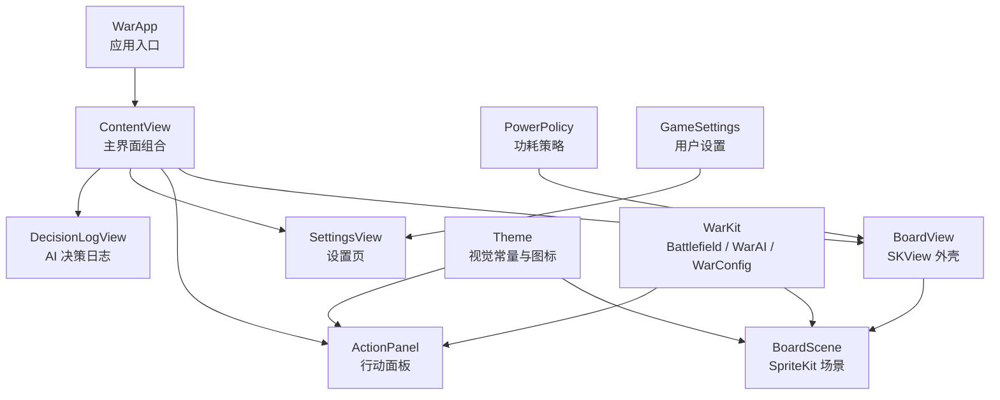
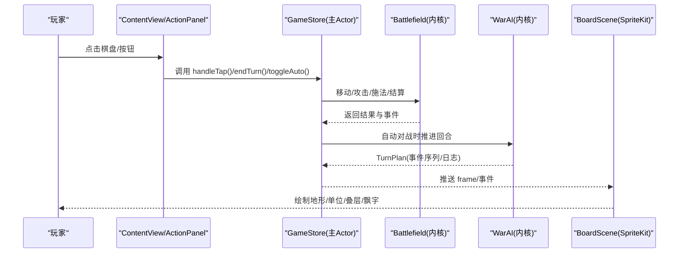
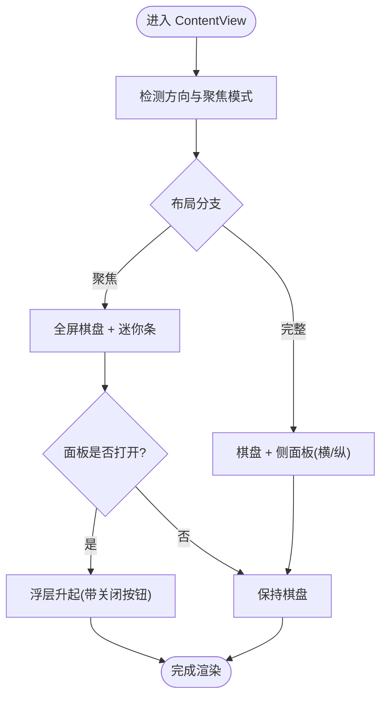
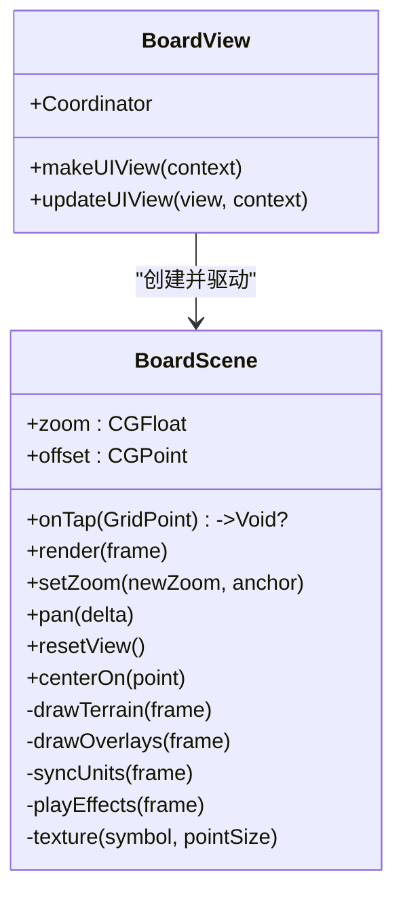
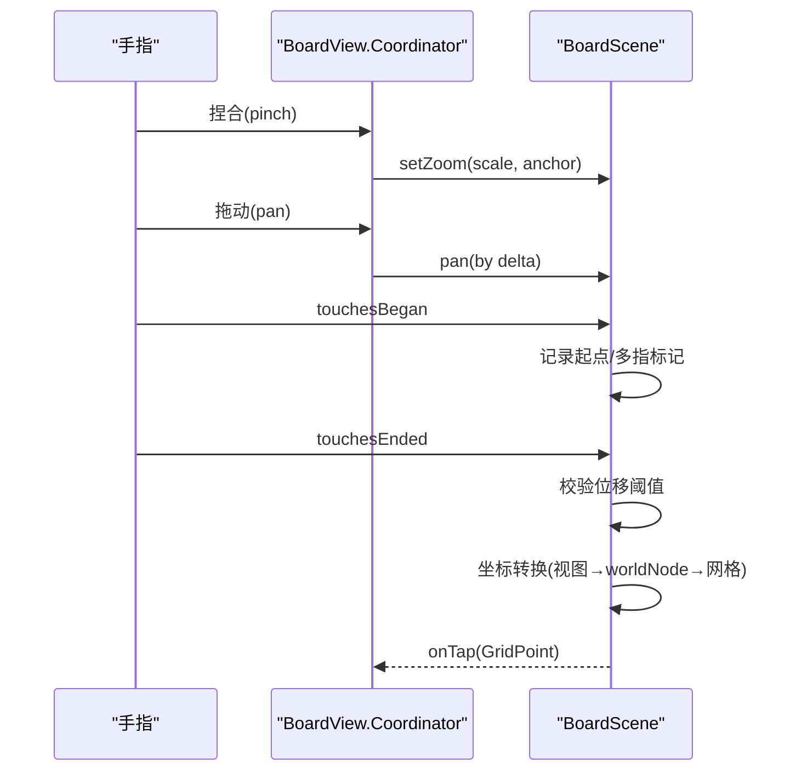
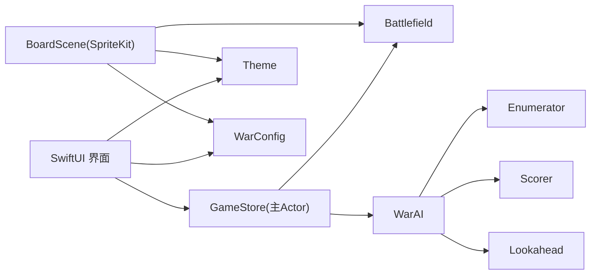

# iOS 原生界面

<cite>
**本文引用的文件**   
- [WarApp.swift](file://war/ios/War/WarApp.swift)
- [ContentView.swift](file://war/ios/War/UI/ContentView.swift)
- [BoardView.swift](file://war/ios/War/Rendering/BoardView.swift)
- [BoardScene.swift](file://war/ios/War/Rendering/BoardScene.swift)
- [ActionPanel.swift](file://war/ios/War/UI/ActionPanel.swift)
- [SettingsView.swift](file://war/ios/War/UI/SettingsView.swift)
- [DecisionLogView.swift](file://war/ios/War/UI/DecisionLogView.swift)
- [GameSettings.swift](file://war/ios/War/Model/GameSettings.swift)
- [Theme.swift](file://war/ios/War/Support/Theme.swift)
- [PowerPolicy.swift](file://war/ios/War/Support/PowerPolicy.swift)
- [Battlefield.swift](file://war/ios/WarKit/Sources/WarKit/Battlefield.swift)
- [WarAI.swift](file://war/ios/WarKit/Sources/WarKit/WarAI.swift)
- [Lookahead.swift](file://war/ios/WarKit/Sources/WarKit/Lookahead.swift)
- [Scorer.swift](file://war/ios/WarKit/Sources/WarKit/Scorer.swift)
- [Enumerator.swift](file://war/ios/WarKit/Sources/WarKit/Enumerator.swift)
- [WarConfig.swift](file://war/ios/WarKit/Sources/WarKit/WarConfig.swift)
- [Support.swift](file://war/ios/WarKit/Sources/WarKit/Support.swift)
</cite>

## 目录
1. [简介](#简介)
2. [项目结构](#项目结构)
3. [核心组件](#核心组件)
4. [架构总览](#架构总览)
5. [详细组件分析](#详细组件分析)
6. [依赖关系分析](#依赖关系分析)
7. [性能与功耗优化](#性能与功耗优化)
8. [故障排查指南](#故障排查指南)
9. [结论](#结论)

## 简介
本文件面向 WAR 游戏的 iOS 原生界面实现，覆盖 SwiftUI 主界面结构、SpriteKit 战场渲染、触摸交互机制、iOS 控件使用、主题定制与响应式布局、平台性能优化，以及与 WarKit 共享逻辑内核的集成方式。文档以“从用户可见界面到内核规则”的分层视角展开，既帮助初学者理解整体流程，也为开发者提供可追溯的代码级参考。

## 项目结构
iOS 应用采用分层组织：
- 入口与全局状态：WarApp.swift 注入 GameStore（主 Actor）与 PowerPolicy，统一设置深色模式、主题色与场景生命周期回调。
- UI 层（SwiftUI）：ContentView 组合棋盘、侧面板与迷你操作条；ActionPanel 负责布阵/指令/叠层开关/自动对战；SettingsView 管理对局参数；DecisionLogView 展示 AI 决策明细。
- 渲染层（SpriteKit + SwiftUI 桥接）：BoardView 封装 SKView 与手势；BoardScene 负责地形、单位、叠层与特效绘制。
- 支持模块：Theme 提供视觉常量与图标映射；PowerPolicy 监听系统热态与低电量策略；GameSettings 持久化用户偏好。
- 内核（WarKit）：Battlefield 维护战场状态机；WarAI 编排战略→枚举→评分→前瞻→采样→执行；WarConfig 集中数值与规则；Enumerator/Scorer/Lookahead 构成 AI 战术管线；Support 提供坐标与确定性随机。

图表来源
- [WarApp.swift:10-31](file://war/ios/War/WarApp.swift#L10-L31)
- [ContentView.swift:14-89](file://war/ios/War/UI/ContentView.swift#L14-L89)
- [BoardView.swift:13-74](file://war/ios/War/Rendering/BoardView.swift#L13-L74)
- [BoardScene.swift:11-79](file://war/ios/War/Rendering/BoardScene.swift#L11-L79)
- [ActionPanel.swift:5-32](file://war/ios/War/UI/ActionPanel.swift#L5-L32)
- [SettingsView.swift:6-106](file://war/ios/War/UI/SettingsView.swift#L6-L106)
- [DecisionLogView.swift:8-29](file://war/ios/War/UI/DecisionLogView.swift#L8-L29)
- [Theme.swift:6-95](file://war/ios/War/Support/Theme.swift#L6-L95)
- [PowerPolicy.swift:14-81](file://war/ios/War/Support/PowerPolicy.swift#L14-L81)
- [GameSettings.swift:8-66](file://war/ios/War/Model/GameSettings.swift#L8-L66)

章节来源
- [WarApp.swift:10-31](file://war/ios/War/WarApp.swift#L10-L31)
- [ContentView.swift:14-89](file://war/ios/War/UI/ContentView.swift#L14-L89)

## 核心组件
- 应用入口与状态容器：WarApp 将 GameStore 作为 @StateObject 注入环境，绑定 scenePhase 变化，统一设置主题与色调。
- 主界面组合：ContentView 根据设备方向与聚焦模式切换布局；通过 safeAreaInset 放置迷你操作条，避免遮挡棋盘底部格子。
- 棋盘渲染：BoardView 创建 SKView 并挂载 BoardScene，处理缩放/平移手势与帧率策略；BoardScene 按 revision 增量更新地形/单位/叠层/特效。
- 行动面板：ActionPanel 在布阵期显示军费与兵种升级/魔法商店；战斗期显示单位指令、成长分配、施法与自动对战开关。
- 设置页：SettingsView 提供模式、难度、棋盘尺寸、默认缩放、seed、动画节拍等配置，必要时触发重开局。
- 决策日志：DecisionLogView 展示 AI 的战略结论与候选评分明细，便于调参与复盘。
- 主题与图标：Theme 集中阵营色、地形色、威胁不透明度、SF Symbol 映射与 Glyph 组件。
- 功耗策略：PowerPolicy 监听热态与低电量，降低前瞻深度与帧率，不影响数值强度。
- 用户设置：GameSettings 持久化偏好，区分“规则权威（WarConfig）”和“本机偏好”。

章节来源
- [WarApp.swift:10-31](file://war/ios/War/WarApp.swift#L10-L31)
- [ContentView.swift:14-89](file://war/ios/War/UI/ContentView.swift#L14-L89)
- [BoardView.swift:13-74](file://war/ios/War/Rendering/BoardView.swift#L13-L74)
- [BoardScene.swift:11-79](file://war/ios/War/Rendering/BoardScene.swift#L11-L79)
- [ActionPanel.swift:5-32](file://war/ios/War/UI/ActionPanel.swift#L5-L32)
- [SettingsView.swift:6-106](file://war/ios/War/UI/SettingsView.swift#L6-L106)
- [DecisionLogView.swift:8-29](file://war/ios/War/UI/DecisionLogView.swift#L8-L29)
- [Theme.swift:6-95](file://war/ios/War/Support/Theme.swift#L6-L95)
- [PowerPolicy.swift:14-81](file://war/ios/War/Support/PowerPolicy.swift#L14-L81)
- [GameSettings.swift:8-66](file://war/ios/War/Model/GameSettings.swift#L8-L66)

## 架构总览
界面与内核解耦：SwiftUI 仅消费 WarKit 暴露的状态与结果（如 BoardFrame、TurnPlan），所有规则判定与计算集中在 Battlefield/WarAI/WarConfig。渲染层只负责把数据画出来，不做业务判断。

图表来源
- [ContentView.swift:178-180](file://war/ios/War/UI/ContentView.swift#L178-L180)
- [BoardView.swift:16-35](file://war/ios/War/Rendering/BoardView.swift#L16-L35)
- [BoardScene.swift:56-79](file://war/ios/War/Rendering/BoardScene.swift#L56-L79)
- [Battlefield.swift:332-442](file://war/ios/WarKit/Sources/WarKit/Battlefield.swift#L332-L442)
- [WarAI.swift:64-181](file://war/ios/WarKit/Sources/WarKit/WarAI.swift#L64-L181)

## 详细组件分析

### SwiftUI 主界面与布局
- 两种形态：聚焦模式（开战后隐藏面板，棋盘全屏+迷你操作条）与完整模式（横屏左右排、竖屏上下排）。
- 浮层面板：通过 overlay 与 transition 控制开合，不改变场景尺寸，避免地形重建闪烁。
- 迷你操作条：使用 safeAreaInset 置于底部，避免全图缩放时被遮挡；包含待命、结束回合、全图复位、面板开关等。
- 顶部状态栏：显示当前阶段、关卡信息、钱包余额、提示与聚焦模式开关。
- 结局卡片：显示胜负原因、物质分、闯关进度与后续操作（重试/下一关/重开）。

图表来源
- [ContentView.swift:35-89](file://war/ios/War/UI/ContentView.swift#L35-L89)
- [ContentView.swift:183-241](file://war/ios/War/UI/ContentView.swift#L183-L241)
- [ContentView.swift:262-301](file://war/ios/War/UI/ContentView.swift#L262-L301)

章节来源
- [ContentView.swift:14-89](file://war/ios/War/UI/ContentView.swift#L14-L89)
- [ContentView.swift:183-241](file://war/ios/War/UI/ContentView.swift#L183-L241)
- [ContentView.swift:262-301](file://war/ios/War/UI/ContentView.swift#L262-L301)

### SpriteKit 战场渲染
- 四层节点：terrainLayer（地形）、overlayLayer（可达域/威胁/AI落点/目标环）、unitLayer（单位）、fxLayer（飘字特效）。
- 地形层缓存：仅在棋盘尺寸/地形变化时重建，避免频繁分配。
- 单位复用：按 id 复用 SKNode，位置变化用 move 补间；新增/删除单位走显式动画。
- 视图变换：worldNode 统一承载四层，缩放/平移只改 transform，不触发重建。
- 图标纹理：优先 SF Symbol，失败回退字母；纹理缓存按名称+字号生成，减少重复开销。
- 触摸到网格：touchesBegan/Moved/Ended 中过滤多指与拖动距离，再换算 worldNode 局部坐标到网格坐标。

图表来源
- [BoardScene.swift:11-79](file://war/ios/War/Rendering/BoardScene.swift#L11-L79)
- [BoardScene.swift:123-157](file://war/ios/War/Rendering/BoardScene.swift#L123-L157)
- [BoardScene.swift:204-311](file://war/ios/War/Rendering/BoardScene.swift#L204-L311)
- [BoardScene.swift:315-424](file://war/ios/War/Rendering/BoardScene.swift#L315-L424)
- [BoardScene.swift:557-580](file://war/ios/War/Rendering/BoardScene.swift#L557-L580)
- [BoardScene.swift:587-619](file://war/ios/War/Rendering/BoardScene.swift#L587-L619)
- [BoardView.swift:13-74](file://war/ios/War/Rendering/BoardView.swift#L13-L74)

章节来源
- [BoardScene.swift:11-79](file://war/ios/War/Rendering/BoardScene.swift#L11-L79)
- [BoardScene.swift:123-157](file://war/ios/War/Rendering/BoardScene.swift#L123-L157)
- [BoardScene.swift:204-311](file://war/ios/War/Rendering/BoardScene.swift#L204-L311)
- [BoardScene.swift:315-424](file://war/ios/War/Rendering/BoardScene.swift#L315-L424)
- [BoardScene.swift:557-580](file://war/ios/War/Rendering/BoardScene.swift#L557-L580)
- [BoardScene.swift:587-619](file://war/ios/War/Rendering/BoardScene.swift#L587-L619)
- [BoardView.swift:13-74](file://war/ios/War/Rendering/BoardView.swift#L13-L74)

### 触摸交互与手势
- 双指捏合缩放：锚点缩放，保持点击位置不变；最小/最大缩放限制。
- 单指拖动平移：仅在地图比屏幕大时允许；与点击互斥，避免误触。
- 点击判定：抬起时检查位移阈值，换算为网格坐标；多指或拖动过大则丢弃点击。
- 手势委托：pan 手势在 canPan=false 时不开始，保证点击穿透；pinch 与 pan 可同时识别。

图表来源
- [BoardView.swift:76-121](file://war/ios/War/Rendering/BoardView.swift#L76-L121)
- [BoardScene.swift:123-157](file://war/ios/War/Rendering/BoardScene.swift#L123-L157)
- [BoardScene.swift:587-619](file://war/ios/War/Rendering/BoardScene.swift#L587-L619)

章节来源
- [BoardView.swift:76-121](file://war/ios/War/Rendering/BoardView.swift#L76-L121)
- [BoardScene.swift:587-619](file://war/ios/War/Rendering/BoardScene.swift#L587-L619)

### iOS 控件与交互
- Picker（分段选择器）：用于面板 Tab、兵种选择、军费分类、难度与棋盘尺寸。
- Button（含 bordered/borderedProminent/destructive）：常用操作（待命/结束回合/投降/重开/新开局）。
- Toggle（开关）：聚焦模式、叠层显示开关。
- Slider（滑块）：动画节拍调节（步长 20ms）。
- Menu（菜单）：顶部工具栏中的重开/新开局/一键布阵/投降。
- ConfirmationDialog（确认对话框）：投降二次确认，区分闯关与常规模式的回滚语义。
- Label/Text/ProgressView：状态行、提示信息与加载指示。

章节来源
- [ActionPanel.swift:36-77](file://war/ios/War/UI/ActionPanel.swift#L36-L77)
- [ActionPanel.swift:430-446](file://war/ios/War/UI/ActionPanel.swift#L430-L446)
- [ContentView.swift:303-330](file://war/ios/War/UI/ContentView.swift#L303-L330)
- [SettingsView.swift:12-106](file://war/ios/War/UI/SettingsView.swift#L12-L106)

### 主题定制与响应式设计
- 主题常量：Theme.accent/campColor/boardBackground/reachTint/threatOpacity 等集中定义，避免散落硬编码。
- 图标映射：Theme.unitIcons/terrainIcons/spellIcons 将内核 key 映射到 SF Symbol，取不到回退字母。
- Glyph 组件：UnitGlyph/TerrainGlyph/SpellGlyph 在 SwiftUI 与 SpriteKit 共用同一映射表，确保一致性。
- 响应式布局：ContentView 根据 GeometryReader 尺寸决定横竖布局；BoardView 同步 scene.size 适配转屏/分屏。

章节来源
- [Theme.swift:6-95](file://war/ios/War/Support/Theme.swift#L6-L95)
- [Theme.swift:97-140](file://war/ios/War/Support/Theme.swift#L97-L140)
- [ContentView.swift:36-45](file://war/ios/War/UI/ContentView.swift#L36-L45)
- [BoardView.swift:38-44](file://war/ios/War/Rendering/BoardView.swift#L38-L44)

### 与 WarKit 内核的集成
- 状态消费：BoardScene.render(BoardFrame) 仅做绘制；ActionPanel/ContentView 调用 GameStore 方法（move/attack/castSpell/endTurn/toggleAuto）。
- 规则权威：所有移动/攻击/施法/成长/终局判定由 Battlefield 统一处理，AI 与真实执行共用同一接口，保证动画与结果一致。
- AI 管线：WarAI.executeTurn 产出 TurnPlan（事件序列与决策日志），供 UI 展示与逐帧回放。
- 配置中心：WarConfig 集中地形/兵种/魔法/难度/权重/标尺，UI 不复制数值，避免“配置改了界面不变”。

章节来源
- [BoardScene.swift:56-79](file://war/ios/War/Rendering/BoardScene.swift#L56-L79)
- [Battlefield.swift:332-442](file://war/ios/WarKit/Sources/WarKit/Battlefield.swift#L332-L442)
- [WarAI.swift:64-181](file://war/ios/WarKit/Sources/WarKit/WarAI.swift#L64-L181)
- [WarConfig.swift:5-576](file://war/ios/WarKit/Sources/WarKit/WarConfig.swift#L5-L576)

## 依赖关系分析
- 界面层依赖 WarKit 的数据结构与结果类型（如 BoardFrame、TurnPlan、AiEvent），但不直接持有可变战场状态。
- 渲染层依赖 Theme 与 WarConfig 的静态常量进行着色与图标映射。
- 行为层（GameStore）协调 UI 与内核：接收用户输入，调用 Battlefield/WarAI，再把结果推给 BoardScene 与 SwiftUI 视图。
- 内核内部：WarAI 依赖 Enumerator/Scorer/Lookahead，三者共同基于 Battlefield 提供的查询与变更接口工作。

图表来源
- [WarAI.swift:11-28](file://war/ios/WarKit/Sources/WarKit/WarAI.swift#L11-L28)
- [Enumerator.swift:9-104](file://war/ios/WarKit/Sources/WarKit/Enumerator.swift#L9-L104)
- [Scorer.swift:11-257](file://war/ios/WarKit/Sources/WarKit/Scorer.swift#L11-L257)
- [Lookahead.swift:9-61](file://war/ios/WarKit/Sources/WarKit/Lookahead.swift#L9-L61)
- [BoardScene.swift:11-79](file://war/ios/War/Rendering/BoardScene.swift#L11-L79)

章节来源
- [WarAI.swift:11-28](file://war/ios/WarKit/Sources/WarKit/WarAI.swift#L11-L28)
- [Enumerator.swift:9-104](file://war/ios/WarKit/Sources/WarKit/Enumerator.swift#L9-L104)
- [Scorer.swift:11-257](file://war/ios/WarKit/Sources/WarKit/Scorer.swift#L11-L257)
- [Lookahead.swift:9-61](file://war/ios/WarKit/Sources/WarKit/Lookahead.swift#L9-L61)

## 性能与功耗优化
- 帧率自适应：静止时压至 30fps，动画/自动对战时按 PowerPolicy.preferredFPS 提升到 60fps；低电量/发热时强制 30fps。
- 地形层缓存：仅在棋盘尺寸/地形变化时重建，避免频繁分配与闪屏。
- 单位节点复用：按 id 复用 SKNode，位置变化用 move 补间，删除走淡出+缩小动画。
- 图标纹理缓存：按 symbol+字号缓存 SKTexture，避免重复生成 UIImage。
- 功耗策略：PowerPolicy 监听热态与低电量，降低 AI 前瞻层数与帧率，不改变单位数值强度。
- 主线程计算：回合制游戏状态钉在主 Actor，AI 单回合实测 <40ms，无需跨线程并发写状态。

章节来源
- [BoardView.swift:68-72](file://war/ios/War/Rendering/BoardView.swift#L68-L72)
- [BoardScene.swift:6-10](file://war/ios/War/Rendering/BoardScene.swift#L6-L10)
- [BoardScene.swift:56-79](file://war/ios/War/Rendering/BoardScene.swift#L56-L79)
- [BoardScene.swift:173-194](file://war/ios/War/Rendering/BoardScene.swift#L173-L194)
- [PowerPolicy.swift:47-68](file://war/ios/War/Support/PowerPolicy.swift#L47-L68)
- [WarApp.swift:6-8](file://war/ios/War/WarApp.swift#L6-L8)

## 故障排查指南
- 点击无效：检查 BoardScene.touchesEnded 的位移阈值与多指标记；确认 pan 手势未吞掉点击（canPan=false）。
- 缩放异常：确认 setZoom 的锚点换算与 clampOffset 边界；验证 zoomReady 条件（地形已构建）。
- 单位不刷新：检查 render 的 revision 比较与 syncUnits 的 alive 集合；确认单位 id 唯一且未重复移除。
- 飘字错位：核对 playEffects 的 center(of) 坐标翻转与 fxLayer zPosition。
- 自动对战卡顿：查看 PowerPolicy.shouldReduceWorkload 与 preferredFPS；确认 stepDelayMs 设置不过小。
- 配置未生效：SettingsView.apply 中 needsRestart 判断 boardIndex/mode/terrainSeed 变化，必要时调用 newGame。

章节来源
- [BoardScene.swift:123-157](file://war/ios/War/Rendering/BoardScene.swift#L123-L157)
- [BoardScene.swift:557-580](file://war/ios/War/Rendering/BoardScene.swift#L557-L580)
- [BoardView.swift:38-72](file://war/ios/War/Rendering/BoardView.swift#L38-L72)
- [SettingsView.swift:99-116](file://war/ios/War/UI/SettingsView.swift#L99-L116)

## 结论
本项目通过清晰的层次划分与严格的职责分离，实现了高性能、低功耗且易扩展的 iOS 原生 WAR 游戏界面。SwiftUI 专注组合与交互，SpriteKit 专注高效渲染，WarKit 提供确定性与可复现的内核规则。主题与图标映射集中在 Theme，功耗策略与用户设置分别由 PowerPolicy 与 GameSettings 管理，使界面在不同设备与系统状态下保持稳定体验。AI 管线（Enumerator/Scorer/Lookahead）与战场状态机（Battlefield）紧密协作，确保“所见即所得”，并为调试与复盘提供了完整的决策日志。