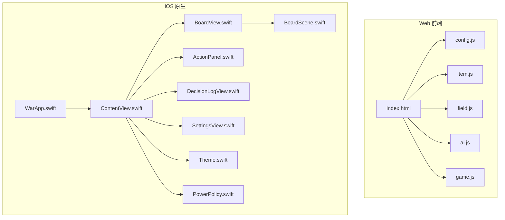
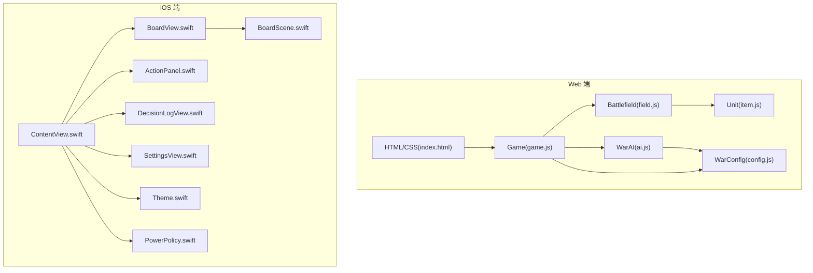
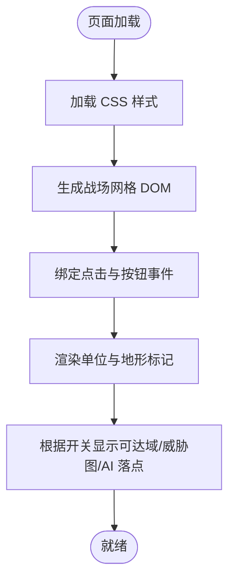
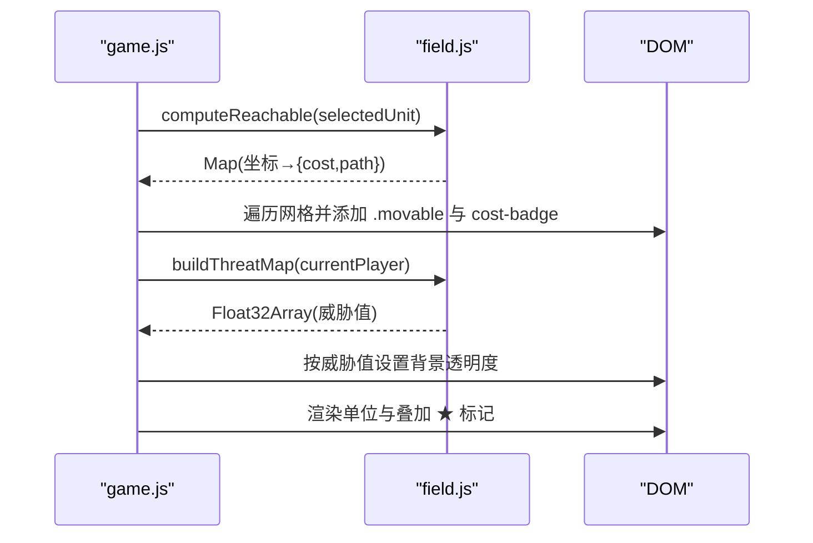
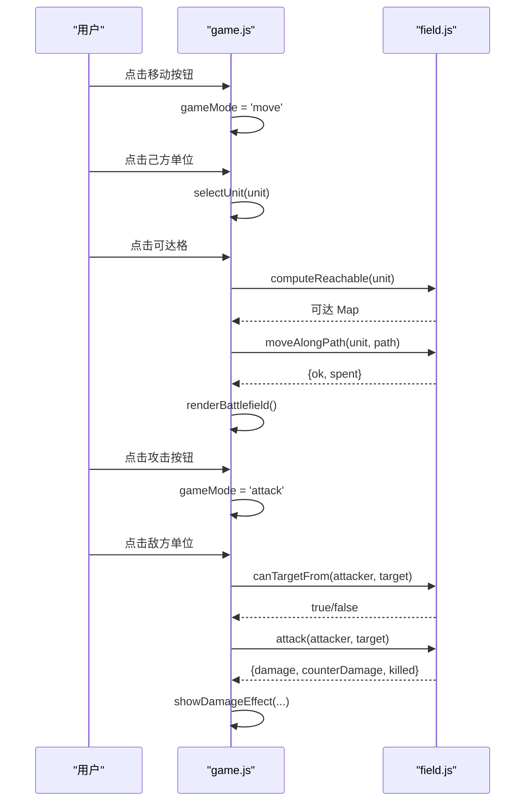
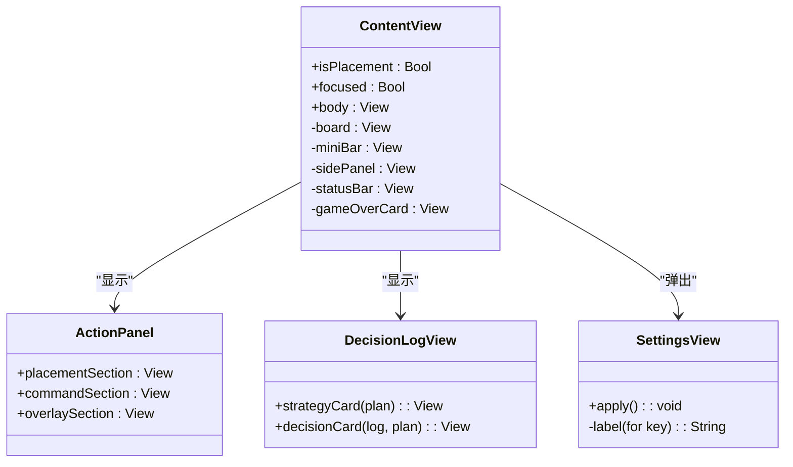
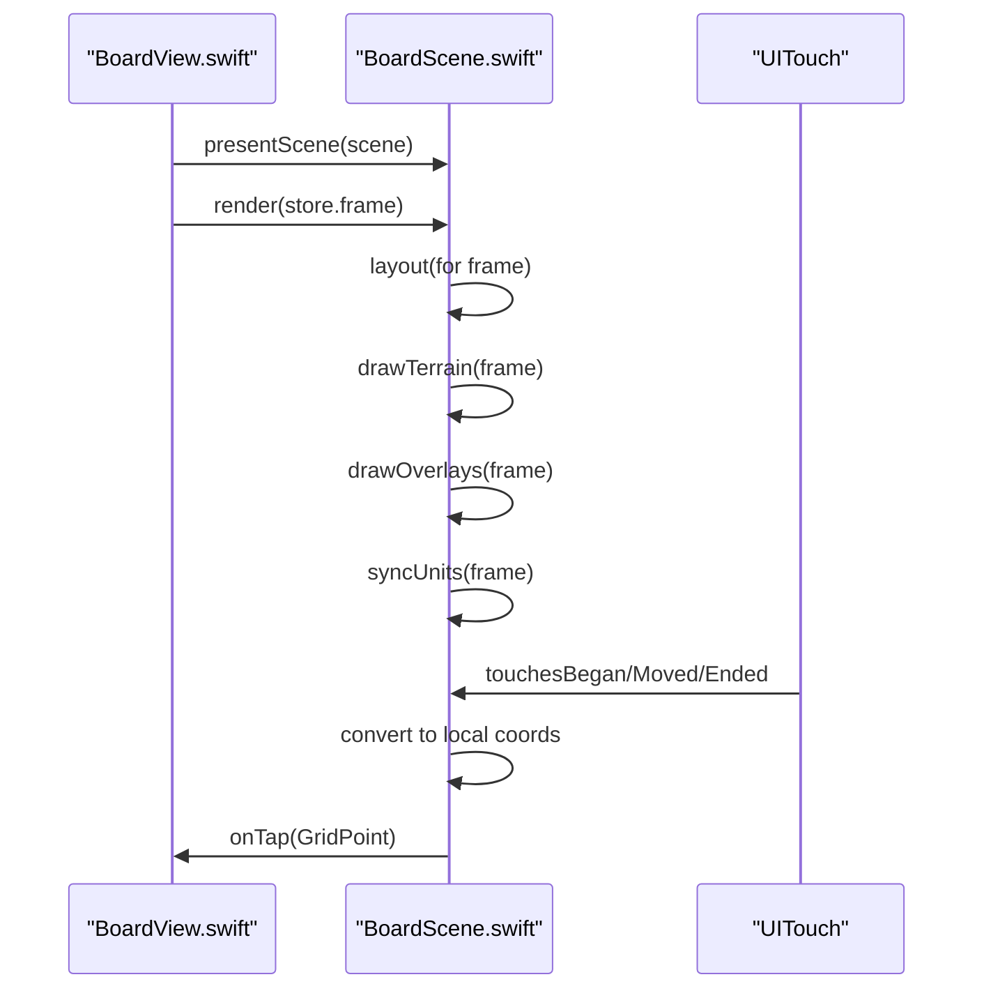
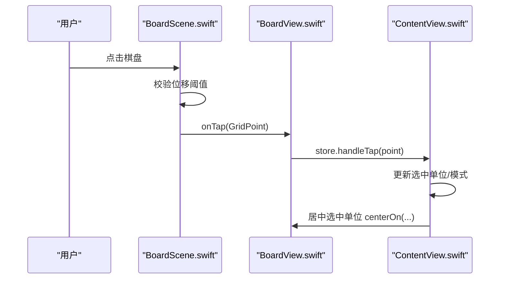
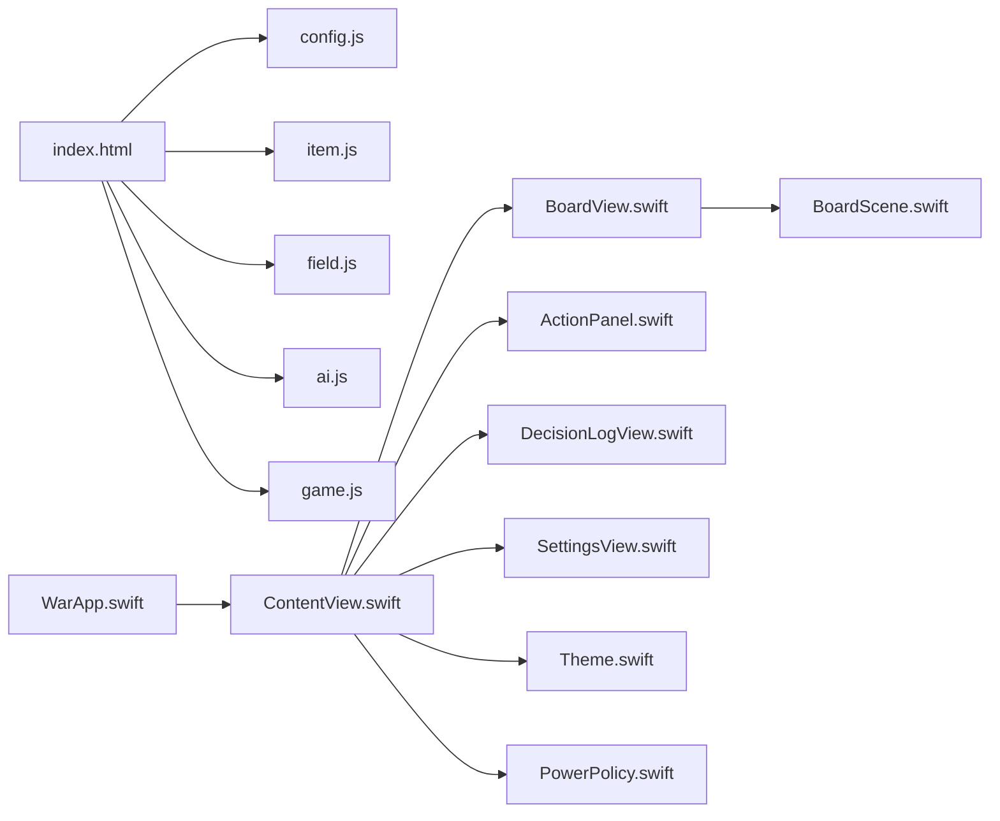

# 用户界面实现

<cite>
**本文引用的文件**   
- [index.html](file://war/war/index.html)
- [config.js](file://war/war/config.js)
- [item.js](file://war/war/item.js)
- [field.js](file://war/war/field.js)
- [ai.js](file://war/war/ai.js)
- [game.js](file://war/war/game.js)
- [ContentView.swift](file://war/ios/War/UI/ContentView.swift)
- [BoardScene.swift](file://war/ios/War/Rendering/BoardScene.swift)
- [BoardView.swift](file://war/ios/War/Rendering/BoardView.swift)
- [ActionPanel.swift](file://war/ios/War/UI/ActionPanel.swift)
- [DecisionLogView.swift](file://war/ios/War/UI/DecisionLogView.swift)
- [SettingsView.swift](file://war/ios/War/UI/SettingsView.swift)
- [Theme.swift](file://war/ios/War/Support/Theme.swift)
- [PowerPolicy.swift](file://war/ios/War/Support/PowerPolicy.swift)
- [WarApp.swift](file://war/ios/War/WarApp.swift)
</cite>

## 目录
1. [引言](#引言)
2. [项目结构](#项目结构)
3. [核心组件](#核心组件)
4. [架构总览](#架构总览)
5. [详细组件分析](#详细组件分析)
6. [依赖关系分析](#依赖关系分析)
7. [性能与功耗优化](#性能与功耗优化)
8. [故障排查指南](#故障排查指南)
9. [结论](#结论)

## 引言
本文件面向 WAR 游戏的用户界面实现，覆盖 Web 前端（HTML/CSS/DOM）与 iOS 原生（SwiftUI + SpriteKit）两套界面的设计、渲染与交互流程。文档同时解释两个平台的渲染差异、响应式适配策略、跨平台兼容性考虑，并提供 UI 组件使用示例、事件处理机制、性能优化技巧与调试方法。

Web 端采用 DOM 网格布局与 CSS 样式驱动，结合 JavaScript 状态机与 AI 回合重放；iOS 端采用 SwiftUI 组合视图与 SpriteKit 场景，通过缩放/平移手势与帧率控制实现高性能棋盘渲染。两者共享同一套规则内核概念（地形、单位、攻击、可达域、威胁图），但表现层各自独立。

## 项目结构
仓库包含两条主要实现路径：
- Web 前端：以 index.html 为入口，加载 config.js、item.js、field.js、ai.js、game.js，构建战场 DOM、绑定事件、驱动游戏状态机与 AI 决策可视化。
- iOS 应用：以 WarApp.swift 为入口，使用 ContentView.swift 组织主界面，BoardView.swift 封装 SKView，BoardScene.swift 负责 SpriteKit 渲染，ActionPanel.swift/DecisionLogView.swift/SettingsView.swift 提供面板与设置，Theme.swift 统一视觉常量，PowerPolicy.swift 管理功耗策略。

**图表来源**
- [index.html:1-269](file://war/war/index.html#L1-L269)
- [WarApp.swift:1-33](file://war/ios/War/WarApp.swift#L1-L33)

**章节来源**
- [index.html:1-269](file://war/war/index.html#L1-L269)
- [WarApp.swift:1-33](file://war/ios/War/WarApp.swift#L1-L33)

## 核心组件
- Web 端
  - 配置与随机源：config.js 定义棋盘尺寸、地形、兵种、难度旋钮、评分权重与 SeededRng。
  - 单位模型：item.js 的 Unit 是纯状态对象，提供伤害计算、配额检查与序列化。
  - 战场内核：field.js 的 Battlefield 维护地形与占位网格，提供移动、攻击、可达域、威胁影响图、快照/回滚。
  - AI 决策：ai.js 分层实现 Strategist → Enumerator → Scorer → Lookahead → WarAI，输出可重放事件序列。
  - 游戏主控：game.js 负责 DOM 渲染、事件绑定、回合流转、AI 回合播放与调试 overlay。

- iOS 端
  - 应用入口：WarApp.swift 注入 GameStore 与 PowerPolicy，设置主题与颜色方案。
  - 主界面：ContentView.swift 组合 BoardPanel、迷你操作条、侧边面板与结束卡片。
  - 棋盘渲染：BoardView.swift 封装 SKView 与手势，BoardScene.swift 绘制地形、单位、叠层与特效。
  - 面板与日志：ActionPanel.swift 提供布阵/指令/魔法/自动对战；DecisionLogView.swift 展示 AI 决策明细。
  - 设置与主题：SettingsView.swift 暴露模式、难度、棋盘尺寸、seed、动画速度；Theme.swift 集中视觉常量与图标映射。
  - 功耗策略：PowerPolicy.swift 监听系统热态与低电量，调整前瞻层数与帧率。

**章节来源**
- [config.js:1-146](file://war/war/config.js#L1-L146)
- [item.js:1-178](file://war/war/item.js#L1-L178)
- [field.js:1-622](file://war/war/field.js#L1-L622)
- [ai.js:1-648](file://war/war/ai.js#L1-L648)
- [game.js:1-600](file://war/war/game.js#L1-L600)
- [WarApp.swift:1-33](file://war/ios/War/WarApp.swift#L1-L33)
- [ContentView.swift:1-332](file://war/ios/War/UI/ContentView.swift#L1-L332)
- [BoardView.swift:1-136](file://war/ios/War/Rendering/BoardView.swift#L1-L136)
- [BoardScene.swift:1-635](file://war/ios/War/Rendering/BoardScene.swift#L1-L635)
- [ActionPanel.swift:1-557](file://war/ios/War/UI/ActionPanel.swift#L1-L557)
- [DecisionLogView.swift:1-135](file://war/ios/War/UI/DecisionLogView.swift#L1-L135)
- [SettingsView.swift:1-136](file://war/ios/War/UI/SettingsView.swift#L1-L136)
- [Theme.swift:1-140](file://war/ios/War/Support/Theme.swift#L1-L140)
- [PowerPolicy.swift:1-82](file://war/ios/War/Support/PowerPolicy.swift#L1-L82)

## 架构总览
Web 端采用“DOM 渲染 + JS 状态机”的架构：HTML 提供结构与样式，JS 在 game.js 中驱动 Battlefield/AI，并通过 DOM 更新战场、控制面板与日志。iOS 端采用“SwiftUI 组合视图 + SpriteKit 场景”的架构：ContentView 编排布局，BoardView 桥接 SKView，BoardScene 负责逐帧绘制与触摸交互，ActionPanel/DecisionLogView/SettingsView 提供业务面板，Theme/PowerPolicy 提供视觉与功耗支持。

**图表来源**
- [game.js:1-600](file://war/war/game.js#L1-L600)
- [field.js:1-622](file://war/war/field.js#L1-L622)
- [item.js:1-178](file://war/war/item.js#L1-L178)
- [ai.js:1-648](file://war/war/ai.js#L1-L648)
- [config.js:1-146](file://war/war/config.js#L1-L146)
- [ContentView.swift:1-332](file://war/ios/War/UI/ContentView.swift#L1-L332)
- [BoardView.swift:1-136](file://war/ios/War/Rendering/BoardView.swift#L1-L136)
- [BoardScene.swift:1-635](file://war/ios/War/Rendering/BoardScene.swift#L1-L635)
- [ActionPanel.swift:1-557](file://war/ios/War/UI/ActionPanel.swift#L1-L557)
- [DecisionLogView.swift:1-135](file://war/ios/War/UI/DecisionLogView.swift#L1-L135)
- [SettingsView.swift:1-136](file://war/ios/War/UI/SettingsView.swift#L1-L136)
- [Theme.swift:1-140](file://war/ios/War/Support/Theme.swift#L1-L140)
- [PowerPolicy.swift:1-82](file://war/ios/War/Support/PowerPolicy.swift#L1-L82)

## 详细组件分析

### Web 前端：HTML 结构与 CSS 样式系统
- 结构
  - 容器与头部：game-container 包裹标题与回合指示器 turnIndicator。
  - 战场区域：battlefield-container 包含 battlefield 网格与 legend 图例。
  - 控制面板：control-panel 包含布阵、行动、AI 控制、调试可视化、单位信息、AI 决策日志与规则说明。
- 样式
  - 战场格子：.battlefield-cell 定义尺寸、边框、悬停与选中态；.terrain-* 对应不同地形底色。
  - 单位显示：.unit 按玩家与兵种区分背景渐变与形状；.targeted 高亮目标。
  - 浮动伤害：.damage-float 配合 @keyframes 实现飘字动画。
  - 按钮与面板：.btn 系列提供主/次/危险按钮风格；.panel-block 分组展示。

**图表来源**
- [index.html:1-269](file://war/war/index.html#L1-L269)
- [game.js:400-463](file://war/war/game.js#L400-L463)

**章节来源**
- [index.html:1-269](file://war/war/index.html#L1-L269)

### Web 前端：Canvas 与 DOM 渲染实现
- 渲染方式
  - 当前实现未使用 Canvas，而是通过 DOM 节点构建网格与单位，利用 CSS 完成样式与动画。
  - renderBattlefield() 使用 DocumentFragment 批量创建行与单元格，减少重排开销。
  - createUnitElement() 为单位节点附加 HP/AP 标签与选中/目标高亮。
- 调试可视化
  - 可达域：overlay.reach 时给可达格添加 .movable 并显示消耗徽章。
  - 威胁图：overlay.threat 时按威胁值设置背景透明度。
  - AI 最优落点：overlay.candidates 时标注 ★。

**图表来源**
- [game.js:400-463](file://war/war/game.js#L400-L463)
- [field.js:219-287](file://war/war/field.js#L219-L287)
- [field.js:452-508](file://war/war/field.js#L452-L508)

**章节来源**
- [game.js:400-463](file://war/war/game.js#L400-L463)
- [field.js:219-287](file://war/war/field.js#L219-L287)
- [field.js:452-508](file://war/war/field.js#L452-L508)

### Web 前端：事件处理与用户交互流程
- 事件绑定
  - 放置单位：placeUnitBtn 切换 placement 模式，点击出生区合法空格放置 Unit。
  - 移动/攻击：moveUnitBtn/attackUnitBtn 切换 move/attack 模式，点击目标格或敌方单位触发 tryPlayerMove/tryPlayerAttack。
  - 待命/结束回合：orderWait/endTurn 重置配额并推进回合。
  - AI 控制：executeAIBtn/toggleAuto 执行单回合或自动战斗循环。
  - 调试开关：ovReach/ovThreat/ovCand 切换 overlay 并重新渲染。
- 交互流程
  - handleCellClick 根据当前 gameMode 分派到放置、移动、攻击或选择单位逻辑。
  - tryPlayerAttack 调用 Battlefield.attack，返回 damage/counterDamage，showDamageEffect 播放飘字。

**图表来源**
- [game.js:80-117](file://war/war/game.js#L80-L117)
- [game.js:156-241](file://war/war/game.js#L156-L241)
- [field.js:305-383](file://war/war/field.js#L305-L383)

**章节来源**
- [game.js:80-117](file://war/war/game.js#L80-L117)
- [game.js:156-241](file://war/war/game.js#L156-L241)
- [field.js:305-383](file://war/war/field.js#L305-L383)

### iOS 原生：SwiftUI 界面设计与布局
- 主界面
  - ContentView 根据屏幕方向与聚焦模式切换布局：横屏并排、竖屏上下堆叠，或聚焦模式下仅棋盘+迷你条。
  - 迷你操作条提供待命、结束回合、全图复位、面板展开等常用操作。
  - 侧边面板通过 PanelTab 切换 ActionPanel/IntelPanel/DecisionLogView。
- 结束卡片
  - 显示胜负、回合数、物质分、闯关进度与结算信息，提供重试/下一关/退出等操作。

**图表来源**
- [ContentView.swift:14-332](file://war/ios/War/UI/ContentView.swift#L14-L332)
- [ActionPanel.swift:5-557](file://war/ios/War/UI/ActionPanel.swift#L5-L557)
- [DecisionLogView.swift:8-135](file://war/ios/War/UI/DecisionLogView.swift#L8-L135)
- [SettingsView.swift:6-136](file://war/ios/War/UI/SettingsView.swift#L6-L136)

**章节来源**
- [ContentView.swift:14-332](file://war/ios/War/UI/ContentView.swift#L14-L332)
- [ActionPanel.swift:5-557](file://war/ios/War/UI/ActionPanel.swift#L5-L557)
- [DecisionLogView.swift:8-135](file://war/ios/War/UI/DecisionLogView.swift#L8-L135)
- [SettingsView.swift:6-136](file://war/ios/War/UI/SettingsView.swift#L6-L136)

### iOS 原生：SpriteKit 图形渲染与触摸交互
- 场景与图层
  - BoardScene 维护 worldNode 容器，内含 terrainLayer/overlayLayer/unitLayer/fxLayer，缩放/平移只改 worldNode transform，避免重建地形层。
  - drawTerrain 按 frame.terrain 绘制底图与地形符号；drawOverlays 绘制可达域、威胁图、AI 落点、目标区。
- 单位节点
  - syncUnits 复用 unitNodes[id]，位置变化用 SKAction.move 补间；decorate 刷新文字/颜色/图标/角标。
  - applyUnitIcon 使用 Theme.unitIcons 映射 SF Symbol，失败回退字母。
- 触摸处理
  - touchesBegan/Moved/Ended 区分点击与拖拽/多指缩放；将视图坐标转换为 worldNode 局部坐标再映射到网格坐标。
  - BoardView.Coordinator 处理 UIPinchGesture 与 UIPanGesture，保证缩放与拖动互不阻塞点击。

**图表来源**
- [BoardView.swift:16-72](file://war/ios/War/Rendering/BoardView.swift#L16-L72)
- [BoardScene.swift:42-79](file://war/ios/War/Rendering/BoardScene.swift#L42-L79)
- [BoardScene.swift:204-311](file://war/ios/War/Rendering/BoardScene.swift#L204-L311)
- [BoardScene.swift:315-424](file://war/ios/War/Rendering/BoardScene.swift#L315-L424)
- [BoardScene.swift:587-614](file://war/ios/War/Rendering/BoardScene.swift#L587-L614)

**章节来源**
- [BoardView.swift:16-72](file://war/ios/War/Rendering/BoardView.swift#L16-L72)
- [BoardScene.swift:42-79](file://war/ios/War/Rendering/BoardScene.swift#L42-L79)
- [BoardScene.swift:204-311](file://war/ios/War/Rendering/BoardScene.swift#L204-L311)
- [BoardScene.swift:315-424](file://war/ios/War/Rendering/BoardScene.swift#L315-L424)
- [BoardScene.swift:587-614](file://war/ios/War/Rendering/BoardScene.swift#L587-L614)

### 跨平台渲染差异与适配策略
- 渲染技术
  - Web：DOM + CSS，适合快速原型与调试；iOS：SpriteKit，适合高性能矢量图标与动画。
- 响应式与适配
  - Web：flex 布局与 min-width/max-height 适应不同屏幕；iOS：GeometryReader 检测横竖屏，HStack/VStack 自适应布局。
- 缩放与平移
  - Web：无内置缩放，可通过 CSS transform 扩展；iOS：双指捏合缩放 + 单指拖动平移，锚点保持缩放中心稳定。
- 图标与主题
  - Web：CSS 渐变与形状表达兵种；iOS：SF Symbol 矢量图标，Theme 统一管理映射与颜色。
- 帧率与功耗
  - Web：浏览器默认帧率；iOS：PowerPolicy 根据热态与低电量模式限制帧率与前瞻层数。

**章节来源**
- [index.html:1-269](file://war/war/index.html#L1-L269)
- [ContentView.swift:35-89](file://war/ios/War/UI/ContentView.swift#L35-L89)
- [BoardView.swift:6-12](file://war/ios/War/Rendering/BoardView.swift#L6-L12)
- [Theme.swift:1-140](file://war/ios/War/Support/Theme.swift#L1-L140)
- [PowerPolicy.swift:1-82](file://war/ios/War/Support/PowerPolicy.swift#L1-L82)

### 事件处理机制与用户交互流程（iOS）
- 点击与手势
  - BoardScene.touchesEnded 判断位移阈值，将视图坐标转为网格坐标后回调 onTap。
  - BoardView.Coordinator.handlePinch/handlePan 分别处理缩放与平移，gestureRecognizerShouldBegin 确保全图模式下点击不被吞掉。
- 状态同步
  - ContentView 通过 EnvironmentObject store 传递选中单位、自动运行、忙碌状态等，驱动迷你条与面板按钮禁用/启用。
- 自动对战
  - ActionPanel 的自动对战按钮调用 store.toggleAuto，ContentView 迷你条也提供快捷开关。

**图表来源**
- [BoardScene.swift:587-614](file://war/ios/War/Rendering/BoardScene.swift#L587-L614)
- [BoardView.swift:86-121](file://war/ios/War/Rendering/BoardView.swift#L86-L121)
- [ContentView.swift:178-241](file://war/ios/War/UI/ContentView.swift#L178-L241)

**章节来源**
- [BoardScene.swift:587-614](file://war/ios/War/Rendering/BoardScene.swift#L587-L614)
- [BoardView.swift:86-121](file://war/ios/War/Rendering/BoardView.swift#L86-L121)
- [ContentView.swift:178-241](file://war/ios/War/UI/ContentView.swift#L178-L241)

### 组件使用示例与自定义方法
- Web 端
  - 渲染战场：调用 Game.renderBattlefield() 重建 DOM 网格与单位。
  - 切换模式：设置 gameMode 为 placement/select/move/attack 以改变交互行为。
  - 调试 overlay：通过 ovReach/ovThreat/ovCand 开关显示可达域、威胁图、AI 最优落点。
- iOS 端
  - 缩放与平移：BoardView.Coordinator.handlePinch/handlePan 直接调用 BoardScene.setZoom/pan。
  - 居中选中单位：BoardScene.centerOn(GridPoint) 将选中单位移至视野中央。
  - 面板内容：ActionPanel 提供布阵/指令/魔法/自动对战；DecisionLogView 展示 AI 决策明细；SettingsView 暴露模式/难度/seed/动画速度。

**章节来源**
- [game.js:400-463](file://war/war/game.js#L400-L463)
- [game.js:46-117](file://war/war/game.js#L46-L117)
- [BoardView.swift:86-121](file://war/ios/War/Rendering/BoardView.swift#L86-L121)
- [BoardScene.swift:149-157](file://war/ios/War/Rendering/BoardScene.swift#L149-L157)
- [ActionPanel.swift:5-557](file://war/ios/War/UI/ActionPanel.swift#L5-L557)
- [DecisionLogView.swift:8-135](file://war/ios/War/UI/DecisionLogView.swift#L8-L135)
- [SettingsView.swift:6-136](file://war/ios/War/UI/SettingsView.swift#L6-L136)

## 依赖关系分析
- Web 端依赖链
  - index.html 加载 config.js → item.js → field.js → ai.js → game.js。
  - game.js 依赖 Battlefield/AI/WarConfig，驱动 DOM 渲染与事件处理。
  - field.js 依赖 WarConfig 与 SeededRng，提供空间推理与快照/回滚。
  - ai.js 依赖 WarConfig 与 Battlefield，输出可重放事件序列。
- iOS 端依赖链
  - WarApp.swift 注入 GameStore 与 PowerPolicy，ContentView 组合各面板。
  - BoardView.swift 封装 SKView 与手势，BoardScene.swift 负责渲染与触摸。
  - Theme.swift 提供视觉常量与图标映射，PowerPolicy.swift 管理功耗策略。

**图表来源**
- [index.html:262-266](file://war/war/index.html#L262-L266)
- [WarApp.swift:14-30](file://war/ios/War/WarApp.swift#L14-L30)

**章节来源**
- [index.html:262-266](file://war/war/index.html#L262-L266)
- [WarApp.swift:14-30](file://war/ios/War/WarApp.swift#L14-L30)

## 性能与功耗优化
- Web 端
  - 使用 DocumentFragment 批量创建 DOM，减少重排。
  - 按需计算可达域与威胁图，仅在 overlay 开启时渲染。
  - 浮动伤害动画使用 CSS @keyframes，避免 JS 动画开销。
- iOS 端
  - 地形层只在棋盘尺寸/地形变化时重建，平时一帧不碰。
  - 单位节点按 id 复用，位置变化用 SKAction.move 补间。
  - 帧率由 BoardView 根据是否动画/自动对战与 PowerPolicy 动态调整（静止压至 30fps）。
  - PowerPolicy 监听热态与低电量，降低前瞻层数与帧率，不改变单位数值。

**章节来源**
- [game.js:400-463](file://war/war/game.js#L400-L463)
- [BoardScene.swift:6-10](file://war/ios/War/Rendering/BoardScene.swift#L6-L10)
- [BoardView.swift:68-72](file://war/ios/War/Rendering/BoardView.swift#L68-L72)
- [PowerPolicy.swift:47-68](file://war/ios/War/Support/PowerPolicy.swift#L47-L68)

## 故障排查指南
- Web 端
  - 移动免费 bug：确认 Battlefield.moveAlongPath 是唯一坐标写入点，Unit 不再自己改坐标。
  - AI 斜走/瞬移：检查 moveAlongPath 的四邻接校验与地形消耗扣点。
  - 打分函数量纲问题：确认所有分项先归一化到 [0,1] 再乘权重。
  - 缺少待命候选：确认 Enumerator 始终加入 wait 候选。
- iOS 端
  - 点击误触：检查 BoardScene.touchesEnded 位移阈值与多指手势标志。
  - 缩放/平移冲突：确认 Coordinator.gestureRecognizerShouldBegin 在全图模式下允许点击。
  - 图标缺失：Theme.unitIcons/terrainIcons/spellIcons 取不到时回退内核符号，避免空白。
  - 帧率过高耗电：检查 PowerPolicy.shouldReduceWorkload 与 preferredFPS。

**章节来源**
- [README.md:49-80](file://war/war/README.md#L49-L80)
- [field.js:385-441](file://war/war/field.js#L385-L441)
- [ai.js:153-221](file://war/war/ai.js#L153-L221)
- [BoardScene.swift:587-614](file://war/ios/War/Rendering/BoardScene.swift#L587-L614)
- [BoardView.swift:110-121](file://war/ios/War/Rendering/BoardView.swift#L110-L121)
- [Theme.swift:50-94](file://war/ios/War/Support/Theme.swift#L50-L94)
- [PowerPolicy.swift:47-68](file://war/ios/War/Support/PowerPolicy.swift#L47-L68)

## 结论
WAR 游戏的 Web 与 iOS 界面分别采用 DOM/SpriteKit 渲染路径，围绕同一套规则内核构建用户体验。Web 端强调快速原型与调试可视化，iOS 端注重高性能矢量渲染与功耗控制。两者在响应式布局、图标主题、事件处理与自动化对战方面保持一致的设计思路，同时针对平台特性进行差异化优化。通过可重放事件、决策日志与调试 overlay，开发者可有效定位问题并调优 AI 行为与界面表现。