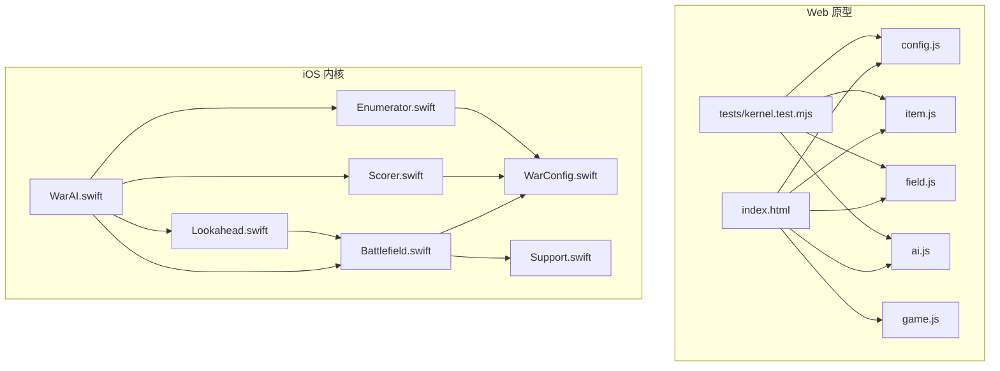
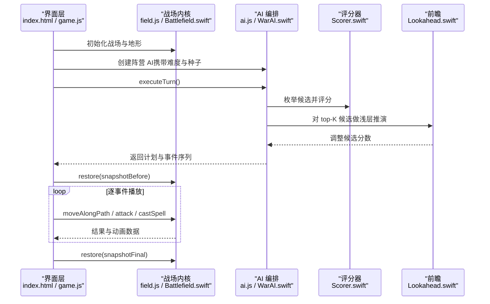
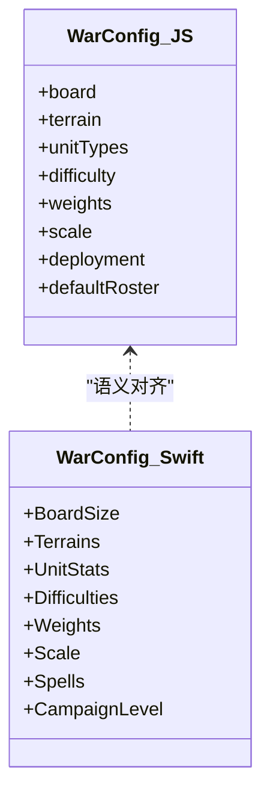
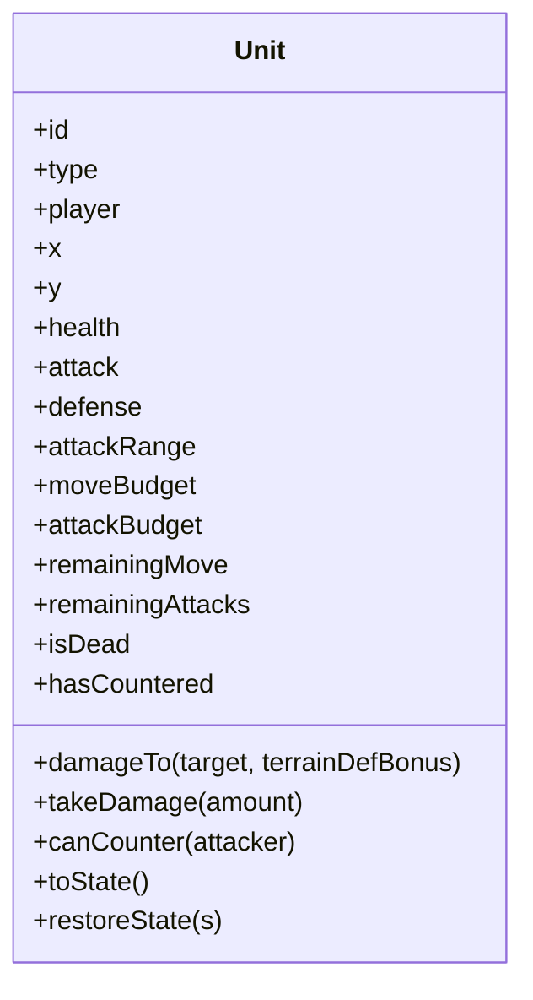
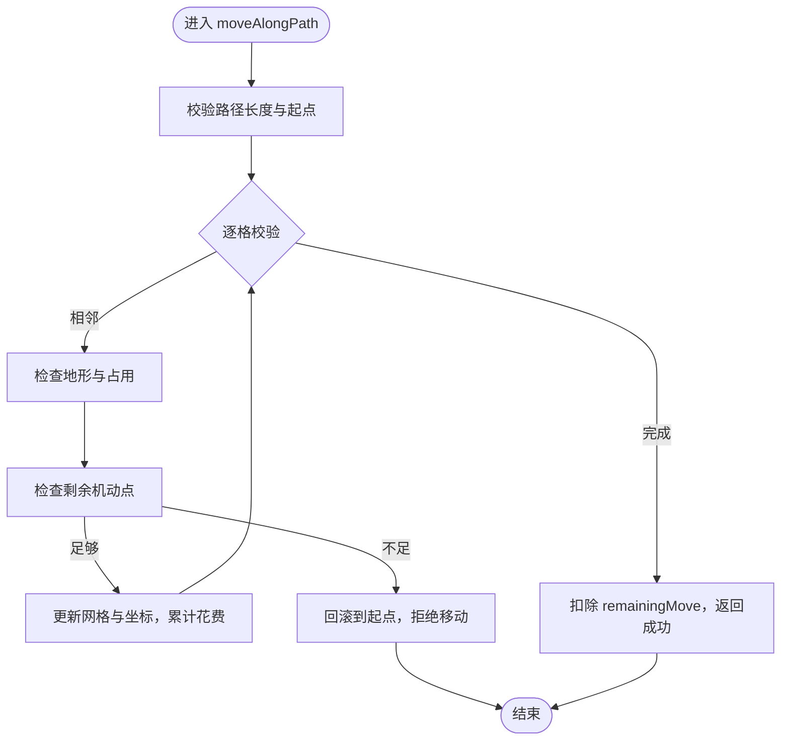
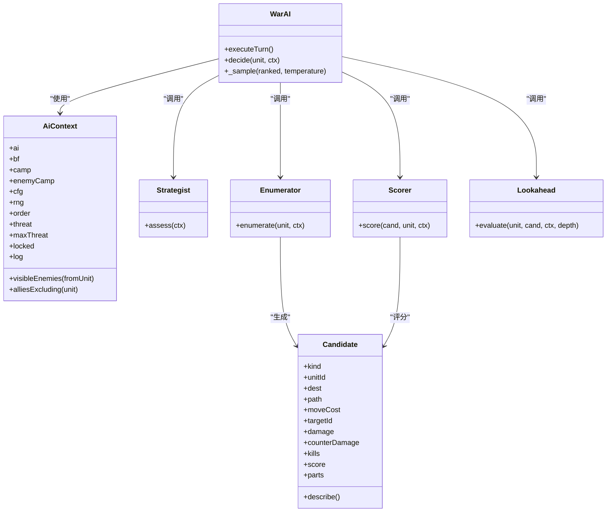
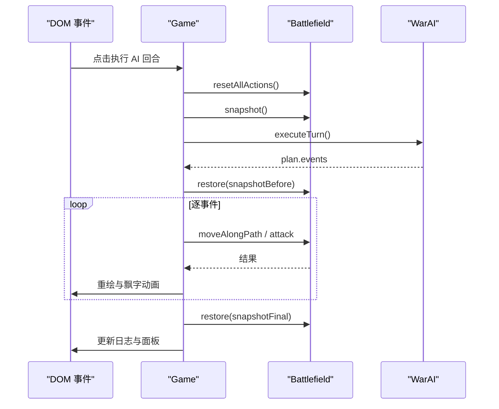
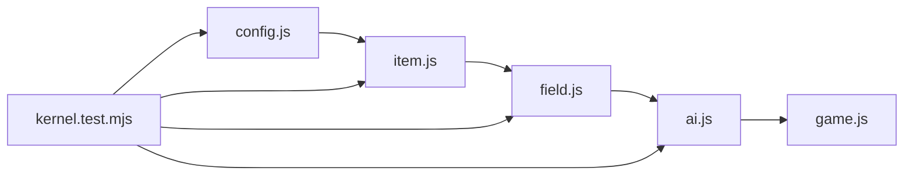

# 项目概述

<cite>
**本文引用的文件**   
- [war/README.md](file://war/war/README.md)
- [package.json](file://war/war/package.json)
- [index.html](file://war/war/index.html)
- [config.js](file://war/war/config.js)
- [item.js](file://war/war/item.js)
- [field.js](file://war/war/field.js)
- [ai.js](file://war/war/ai.js)
- [game.js](file://war/war/game.js)
- [kernel.test.mjs](file://war/war/tests/kernel.test.mjs)
- [WarConfig.swift](file://war/ios/WarKit/Sources/WarKit/WarConfig.swift)
- [Battlefield.swift](file://war/ios/WarKit/Sources/WarKit/Battlefield.swift)
- [WarAI.swift](file://war/ios/WarKit/Sources/WarKit/WarAI.swift)
- [Lookahead.swift](file://war/ios/WarKit/Sources/WarKit/Lookahead.swift)
- [Scorer.swift](file://war/ios/WarKit/Sources/WarKit/Scorer.swift)
- [Enumerator.swift](file://war/ios/WarKit/Sources/WarKit/Enumerator.swift)
- [Support.swift](file://war/ios/WarKit/Sources/WarKit/Support.swift)
</cite>

## 目录
1. [简介](#简介)
2. [项目结构](#项目结构)
3. [核心组件](#核心组件)
4. [架构总览](#架构总览)
5. [详细组件分析](#详细组件分析)
6. [依赖关系分析](#依赖关系分析)
7. [性能与可重放性](#性能与可重放性)
8. [快速开始](#快速开始)
9. [故障排查](#故障排查)
10. [结论](#结论)

## 简介
这是一个零依赖的回合制战棋游戏原型，采用 JavaScript + Swift 双实现：Web 端通过浏览器直接运行，iOS 端通过 WarKit 提供跨平台内核。项目包含步兵、骑兵、弓兵三种兵种，具备地形系统、威胁影响图、浅层前瞻推演与分层 AI 决策系统。设计强调确定性随机数与可重放性：所有随机来源统一为种子随机，同一局面与种子下，AI 决策、地形生成与回放动画完全一致。

项目目标：
- 提供一个规则严谨、AI 可解释、可在 Web 与 iOS 上运行的战棋原型。
- 用“难度旋钮”（视野、温度、前瞻）替代多套算法，使难度连续可调且结果可复现。
- 将战场状态变更收敛到单一入口，避免旧版移动/攻击副作用不一致的问题。

## 项目结构
仓库分为 Web 原型与 iOS 内核两部分：
- Web 原型位于 war/war，由 config.js、item.js、field.js、ai.js、game.js 与 index.html 组成，测试在 tests/kernel.test.mjs。
- iOS 内核位于 war/ios/WarKit，核心包括 WarConfig.swift、Battlefield.swift、WarAI.swift、Enumerator.swift、Scorer.swift、Lookahead.swift、Support.swift。

图表来源
- [index.html:262-266](file://war/war/index.html#L262-L266)
- [kernel.test.mjs:16-28](file://war/war/tests/kernel.test.mjs#L16-L28)
- [WarAI.swift:1-10](file://war/ios/WarKit/Sources/WarKit/WarAI.swift#L1-L10)
- [Battlefield.swift:46-54](file://war/ios/WarKit/Sources/WarKit/Battlefield.swift#L46-L54)

章节来源
- [war/README.md:37-47](file://war/war/README.md#L37-L47)
- [package.json:1-12](file://war/war/package.json#L1-L12)

## 核心组件
- 配置与数值中心：config.js 与 WarConfig.swift 集中定义棋盘尺寸、地形、兵种、难度旋钮、评分权重与归一化标尺。
- 单位模型：item.js 中的 Unit 是纯状态对象，伤害计算为纯函数，不再自行修改坐标。
- 战场内核：field.js 与 Battlefield.swift 负责地形、占位、移动与攻击结算、可达域、威胁影响图与快照回滚。
- AI 分层：ai.js 与 WarAI.swift 实现 Strategist → Enumerator → Scorer → Lookahead → WarAI 的分层决策。
- 渲染与交互：game.js 与 index.html 负责状态机、DOM 渲染、AI 回合事件重放与调试可视化。
- 测试套件：kernel.test.mjs 覆盖规则修复、空间推理、AI 行为、地图生成与性能预算。

章节来源
- [config.js:1-11](file://war/war/config.js#L1-L11)
- [item.js:1-11](file://war/war/item.js#L1-L11)
- [field.js:1-10](file://war/war/field.js#L1-L10)
- [ai.js:1-13](file://war/war/ai.js#L1-L13)
- [game.js:1-11](file://war/war/game.js#L1-L11)
- [kernel.test.mjs:1-6](file://war/war/tests/kernel.test.mjs#L1-L6)

## 架构总览
Web 原型以 HTML 页面加载脚本，依次引入配置、单位、战场、AI 与主游戏；iOS 内核以 Swift 模块暴露相同语义的内核能力。两者共享“难度旋钮”理念：vision（信息）、temperature（随机度）、lookahead（前瞻步数）。

图表来源
- [game.js:291-335](file://war/war/game.js#L291-L335)
- [ai.js:455-513](file://war/war/ai.js#L455-L513)
- [WarAI.swift:64-181](file://war/ios/WarKit/Sources/WarKit/WarAI.swift#L64-L181)
- [Lookahead.swift:26-61](file://war/ios/WarKit/Sources/WarKit/Lookahead.swift#L26-L61)

## 详细组件分析

### 配置与数值中心（config.js / WarConfig.swift）
- 棋盘尺寸：JS 原型固定 20×20；iOS 默认 14×14，并提供多种尺寸。
- 地形：平原、森林、山地、河流、岩壁，分别定义机动消耗、防御加成与不可通行属性。
- 兵种：步兵、骑兵、弓兵，定义生命、攻防、射程、机动预算、反击资格与 AI 价值。
- 难度旋钮：vision、temperature、lookahead 正交组合，避免“换一套打分逻辑”。
- 评分权重与归一化标尺：damage、kill、overkill、exposure、terrain、focus、counter、mobility、objective、support、waste、followup 等分项先归一化再乘权重，消除量纲压制问题。

图表来源
- [config.js:12-103](file://war/war/config.js#L12-L103)
- [WarConfig.swift:5-103](file://war/ios/WarKit/Sources/WarKit/WarConfig.swift#L5-L103)

章节来源
- [config.js:1-146](file://war/war/config.js#L1-L146)
- [WarConfig.swift:1-163](file://war/ios/WarKit/Sources/WarKit/WarConfig.swift#L1-L163)

### 单位模型（item.js）
- Unit 是纯状态对象，不直接修改坐标或网格；坐标与占位唯一写入者为 Battlefield。
- 行动配额拆分为 moveBudget 与 attackBudget，避免“移动与攻击互相白嫖”。
- damageTo 为纯函数，供 AI 在不改变状态的前提下预估伤害。
- toState/restoreState 支持快照与回滚。

图表来源
- [item.js:12-44](file://war/war/item.js#L12-L44)
- [item.js:86-149](file://war/war/item.js#L86-L149)

章节来源
- [item.js:1-178](file://war/war/item.js#L1-L178)

### 战场内核（field.js / Battlefield.swift）
- 唯一写入点：moveAlongPath 校验 4 邻接、空格、地形消耗并同步扣机动点；attack 处理主击与反击、击杀清位。
- 可达域：Dijkstra + 桶式优先队列，按地形 moveCost 累加，缓存带版本失效。
- 威胁影响图：按敌方完整机动力外扩射程，评估“下回合威胁”，用于评分 exposure。
- 快照/回滚：snapshot/restore 用于 AI 前瞻与动画重放，保证最终状态与决策一致。
- iOS 扩展：Battlefield.swift 增加魔法施法、成长转职、斩首/全灭终局判定等。

图表来源
- [field.js:391-441](file://war/war/field.js#L391-L441)
- [Battlefield.swift:332-381](file://war/ios/WarKit/Sources/WarKit/Battlefield.swift#L332-L381)

章节来源
- [field.js:1-622](file://war/war/field.js#L1-L622)
- [Battlefield.swift:46-54](file://war/ios/WarKit/Sources/WarKit/Battlefield.swift#L46-L54)

### AI 分层决策（ai.js / WarAI.swift）
- Strategist：战略层根据物质差、兵种构成、最脆单位决定本轮策略（进攻/防守/冲锋/包抄/撤退）与集火目标。
- Enumerator：候选枚举将“落点 × 动作”摊开，包含原地攻击、移动后攻击、纯机动与待命。
- Scorer：效用评分将所有候选用同一套归一化公式打分，附 breakdown 供可视化。
- Lookahead：浅层推演只对 top-K 候选做 1~2 ply 模拟，用局势评估修正分数。
- WarAI：softmax 采样 → 落到真实战场 → 记录可重放事件序列。

图表来源
- [ai.js:15-41](file://war/war/ai.js#L15-L41)
- [ai.js:43-124](file://war/war/ai.js#L43-L124)
- [ai.js:126-221](file://war/war/ai.js#L126-L221)
- [ai.js:223-335](file://war/war/ai.js#L223-L335)
- [ai.js:337-418](file://war/war/ai.js#L337-L418)
- [ai.js:420-628](file://war/war/ai.js#L420-L628)

章节来源
- [ai.js:1-648](file://war/war/ai.js#L1-L648)
- [WarAI.swift:1-233](file://war/ios/WarKit/Sources/WarKit/WarAI.swift#L1-L233)

### 渲染与交互（game.js / index.html）
- Game 类管理状态机、DOM 渲染、AI 回合播放与调试 overlay。
- AI 回合播放流程：记录 snapshotBefore → ai.executeTurn() → 记录 snapshotFinal → restore(snapshotBefore) → 逐事件 replayEvent() + 重绘 → restore(snapshotFinal)。
- 控制面板支持手动/AI vs 玩家/自动模式，难度、种子、速度可调，威胁热力图、可达域、AI 最优落点可叠加显示。

图表来源
- [game.js:291-335](file://war/war/game.js#L291-L335)
- [game.js:400-463](file://war/war/game.js#L400-L463)

章节来源
- [game.js:1-600](file://war/war/game.js#L1-L600)
- [index.html:149-269](file://war/war/index.html#L149-L269)

## 依赖关系分析
- Web 原型依赖顺序：config.js → item.js → field.js → ai.js → game.js。
- iOS 内核依赖：WarAI 依赖 Battlefield、Enumerator、Scorer、Lookahead；这些组件共同依赖 WarConfig 与 Support。
- 测试套件通过拼接 JS 源文件并在 Node 中求值，直接断言规则、AI 行为与性能。

图表来源
- [index.html:262-266](file://war/war/index.html#L262-L266)
- [kernel.test.mjs:16-28](file://war/war/tests/kernel.test.mjs#L16-L28)

章节来源
- [index.html:262-266](file://war/war/index.html#L262-L266)
- [kernel.test.mjs:16-28](file://war/war/tests/kernel.test.mjs#L16-L28)

## 性能与可重放性
- 确定性随机：SeededRng 贯穿 AI 决策与地形生成，同 seed 必得同决策，便于回归测试与回放。
- 可达域缓存：按单位 id 与预算缓存，版本失效，避免重复计算。
- 威胁影响图缓存：按阵营缓存，版本失效。
- 浅层前瞻：只对 top-K 候选做 1~2 ply 模拟，控制分支爆炸。
- 性能预算：20v20 nightmare 每阵营回合约 12ms，测试断言中位数不超过 20ms。

章节来源
- [config.js:105-139](file://war/war/config.js#L105-L139)
- [field.js:214-287](file://war/war/field.js#L214-L287)
- [field.js:452-508](file://war/war/field.js#L452-L508)
- [ai.js:337-418](file://war/war/ai.js#L337-L418)
- [kernel.test.mjs:519-551](file://war/war/tests/kernel.test.mjs#L519-L551)

## 快速开始
- 在浏览器中运行：
  - 打开 war/war/index.html 即可游玩。
  - 或使用 npm 脚本启动本地服务：npm start。
- 运行测试套件：
  - 使用 Node 直接运行：node war/war/tests/kernel.test.mjs。
  - 或通过 npm 脚本：npm test。

章节来源
- [war/README.md:39-44](file://war/war/README.md#L39-L44)
- [package.json:6-9](file://war/war/package.json#L6-L9)

## 故障排查
- 移动免费或无限走：确认 moveAlongPath 是唯一坐标写入点，且按地形累扣 remainingMove；失败时回滚不留部分副作用。
- 攻击连射：确认 attack 会递减 remainingAttacks，且 canTargetFrom 校验射程与视线。
- 斜走或瞬移：moveAlongPath 强制 4 邻接，禁止斜向与跨格。
- 威胁影响图误判：buildThreatMap 使用敌方完整 moveBudget 外扩射程，而非当前剩余点数。
- 可重放不一致：确保仅通过 SeededRng 产生随机，并使用 snapshot/restore 与 replayEvent。

章节来源
- [field.js:391-441](file://war/war/field.js#L391-L441)
- [field.js:305-383](file://war/war/field.js#L305-L383)
- [field.js:452-508](file://war/war/field.js#L452-L508)
- [game.js:291-335](file://war/war/game.js#L291-L335)

## 结论
该项目以零依赖的 Web 原型与跨平台 iOS 内核为核心，围绕“确定性随机、可重放、单一写入点”的设计理念，构建了稳健的规则系统与分层 AI。通过地形系统、威胁影响图与浅层前瞻，AI 能在可控算力下做出有解释性的决策。难度旋钮使强度调节连续且可复现，测试套件覆盖了规则修复、空间推理、AI 行为与性能预算，为后续扩展（如魔法、成长、闯关）提供了坚实基础。